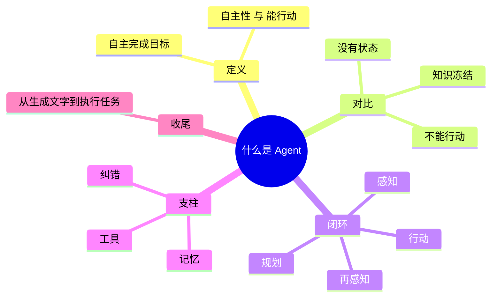

## 🔥 快速背诵

Agent 是能自主把任务做完的系统。和大模型比，区别落在三点：能规划，把大目标拆成多步；能行动，自己调工具和外部系统；有闭环，每一步的结果回灌到下一步，感知、规划、行动、再感知，一直转下去。支撑这个循环的是工具、记忆和纠错。大模型知识冻结、动不了手、也没有状态，只能一问一答。所以本质区别就一句：从生成文字，到执行任务。

> **一句话**：Agent = 大模型 + 自主闭环。核心是「自主性」和「能行动」，本质区别是**从生成文字到执行任务**。

## 🧠 导图



---

# 📖 背诵稿

> 六段，按顺序背。每段**第一句是主线**，后面是补充——先只背第一句，再往里加。

### ① 定义

**我理解 Agent 就是一个能自己把事做完的系统，关键在两点：能自己做决定，也能真的动手。**

普通大模型是你问一句它答一句，问完就结束了。Agent 是你给它一个目标，它自己拆成几步，该查资料查资料，该调接口调接口，一步步做完。说白了，它不只是输出文字，它是真能干活。

### ② 对比

**普通大模型有三个硬伤：知识是死的、没有手脚、还记不住事。**

训练数据有截止日期，你问它今天天气它真不知道。它本质就是个文本生成器，能帮你把邮件正文写得很漂亮，但那个"发送"按钮它按不了。而且每次调用之间它完全失忆，你不把历史塞给它，它就不记得上一轮聊了啥。这三样加一起，它只能干一问一答的活。

### ③ 闭环

**Agent 的核心是一个循环：感知、规划、行动、再感知，走完一圈看结果，再决定下一步。**

你给它"帮我调研竞品写份报告"，它不会直接甩一段文字，而是先想我要搜什么、看哪些站、怎么组织，然后一步步走，每一步的结果再反馈回来调下一步。这就是它跟"调个工具"最大的区别——没有这个循环，那就是个自动化脚本。

### ④ 支柱

**这个循环能转起来靠三样东西：工具让它能做事，记忆让它不掉线，自我纠错让它撞墙了会绕路。**

工具解决两件事——看不见实时数据、动不了手。记忆分两层，短期的放在上下文里记当前进度，长期的放向量库，跨任务记住你的习惯。最容易被忽略的是纠错：某一步失败了，它能看出来、分析原因、换个方式再来，而不是一路走到黑。

### ⑤ 澄清

**这里有个特别容易搞错的地方：模型只是大脑，工具不是它执行的，是代码执行的。**

它是看着工具说明书，决定"我该调哪个、参数填什么"，然后用 JSON 把这个决定告诉你，真正去跑的是你的程序，结果再喂回去给它看。

### ⑥ 收尾

**所以一句话：从生成文字，到执行任务。**

---

# 🔑 记忆锚

| 记什么 | 内容 | 口诀 |
|---|---|---|
| **3** 重局限 | 知识冻结 / 不能行动 / 无状态 | 「死·无·断」 |
| **4** 步闭环 | 感知 / 规划 / 行动 / 再感知 | 「感规行感」 |
| **3** 根支柱 | 工具（手）/ 记忆（本）/ 纠错（脑） | 手·本·脑 |

> **卡壳急救**：任何一点想不起来，回到闭环四步反推。讲工具 → 属于"行动"；讲记忆 → "感知/规划"的支撑；讲纠错 → "再感知"。

---

# 🎯 追问速查

| 面试官问             | 你答                                                                   |
| ---------------- | -------------------------------------------------------------------- |
| 和 Workflow 什么区别？ | **控制权在谁手里**。工作流是人预先编排路径，Agent 是模型运行时动态决定。工程上能用工作流就别上 Agent——稳定、可测、便宜 |
| 能调工具就算 Agent 吗？  | 不算。工具只是「行动」一环，关键是**自主**决定调不调、结果不对怎么办                                 |
| 工具是谁在执行？         | **代码执行，模型只输出决策 JSON**。模型是大脑，不是手脚                                     |
| 为什么现在才爆发？        | 模型跨过「能用」门槛 + Function Calling 标准化 + 生态完善，三者同时成熟                      |
| 为什么容易不稳定？        | 多步串行、误差累积。工程上靠**步数上限、权限沙箱、结果校验、可观测性**兜                               |
| MCP 和 A2A 区别？    | **MCP 管 Agent↔工具，A2A 管 Agent↔Agent**                                 |

---

# 🔗 串联

- 讲闭环 → 顺势点 **ReAct**：`Thought → Action → Observation` 就是这四步的经典实现
- 讲工具 → **Function Calling** → 工具一多就需要 **MCP**（把 M×N 套适配变成一套标准）
- 讲记忆 → 短期上下文 / 长期向量库 → 顺带提 **RAG**：RAG 解决知道，Agent 解决做到
- 讲边界 → **Workflow**：人编排 vs 模型决定
- 总纲收尾：**RAG 知道，Agent 做到，Workflow 稳定，MCP 连接，A2A 协作**

---

# 📚 细节（背完再点开）

> [!note]- 三重局限的具体表现
> | 局限 | 表现 | 根因 |
> |---|---|---|
> | 知识被冻结 | 不知道今天天气、最新股价 | 训练数据有截止日期，没有实时通道 |
> | 不能行动 | 能写邮件正文，点不了发送键 | 本质是**文本生成器**，输出只有文字 |
> | 没有持续状态 | 每次调用失忆 | 上下文之外没有记忆载体 |
>
> 记忆锚：**一个刚毕业就断网的人**——知识背得熟，但看不了新闻、动不了手、说明天就忘。

> [!note]- 三根支柱展开
> - **工具调用**：突破知识冻结（接搜索）+ 突破不能行动（接 API/代码执行器）
> - **记忆**：短期 = 上下文里的中间状态；长期 = 向量库 + 语义检索（偏好、历史操作）
> - **自我纠错**：关键词 A 搜不到→换 B；API 报错→看错误调参数；做完一步会回头审视计划
>
> 第三点是**分水岭**——工具和记忆很多人都能说，纠错才是区别于自动化脚本的关键。

> [!note]- 工具调用长什么样（能画出来最好）
> ```python
> tools = [
>     {
>         "name": "get_weather",
>         "description": "获取指定城市的当前天气",
>         "parameters": {
>             "type": "object",
>             "properties": {"city": {"type": "string", "description": "城市名称"}},
>             "required": ["city"]
>         }
>     }
> ]
> # 工具定义里没有一行执行逻辑，只有名字、描述、参数——本质是一份说明书
> # 模型返回：{"tool_call": {"name": "get_weather", "arguments": {"city": "北京"}}}
> # 你的代码执行 → 拿到"晴天 15°C" → 回灌给模型 → 模型决定下一步
> ```
> 一句话分工：**模型决定做什么，程序负责真正执行。**

> [!note]- 为什么现在才爆发
> 1. **模型能力跨过「能用」门槛**：早期做不好任务拆解和工具选择；GPT-4 / Claude 3 起推理与指令遵循质变
> 2. **工具调用标准化**：OpenAI 2023 年推出 **Function Calling**，结构化 JSON 表达调用意图，各家跟进
> 3. **生态配套完善**：编排框架降门槛、向量库解决长期记忆、外部 API 足够丰富
>
> 一句话：**模型会想了、接口统一了、零件齐了。**

> [!note]- MCP 与 A2A（生态两协议）
> **MCP**（Agent ↔ 工具，喻为 USB-C）：标准 JSON-RPC，工具方实现 Server，任何支持 MCP 的 Agent 用内置 Client 即可发现并调用。三层架构 `Host → Client → Server`。三类能力：**Tools**（有副作用的操作）/ **Resources**（只读数据源）/ **Prompts**（提示词模板）。
>
> **A2A**（Agent ↔ Agent）：核心是 **Agent Card** 名片——写着能做什么、需要什么输入，其他 Agent 读了就知道怎么协作。
>
> **一句话区分**：MCP 让 Agent 伸手拿工具，A2A 让 Agent 互相说话。

---

# 🎴 自测（遮住上面，先自己说）

> [!question]- Q1 一句话说清 Agent 和大模型的区别
> **自主性 + 能行动**。大模型被动问答、每次独立；Agent 把目标拆成多步、调工具、感知环境执行到完成。从生成文字到执行任务。

> [!question]- Q2 三重局限怎么串？
> 知识冻结 / 不能行动 / 无状态 → **死·无·断** → 只能一问一答。

> [!question]- Q3 闭环四步？为什么是核心？
> 感知 → 规划 → 行动 → 再感知。因为每步结果反馈回来指导下一步，**没有回环只是脚本**。

> [!question]- Q4 三根支柱？
> 工具（能做事）/ 记忆（不丢上下文）/ 自我纠错（能绕路）。**纠错是分水岭**。

> [!question]- Q5 最容易答错的点？
> 以为模型自己执行工具。实际是**决策与执行分离**，执行在代码侧。

> [!question]- Q6 和 Workflow 的边界？
> **控制权**：人预先编排 vs 模型动态决定。能用工作流就别上 Agent。
