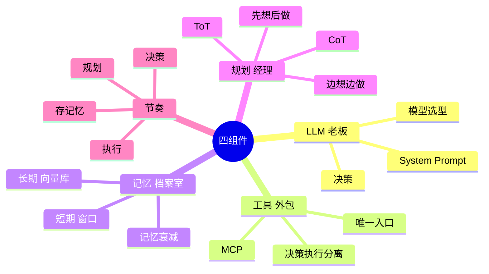

## 🔥 快速背诵

Agent 的架构就四个组件：大模型、工具、记忆、规划。模型负责想，工具负责做，记忆负责记，规划负责拆。铁律只有一条：决策和执行分开，模型只提出动作，真正执行的是代码。跑起来是一个链条：规划拆步骤，模型做决策，工具去执行，结果存回记忆。

> **一句话**：四个组件——**LLM、工具、记忆、规划**。LLM 想、工具做、记忆记、规划拆。类比一家公司：**老板、外包团队、档案室、项目经理**。

## 🧠 导图



---

# 📖 背诵稿

> 六段，按顺序背。每段**第一句是主线**，后面是补充。

### ① 总起

**我一般把它拆成四块：大模型、工具、记忆、规划。**

你可以把它想成一家公司——大模型是老板，负责拍板；工具是外包团队，老板说去搜这个、去发这封，他们真去干；记忆是档案室，什么都能记下来、随时能调；规划是项目经理，拿到大目标先拆成任务单。四个角色齐了，这公司才能自己转起来。

### ② LLM

**大模型是这个系统的大脑，用户说的话、工具返回的结果、记忆里翻出来的东西，最后都要过它一遍。**

它决定下一步是接着想、去调工具、还是直接给答案。这里有个不太被提到的点：System Prompt 其实就是它的岗位说明书，开工前就把角色、边界、输出格式定死了，所以调它往往是性价比最高的手段。另外选模型不只看谁强，还得看它调工具稳不稳——有些模型 JSON 老是乱填，一错就得重试，白烧 token。

### ③ 工具

**工具是 Agent 唯一能和外部世界打交道的通道，这里有条铁律：决策和执行是分开的。**

工具定义里只有名字、描述、参数，一行执行代码都没有，它就是个说明书。模型看完自己决定调谁、传什么，真正跑的还是你的代码。还有个特别现实的坑——描述写得好不好，直接决定它会不会被调对。你写"查询数据"，模型问天气都可能去查库；你写"查内部销售库，支持按日期和品类筛选"，它就知道什么时候该用了。

### ④ 记忆

**记忆分两层，短期放上下文里，长期放向量库里，这俩不能混。**

短期的就是当前这轮任务的中间状态——第一步搜到啥、第二步算出多少，任务一结束就清了。长期的得 embedding 存起来，用的时候靠语义检索捞回来，能跨任务记住你的习惯。短期最头疼的是窗口总会满，只能靠摘要压缩或者滑动窗口，但这俩都会丢信息，怎么取舍是门手艺。长期的问题是"什么该存"，而且还得考虑记忆衰减——三个月前的对话现在大概率没用了，给记忆加个时间权重，越老越往后排。

### ⑤ 规划

**规划负责把大目标拆成小步骤，它底下靠的是模型的推理能力。**

技术上就是 CoT 和 ToT。CoT 是让它把思考过程写出来，相当于多给它一点思考空间；ToT 是走到岔路口先把几条路都看一遍再选，效果更好但更烧钱。工程上有两种玩法：先出完整计划再干，叫 Plan-and-Execute，结构清楚还能人工审一遍，但中间情况一变计划就废；边干边想叫 ReAct，灵活，但容易走偏。实际项目里经常混着来——先粗粗定个方向，边跑边调。

### ⑥ 节奏

**跑起来就是：规划拆步骤、模型做决策、工具去执行、结果存进记忆，再回来做下一个决策。**

一直循环到模型说可以给答案为止。模型始终是拍板的那个，工具是干活的，记忆负责不忘事，规划负责拆任务。

---

# 🔑 记忆锚

| 记什么            | 内容                                          |     |
| -------------- | ------------------------------------------- | --- |
| **4** 个角色      | 老板 / 外包团队 / 档案室 / 项目经理 = LLM / 工具 / 记忆 / 规划 |     |
| **2** 层记忆      | 短期在窗口 / 长期在向量库                              |     |
| **1** 条铁律      | 决策与执行分离——模型是大脑，代码是手脚                        |     |
| **2** 个推理技术    | CoT（一条路走到底）/ ToT（岔路口看几条路）                   |     |
| **2** 种规划模式    | Plan-and-Execute（先想后做）/ ReAct（边想边做）         |     |
| **3** 类 MCP 能力 | Tools / Resources / Prompts                 |     |

> **卡壳急救**：把公司演一遍——老板拍板 → 叫外包去干 → 让档案室记下 → 项目经理先拆任务单。

---

# 🎯 追问速查

| 面试官问 | 你答 |
|---|---|
| 为什么需要规划模块？LLM 自己不能拆？ | 规划**本质也是 LLM 推理**，模块是工程上的职责划分：可替换、计划可人工审核、可单独用强模型优化 |
| 记忆和 RAG 什么关系？ | RAG 是长期记忆的一种实现，但视角不同——RAG 偏**外部知识库**，长期记忆偏**这个用户的交互历史**。记忆多了时间衰减和重要性评估 |
| 上下文满了怎么办？ | 摘要压缩 / 滑动窗口，都丢信息。进阶做法：中间结果**外置**只留引用、维护"进度+待办+结论"的结构化草稿 |
| 为什么不都上最强模型？ | 权衡推理、调用稳定性、延迟成本。常见做法**分层用模型**；推理模型决策强但慢且贵 |
| 工具描述真那么重要？ | 非常重要。模型靠描述判断何时该用，写"查询数据"会乱调，写"查内部销售库，支持按日期品类筛选"才准。**重要性不亚于 prompt 工程** |
| MCP 只标准化工具？ | 不止。还有 **Resources**（只读数据源）和 **Prompts**（提示词模板）。Tools 会改变外部世界，两者不会 |
| 四个里哪个最重要？ | 看场景：简单工具调用看**工具**；长程任务看**记忆和规划**。LLM 定上限，工具定边界，记忆规划定能不能扛住 |

---

# 🔗 串联

- 这题是**全系列总目录**——四个组件就是后面所有题的四个入口
- 工具 → **Function Calling** → **MCP**（Agent↔工具）→ **A2A**（Agent↔Agent）
- 记忆 → **记忆机制、记忆压缩、记忆粒度、上下文工程、多轮状态管理**
- 规划 → **CoT/ToT → ReAct / Plan-and-Execute / Reflection → 任务拆分**
- 上一题 01 什么是 Agent 与大模型的本质不同 的自主闭环，落到架构上就是这四个组件在支撑
- 总纲：**LLM 想、工具做、记忆记、规划拆**

---

# 📚 细节（背完再点开）

> [!note]- System Prompt 与模型选型
> **System Prompt** = 给老板的岗位说明书，开工前就定义好角色、行为边界、输出格式。
> 例：*"你是专业的客服助手，只回答产品相关问题，遇到不确定的信息要说不知道，不要编造。"*
> 工程上它的调优往往占开发时间很大比例——因为它是你能最直接控制 Agent 行为的手段。
>
> **选型三维度**：
> | 维度 | 关注点 | 踩坑 |
> |---|---|---|
> | 推理能力 | 多步决策、拆解、选对工具 | 小模型拆不动复杂任务 |
> | 调用稳定性 | JSON 是否规范、参数是否乱填 | 格式错 → 重试 + token 浪费 |
> | 上下文窗口 | 每步结果都塞进上下文 | 窗口小 → 后面看不到前面 |
>
> 趋势：推理模型（o1/o3、DeepSeek-R1 这类）拆解和决策更强，适合当大脑，但延迟高、token 贵。

> [!note]- 工具定义与描述质量
> ```python
> tools = [{
>     "type": "function",
>     "function": {
>         "name": "search_web",
>         "description": "搜索互联网上的信息",
>         "parameters": {
>             "type": "object",
>             "properties": {"query": {"type": "string", "description": "搜索关键词"}},
>             "required": ["query"]
>         }
>     }
> }]
> # 模型返回的是决策：{"tool_call": {"name": "search_web", "arguments": {"query": "..."}}}
> # 执行在你自己的代码里，结果再回灌
> ```
> **描述写法的差别**：
> - ❌ "查询数据" → 用户问天气也可能去查数据库
> - ✅ "查询公司内部销售数据库，支持按日期、产品类别筛选" → 精准触发

> [!note]- 记忆的认知科学分类
> 便于理解的类比，工程实现通常是**向量检索 + metadata 过滤**：
> | 类型 | 存什么 | 例 |
> |---|---|---|
> | 语义记忆 | 事实性知识 | "用户是做金融行业的" |
> | 情景记忆 | 具体经历 | "上次问退款，查订单发现已过期" |
> | 程序性记忆 | **做事的方法论** | "退款流程：先查订单状态再核实支付方式" |
>
> 程序性记忆最有价值——它沉淀的是方法论，同类任务下次能直接套流程。

> [!note]- 记忆衰减（容易被忽略）
> 给每条记忆加**时间权重**，越久远权重越低：
> `相关性分数 = 语义相似度 × 时间衰减因子`
> 衰减速度按业务调：**客服可以快**（对话多是一次性）、**法律合规要慢**（历史记录很久后还可能被引用）。
> 目的：不被过时信息淹没，总优先关注最近、最相关的。

> [!note]- Plan-and-Execute vs ReAct
> | | Plan-and-Execute | ReAct |
> |---|---|---|
> | 做法 | 先出完整步骤列表，按序执行 | 每步根据当前结果重新思考下一步 |
> | 优点 | 结构清晰，**可人工审核** | **灵活**，能随时调整 |
> | 缺点 | 中间结果不符预期 → 计划失效 | 每步局部最优 → 容易**走偏** |
>
> 实践：**先粗计划定大方向 + 执行中动态微调。**

> [!note]- 完整运行伪代码
> ```python
> def agent_run(user_goal):
>     plan = llm.plan(user_goal)          # ① 规划：拆步骤
>     memory = []                          # 短期记忆
>     for step in plan:
>         action = llm.decide(             # ② 决策
>             step=step,
>             history=memory,
>             long_term=vector_db.search(step)   # 长期记忆召回
>         )
>         if action.type == "tool_call":
>             result = tools.execute(action.tool_name, action.args)   # ③ 执行
>             memory.append({"step": step, "result": result})         # ④ 存记忆
>         elif action.type == "final_answer":
>             return action.content
> ```
> LangChain / LlamaIndex / AutoGen 本质上都是围绕这四个组件做封装。

---

# 🎴 自测（遮住上面，先自己说）

> [!question]- Q1 四个组件 + 一句话职责
> LLM（理解决策）/ 工具（唯一外部入口）/ 记忆（保持状态、跨任务积累）/ 规划（把目标拆步骤）。类比老板、外包、档案室、项目经理。

> [!question]- Q2 记忆分两层，差别？
> 短期在 context window，存当前任务中间状态，结束清空；长期在向量库，embedding + 语义检索，跨任务保存偏好。

> [!question]- Q3 工具这条铁律是什么？
> **决策与执行分离**——模型只输出"调谁、传什么"的 JSON，执行在代码里。

> [!question]- Q4 规划底层靠什么？
> CoT（把思考写出来，扩思考空间）/ ToT（多分支评估择优，成本高）。

> [!question]- Q5 Plan-and-Execute 和 ReAct 怎么选？
> 前者结构清晰可审核、但计划易失效；后者灵活、但易走偏。实践是粗计划 + 动态微调。

> [!question]- Q6 四个组件怎么跑起来？
> 规划 → 决策 → 执行 → 存记忆 → 再决策，循环到给最终答案。
