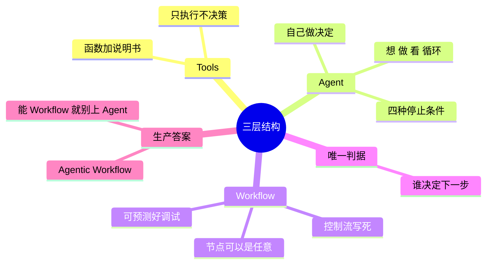

## 🔥 快速背诵

Tools、Agent、Workflow 不是三选一，是粒度从小到大三层。Tools 只执行不决策，Agent 自己决定用哪个，Workflow 把流程写死在代码里。判断标准只有一个：下一步去哪由谁定。生产上主流不是纯 Agent，而是 Agentic Workflow，骨架钉死，只在需要临场判断的节点交给模型。

> **一句话**：它们不是三选一，而是**粒度从小到大的三层结构**。区分它们只需一个问题——**谁来决定「下一步去哪」**：Tools 不决策，Agent 自己决策，Workflow 由开发者提前写死。

## 🧠 导图



---

# 📖 背诵稿

### ① 定位

**这三个不是三选一，是从小到大的三层，实际项目里一般同时都有。**

Tools 是最小的能力单元，Agent 是能自己做主的那个，Workflow 是外面那层框架。很多人喜欢把它们并排比，好像得挑一个用，其实不是——一个真实系统里三个都在，各干各的活。

### ② Tools

**Tools 说白了就是"给模型调的函数"，它只负责执行，自己不做任何决定。**

普通函数是给程序员调的，工具是给模型调的，所以得多配一份模型看得懂的说明书——叫什么、能干啥、要传什么参数，不然模型压根不知道有这能力。最关键的一点是：工具甚至不知道自己什么时候该被用。这不是设计得不好，是故意的。就像瑞士军刀上的刀片，每片都擅长一件事，但刀片不会喊"现在该用我了"，决定翻哪片的是那只手。

### ③ Agent

**Agent 就是那只手——拿着工具、自己决定用哪个。**

你给它一个目标，它自己琢磨搜什么、够不够、什么时候停。跑法就是"想一下、做一步、看看结果、再想"。这里有个特别反直觉的地方：这循环会跑几轮，写代码的人事先根本不知道，是模型当场决定的。这就是它跟普通代码最大的不一样。

### ④ Workflow

**Workflow 是把整条流程写死在代码里，模型也好 Agent 也好，都只是流程里的节点，往哪走是代码说了算。**

比如客服系统：先让模型判断用户问的是哪类问题，然后 `if/elif` 分到不同分支，分支里再调工具查、调模型生成回答。模型在里面就两个工位，"接下来去哪"一次都没让它决定。所以 Workflow 的节点是什么都行——模型、Agent、工具都行，**节点不重要，控制流在谁手里才重要。**

### ⑤ 唯一判据

**所以区分它们就一个标准：谁来决定「下一步去哪」。**

工具不会决定；Agent 是模型当场决定；Workflow 是人提前写死。这一条推下去，三个结论自动就有了：确定性上 Workflow 高、Agent 低，同样输入 Agent 可能走出不一样的路；灵活性上正好反过来；调试上 Workflow 能打断点一步步追，Agent 路径复现不了，只能靠详细日志事后还原。

### ⑥ 生产答案

**真到生产环境，主流不是纯 Agent，而是 Agentic Workflow——骨架用 Workflow 钉死，需要灵活判断的地方塞个 Agent 进去。**

纯 Agent 太难管，出问题不好查，成本还容易飞天；纯 Workflow 又太脆，你没法把所有情况都写进 if/else。所以骨架固定、关键节点灵活，两头好处都占。

这里有条反直觉但很加分的说法：**能用 Workflow 解决的，就别上 Agent。** 因为线上可控比灵活重要。先从最简单的 Workflow 开始，只有某个节点实在写不死了，再把它升级成 Agent。

---

# 🔑 记忆锚

| 记什么         | 内容                                         |
| ----------- | ------------------------------------------ |
| **1** 个判据   | 谁决定「下一步去哪」                                 |
| **3** 层粒度   | Tools（不决策）→ Agent（自己决策）→ Workflow（开发者替它决策） |
| **1** 个循环   | Agent = Thought → Action → Observation     |
| **4** 种停止条件 | LLM 判断完成 / 最大轮数 / token 预算 / 超时            |
| **5** 种编排模式 | 提示链 / 路由 / 并行化 / 编排者-工人 / 评估者-优化者          |
| **1** 句原则   | 能用 Workflow 就别用 Agent                      |

> **卡壳急救**：拿一个具体场景推——客服系统里，查订单是 Tools，自己琢磨怎么答是 Agent，`if 意图==退款` 是 Workflow。

---

# 🎯 追问速查

| 面试官问                      | 你答                                                             |
| ------------------------- | -------------------------------------------------------------- |
| Workflow 里的节点必须是 Agent 吗？ | 不必。可以是 LLM、Agent 或 Tool。**节点类型不重要，控制流在谁手里才重要**                 |
| Agent 死循环了怎么办？            | 四种停止条件兜底：LLM 判断完成、最大轮数（如 15 轮）、token 预算上限、超时。生产上通常同时开，哪个先触发算哪个 |
| 为什么 Agent 行为不确定？          | LLM 是概率模型，每次生成都有随机性。**灵活性不确定是一对孪生兄弟**，所以要靠执行日志追溯               |
| 工具怎么设计才好用？                | 四原则：职责单一、描述精确、错误信息要模型看得懂、参数尽量少                                 |
| 为什么不直接全用 Agent？           | 难控制、难调试、成本易失控。生产主流是 Agentic Workflow，可控性和灵活性兼顾                 |
| 五种编排模式是什么？                | 提示链（流水线）、路由（分类分发）、并行化（同时跑再汇总）、编排者-工人（中央派活）、评估者-优化者（一个生成一个审）    |

---

# 🔗 串联

- 上一题 02 Agent 的基本架构由哪些核心组件构成 的四个组件，就是这三层里的"零件"
- Tools 层深挖 → **Function Calling**、工具描述质量、**MCP**（工具多了要标准化）
- Agent 层深挖 → **ReAct**（就是那个 Thought→Action→Observation）、04 Agent 设计范式与 Workflow 的区别、停止条件与稳定性治理
- Workflow 层深挖 → **五种编排模式**、Agentic Workflow
- 一句话总纲：**Tools 是砖，Agent 是会自己找路的工人，Workflow 是施工图纸**

---

# 📚 细节（背完再点开）

> [!note]- 工具设计的四条原则（能说出这个很加分）
> 1. **职责单一**：一个工具只做一件事，别把"查天气 + 发邮件"塞一起——描述太杂模型就判断不准
> 2. **描述精确**：模型完全靠 description 理解能力。写"查询数据"会被乱调，写"查内部销售库，支持按日期和品类筛选，返回销售额和订单数"才准
> 3. **错误信息要能看懂**：返回"参数 city 不能为空"比"Error code 400"好得多——前者模型能自己改参数重试
> 4. **参数简洁**：能少传就不传，能有默认值就给默认值，**模型填的参数越多出错概率越大**

> [!note]- Agent 的核心循环代码
> ```python
> def run_agent(user_goal):
>     messages = [{"role": "user", "content": user_goal}]
>     while True:                      # 跑几次？开发者不知道，LLM 决定
>         resp = client.messages.create(
>             model="...", tools=tools, messages=messages
>         )
>         if resp.stop_reason == "end_turn":
>             return resp.content[0].text          # LLM 说完成了
>
>         tool_use = next(b for b in resp.content if b.type == "tool_use")
>         result = execute_tool(tool_use.name, tool_use.input)   # 代码真正执行
>
>         messages.append({"role": "assistant", "content": resp.content})
>         messages.append({"role": "user", "content": [
>             {"type": "tool_result", "tool_use_id": tool_use.id, "content": result}
>         ]})
> ```
> 最后一轮 LLM 会把 Observation 读进去，再决定下一步——这就是"历史即记忆"。

> [!note]- Workflow 的客服例子（看清控制流在代码手里）
> ```python
> def run_customer_service_workflow(user_query):
>     intent = classify_intent_with_llm(user_query)   # LLM 只当分类器
>
>     if intent == "product":                         # 分支由代码决定
>         docs = search_knowledge_base(user_query)    # 直接调 Tool
>         return generate_answer_with_llm(user_query, docs)
>     elif intent == "refund":
>         order = query_order_system(user_query)
>         if order["eligible"]:
>             process_refund(order["order_id"])
>             return "退款已受理"
>         return "不满足退款条件"
>     else:
>         escalate_to_human_agent(user_query)
> ```
> **LLM 出现两次，但"接下来去哪"一次都没让它决定。**

> [!note]- 五种 Workflow 编排模式
> | 模式 | 做法 | 适用 |
> |---|---|---|
> | **Prompt Chaining** 提示链 | 大任务拆成小步，前一步输出作为后一步输入 | 步骤清晰的流水线 |
> | **Routing** 路由 | 先 LLM 分类，再分发到不同分支 | 客服意图分流（最典型） |
> | **Parallelization** 并行化 | 可并行的子任务同时跑，最后汇总 | 多数据源检索、多维度分析 |
> | **Orchestrator-Workers** 编排者-工人 | 中央编排者派活，多个 Worker 独立完成 | 任务可分解且子任务独立 |
> | **Evaluator-Optimizer** 评估者-优化者 | 一个 LLM 生成，另一个评估，不通过就带着反馈重来 | 文案、法律条款、代码等高质量要求场景 |
>
> 评估者-优化者的关键约束：**评估标准必须写在代码里**（比如打分函数），不能让评估者自由发挥，否则评估质量本身不可控。

> [!note]- 三者对比表（答题时可背这行结论）
> | 维度 | Tools | Agent | Workflow |
> |---|---|---|---|
> | 决策能力 | 无，只执行 | 有，LLM 动态决策 | 无，开发者写死 |
> | 执行方式 | 被动等待调用 | 自主循环直到完成 | 按定义顺序执行 |
> | 确定性 | 高 | 低 | 高 |
> | 灵活性 | 只做一件事 | 高 | 低 |
> | 调试难度 | 容易 | 难 | 容易 |
> | 适用 | 单一能力封装 | 路径未知的复杂任务 | 流程固定的业务 |
>
> **成本视角**：纯 Agent 一个复杂任务可能跑十几轮，每轮都带完整上下文，token 线性增长；Workflow 能精确控制每节点预算、该并行就并行，延迟和成本都更可控。**这也是很多团队从原型（纯 Agent 验证）到生产（重构为 Agentic Workflow）的原因。**

---

# 🎴 自测（遮住上面，先自己说）

> [!question]- Q1 三者是什么关系？
> 不是三选一，是**粒度从小到大、可相互嵌套的三层**：Tools 是能力积木，Agent 是决策系统，Workflow 是编排框架。

> [!question]- Q2 区分三者的唯一判据？
> **谁决定「下一步去哪」**：Tools 不决策、Agent 让 LLM 动态决策、Workflow 由开发者写死。

> [!question]- Q3 Tools 为什么"不知道自己该什么时候被用"？
> 因为它只是「带 schema 的函数」，职责就是随时待命执行。判断何时调用是 Agent 的事——这是有意的设计分工。

> [!question]- Q4 Agent 的循环跑几次由谁决定？
> LLM 自己决定，开发者事先不知道。所以必须有**停止条件**：LLM 判断完成、最大轮数、token 预算、超时，四者通常同时开。

> [!question]- Q5 Workflow 的节点必须是 Agent 吗？
> 不必。可以是 LLM、Agent 或 Tool。**节点类型不重要，控制流在谁手里才重要。**

> [!question]- Q6 生产环境该用哪个？
> **Agentic Workflow**：Workflow 框骨架保证可控，关键节点嵌 Agent 保留灵活。原则是「能用 Workflow 就别用 Agent」。
