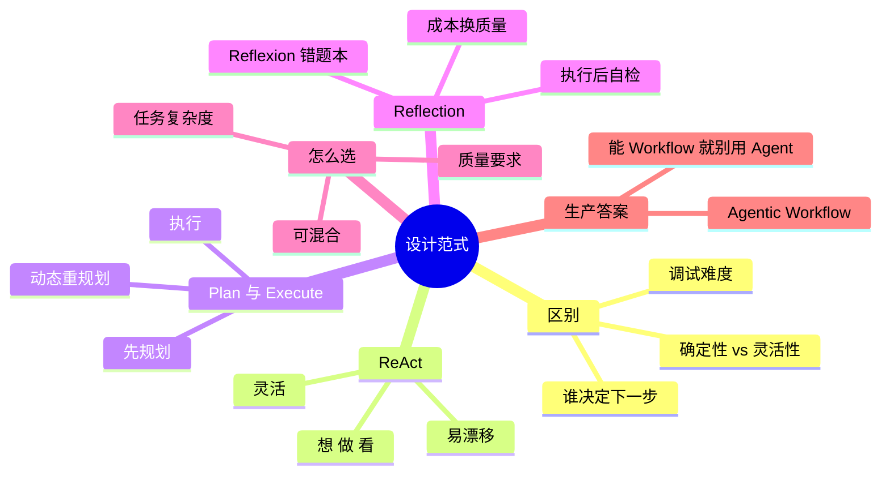

## 🔥 快速背诵

主流范式有三种：ReAct 边想边做，Plan-and-Execute 先规划再执行，Reflection 做完再自检。它们和 Workflow 的区别还是那一句：下一步由谁决定。关键机制是动态重规划，计划是活的。选型看任务复杂度和质量要求，流程确定的框进 Workflow，需要灵活判断的地方才交给模型。

> **一句话**：主流范式有**三种**——ReAct（边想边做）、Plan-and-Execute（先规划再执行）、Reflection（做完再自检）。而 Agent 与 Workflow 的区别仍然是那一句：**谁决定下一步**。

## 🧠 导图



---

# 📖 背诵稿

> Workflow 与 Agent 的区别在第 3 篇已讲透，这里只留一句判据，重点放在三种范式上。

### ① 区别（一句话）

**一句话：Workflow 是人把流程写死，Agent 是把"下一步干啥"交给模型。**

代价也很清楚：Workflow 确定、好测、好查，但一遇到没预料的情况就走死胡同；Agent 灵活、能接住设计之外的情况，但它不确定，同样输入走的路可能都不一样，线上出了错很难复现。有人形容得挺准——Workflow 是你在开车，Agent 是模型在开车，你坐副驾，只能给它设点安全限制。

### ② ReAct

**ReAct 就是让模型"想一步、做一步、看一眼结果、再想"，一轮一轮推着走。**

每一轮都是 Thought、Action、Observation：先分析现在什么情况，再决定调哪个工具传什么参数，工具返回的东西作为观察喂回去，接着想下一步。

为什么要专门写 Thought？因为不写的话模型容易冲动，还没搞清楚用户要啥就急着调工具。写出来之后判断稳多了，而且思考过程看得见，哪一步想歪了一眼就能看出来。但它是走一步看一步，每步只顾眼前，任务一复杂就容易迷路——十几步的活，做到第五步可能就忘了当初要干嘛，或者在两三个工具之间打转。

### ③ Plan-and-Execute

**Plan-and-Execute 是把规划和执行拆开：先让模型把步骤列全，再按顺序做。**

好处是结构清楚，甚至可以执行前让人先审一遍计划。但有个常被误解的点——它不是"定好计划就死板执行"。

成熟的做法里有动态重规划：每做完一步，把结果喂回规划器，让它判断"跟预期一样吗？后面还适用吗？"偏了就改，严重偏了甚至插新步骤。比如原计划是先查 A 再查 B 最后对比，结果第一步就发现 A 刚发了个大更新，规划器会插一步"查 A 这次更新的详情"再继续。**计划是活的。**

代价是多花了那几次规划调用，延迟和成本都涨；而且一开始方向如果就错了，后面怎么调都救不回来。

### ④ Reflection

**Reflection 就是做完一步或者做完整个任务，再让模型回头评一下，不行就重做。**

它是正式跑在流程里的机制，不是调试手段。在写代码、写文案这种"要求高但一次很难做对"的地方特别有用。

它有个升级版叫 Reflexion：不是简单说"不好，重来"，而是写一段反思——这次错在哪、下次注意什么——再把这段话带着进入下一次尝试。说白了就是**错题本**。

效果是有数据的：HumanEval 上 GPT-4 直接做大概 80%，加了 Reflexion 到 91%。代价也很直接，每反思一轮就多一次甚至好几次调用，token 和延迟都上去。所以这是拿钱换质量。

### ⑤ 怎么选

**就看两件事：任务有多复杂，质量要求有多高。**

步骤不多、每步也比较独立，ReAct 就够；任务复杂、步骤之间有依赖得统筹全局，上 Plan-and-Execute；对质量要求极高、又愿意多花时间和钱，就在前面基础上加 Reflection。这三个也不冲突，实际常见的是：Plan 做整体规划，每一步里面用 ReAct 去执行，关键步骤再加一层 Reflection 把关。

### ⑥ 生产答案

**生产环境里纯 Agent 用得很少，基本都是 Agentic Workflow——主干用 Workflow 框住，需要灵活的那个节点塞 Agent。**

比如客服，意图识别、知识检索、生成回答这条主线是固定的，但"知识检索"这一块可以让 Agent 自己决定查几轮、用哪些工具。

有条原则我觉得挺重要：**能用 Workflow 解决的，就别上 Agent。** 因为线上可控比灵活值钱。Workflow 行为确定，坏了能精确定位；Agent 是概率性的，同样输入不同路径，测试覆盖率天然就低。所以从最简单的开始，写死逻辑真覆盖不了，再把那个节点升级。

---

# 🔑 记忆锚

| 记什么 | 内容 |
|---|---|
| **3** 种范式 | ReAct（边想边做）/ Plan-and-Execute（先想后做）/ Reflection（做完自检） |
| **1** 个关键机制 | **动态重规划**——计划是活的 |
| **1** 个升级版 | Reflexion = 写错题本，带着反思再做 |
| **1** 组数据 | HumanEval：GPT-4 约 80% → 加 Reflexion 91% |
| **1** 条原则 | 能用 Workflow 就别用 Agent（可控性 > 灵活性） |
| **1** 个组合套路 | Plan 做规划 + ReAct 做执行 + Reflection 把关 |

> **卡壳急救**：把三个范式想成旅行的三种方式——ReAct 是边走边问路，Plan-and-Execute 是先看地图再出发，Reflection 是走到一半回头检查有没有走错。

---

# 🎯 追问速查

| 面试官问 | 你答 |
|---|---|
| Reflection 不就是调试吗？ | 不是。它是**运行时机制**，内嵌在执行流程里做质量保障，代价是额外的 token 和延迟 |
| 它和 Reflexion 什么区别？ | Reflection 是"评估→重试"；Reflexion 会**生成具体的反思总结**（错在哪、下次注意什么）并作为上下文传下去，相当于写错题本 |
| 为什么纯 Agent 生产里少用？ | 行为不确定、同输入不同路径、线上问题难复现、测试覆盖率低、成本易失控 |
| 三种范式怎么选？ | 看任务复杂度和质量要求：简单独立用 ReAct；复杂有依赖用 Plan-and-Execute；质量优先就叠加 Reflection |
| Plan-and-Execute 是不是很死板？ | 恰恰不是。成熟实现有**动态重规划**：每步结果回灌规划器，偏离预期就改计划甚至插新步骤 |
| 能举个例子说 ReAct 会漂移吗？ | 让它查"苹果近三年营收"，第一步搜到苹果和三星竞争，它觉得有意思就去搜三星了——**越走越远，忘了原目标** |

---

# 🔗 串联

- 承接 03 Workflow、Agent、Tools 三者的概念与区别：那篇讲"三者是什么"，这篇讲"Agent 内部有哪些打法"
- ReAct 的机制细节与实现代码 → 05 推理模式与 ReAct 的实现
- Reflection 深挖 → 反思机制、自我进化
- 动态重规划 → 任务拆分、规划能力
- 稳定性治理 → 路径震荡、重复调用、死循环（ReAct 的两个坑就是它们的源头）
- 一句话总纲：**ReAct 灵活但会飘，Plan 稳但要重规划，Reflection 保质量但费钱**

---

# 📚 细节（背完再点开）

> [!note]- Workflow 与 Agent 的代码结构对比（一眼看懂差别）
> ```python
> # Workflow：每一行都是明确指令，控制流由代码决定
> def workflow_answer(user_query):
>     docs = vector_db.search(user_query, top_k=5)     # 固定检索
>     reranked = reranker.rank(user_query, docs)       # 固定重排
>     return llm.generate(user_query, context=reranked)  # 固定生成
>
> # Agent：loop 里只有一个 llm.decide()，所有路径运行时选
> def agent_answer(user_query):
>     while True:
>         action = llm.decide(user_query, history=memory)   # LLM 决定
>         if action.type == "search":
>             memory.append(vector_db.search(action.query))
>         elif action.type == "calculate":
>             memory.append(calculator.run(action.expr))
>         elif action.type == "final_answer":
>             return action.content
> ```

> [!note]- 动态重规划的代码逻辑
> ```python
> plan = llm.generate(f"为以下任务制定分步计划：{question}")
> steps = parse_plan(plan)
> results = []
> for i, step in enumerate(steps):
>     r = react_executor(task=step, tools=tools,
>                        context=f"共{len(steps)}步，当前第{i+1}步",
>                        previous_results=results)
>     results.append(r)
>     # 关键：每步后检查是否要改后续计划
>     if need_replan(step, r, steps[i+1:]):
>         remaining = llm.generate(f"原计划{steps}，已完成到第{i+1}步，结果{results}，剩余步骤是否调整？")
>         steps = steps[:i+1] + parse_plan(remaining)
> ```
> 像导航——前方封路会自动重新规划路线，而不是让你掉头回起点。

> [!note]- 三范式对照
> | | ReAct | Plan-and-Execute | Reflection |
> |---|---|---|---|
> | 核心 | 想→做→看 循环 | 先规划再执行 | 执行后自检 |
> | 优点 | 灵活，能探索未知 | 全局视野，不易跑偏，可人工审核计划 | 显著提升输出质量 |
> | 缺点 | 易漂移、错误传播、上下文线性增长 | 多一次规划调用；初始方向错则难挽回 | token 和延迟增加 |
> | 适用 | 开放式问答、信息搜索 | 深度研究、长文写作、多工具分析 | 代码生成、文案、法律条款 |

> [!note]- 大小模型搭配（很实用的降本技巧）
> 规划阶段用能力强的大模型（GPT-4 / Claude Opus）保证计划质量，执行阶段用便宜的小模型跑具体工具调用。
> 实际项目里这种搭配能降低 **70%–90%** 的 LLM 调用成本，同时保住全局方向。

---

# 🎴 自测（遮住上面，先自己说）

> [!question]- Q1 三种设计范式是什么？
> **ReAct**（想→做→看循环，灵活易漂移）、**Plan-and-Execute**（先出计划再执行，全局视野）、**Reflection**（执行后自检保质量）。

> [!question]- Q2 Reflection 是调试工具吗？
> 不是，是**运行时机制**，内嵌在执行流程里做质量保障，代价是 token 和延迟增加。

> [!question]- Q3 Reflexion 和 Reflection 的区别？
> Reflexion 会**生成反思总结**（错在哪、下次注意什么）作为上下文传给下一次尝试，像写错题本；Reflection 只做评估→重试。

> [!question]- Q4 Plan-and-Execute 的核心机制？
> **动态重规划**：每步结果回灌规划器，偏离预期就改计划甚至插新步骤。计划是活的，不是死的。

> [!question]- Q5 三范式怎么选？
> 看任务复杂度和质量要求。简单独立→ReAct；复杂有依赖→Plan-and-Execute；质量优先→叠加 Reflection。**可以混用**：Plan 规划 + ReAct 执行 + Reflection 把关。

> [!question]- Q6 生产里为什么不用纯 Agent？
> 不可控、难复现、测试覆盖率低、成本易失控。主流是 **Agentic Workflow**，原则是「能用 Workflow 就别用 Agent」。
