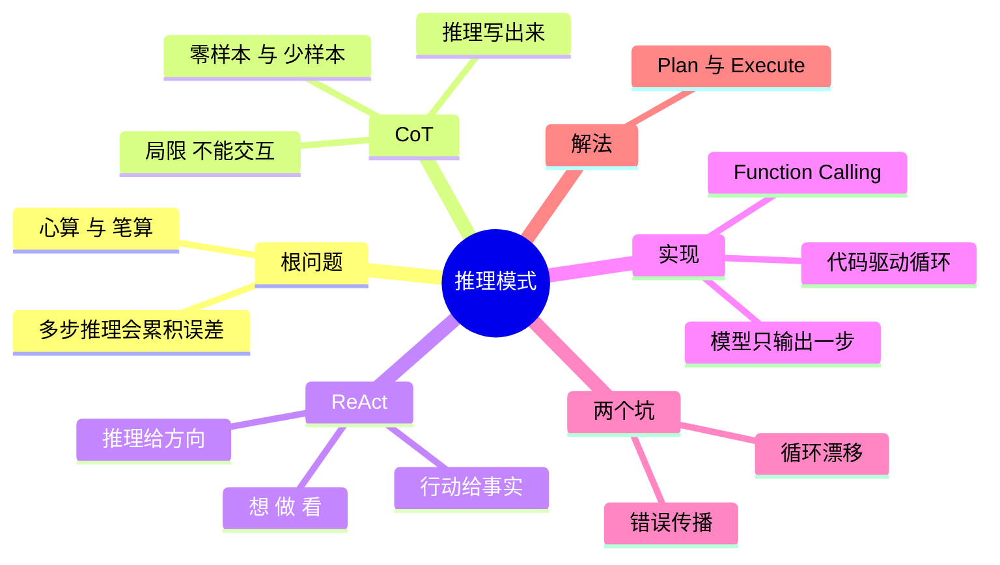

## 🔥 快速背诵

推理模式解决的是把隐式思考显式化，减少多步推理的累积误差。CoT 让它一步步写出来；ReAct 在推理链里插入真实行动，形成思考、行动、观察的循环。关键认知是这个循环由代码驱动，不是模型自己转。它有两个坑：循环漂移和错误传播，所以常配 Plan 管全局、ReAct 管单步。

> **一句话**：推理模式的存在是为了**把隐式思考显式化**，减少多步推理的累积误差。ReAct = 在 CoT 的推理链里插入真实行动，形成 `Thought → Action → Observation` 循环；而**这个循环不是模型自己转的，是你的代码在驱动。**

## 🧠 导图



---

# 📖 背诵稿

### ① 根问题：为什么需要推理模式

**模型是一个词一个词往外蹦的。你让它一口气给答案，中间的推导全闷在里面，错在哪儿你都看不见，误差就这么一点点攒起来了。**

比如问它"A 市值是 B 的 1.2 倍，B 比 C 高 30%，A 和 C 谁高"，它往往直接甩一个"感觉对"的数，而那数可能是错的。

这就像心算和笔算。123 乘 456 你心算容易错，但拿笔在纸上一行一行写，错得就少。不是你变聪明了，是"写下来"这个动作逼着你不在中间跳步。模型也一样，前面写出来的推理进了上下文，后面就踩着它往前走。**所以推理模式说白了就是：想办法让它把心里那点算计说出来。**

### ② CoT

**CoT 是最早也最土的办法：在 prompt 里加一句"让我们一步步思考"，它就真的会先写推理再给答案。**

两种用法。零样本就是光加这句话，不花钱、即插即用，但它写成什么样全看模型发挥，有时啰嗦有时跳步；少样本是先给它几个带完整推理的例子让它照着来，稳得多，适合格式要求固定的场景，代价是得准备高质量例子，还挺占 token。

但 CoT 有个死穴：**它只在脑子里推，出不去。** 推得再漂亮也拿不到实时数据、不会算数、查不了库。你问它现在苹果市值多少，它只能靠可能过时好几个月的记忆答。**所以才有了 ReAct。**

### ③ ReAct 是什么

**ReAct 就是在 CoT 的推理链里插进真家伙——思考、行动、观察，循环着来。**

想清楚了就动手调工具，工具返回啥就作为观察喂回来，接着再想。为什么它比另外两种都好？纯 CoT 出不去，容易胡说；纯"只调工具不思考"更糟，动作之间没推理串着，一步搜错了后面全跟着跑偏。**ReAct 妙就妙在互补：推理给行动指方向，行动给推理带事实。**

### ④ 实现：谁在驱动这个循环

**这一点最容易答错，也最能拉开差距：这循环不是模型自己在转，是你的代码在转。**

模型每次调用只干一件事——看着当前历史，输出下一步的 Thought 和 Action，然后就没了。它不会循环，也不会自己去执行工具。是代码在干活：看输出里有没有 Final Answer，没有就解析出调哪个工具、传什么参数，执行，把结果当 Observation 塞回历史，再调它一次。

**所以分工就一句：模型负责想，代码负责转。** 现在模型基本都原生支持 Function Calling，直接吐结构化 JSON，不用再解析文本了，但循环本身一点没变。

### ⑤ 两个实战坑

**ReAct 有两个坑：一个是跑着跑着跑偏了，一个是错一步后面全错。**

跑偏是因为它每步只看眼前，没有全局计划揪着。你让它查苹果近三年营收，它第一步搜到苹果和三星在打，觉得有意思就跑去搜三星了，越走越远，把原来的活忘了。步骤越多、历史越长越容易偏，因为那些历史里全是诱惑。

错误传播更阴——每步都踩在前面的结果上，中间某步拿了错信息，后面全被带着跑。而且它没有回头检查的习惯，默认前面给的都是对的，一路往前冲。错在第一步，整条链后面全白干。

### ⑥ 解法

**既然病根是"没全局规划"，那就先让它站高了把整个任务想清楚、列成计划，再一步步做——这就是 Plan-and-Execute。**

规划和执行分开：规划那个只想着怎么拆，不动手；执行那个拿着计划一步步走，每一步里面还可以用 ReAct，但它始终知道自己在第几步，不会瞎飘。

中间还有个关键机制叫动态重规划：每做完一步把结果喂回去，看后面还适用吗，不行就改甚至插新步骤。再往上叠一层 Reflection，就是质量把关。

**实践中这俩经常一起用：Plan 管全局，ReAct 管每一步；规划用强模型保质量，执行用便宜的小模型省钱。**

---

# 🔑 记忆锚

| 记什么 | 内容 |
|---|---|
| **1** 个根问题 | 隐式推理 → 显式化，减少累积误差（心算 vs 笔算） |
| **3** 步循环 | Thought → Action → Observation |
| **1** 句关键认知 | **模型负责推理，代码负责驱动循环** |
| **1** 句互补 | 推理给行动方向，行动给推理事实 |
| **2** 个坑 | 循环漂移（忘目标）/ 错误传播（错一步全错） |
| **1** 个解法 | Plan-and-Execute + 动态重规划 |

> **卡壳急救**：忘了 ReAct 细节就回到循环三步——想（Thought）、做（Action）、看（Observation）；再补一句"这三步是代码在推，不是模型自己转"。

---

# 🎯 追问速查

| 面试官问 | 你答 |
|---|---|
| 这个循环是谁在驱动？ | **代码**。模型每次只输出一步的 Thought + Action，代码负责解析、执行、回填 Observation、再次调用。模型不会自己循环 |
| CoT 和 ReAct 的区别？ | CoT 只在脑子里推、拿不到外部数据；ReAct 在推理链里插入真实行动，用外部事实校准推理 |
| 为什么非要有 Thought？ | 不然模型容易"冲动决策"——没搞清需求就急着调工具。写出来还能让决策过程可见，方便排查在哪步想歪 |
| Act-only 为什么不行为？ | 动作之间没有推理链连接，一步搜错后面全跑偏，在多跳任务上准确率明显低 |
| ReAct 有什么毛病？ | 循环漂移 + 错误传播。它是纯前向推理，没全局规划约束、也没反思机制纠错 |
| 现在还要手写解析吗？ | 不用了。现代 LLM 原生支持 **Function Calling**，直接输出结构化 JSON；ReAct 的循环本质不变，只是"行动"从解析文本变成解析 JSON |
| ReAct 和 Plan 怎么配合？ | Plan 做全局规划，ReAct 做每步执行；规划用强模型、执行用便宜模型，能降 70%–90% 调用成本 |

---

# 🔗 串联

- 承接 04 Agent 设计范式与 Workflow 的区别：那篇讲范式选型，这篇讲 ReAct 的机理和实现
- 上一题 03 Workflow、Agent、Tools 三者的概念与区别 的 Agent 层，就是靠 ReAct 这种循环撑起来的
- CoT / ToT → 02 Agent 的基本架构由哪些核心组件构成 的规划模块
- 循环漂移、错误传播 → 路径震荡、重复调用、死循环治理
- 动态重规划 → 任务拆分、规划能力
- 一句话总纲：**CoT 让它想清楚，ReAct 让它能查证，Plan 让它不跑偏**

---

# 📚 细节（背完再点开）

> [!note]- ReAct 的 prompt 模板（经典实现长这样）
> ```
> 你是一个 AI 助手，可以使用以下工具：
> - search(query): 搜索互联网获取最新信息
> - calculator(expr): 计算数学表达式
>
> 回答时请严格按照以下格式：
> Thought: 你的思考过程（分析当前情况，决定下一步）
> Action: 工具名称
> Action Input: 工具的输入参数
> Observation: （此行由系统填入工具返回结果，你不用写）
> ... 以上可以重复多轮 ...
> Final Answer: 确定可以回答时，在这里给出最终答案
> ```
> 注意：**Observation 是系统填的**，模型只负责 Thought / Action / Final Answer。

> [!note]- 一次完整的多跳推理长什么样
> ```
> Thought: 需要两家公司实时市值，先查苹果
> Action: search
> Action Input: 苹果公司 2024 年市值
> Observation: 苹果 2024 年市值约 3.5 万亿美元
>
> Thought: 苹果有了，再查谷歌
> Action: search
> Action Input: 谷歌 2024 年市值
> Observation: 谷歌 2024 年市值约 2.1 万亿美元
>
> Thought: 苹果 3.5 万亿 > 谷歌 2.1 万亿，差 1.4 万亿
> Final Answer: 苹果更高，差距约 1.4 万亿美元
> ```
> 每一轮都是"推理 → 拿真实数据 → 再推理"，这就是它比纯 CoT 强的地方。

> [!note]- 驱动循环的代码
> ```python
> def react_agent(question, tools, max_steps=10):
>     prompt = build_react_prompt(question, tools)
>     history = []
>
>     for _ in range(max_steps):
>         response = llm.generate(prompt + "\n".join(history))  # 每轮带完整历史
>
>         if "Final Answer:" in response:
>             return response.split("Final Answer:")[-1].strip()
>
>         action, action_input = parse_action(response)          # 解析 Action
>         observation = (tools[action](action_input)
>                        if action in tools
>                        else f"工具 {action} 不存在，请选择可用工具")  # 错误信息要可理解
>
>         history.append(response)
>         history.append(f"Observation: {observation}")          # 回填观察
>
>     return "超过最大步数，任务未完成"                            # 必须有停止条件
> ```
> 注意三件事：**完整历史每轮都带**（这就是记忆）、**工具名错了要给可读反馈**（模型能自我修正）、**必须有 max_steps**。

> [!note]- CoT 两种触发方式对比
> | | Zero-shot CoT | Few-shot CoT |
> |---|---|---|
> | 做法 | prompt 末尾加"让我们一步步思考" | 给几个带完整推理的示例让它模仿 |
> | 优点 | 零成本、即插即用 | 效果更稳，格式可控 |
> | 缺点 | 推理格式和深度靠模型发挥，不稳定 | 需准备高质量示例，且占 token |
> | 适用 | 快速试验 | 格式要求固定的生产场景 |

> [!note]- ToT 补一句（Plan 模块会问）
> **ToT（思维树）**：在每个推理节点展开多个分支，评估质量后选最优路径继续。
> CoT 是"一条路走到底"，ToT 是"走到岔路口先看几条路再选最好的那条"。适合创造性思考或复杂决策，但计算成本更高，因为要同时评估多条路径。

---

# 🎴 自测（遮住上面，先自己说）

> [!question]- Q1 为什么需要推理模式？
> LLM 逐个 token 预测，"一口气"给答案会让中间推导隐式化、误差累积。推理模式把隐式思考显式化，减少多步推理的累积误差——**心算 vs 笔算**。

> [!question]- Q2 CoT 的局限是什么？
> 纯文字推理，**没法跟外部世界交互**：拿不到实时数据、不能执行计算、不能查库，容易产生幻觉（没有外部事实校准）。

> [!question]- Q3 ReAct 是什么，为什么比 CoT 和 Act-only 都好？
> Reasoning + Acting，在推理链里插入真实行动，形成 Thought→Action→Observation 循环。**推理给行动方向，行动给推理事实**，两者互补。

> [!question]- Q4 循环是谁在驱动？
> **代码**。模型每次只输出一步的 Thought+Action，代码负责解析、执行工具、回填 Observation、再次调用。这是本题最能拉开差距的点。

> [!question]- Q5 ReAct 的两个坑？
> **循环漂移**（没有全局计划约束，越走越偏、忘了原目标）和**错误传播**（错一步后面全被带跑，且没有回头检查机制）。

> [!question]- Q6 怎么解决漂移？
> **Plan-and-Execute**：先全局规划再执行，每步内部可用 ReAct；加**动态重规划**，结果偏离就改计划；关键步骤再加 Reflection 把关。
