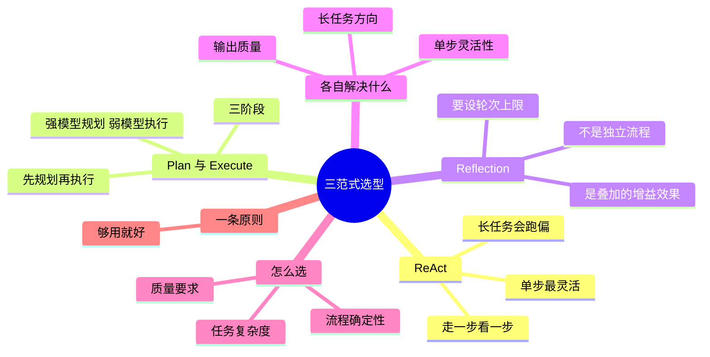

## 🔥 快速背诵

三者不在一个层次上：ReAct 管单步灵活，Plan-and-Execute 管长任务不跑偏，Reflection 管输出质量。Reflection 不是独立流程，是能叠在前两者身上的质量增益。选型看三个维度：任务复杂度、流程确定性、输出质量要求。原则是够用就好，不要过度工程化。

> **一句话**：三者解决的**层次不同**——ReAct 管单步灵活，Plan-and-Execute 管长任务不跑偏，Reflection 管输出质量。而且 **Reflection 根本不是一套独立流程，它是能叠在前两者身上的"质量增益效果"**，光这一句就够拉开差距。

## 🧠 导图

---

# 📖 背诵稿

> 第 4 篇讲的是三种范式「是什么」，这篇讲它们「各自治什么病、什么场景选哪个」。

### ① 先纠一个定位

**这里最容易被问倒：Reflection 不是一套独立的流程，它是能叠在 ReAct 或 Plan-and-Execute 上面的增强机制。**

ReAct 和 Plan-and-Execute 是两种「怎么把事干完」的路线，二选一；Reflection 不选边，它只是在原有流程上加一层「做完再检查、不行就改」。所以严格说，能并列的是前两个，Reflection 是加在它们头上的增益。

这个定位一说出来，后面就好讲了——因为三者的关系不是三个选项，而是「两种路线 + 一个增益效果」。

### ② ReAct 治什么

**ReAct 是走一步看一步，每一步都根据上一步的结果临时决定下一步，治的是「单步要灵活」。**

就像外卖骑手：接了送餐的活，他不会提前把每个路口都定死，而是先想"我该去商家取餐"，取到了再想"该往用户小区走"，到门口再想"走西门更近"。路上封路了立刻改道，不死守原计划。

它的好处是简单、灵活、过程透明，出了问题好查；短处是没全局计划揪着，长流程容易走偏，或者在某个工具上死循环。所以它适合**流程不固定、复杂度适中**的活，也是新手入门首选。
====
### ③ Plan-and-Execute 治什么

**Plan-and-Execute 是先想全再干，把规划和执行彻底拆开，治的是「长任务容易跑偏」。**

就像项目经理：接了"做个新产品"，不会上来就写代码，而是先出一份完整计划——需求调研、原型设计、开发、测试、上线，然后再派人一步步干。

它有三个阶段：**规划**（只拆不动手，注意力全在"想清楚"）、**执行**（按清单走，每步都带着前面所有结果，始终知道做到哪了）、**汇总**（把各步产出拼成连贯的整体，解决衔接问题）。

这里有个特别实用的技巧：规划和执行是两个独立模块，**可以用不同的模型**。规划只调一次，用强模型保证拆得对；执行要调很多次，用便宜的小模型就够。**强模型规划、弱模型执行，实际项目里总成本能降 70% 到 90%，质量几乎不受影响。**

代价是灵活度不如 ReAct，遇到计划外的事容易卡住；实现也更复杂，要维护两个模块。

### ④ Reflection 治什么

**Reflection 治的是「输出质量不够」，它的循环是在原流程上加一层「生成、评估、改进」。**

就像考试：ReAct 是一道题一道题往下做，做完不回头；Plan-and-Execute 是先定好整张卷子的做题顺序；Reflection 是做完之后回头检查一遍，看有没有算错数、看错题，错了就改。

它的价值和代价都很直接：质量明显上去，幻觉、逻辑漏洞、细节遗漏都会少；但每检查一轮就多一次甚至几次调用，**token 和延迟线性增加**，而且如果没有轮次限制，很容易陷进"为了改而改"的死循环。所以生产上一般**最多反思 2 到 3 轮**。

它适合那种"错一次就出大事"的场景——上线代码、正式商业报告、法律文书。

### ⑤ 三者其实是三个层次

**把三个摆到一张表里就清楚了：ReAct 解决单步的灵活性，Plan-and-Execute 解决长任务的全局方向，Reflection 解决最终输出的质量。**

一个是"每一步怎么走"，一个是"整条路怎么规划"，一个是"走完回头看有没有走错"。所以问"哪个更好"是问错了——它们治的是不同的病。

### ⑥ 怎么选

**看三个维度：任务复杂度、流程确定性、输出质量要求。**

任务不复杂、流程也不固定、需要随时调整，**ReAct 就够**，别上复杂方案。任务长、容易跑偏、需要整体结构清晰，上 **Plan-and-Execute**。如果执行中经常遇到意外要改计划，加**动态 Replan**。输出要求高、不能出错，在前两者基础上叠 **Reflection**。还要跨任务积累经验、避免重复踩坑，就用 **Reflexion** 把失败教训沉淀下来。

**最后一定补一句：别把这些全堆在一起。** 又要规划、又要反思、又要 Replan，系统又慢又复杂还容易出怪 bug。工程上永远是"够用就好"，先把 ReAct 玩明白，再按实际需要往上加。这句说出来，面试官会觉得你真做过项目。

---

# 🔑 记忆锚

| 记什么         | 内容                                                |
| ----------- | ------------------------------------------------- |
| **1** 个纠正   | **Reflection 不是独立流程，是叠在前两者上的增益效果**                |
| **3** 个层次   | ReAct 管单步灵活 / Plan 管长任务方向 / Reflection 管输出质量      |
| **3** 个阶段   | 规划 → 执行 → 汇总（Plan-and-Execute）                    |
| **3** 个维度   | 任务复杂度 / 流程确定性 / 输出质量要求                            |
| **1** 组成本   | 5 步任务：ReAct 约 3 万 token，Plan-and-Execute 约 1.45 万 |
| **1** 个降本技巧 | 强模型规划 + 弱模型执行，总成本降 70%–90%                        |
| **1** 句原则   | 够用就好，别过度工程化                                       |

> **卡壳急救**：想不起区别就回到三句话——一个管每步怎么走（ReAct），一个管整条路（Plan），一个管走完检查（Reflection）。

---

# 🎯 追问速查

| 面试官问                     | 你答                                                                          |
| ------------------------ | --------------------------------------------------------------------------- |
| Reflection 为什么单独列出来？     | 因为它是**质量增益效果**，不是独立路线。它不改变原流程，只在上面加「生成→评估→改进」                               |
| 三者能一起用吗？                 | 能，而且生产上常这么搭：Plan 定全局规划，每步用 ReAct 执行，最后整体过一次 Reflection                      |
| ReAct 为什么长任务会跑偏？         | 每步只顾眼前，没有全局计划揪着。历史越长，里面"诱人"的信息越多，注意力越容易被带走                                  |
| Plan-and-Execute 是不是太死板？ | 不。有**动态 Replan**：每步结果回灌规划器，偏离就改甚至插新步骤。只是不必每步都触发，设条件更省                       |
| 成本差多少？                   | 5 步、每步 2000 token 的任务：ReAct 因每轮带完整历史，累计约 3 万；Plan-and-Execute 约 1.45 万，低一半多 |
| 新手该先学哪个？                 | ReAct。简单、透明、好排查，先跑通再按需要升级                                                   |

---

# 🔗 串联

- 承接 04 Agent 设计范式与 Workflow 的区别：那篇讲"有哪些范式"，这篇讲"各治什么病、怎么选"
- ReAct 的机理和实现 → 05 推理模式与 ReAct 的实现
- 动态 Replan → 07 复杂任务的任务拆分 的 Replan 一节
- Reflexion 的"错题本" → 反思机制、自我进化
- 规划用强模型、执行用弱模型 → 模型选型与成本控制
- 一句话总纲：**ReAct 管每步，Plan 管全局，Reflection 管成品**

---

# 📚 细节（背完再点开）

> [!note]- 设计范式 vs 推理模式（容易混，说清了很加分）
> **设计范式** = 整个 Agent「从头到尾按什么大逻辑跑」，是顶层流程框架。
> **推理模式** = 每一步里面「脑子里具体怎么想」，是底层的思考方式。
>
> 类比：**设计范式是公司的管理制度，推理模式是员工的干活方法。**
>
> 顺带澄清一个常被混的：CoT / ToT 是"模型内部怎么把一个复杂问题想清楚"（一次生成内的内部拆分）；静态/动态拆分是"Agent 怎么把大任务切成多个独立执行的步骤"。**粒度和目标不同，别混为一谈。**

> [!note]- token 消耗实测对比（5 步任务，每步约 2000 token）
> | 范式 | 算法 | 总消耗 |
> |---|---|---|
> | ReAct | 每轮带完整历史：2000+4000+6000+8000+10000 | **约 30000** |
> | Plan-and-Execute | 规划 3000 + 执行 5×1500 + 汇总 4000 | **约 14500** |
> | 叠加 Reflection | 每个反思节点至少多一次调用 | **+30% 到 +100%** |
>
> 结论：ReAct 的消耗是**线性增长**，步骤越多越贵；Plan-and-Execute 的开销集中在规划和汇总两个大头，中间执行很省。
> 再加"强模型规划 + 弱模型执行"，数量差不多但钱能再省 70% 以上。

> [!note]- 动态 Replan（Plan 的续命机制）
> 计划定死了，中途遇到意外怎么办？比如规划五步写竞品报告，做到第三步发现某竞品已被收购，原框架失效。
> 做法：每步执行完，把"当前结果 + 剩余计划"一起交给规划模块，判断"还合理吗"，不合理就生成新的剩余步骤替换掉。
> 既保住"先规划"的结构优势，又不会因为太僵硬翻车。
> **实践折中**：不必每步都触发（每步一次评估调用也是钱），只在「输出与预期差异很大」或「步骤失败」时才启动。

> [!note]- Reflexion（反思的进阶版）
> 普通 Reflection 是"做完检查一遍，不行重做"；Reflexion 多做一件事：**把失败原因总结成一段"经验教训"存进记忆**，下次遇到同类任务时作为上下文带上，避免重蹈覆辙。
> 就是**错题本**——不只改答案，还写"这类题容易漏符号变化，下次注意"。
> 效果：HumanEval 上把 GPT-4 的 pass@1 从 80% 提到 91%。
> 为什么代码场景特别灵？因为**代码能跑、能测，执行结果就是最直接的反馈信号**。
> 这套思路叫 verbal reinforcement learning——不改模型参数，靠语言反馈从错误里学。

---

# 🎴 自测（遮住上面，先自己说）

> [!question]- Q1 三者最核心的区别？
> 解决**层次**不同：ReAct 管单步灵活性、Plan-and-Execute 管长任务全局方向、Reflection 管输出质量。

> [!question]- Q2 Reflection 是独立流程吗？
> **不是。** 它是能叠在 ReAct 或 Plan-and-Execute 上的质量增强机制，加一层「生成→评估→改进」，不改变原流程。

> [!question]- Q3 Plan-and-Execute 三个阶段？
> **规划**（只拆不动手）→ **执行**（按清单走，带前面所有结果）→ **汇总**（拼成连贯整体，解决衔接）。

> [!question]- Q4 成本上有什么差别？
> ReAct 每轮带完整历史，线性增长（5 步约 3 万 token）；Plan-and-Execute 开销集中在规划+汇总（约 1.45 万）。再加"强模型规划、弱模型执行"还能省 70% 以上。

> [!question]- Q5 动态 Replan 是什么？
> 每步执行完把结果和剩余计划交给规划器，判断还合不合理，不合理就生成新计划。**不必每步触发**，设条件更省。

> [!question]- Q6 选型口诀？
> 简单/流程不固定 → ReAct；长流程/易跑偏 → Plan-and-Execute + 动态 Replan；要求高不能错 → 叠 Reflection；要跨任务积累经验 → Reflexion。**够用就好，别过度工程化。**
