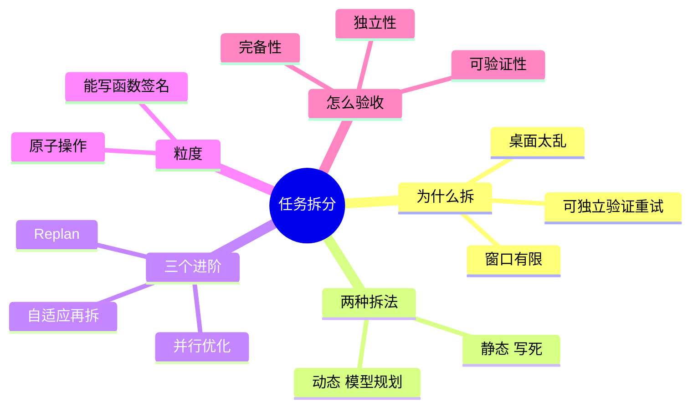

## 🔥 快速背诵

拆分的根因是上下文窗口有限：任务越大，中间状态越多，模型越盯不住当前子目标。拆成小步，每步只干一件事，还能单独验证、单独重试。整个过程分规划、执行、汇总三段，中间做依赖分析，能并行的并发跑。验收看完备性、独立性、可验证性，粒度标准是能写出清晰的函数签名。

> **一句话**：拆分的根因是 **context window 有限**——任务越大，中间状态堆得越多，"桌面"越乱，模型就越难盯住当前子目标。拆成小步后每步只干一件事，还能单独验证、单独重试。

## 🧠 导图



---

# 📖 背诵稿

### ① 为什么拆

**根因是 context window 有上限：任务越大，中间状态越多，桌面就越乱，模型很难持续盯住"我现在在做哪个子目标"。**

你让它一次写完一份竞品分析报告，其实是四件事混在一起。结果就是：搜索阶段掺进分析意见、写对比表时突然蹦出新竞品、写到一半把前面整理的数据忘了——最后出来一篇什么都有、什么都不深的文章。

这不是偶发，是系统性的。**就像让一个人同时记住十件事并全部做对，比每次只专注做一件的出错率高得多。** 拆开还有个额外好处：每一步都是独立输出，能单独检查和验证，某步错了只重跑那一步，不用整个重来。

### ② 两种拆法

**拆法就两种：一种是你自己拆死，一种让模型拆活。**

**静态拆分**是提前把流程设计好、固定成一个确定的 Workflow，每步是什么、什么顺序全写死。像"写技术博客"固定成：搜资料 → 整理大纲 → 逐段写 → 润色。好处是行为完全可预测，坏了知道是哪步；坏处是遇到没设计进去的情况就卡住。

**动态拆分**是把"怎么拆"这件事也交给模型——先让它输出执行计划，再按计划走，这就是 Plan-and-Execute 的核心。好处是灵活，能针对任务特点定制；坏处是**规划质量不稳定，规划一旦错了，后面全建在错地基上**。

### ③ 动态拆分的三个阶段

**整个流程分三阶段：规划、执行、汇总。**

**规划**像项目启动会：只出步骤列表，不动手干，注意力全在"想清楚要做什么"。**执行**像各部门按分工干活：逐步执行，每步都把前面所有结果当 context 传进去，始终知道做到哪了——这是它不像 ReAct 那样被岔路带走的关键。**汇总**像验收会：把各步产出拼起来，而且要解决衔接问题，保证是一篇连贯的东西，而不是几段硬拼。

### ④ 拆完还要做：依赖与并行

**这一步最容易被漏掉，但它是真正的性能优化点：分析步骤依赖，把能并行的并发跑。**

用做饭建立直觉：要烧水、切菜、腌肉。傻乎乎串行就是等水开了再切菜、切完再腌肉，总时间是三件事之和。老手是先把水烧上，烧水的同时切菜腌肉，水开了三样都好了。**降低的不是每步的时间，而是关键路径的总时间。**

落地要先把依赖画成有向无环图（DAG），没依赖的节点同时跑。四步各 3 秒，串行 12 秒，并行后 9 秒。实际项目里端到端延迟降 40% 到 60% 很常见——**前提是依赖稀疏、耗时主要在工具 I/O**；如果每步都强依赖上一步，并行空间基本是零。

### ⑤ 粒度怎么定

**实践中以"原子操作"为标准：这一步只做一件独立的事，边界清晰，做完有明确输出，不跟别的步骤互相依赖。**

"搜索竞品 A 的产品信息"是原子的；"整理竞品分析"不是，它里面还藏着搜索、筛选、格式化三件事。

有个特别好用的判断方法：**你能给它写一个清晰的函数签名吗？** 能写出来，大概是原子的；如果你发现函数里还要分好几阶段、处理好几类情况，那就还得再拆。

拆太细也不行：调用次数变多、token 上升，而且每步太碎看不到全局，产出各部分衔接生硬。拆太粗又回到原来"每步事太多、出错也定位不了"的老问题。

### ⑥ 三个进阶

**第一个是自适应拆分：别在开头就把粒度定死，执行时发现哪步做不好，再把它拆细。**

先让执行器试着做，做得好就往下走；做不好（超步数、质量不达标）就交给规划器再拆一层，然后对子任务重复同样流程。像一棵递归展开的任务树，**只有真正做不好的节点才继续拆**——所以开销和任务实际难度成正比，而不是一刀切对谁都拆同样深。

**第二个是 Replan**：每步做完把结果和剩余计划交给规划器，看后面还合不合理，不合理就换。但**不必每步都触发**，只在"结果和预期差很多"或"步骤失败"时才启动，不然白花钱。

**第三个是验收标准**：拆完怎么判断拆得好？看三性——**完备性**（所有步骤拼起来覆盖了原任务的全部要求吗）、**独立性**（有没有两步在干重叠的活）、**可验证性**（每步做完能不能用一个简单标准判断对错）。第三点最容易被忽略：拆的时候顺手写好每步的"验收条件"，就像给单元测试写断言，缺了就能自动重试。

---

# 🔑 记忆锚

| 记什么 | 内容 |
|---|---|
| **1** 个根因 | context window 有限 → 桌面太乱 → 盯不住子目标 |
| **2** 种拆法 | 静态（写死、可控）/ 动态（模型规划、灵活但不稳） |
| **3** 个阶段 | 规划 → 执行 → 汇总 |
| **3** 个验收 | 完备性 / 独立性 / 可验证性 |
| **1** 个优化 | 依赖分析 + 并行，端到端延迟降 40%–60% |
| **1** 个粒度标准 | 能写出清晰的函数签名 = 原子 |
| **1** 个进阶 | 自适应拆分：做不好就再拆一层 |

> **卡壳急救**：忘了细节就按顺序过四问——为什么拆（窗口有限）、怎么拆（静态/动态）、拆完干啥（并行 + 验收）、拆多细（原子）。

---

# 🎯 追问速查

| 面试官问           | 你答                                                                |
| -------------- | ----------------------------------------------------------------- |
| 为什么拆了准确率就上去了？  | 不是"任务简单了"这么含糊。根因是**窗口有限**，任务大中间状态多，模型难盯住子目标；拆开后注意力集中，而且每步能独立验证和重试 |
| 静态和动态怎么选？      | 流程固定、可预判 → 静态，可控好排查；流程不定、需要按任务特点定制 → 动态，但要接受规划质量不稳                |
| 拆太细会怎样？        | token 和调用次数上去，每步看不到全局，各部分衔接生硬。**太粗又定位不了错**，所以要按原子操作来              |
| 并行怎么落地？        | 先画依赖 DAG，没依赖的节点同时跑。降的是**关键路径时间**，不是单步时间                           |
| 每步都要 Replan 吗？ | 不必，那样太贵。只在结果与预期差异大、或步骤失败时触发                                       |
| 怎么判断拆得好不好？     | 三性：完备性、独立性、可验证性。**可验证性**最容易被忽略——拆的时候就要写好验收条件                      |

---

# 🔗 串联

- 静态拆分 ≈ 03 Workflow、Agent、Tools 三者的概念与区别 里的 Workflow；动态拆分 ≈ Plan-and-Execute
- 三阶段来自 04 Agent 设计范式与 Workflow 的区别 的 Plan-and-Execute
- Replan → 06 三种范式的区别与选型 的动态 Replan
- 并行 + 关键路径 → 工程化优化、延迟治理
- 验收标准 → Agent 评测、结果校验
- 一句话总纲：**拆得动（拆法）、拆得对（粒度）、跑得快（并行）、验得了（验收）**

---

# 📚 细节（背完再点开）

> [!note]- 失败案例长什么样
> 让模型一次写完"竞品分析报告"，它会：
> - 在搜索阶段就开始掺分析意见
> - 写对比表时突然引入新竞品信息
> - 报告写到一半忘掉前面整理的某个关键数据
> - 最终输出结构混乱，什么都有一点、什么都不深
>
> 不是模型不行，是**四件事挤在一张桌子上**：搜索、整理、对比、结论。

> [!note]- 并行执行的代码形态
> ```python
> import asyncio
>
> async def execute_parallel_steps(independent_steps):
>     tasks = [execute_step_async(step) for step in independent_steps]
>     results = await asyncio.gather(*tasks)   # 一起等，不串行
>     return results
>
> # 依赖图：
> # 步骤1 ──┐
> #          ├──> 步骤3 ──┐
> # 步骤2 ──┘              ├──> 步骤4（最终输出）
> #          └─────────────┘
> ```
> 关键路径 = 1/2 并行 → 3 → 4。四步各 3 秒：串行 12 秒，并行 9 秒。

> [!note]- 自适应拆分的递归过程
> 目标：做一份完整竞品分析报告。
> 1. 执行器直接一口气写完 → 质量差（数据不准、结构乱）
> 2. 规划器拆成三步：搜集核心数据 / 功能对比 / 写总结
> 3. 执行"搜集核心数据" → 竞品太多一次搜不完，还是不达标
> 4. 规划器再拆：搜 A 的数据 / 搜 B 的数据 / 搜 C 的数据
> 5. 每步都够简单，顺利跑通
>
> **只有真正做不好的节点才继续拆**，开销与实际难度成正比。

> [!note]- 拆分质量三性的检查方法
> | 标准 | 检查方法 | 反例 |
> |---|---|---|
> | **完备性** | 把各步描述拼起来，跟原任务逐项对照 | 说了要市场份额、功能对比、定价三个维度，只拆了两个 |
> | **独立性** | 看有没有两步会产出重叠内容 | "搜产品功能"和"分析核心能力"大概率搜到同一批东西；应改成"搜全部信息"和"从结果里提炼对比表" |
> | **可验证性** | 每步有没有能自动判断的完成标准 | 「搜定价信息」→ 加断言「输出必须含价格数字和计费模式」 |

---

# 🎴 自测（遮住上面，先自己说）

> [!question]- Q1 为什么任务要拆？根因是什么？
> **context window 有限**，任务越大中间状态越多，模型难持续追踪当前子目标。拆开后注意力集中，还能单步验证和重试。

> [!question]- Q2 两种拆分思路？
> **静态**：提前写死流程，可控好排查，但遇到没预料的情况会卡住。**动态**：让模型自己规划（Plan-and-Execute），灵活但规划质量不稳定。

> [!question]- Q3 Plan-and-Execute 的三阶段？
> **规划**（只拆不动手）→ **执行**（按步走，带全部前面结果）→ **汇总**（拼成连贯整体，处理衔接）。

> [!question]- Q4 拆完最大的优化点是什么？
> **依赖分析 + 并行**。画成 DAG，无依赖的并行跑，降的是关键路径时间，端到端延迟常能降 40%–60%。

> [!question]- Q5 粒度怎么把握？
> 以**原子操作**为标准：只做一件事、边界清晰、有明确输出。判断法：能写出清晰的函数签名吗？

> [!question]- Q6 怎么判断拆得好？
> 三性：**完备性**（覆盖全部要求）、**独立性**（无重叠职责）、**可验证性**（每步有可自动判断的完成标准）。
