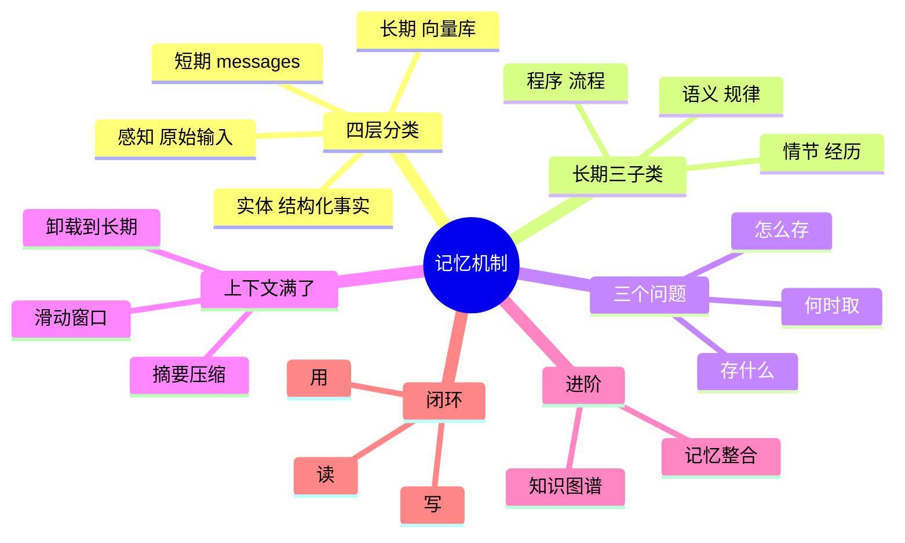

## 🔥 快速背诵

记忆分四层：感知、短期、长期、实体。设计记忆就是回答三个问题：存什么、怎么存、什么时候取。判断一条信息存不存，只看下次任务开始时知道它会不会做得更好。用户偏好和关键结论该存，中间推理和工具原始返回不该存，存多了会稀释记忆。存法要分类，语义走向量库，结构化字段走 KV。

> **一句话**：记忆分四层——**感知、短期、长期、实体**。设计记忆模块本质是回答三个问题：**存什么、怎么存、什么时候取**。整个链路是一条「**读 → 用 → 写**」的闭环。

## 🧠 导图

---

# 📖 背诵稿

> 第 9 篇讲"具体怎么存、粒度多大"，这篇讲"分哪几层、怎么设计"。

### ① 没有记忆会怎样

**先想一下没记忆多难用：你今天跟它说"代码风格要简洁、变量用英文"，明天开新对话，它又给你写一坨中文注释的啰嗦代码。**

因为在它看来昨天根本不存在。这不只是偏好记不住，更麻烦的是任务状态断——一个多步任务跑到一半，它不知道自己上一步做了啥、已经收集了哪些信息，后面那步就没法接。所以记忆是 Agent 从"单次问答工具"变成"真助手"的分水岭。

### ② 四层分类

**从最短暂到最持久，分四层：感知记忆、短期记忆、长期记忆、实体记忆。**

**感知记忆**是这一次调用进来的原始内容——用户这条消息、这张截图、这个文档，处理完就没了，相当于"刚听到还没记"的那句话。**短期记忆**是 context window 里的 messages，维持当前任务的完整状态，像一张工作台，任务一结束就清空。**长期记忆**在外部数据库里，跨任务保留，像档案室，要用得主动去翻。**实体记忆**最精炼，不存原文，只把关键事实抽成结构化字段——"用户偏好 Python""预算 5 万""截止 3 月底"，像医生的病历卡。

四层的区别抓三个点就够：**载体**（当次输入 / 上下文 / 数据库 / 结构化存储）、**生命期**（一次调用 / 一次任务 / 持久 / 持久）、**怎么访问**（直接用 / 直接读 / 语义检索 / 精确查询）。

### ③ 长期记忆还分三种

**长期记忆不是铁板一块，按存的东西分三类：情节、语义、程序。**

**情节记忆**存具体经历——"上周二写爬虫遇到反爬，最后用 Selenium 解决"，带时间线和因果，作用是遇到类似任务时能翻出历史案例参考。**语义记忆**存从多次经历里提炼的规律——"目标站有 JS 动态渲染时 requests 抓不到，优先上 Selenium 或 Playwright"，信息密度更高，检索更容易命中，因为它直接给结论。**程序记忆**存做事的流程——"部署 Flask 的标准步骤：建虚拟环境 → 装依赖 → 配 gunicorn → 设 nginx → 启动"，重复任务直接调 SOP，又快又稳。

三者配合才完整：情节给案例，语义给规律，程序给流程。

### ④ 三个工程问题

**设计记忆模块，说到底就三个问题：存什么、怎么存、什么时候取。**

**存什么**——判断标准一句话："这条信息，下次任务开始时如果知道，会让它做得更好吗？"值得存的是用户偏好习惯、任务中的关键结论和决策、外部知识；不该存的是中间推理过程、工具的原始返回（日志太啰嗦）、闲聊。**存多了反而稀释记忆，检索信噪比下降。**

**怎么存**——按类型选介质，别一刀切全塞向量库。要语义检索的非结构化文本走向量数据库；能精确查的结构化字段（语言偏好、项目配置）用关系库或 KV，快且不用理解语义。**混合存储是主流。**

**什么时候取**——两种策略结合用。**主动检索**：任务开始前用任务描述去查，把结果注入 system prompt，让它一上来就带着背景。**被动触发**：把"查记忆"封装成一个 Tool，执行中需要时让它自己调，更灵活但依赖模型判断。

### ⑤ 上下文满了怎么办

**短期记忆最大的现实问题是窗口会满，满了就只能截断，然后就开始"遗忘"。**

常见三种解法，从简单到复杂：**滑动窗口**只留最近 N 轮，简单但早期重要信息会被滑掉（用户第一轮说"全用 TypeScript"，第十轮滑出去了它又开始写 JavaScript）。**摘要压缩**是快满时让模型把早期历史压成一段摘要，几千 token 压到几百，代价是细节丢失且要多调一次。**卸载到长期记忆**是把当前用不上、后面可能要的中间结果先存进向量库、从上下文移除，需要时再检索回来——相当于给工作台配了个抽屉。

### ⑥ 进阶与闭环

**再往深两层：知识图谱和记忆整合。**

**知识图谱**解决"记忆之间没关联"的问题。向量检索是一条条存、一条条取，但"用户 A 是公司 B 的 CTO"和"公司 B 主营云计算"这两条文本相似度很低，纯向量查"用户 A 所在公司做什么"就查不到。图谱用三元组（实体-关系-实体）把这些连起来，能沿关系链多跳推理。**两者是互补的**：向量管模糊语义，图谱管精确关系。

**记忆整合**是定期给长期记忆做清理和升华：去重（三条差不多的合并成一条）、冲突消解（"偏好 Python"和后来的"转用 Go 了"，保留新的、标记旧的过期）、**抽象提炼**（把多条情节记忆蒸馏成一条语义规律，这是最有价值的一步）。节奏上：每次任务结束做轻量去重更新，隔一段时间做一次深度提炼。

**最后用闭环收尾：读 → 用 → 写。** 任务开始前"读"——从实体记忆取偏好、拿任务描述去长期记忆语义检索，拼进 system prompt。执行中"用"——短期记忆全程记状态，需要专业知识时临时检索一次。结束后"写"——新偏好更新实体记忆，有价值的结论写进长期记忆，然后清空短期记忆。**用得越久，它越了解你——这才是记忆系统真正的价值。**

---

# 🔑 记忆锚

| 记什么 | 内容 |
|---|---|
| **4** 层记忆 | 感知（原始输入）/ 短期（messages）/ 长期（向量库）/ 实体（结构化事实） |
| **3** 个子类 | 情节（经历）/ 语义（规律）/ 程序（流程） |
| **3** 个问题 | 存什么 / 怎么存 / 什么时候取 |
| **3** 种压缩 | 滑动窗口 / 摘要压缩 / 卸载到长期 |
| **2** 种检索 | 主动（任务前注入）/ 被动（封装成 Tool 按需调） |
| **1** 个闭环 | 读 → 用 → 写 |

> **卡壳急救**：想不起分层就按"生命期"数——这一刻的（感知）、这次任务的（短期）、跨任务的（长期）、抽出来的结论（实体）。

---

# 🎯 追问速查

| 面试官问 | 你答 |
|---|---|
| 为什么要有实体记忆？ | 因为它存的是**结论不是原文**，信息密度最高、查询最快，而且不受原始表述方式影响。像病历卡：不存问诊录音，只记"主诉、诊断、用药" |
| 存什么才有价值？ | 一句话判断："下次任务开始时知道它，会让 Agent 做得更好吗？"偏好、关键结论、外部知识值得存；中间推理、工具原始日志、闲聊不值得 |
| 怎么存才对？ | **按类型选介质**。非结构化文本进向量库做语义检索，结构化字段进关系库精确查。混合存储是主流，别全塞向量库 |
| 什么时候取？ | **主动 + 被动结合**。任务前主动检索注入 system prompt；执行中把检索封装成 Tool 让它按需调 |
| 上下文满了？ | 滑动窗口（丢早期）、摘要压缩（丢细节）、卸载到长期记忆（存起来再取回）。三者可叠加 |
| 知识图谱和向量库什么关系？ | **互补**。向量管模糊语义（"之前那个项目"），图谱管精确关系（多跳推理："用户 A 所在公司做什么"）。做法：向量先召回候选，图谱补关联，合并注入 |
| 记忆越积越多怎么办？ | **记忆整合**：去重、冲突消解（按时间保留新的）、抽象提炼（情节→语义）。轻量每次做，深度定期做 |

---

# 🔗 串联

- 02 Agent 的基本架构由哪些核心组件构成 里的"记忆组件"，这篇是它的展开
- 09 Agent 的长短期记忆怎么存怎么用：那篇讲存储实现和粒度，这篇讲分层和设计
- 记忆压缩 → 12 Agent 记忆压缩方法、17 上下文工程
- 记忆衰减 → 02 Agent 的基本架构由哪些核心组件构成 提到的衰减机制
- 记忆 vs RAG → RAG 是长期记忆的一种实现，但 RAG 偏外部知识，记忆偏这个用户的经历
- 一句话总纲：**该记的记、按类型存、该取时取，读完用完再写回去**

---

# 📚 细节（背完再点开）

> [!note]- 四层记忆横向对比
> | 类型 | 载体 | 容量 | 生命周期 | 访问方式 |
> |---|---|---|---|---|
> | 感知记忆 | 当次输入 | 极小 | 单次调用 | 即时访问 |
> | 短期记忆 | context window | 受 token 限制 | 一次任务 | 直接读取 |
> | 长期记忆 | 向量 / 关系数据库 | 近乎无限 | 持久 | 语义检索 |
> | 实体记忆 | 结构化存储 | 近乎无限 | 持久 | 精确查询 |

> [!note]- 三种长期记忆的区别（一句话记忆）
> - **情节记忆**：答"之前遇到过类似情况吗"——带时间线和因果
> - **语义记忆**：答"这个领域的规律是什么"——从经历里蒸馏出的结论
> - **程序记忆**：答"这类事该按什么流程做"——可直接复用的 SOP
>
> 抽取路径：**多条情节 → 提炼 → 一条语义**。这个动作就叫"抽象提炼"，是记忆整合里最有价值的一步。

> [!note]- 三个 Agent 记忆框架（说出来显示视野）
> | 框架 | 核心思路 | 适合 |
> |---|---|---|
> | **Mem0** | 把记忆做成独立服务层，`add` / `search` 两行搞定 embedding、去重、冲突消解；支持按 user_id 隔离；同时支持向量库和图存储 | 个性化记忆（记住每个用户） |
> | **Letta**（前身 MemGPT） | 借鉴操作系统内存分层：Core Memory（常在窗口，像主存）/ Recall Memory（近期对话，像缓存）/ Archival Memory（归档，像磁盘）。**让 Agent 自己通过工具管理这三层** | 长会话、需要自主管理记忆 |
> | **Zep**（Graphiti） | 引入**时间感知**：每条记忆带"有效期窗口"，用时序知识图谱管理生命周期，自动识别过期 | 长期运行、信息会过时 |

> [!note]- 知识图谱多跳推理长什么样
> 三元组：`用户 A —担任CTO→ 公司 B`、`公司 B —主营→ 云计算`、`公司 B —成立→ 2015`
> 问"用户 A 所在公司做什么业务"：
> - 纯向量检索 → 可能查不到（"用户 A"和"云计算"文本不相似）
> - 图谱 → 从 A 沿"担任CTO"到 B，再从 B 沿"主营"到云计算，**两跳拿到答案**
>
> 落地方式：对话中用 LLM 自动抽取实体和关系入库；检索时向量先召回候选，图谱补充关联，最后合并注入 context。

> [!note]- 什么不值得存（很容易被追问）
> - **中间推理过程**：是一次性的，存了占地方还干扰
> - **工具的原始返回**：日志太长、噪音多，应该存提炼后的结论
> - **闲聊内容**：稀释信噪比
>
> 判断准则始终是那一句：**这条信息，下次任务开始时知道它，会让 Agent 做得更好吗？**

---

# 🎴 自测（遮住上面，先自己说）

> [!question]- Q1 记忆分哪四层？
> **感知**（当次原始输入）/ **短期**（context window 的 messages）/ **长期**（外部数据库，语义检索）/ **实体**（从对话里抽出的结构化事实）。

> [!question]- Q2 长期记忆的三种子类型？
> **情节**（具体经历，带时间线）/ **语义**（从多次经历提炼的规律）/ **程序**（做事的 SOP）。配合起来：案例 + 规律 + 流程。

> [!question]- Q3 设计记忆模块的三个核心问题？
> **存什么**（只存对下次有价值、过滤噪音）、**怎么存**（按类型选介质，混合存储）、**什么时候取**（任务前主动 + 执行中被动）。

> [!question]- Q4 上下文满了三种解法？
> **滑动窗口**（丢早期，简单但会丢关键信息）、**摘要压缩**（压成一段，丢细节且多一次调用）、**卸载到长期记忆**（存起来需要时取回）。

> [!question]- Q5 知识图谱解决什么问题？
> 解决"记忆之间没关联"——向量检索只能一条条找，语义不相近就查不到；图谱用三元组连起来，能沿关系链**多跳推理**。

> [!question]- Q6 记忆整合做哪三件事？
> **去重**（合并相近的）、**冲突消解**（按时间保留新的、标记旧的过期）、**抽象提炼**（多条情节→一条语义规律，最有价值）。
