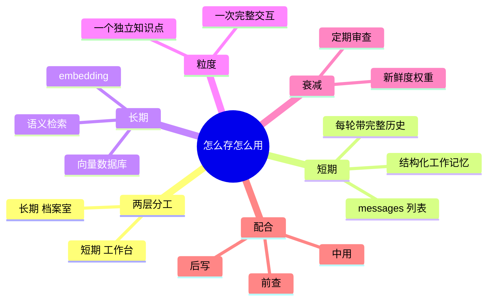

## 🔥 快速背诵

短期记忆就是 messages 列表，每轮带上完整历史，是当前任务的工作台。长期记忆是 embedding 加向量库，靠语义距离检索，是跨任务的档案室。粒度按一次完整交互或一个独立知识点存，太细会碎片化，太粗会带噪音。长期记忆要有衰减，越久远权重越低。配合就三个动作：任务前查、执行中用、结束后写。

> **一句话**：短期记忆就是 **messages 列表**，每轮把完整历史带上——它是"工作台"；长期记忆是 **embedding + 向量库**，靠**语义距离**而不是关键词匹配——它是"档案室"。粒度按"**一次完整交互**"或"**一个独立知识点**"来存。

## 🧠 导图



---

# 📖 背诵稿

> 第 8 篇讲"分哪几层、怎么设计"，这篇专讲三个落地细节：**怎么存、粒度多大、怎么用**。

### ① 两层分工

**记忆分两层，解决的问题完全不同：短期记忆是当前任务的工作台，长期记忆是跨任务的档案室。**

工作台的特点是**随时可见**——桌上的东西直接就能看，不用翻箱倒柜，但它有大小限制（token 上限），放满了就得清。档案室的特点是**放进去不会丢**，但要用的时候得主动去翻。所以短期管"这次别断片"，长期管"下次还记得"。

### ② 短期记忆怎么存

**短期记忆就是一个 messages 列表，每条有 role 和 content，每一步产生的都往里追加。**

关键点在这儿：**每次调 LLM 传的是完整历史，不是只传最新那条。** 这就是短期记忆的本质——把整个任务状态带在身上，它才知道自己做到哪了、前面发现了什么。代价是列表越来越长，窗口早晚会满，然后开始截断、开始遗忘。

有个进阶做法叫**结构化工作记忆**：别把什么消息都往列表里塞，而是给工作台划几个固定区域——"当前任务目标""已确认的结论""待验证的假设"。每步做完不是简单追加，而是主动更新对应区域，把过时的结论替换掉。这样对话再长，台面也是清楚的。

### ③ 长期记忆怎么存

**长期记忆的核心是 embedding + 向量数据库，说白了就是把文字换算成一组数字，语义相近的，数字挨得也近。**

用颜色打比方：红色是 (255,0,0)，橙色是 (255,165,0)，数字距离很近，因为颜色本来就接近；深蓝 (0,0,139) 离红色就很远。文字也一样——"苹果公司的产品策略"和"Apple 的产品线规划"字面完全不同，但向量距离很近。

**这就是它比关键词搜索强的地方**：你存的是"用户不喜欢冗长的注释"，用"代码风格偏好"去查也能查到，因为意思近。存的时候把向量和原文一起写进去，取的时候把问题也转成向量，找距离最近的几条。

### ④ 粒度（最容易答错）

**粒度按"一次完整交互"或者"一个独立的知识点"来存，太细太粗都不行。**

**太细会碎片化**：把"用户偏好 Python、不喜欢全局变量、风格简洁、注释用英文"拆成四条分开存，检索时可能只命中其中两三条，你拿到的是残缺的偏好。**太粗会带噪音**：把一次两千 token 的完整对话存成一条，命中了，但里面真正相关的可能只有一百 token，模型还得在一堆无关内容里挑。

所以合理的做法是打包成一条完整的：**"用户偏好：Python，简洁风格，英文注释"**——检索时一次拿到完整的，不会有残缺。至于过程中的细小中间结果，大多不用进长期记忆，短期够用了。

### ⑤ 记忆衰减

**长期记忆还该有个衰减机制，不然过时的信息会一直误导它。**

比如用户半年前说"我最近在学 Go"，但最近三个月聊的全是 Python。如果不衰减，下次检索到那条旧记忆，它还按"用户在学 Go"来处理，就很违和。

常见做法有两种：给每条记忆加个**新鲜度权重**，排序时把语义相似度和时间新鲜度一起算，越久远权重越低；或者**定期让 LLM 审一遍记忆库**，把过时的、互相矛盾的标记失效或合并更新。

### ⑥ 怎么配合用

**两层配合就三个动作：任务前"查"、执行中"用"、结束后"写"。**

任务开始前，拿用户这句话去检索长期记忆，取 top 3 注进 system prompt，它一上来就带着你的背景，不用你重新交代。执行中，短期记忆全程记状态，每一步都追加，保证不断片。任务结束后，判断一下这次有没有产生值得记的东西——新偏好就存一条、关键结论就写进向量库，然后清空短期记忆，工作台恢复干净。

**这套跑起来的效果就是：用得越久它越懂你。** 用户会觉得"这 AI 真了解我"，其实是长期记忆在背后起作用。

---

# 🔑 记忆锚

| 记什么 | 内容 |
|---|---|
| **2** 层分工 | 短期 = 工作台（随时可见、容量有限）/ 长期 = 档案室（不丢、要主动翻） |
| **1** 个短期本质 | 每轮传**完整历史**，不是只传最新一条 |
| **1** 个长期原理 | embedding 把语义相近变成**距离相近**（RGB 类比） |
| **3** 种类型 | 语义（事实）/ 情节（经历）/ 程序（方法论） |
| **1** 个粒度 | 一次完整交互 或 一个独立知识点 |
| **2** 个粒度错误 | 太细碎片化 / 太粗带噪音 |
| **1** 个衰减 | 新鲜度权重，越久远越往后 |
| **3** 个动作 | 前查 / 中用 / 后写 |

> **卡壳急救**：想不清就分两个问题问自己——这次任务里它靠什么不忘？（messages）下次任务它靠什么想起我？（向量检索）

---

# 🎯 追问速查

| 面试官问 | 你答 |
|---|---|
| 长期记忆用关键词搜行不行？ | 不行。问"代码习惯"，历史存的是"Python 风格偏好"，关键词不重叠就搜不到。**向量检索靠语义距离，不靠字面匹配** |
| 那我把粒度拆细点不就行了？ | 更糟。拆细了一整条偏好散成四五条，检索只命中两三条，拿到的是碎片。**合理粒度是打包成完整的一条** |
| embedding 是什么？ | 把文字转成几百到几千维的向量，语义相近的向量在空间里离得近。检索时用余弦相似度找最近的几条 |
| 为什么不存原始对话？ | 太长、噪音多。应该存**提炼后的结论**——"竞品 A 按用量收费"，而不是那段三千字的调研过程 |
| 短期记忆怎么防止越堆越长？ | 滑动窗口 / 摘要压缩 / 卸载到长期记忆；进阶用**结构化工作记忆**，只维护"目标 + 已确认结论 + 待验证假设" |
| 记忆会不会过时？ | 会。加**新鲜度权重**参与排序，或者定期让模型审查、把矛盾的标记失效 |

---

# 🔗 串联

- 承接 08 Agent 的记忆机制与设计：那篇讲分层与设计，这篇讲存储实现与粒度
- 结构化工作记忆 → 07 复杂任务的任务拆分 里"上下文管理"的延伸
- 记忆衰减 → 12 Agent 记忆压缩方法、02 Agent 的基本架构由哪些核心组件构成 的衰减机制
- 向量检索 → RAG：同一套 embedding + 向量库，只是 RAG 偏外部知识，记忆偏用户经历
- 前查后写 → 17 上下文工程、多轮对话状态管理
- 一句话总纲：**短期靠 messages 不断片，长期靠向量库不忘事**

---

# 📚 细节（背完再点开）

> [!note]- 短期记忆的代码形态
> ```python
> class ShortTermMemory:
>     def __init__(self):
>         self.messages = []          # 工作台
>
>     def add(self, role, content):
>         # role: user / assistant / tool
>         self.messages.append({"role": role, "content": content})
>
>     def get_context(self):
>         return self.messages        # 每轮传完整历史
>
>     def clear(self):
>         self.messages = []          # 任务结束清空
> ```
> 注意：**传完整历史**是短期记忆的本质，也是它 token 线性增长的原因。

> [!note]- 长期记忆的存取
> ```python
> def save_to_long_term(content, metadata):
>     embedding = client.embeddings.create(
>         input=content, model="text-embedding-3-small"
>     ).data[0].embedding
>
>     collection.add(
>         embeddings=[embedding],   # 索引，用于相似度检索
>         documents=[content],      # 原文，命中后直接给 LLM 读
>         metadatas=[metadata],     # 时间、任务类型、重要度、记忆类型
>         ids=[f"mem_{hash(content)}"]
>     )
>
> def retrieve_memory(query, top_k=3):
>     q = client.embeddings.create(input=query, model="text-embedding-3-small").data[0].embedding
>     return collection.query(query_embeddings=[q], n_results=top_k)["documents"][0]
> ```
> **metadata 很关键**：它是记忆的标签，能支持"只查 coding 类""只查最近 7 天"这类过滤，纯向量检索做不到。

> [!note]- 三种记忆类型分别在答什么问题
> | 类型 | 存什么 | 回答什么问题 |
> |---|---|---|
> | **语义记忆** | 事实性知识（"用户是 Python 开发者"、"预算 5 万"） | 是什么 |
> | **情节记忆** | 具体事件（"上周写爬虫因反爬改了三次方案"） | 之前怎么处理过类似的 |
> | **程序记忆** | 做事的方法论（"给这人写代码：先确认风格，再写主逻辑，最后加注释"） | 该按什么流程来 |
>
> 分开存的好处：检索时能精准去对应类型的库里查，召回质量比"一锅端混合搜"高不少。

> [!note]- 完整配合代码（前查 / 中用 / 后写）
> ```python
> def run_agent_with_memory(user_request, long_term, short_term):
>     # ① 前查：用任务描述召回相关记忆
>     memories = long_term.retrieve(user_request, top_k=3)
>
>     # ② 注入 system prompt
>     system_prompt = f"""你是一个智能助手。
> 以下是用户的相关历史信息，请在处理任务时参考：
> {"\n".join(memories)}"""
>     short_term.add("system", system_prompt)
>     short_term.add("user", user_request)
>
>     # ③ 中用：执行过程靠短期记忆维持状态
>     result = execute_task_with_short_term_memory(short_term)
>
>     # ④ 后写：重要结论沉淀
>     if result.is_important:
>         long_term.save(content=result.summary,
>                        metadata={"task_type": "coding", "timestamp": now()})
>     return result
> ```

> [!note]- 为什么「每次传完整历史」是必须的
> 如果只传最新一条，模型不知道上一步搜到了什么、当前在第几步，就无法做连贯的多步决策——这正是01 什么是 Agent 与大模型的本质不同里"没有持续状态"那个问题的解法。
> 但代价跟着来：token 随轮数线性增长。所以"传完整历史"和"上下文会满"是一对天生的矛盾，压缩策略就是为它准备的。

---

# 🎴 自测（遮住上面，先自己说）

> [!question]- Q1 短期记忆的本质是什么？
> **就是一个 messages 列表，每轮把完整历史传给 LLM**——这样它才知道自己做到哪、前面发现了什么。任务结束清空。

> [!question]- Q2 长期记忆靠什么检索？
> **embedding + 向量数据库**：文字转成向量，语义相近则距离近，用余弦相似度找最近的几条。**不靠关键词匹配**。

> [!question]- Q3 为什么关键词搜索不够用？
> 问"代码习惯"，历史里存的是"Python 风格偏好"，字面不重叠就搜不到。语义检索能靠"意思近"命中。

> [!question]- Q4 粒度怎么定？太细太粗各有什么问题？
> 按"**一次完整交互**"或"**一个独立知识点**"。太细 → 偏好被拆散、检索拿到碎片；太粗 → 一条里大部分内容和当前无关，带噪音。

> [!question]- Q5 记忆衰减怎么做？
> 给每条记忆加**新鲜度权重**，排序时和语义相似度一起算，越久远越低；或定期让 LLM 审查，把过时/矛盾的标记失效。

> [!question]- Q6 两层怎么配合？
> **前查**（任务描述检索长期记忆，注入 system prompt）→ **中用**（短期记忆维持状态）→ **后写**（新偏好和结论写回长期，清空短期）。
