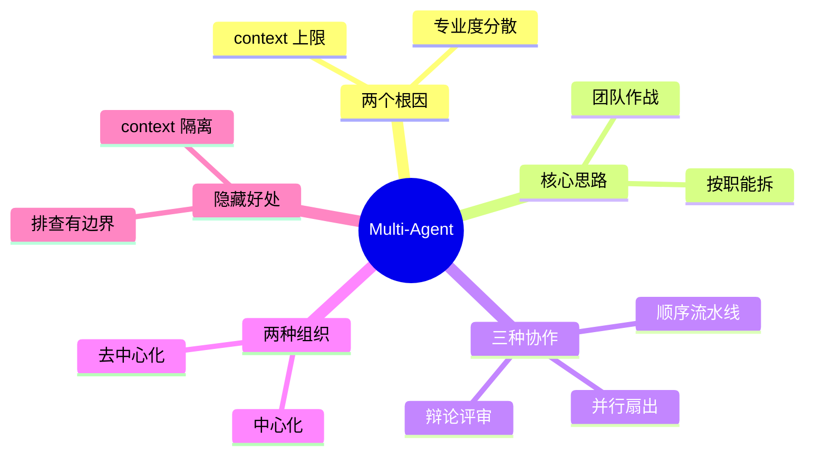

## 🔥 快速背诵

Multi-Agent 是多个 Agent 分工协作完成一个任务。需要它有两个硬理由：单 Agent 的上下文有上限，信息一多就开始遗忘；专业度也会被摊薄。协作方式有顺序流水线、并行扇出、辩论评审三种，工程上多用中心化调度。还有两个容易忽略的好处：上下文隔离和责任可定位。但它不是越多越好。

> **一句话**：Multi-Agent 就是**多个 Agent 分工协作**完成一个任务。为什么需要它，两个硬理由：**单 Agent 的 context window 有上限**（信息一多就开始遗忘），以及**专业度会被分散**（一个人身兼数职哪样都不精）。

## 🧠 导图

---

# 📖 背诵稿

### ① 为什么需要它

**先说清根因：单 Agent 有两个结构性限制，一个是 context window 有硬上限，一个是专业度会被摊薄。**

复杂任务的信息量很容易撑爆窗口——搜十家竞品，每家几百字，再加对话历史和中间推理，还没开始写结论工作台就满了。满了之后早期的内容就开始"掉"，你半小时前确认的方案悄悄消失，它开始遗忘。**这是结构性的，不是优化能绕过去的。**

第二个更隐蔽：让一个 Agent 又搜信息、又写代码、又做测试、又写文档，每件事都得兼顾，精力是散的。就像一个人同时当产品、开发、测试、文档，哪个角色都不够专注，还互相干扰；一旦某个环节出问题，整条链路就卡住，没有隔离性，也很难排查。

### ② 核心思路

**思路就是"团队作战代替单打独斗"：把任务按职能拆开，每个 Agent 只管一件事，做完把结果交给下一个。**

像公司分工——产品梳理需求、开发写代码、测试验收，各管一摊，信息传递清晰，出问题也好定位是谁的责任。拿"开发一个爬虫工具"举例：需求分析 Agent 把需求转成功能列表就退出，它的工作台是干净的；程序员 Agent 拿到列表专注写代码，不需要知道需求怎么来的；测试 Agent 拿到代码专注写用例。**每个 Agent 的 context 里只有自己那块信息**，自然就更专业。

### ③ 三种协作模式

**协作方式主要有三种：顺序流水线、并行扇出、辩论评审。**

**顺序流水线**是 A 做完交给 B，B 做完交给 C，像工厂流水线，适合有严格先后依赖的流程。**并行扇出**是一个调度者把几个独立的子任务同时派给不同 Worker，各自跑完再统一汇总——这是效率提升的主要来源。**辩论评审**是多个 Agent 对同一个问题各出方案，再由裁判或互相评审选出最优，适合代码评审、方案选型这种要高质量决策的场景。

### ④ 两种组织方式

**组织上有中心化和去中心化两条路，工程上更常用中心化。**

中心化是有一个统一调度者分配任务、收集结果；去中心化是 Agent 之间自行协商、直接通信。中心化的好处是调度逻辑清晰、责任归属明确、出问题好排查；去中心化的灵活性更高，但通信和冲突处理会复杂很多。

### ⑤ 隐藏好处

**除了并行提速，还有个很容易被忽略的好处：context 隔离。**

因为每个 Worker 的上下文是独立的，程序员 Agent 不会被测试用例的信息干扰，测试 Agent 也不会被实现细节淹没，各自在干净的环境里专注干活，输出质量也就更高。**顺带还带来可排查性**——某个环节出问题，能直接定位到是哪个 Agent 的责任，不像单体那样一锅粥。

### ⑥ 别忘了代价

**最后要补一句权衡：Multi-Agent 不是越多越好。**

它带来的是调用次数成倍增长、通信开销、以及协作失败的风险（上游输出有问题会一路传下去）。所以判断标准是：**任务确实复杂到单 Agent 撑不住，或者子任务之间专业差异足够大，才值得拆。** 简单任务硬拆成多 Agent，纯属给自己找麻烦。

---

# 🔑 记忆锚

| 记什么 | 内容 |
|---|---|
| **2** 个根因 | context window 硬上限 + 专业度被摊薄 |
| **1** 句核心 | 团队作战代替单打独斗，按职能拆，context 各管各的 |
| **3** 种协作 | 顺序流水线 / 并行扇出 / 辩论评审 |
| **2** 种组织 | 中心化（主流）/ 去中心化 |
| **2** 个隐藏好处 | context 隔离 + 责任可定位 |
| **1** 句权衡 | 任务够复杂、专业差异够大才拆，别为炫技而拆 |

> **卡壳急救**：想不起为什么用它，就说"窗口装不下 + 一个人啥都干嘛样都不精"。

---

# 🎯 追问速查

| 面试官问 | 你答 |
|---|---|
| 单 Agent 到底卡在哪？ | 不是"容易出错"这么模糊。是 **context window 有硬上限**，信息一多早期内容就掉，开始遗忘；这是结构性限制 |
| 除了窗口还有别的问题吗？ | 有，**专业度分散**。一个 Agent 身兼数职，每样都不够专注，还互相干扰；出问题也没有隔离性、难排查 |
| 有哪些协作模式？ | 顺序流水线（有依赖）、并行扇出（独立子任务同时跑，效率主要来源）、辩论评审（多方案择优，适合代码评审/方案选型） |
| 中心化还是去中心化？ | 工程上多用**中心化**：调度清晰、责任明确、好排查。去中心化更灵活但通信和冲突处理复杂 |
| 多 Agent 一定比单 Agent 好吗？ | 不一定。调用次数成倍增加、通信开销、上游错误会往下传。任务够复杂或专业差异够大才值得拆 |
| 用什么框架？ | CrewAI（易用）/ LangGraph（灵活）/ 微软的 MAF（原 Semantic Kernel + AutoGen 合并，生产优先）。选型看团队栈和灵活度需求 |

---

# 🔗 串联

- 根因里的 context 上限 → 08 Agent 的记忆机制与设计 的上下文管理、09 Agent 的长短期记忆怎么存怎么用 的压缩策略
- "专业分工"其实就是 03 Workflow、Agent、Tools 三者的概念与区别 里 Workflow 编排的一种形态
- 并行扇出 → 07 复杂任务的任务拆分 的依赖分析与并行优化
- Agent 之间怎么通信 → **A2A 协议**（Agent Card 名片机制）
- 评判机制 → 06 三种范式的区别与选型 的 Reflection（一个生成一个审）
- 一句话总纲：**一个 Agent 装不下也干不精，所以拆成一支队伍**

---

# 📚 细节（背完再点开）

> [!note]- 三种协作模式对比
> | 模式 | 怎么跑 | 适合 | 风险 |
> |---|---|---|---|
> | **顺序流水线** | A→B→C 依次传递 | 有严格先后依赖的流程 | 任一环节错，后面全错；串行慢 |
> | **并行扇出** | 调度者同时派发独立子任务，收齐再汇总 | 子任务相互独立 | 汇总时要处理结果冲突 |
> | **辩论评审** | 多 Agent 各出方案，裁判或互评审择优 | 代码评审、方案选型等高质量决策 | 成本最高，要设轮次上限 |

> [!note]- 两种组织方式
> - **中心化**：一个 Orchestrator 统一分配、收集、汇总。优点是调度清晰、责任明确、好排查；缺点是调度者可能成为瓶颈和单点。
> - **去中心化**：Agent 之间直接协商通信。优点是灵活、抗单点；缺点是协议复杂、容易冲突、全局状态难掌握。
>
> 工程实践：**先中心化**，除非有明确理由才考虑去中心化。

> [!note]- 框架格局（2025 年的变化，说出来很加分）
> | 框架 | 定位 |
> |---|---|
> | **CrewAI** | 上层易用，定义角色和工具就能跑 |
> | **LangGraph** | 底层灵活，可控性强 |
> | **Microsoft Agent Framework（MAF）** | 微软 2025 年把 Semantic Kernel（企业级）和 AutoGen（多 Agent 编排）合并成的统一生产 SDK |
>
> 原 AutoGen 仓库继续作研究/原型迭代，社区 fork 出 **AG2** 保持向后兼容。
> 选型建议：微软栈的生产场景优先 MAF；其他场景 CrewAI（要易用）或 LangGraph（要灵活）都是主流。

> [!note]- 什么时候不该上 Multi-Agent
> - 任务本身简单，两三步能搞定 → 拆了纯增开销
> - 子任务之间强依赖、必须严格串行 → 并行的好处拿不到
> - 团队还没把单 Agent 跑稳 → 先解决单体的可靠性，再谈组队
>
> 判断准则：**是不是"窗口装不下"或"专业差异足够大"，两个都不成立就别拆。**

---

# 🎴 自测（遮住上面，先自己说）

> [!question]- Q1 为什么需要 Multi-Agent？两个硬理由
> ① **context window 有硬上限**，复杂任务信息一多就撑爆、开始遗忘，这是结构性限制；② **专业度被摊薄**，一个 Agent 身兼数职哪样都不精，还互相干扰、没有隔离性。

> [!question]- Q2 三种协作模式？
> **顺序流水线**（有依赖，依次传）、**并行扇出**（独立子任务同时跑，效率主来源）、**辩论评审**（多方案择优，适合评审和选型）。

> [!question]- Q3 中心化和去中心化怎么选？
> 工程上多用**中心化**：调度清晰、责任明确、好排查。去中心化更灵活但通信和冲突处理复杂。

> [!question]- Q4 除了并行，还有什么隐藏好处？
> **context 隔离**——每个 Worker 只装自己那块信息，不被别的环节干扰，输出质量更高；而且责任可定位，出问题知道找谁。

> [!question]- Q5 Multi-Agent 的代价？
> 调用次数成倍增长、通信开销、上游错误会往下传，协作失败风险高。**任务不够复杂就别拆。**

> [!question]- Q6 框架怎么选？
> CrewAI（易用）、LangGraph（灵活）、微软 MAF（Semantic Kernel + AutoGen 合并，生产优先）。看团队栈和灵活度需求。
