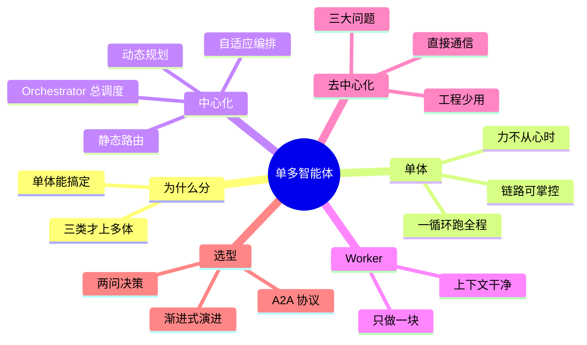

## 🔥 快速背诵

流程清晰、复杂度适中的任务，单 Agent 就够，好实现也好维护。要不要上多 Agent 看三条：上下文快爆了、需要专业分工、有能并行的子任务。工程上几乎都用中心化 Orchestrator，它只干三件事：拆任务、派活、收结果，自己不干活。策略是渐进式演进，先单 Agent，扛不住再拆。

> **一句话**：Single-Agent 适合流程清晰、复杂度适中的任务，实现简单、好维护；Multi-Agent 适合需要专业分工、任务量大或要并行的复杂场景。工程上几乎都用中心化 Orchestrator 模式，因为可控、可追踪、出问题能顺着调度链路排查。

## 🧠 导图

---

# 📖 背诵稿

### ① 什么时候该上 Multi-Agent

**说白了，别一上来就堆 Agent。任务流程清晰、复杂度适中，Single-Agent 就够了，架构简单、链路透明，好维护。**

很多人张口就是"任务复杂就用 Multi-Agent"，这话说得太虚。这里有个容易搞错的地方：步骤多不等于要上多体。Single-Agent 自己循环调工具也能干很多步骤活。只有当它真的开始力不从心，才值得引入多体。你可以把它想成：一个人能写完的博客，就别拉个团队，沟通成本为零反而更快。

### ② Single-Agent 力不从心的三类场景

**判断标准就三个：context 快撑爆了、需要不同专业分工、有多个能并行的子任务。不属于这三类，就别上。**

第一种，任务太长信息太多，窗口塞满，它开始遗忘前面定的事。第二种，不同阶段要完全不同的专业能力，全塞进一个 Agent，每件事都不够专注。第三种，任务里有多块能并行，但单 Agent 只能一个个来。

这里最容易答错的点是：盲目引入多体只会让系统变复杂、变难维护，却没带来对应收益。你要能说出这三个具体场景，而不是"复杂"两个字就糊弄过去。

### ③ 中心化 Orchestrator 模式

**工程里几乎都用中心化，核心是那个 Orchestrator，你可以把它想成项目经理：它自己不干活，只负责拆任务、派活、收结果。**

它有三件事：读懂用户大目标、拆成子任务；判断每个子任务该交给哪个 Worker；收集 Worker 产出拼成最终答案。它还有几个变体。最基础是静态路由，规则和分配方式提前写死，比如遇到代码交给 Coder、遇到搜索交给 Researcher，简单可预测。进阶是动态规划，Orchestrator 本身就是 LLM，根据输入动态生成计划，还能中途调整。最复杂是自适应编排，不仅动态规划，还会看 Worker 结果实时改后续计划，比如搜回来的信息不够就追加一轮搜索。实际场景动态规划基本够用，自适应调试成本太高。

### ④ Worker 是什么

**Worker 就是干活的，只管自己那块，不需要知道整体在干嘛，也不需要管别人在干嘛。**

它拿到的就是属于自己那部分的指令，做完返回结果就退出。关键是它的上下文是干净的，只装和自己职责相关的信息，不会被别的任务污染。

排查的时候好处特别明显：报告内容不准，多半是 Researcher 搜得不好；分析逻辑有问题，是 Analyst 的对比维度不对；格式不对，是 Writer 的锅。每个 Agent 职责清晰，顺着调度记录一步步追就能定位，不用猜。

### ⑤ 去中心化为什么工程上几乎不用

**去中心化听着很美：没有总调度，Agent 之间直接通信，像一支能自我组织的团队。但生产环境里它基本没人用，因为它藏着三个很实在的工程问题。**

第一，没人告诉 A 和 B 各搜什么范围，俩人很可能搜了大量重叠内容，白干活。第二，没人告诉汇总者 C，A 和 B 什么时候算搜完，C 不知道该等多久、有没有漏。第三，如果 A 中途出错，没有中央调度收到错误通知，B 和 C 还在正常跑，最后汇总出一份不完整结果，系统甚至不知道出错了。

你可以把它想成没有项目经理的团队：每个人都厉害，但没人协调时间节点和接口，最后交出来的东西互不兼容，还没人知道整体进度。所以学术里探索它，生产里几乎都选 Orchestrator。

### ⑥ 选型决策与演进

**选型逻辑其实两问就能搞定，而且有个很实用的渐进式思路。**

先问：Single-Agent 能搞定吗？流程明确、不长、不需要多种分工，那就它来，别为了显得高级硬上多体。搞不定了再问第二问：你能接受系统行为不可控吗？生产环境答案几乎一定是不能，那就上 Orchestrator 中心化。

实际里我建议渐进式演进：先用 Single-Agent 跑起来，发现某个环节真成了瓶颈，比如 context 常撑满、某类子任务质量不行，再把那块拆出来交给专门 Worker。别一上来就设计五六个 Agent 的复杂系统，你可能连瓶颈在哪都没搞清楚。行业上还有个 A2A 协议趋势，是跨框架 Agent 通信的开放标准，思路像微服务，不过目前生态还早期。

---

# 🔑 记忆锚

| 记什么 | 内容 |
|---|---|
| **1** 个判断 | 不属于三类就别上多体：context 爆 / 需分工 / 能并行 |
| **3** 种中心化 | 静态路由（写死）/ 动态规划（LLM 生成）/ 自适应编排（看结果改） |
| **1** 个角色 | Orchestrator 只干三件事：拆任务、派活、收结果，自己不干活 |
| **1** 句 Worker | 只做一块、上下文干净、做完退出 |
| **3** 个缺陷 | 去中心化：分配无协调 / 顺序无保证 / 失败无感知 |
| **2** 问选型 | 单体能搞定？不能接受失控？ |
| **1** 个策略 | 渐进式演进，别一上来堆 Agent |
| **1** 个趋势 | A2A 跨框架通信开放标准，思路像微服务 |

> **卡壳急救**：忘了细节就过四问——为什么要分（单体能搞定语别上）、中心化靠谁（Orchestrator 拆派收）、去中心化为啥少用（三个"无"）、怎么选（两问 + 渐进式）。

---

# 🎯 追问速查

| 面试官问 | 你答 |
|---|---|
| 任务复杂就上 Multi-Agent 吗？ | 不行，步骤多 ≠ 要上多体。只有三类场景才值：context 撑爆、需不同专业分工、有可并行子任务，否则 Single-Agent 更优 |
| 中心化有哪几种？ | 静态路由（规则写死）、动态规划（LLM 动态生成计划）、自适应编排（看 Worker 结果实时改计划），实际动态规划最常用 |
| Orchestrator 自己干活吗？ | 不干。它只拆任务、派给 Worker、收结果拼答案，是"项目经理"角色 |
| 去中心化灵活为啥不用？ | 三个实在问题：任务分配无协调（重复劳动）、执行顺序无保证、失败无感知，生产不可控 |
| 怎么选型？ | 两问：单体能搞定就用单体；搞不定且不能接受失控，就上 Orchestrator 中心化 |
| 有没有演进策略？ | 渐进式：先用单体跑，哪块真成瓶颈再拆成专门 Worker，别一上来堆 Agent |
| A2A 是啥？ | 跨框架 Agent 通信的开放标准，让不同来源的 Agent 互相发现调用，思路像微服务，目前生态早期 |

---

# 🔗 串联

- 承接 10 什么是 Multi-Agent：那篇讲概念边界，这篇讲工程选型与架构组织
- 通向 07 复杂任务的任务拆分：Orchestrator 把任务拆给 Worker，本质是任务拆分
- 通向 14 如何赋予 LLM 规划能力：动态规划与自适应编排，底层就是规划能力
- 一句话总纲：**单体能搞定就别上多体，上多体几乎都选 Orchestrator 中心化**

---

# 📚 细节（背完再点开）

> [!note]- 三方案对比表
> | 维度 | Single-Agent | Multi-Agent 中心化 | Multi-Agent 去中心化 |
> |---|---|---|---|
> | 架构复杂度 | 低 | 中 | 高 |
> | Context 压力 | 全压一个 Agent | 各 Agent 独立管理 | 各 Agent 独立但需共享协调 |
> | 专业能力 | 泛才，什么都做 | 专才分工 | 专才分工 |
> | 并行能力 | 不支持 | 支持子任务并行 | 支持并行 |
> | 可控性 | 高 | 高，Orchestrator 统管 | 低，难统一调度 |
> | 工程实用性 | 高 | 高 | 低，主要用于学术 |

> [!note]- 一个完整中心化流程长啥样
> 用户说"帮我写一份 AI 行业竞品分析"：
> 1. Orchestrator 读懂目标，拆成：搜资料 / 做对比分析 / 写报告
> 2. 派 Researcher 搜信息、Analyst 做对比、Writer 出报告
> 3. 每个 Worker 只拿自己那块指令，上下文干净，做完返回
> 4. Orchestrator 收集三者产出，拼成最终报告
> 任一步出问题都能精准定位：内容不准看 Researcher、逻辑歪看 Analyst、格式错看 Writer。

> [!note]- Orchestrator 三种变体细说
> - **静态路由**：任务拆分与分配规则预先定义，逻辑简单可预测，适合分工固定场景
> - **动态规划**：Orchestrator 本身是 LLM，按用户输入动态生成计划，决定几步、每步交给谁，执行中可调整
> - **自适应编排**：不仅动态规划，还根据 Worker 执行结果实时调整后续计划，如搜索信息不够就追加一轮，最强大但调试最复杂

> [!note]- 去中心化的真实工程问题展开
> 三个 Agent 处理同一任务：A 搜信息、B 也搜类似信息、C 汇总，但没人统筹。
> - A 和 B 没人告诉各搜什么范围 → 大量重叠、重复劳动
> - C 没人告诉 A、B 何时算搜完 → 不知该等多久、是否漏了谁
> - A 中途出错，无中央调度收通知 → B、C 照常跑，汇总出不完整结果，系统不知出错
> 类比无项目经理的团队：人人能干，但无人协调时间节点与接口，交付物互不兼容且无人知整体进度。

---

# 🎴 自测（遮住上面，先自己说）

> [!question]- Q1 什么时候该上 Multi-Agent？
> 不是"任务复杂"就上。只有三类场景才值：context 快撑爆、需要不同专业分工、有多个能并行的子任务。不属于这三类，Single-Agent 更优。

> [!question]- Q2 Single-Agent 的核心优势？
> 整条任务链路完全在自己掌控内，任务怎么走、用什么工具、何时结束都在一处写清，链路短、好排查、维护成本低。

> [!question]- Q3 Orchestrator 是干嘛的？
> 中心化的"总调度 / 项目经理"，自己不干活，只干三件事：读懂目标拆子任务、判断每步派给谁、收集 Worker 产出拼答案。

> [!question]- Q4 去中心化为啥工程上几乎不用？
> 三个实在问题：任务分配无协调（重复劳动）、执行顺序无保证、失败无感知。生产要的是可控可追踪，所以它基本只在学术探索。

> [!question]- Q5 怎么选型？
> 两问：Single-Agent 能搞定吗？能就它来。搞不定且不能接受系统失控，就上 Orchestrator 中心化。建议渐进式演进。

> [!question]- Q6 A2A 协议解决啥？
> 跨框架 Agent 通信的开放标准，让不同团队、不同框架开发的 Agent 能在协议层互相发现与调用，思路像微服务，目前生态早期。
