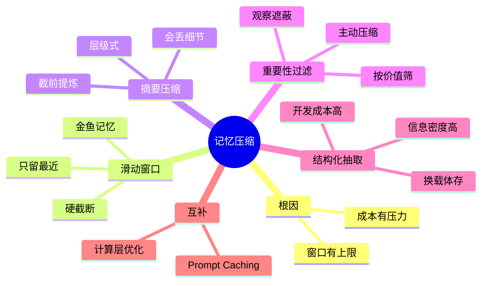

## 🔥 快速背诵

记忆压缩常见四种方法，分三个维度。滑动窗口和摘要压缩管历史太长怎么截，前者硬截，后者先提炼再截。重要性过滤管内容不等价怎么挑，按价值不按时间。结构化抽取管对话文本是不是最好的载体，换成更高密度的形式存。四种不互斥，最稳的组合是滑动窗口加摘要。

> **一句话**：记忆压缩常见四种方法，分三个维度——滑动窗口和摘要压缩管"历史太长怎么截"（前者硬截、后者截前先提炼）；重要性过滤管"内容不等价怎么挑"，按价值不按时间；结构化抽取管"对话文本是不是最佳载体"，换更高密度的形式存。

## 🧠 导图

---

# 📖 背诵稿

### ① 为什么要压缩

**根因就两个：context window 有硬上限，对话越长成本越高。**

我理解，LLM 每次生成并不是像人一样有持续记忆，它靠的是每次调用时传进去的那份完整对话历史。你每说一句，都被打包进 messages 列表，模型读完才能回下一条。这个列表有上限，GPT-4o 是 128K、Claude 默认 200K，超了就得从最老的对话开始丢。更现实的是成本：历史越长，每调一次 LLM 费用越高，因为输入越塞越多。压缩要解决的，就是在保留关键信息的前提下，少占 token。

### ② 滑动窗口：最糙也最快

**这法子最符合直觉，就像手机聊天只显示最近两百条：超出就从最老的删，只留最近 N 轮。**

好处是实现极简单，不用任何额外 LLM 调用、零开销。坏处是"硬截断"——三周前定的关键决策和昨天随口一句话，被同等对待，超窗口就都没了。你可以把它想成金鱼记忆，只记得最近发生的事，越往前越模糊，再久就什么都没。短对话、历史不重要的场景它够用，成本最低。但这里有个容易搞错的地方：窗口调大只是治标，本质缺陷是"硬截断"意味着重要信息可能被直接扔掉。

### ③ 摘要压缩：丢之前先提炼

**这是对硬截断的改进：不直接扔即将超窗的历史，而是先让 LLM 把这段总结成精华摘要，用摘要替换原始对话，再往前走。**

类比一下：笔记本快写满了，你不是把前半本撕掉，而是先把要点整理成一页纸精华，收起前半本带着这页继续。后来翻回去，脉络都在，只是不如原版细。代价是摘要会丢细节——LLM 按自己判断的"重要性"决定留什么，有些当时看着不重要、后来刚好要用的，就找不回了。常见做法是旧的压成摘要、近的保持原始对话，因为最近的往往和当前任务最相关。进阶是层级式摘要：最近 10 轮原始对话，10 到 50 轮压成中期摘要，50 轮前压成长期摘要，像公司会议纪要体系，越久越精炼但关键决策始终留着。

### ④ 重要性过滤：按价值不按时间

**滑动窗口和摘要都还在"时间维度"处理历史，但时间不等于重要性。这法子换了个角度，按内容实际价值决定去留。**

给每条记录打重要性分，低于阈值淘汰、高分保留。类比整理房间：没人按购买时间决定扔啥，而是按"现在还有没有用"。打分两种：规则打分，含"决定""确认""需求"等关键词加分、被引用多加分、闲聊降分，快但粗；LLM 打分，逐条判重要度，准但每条都要一次调用，开销大，通常批量清理时用。还有两个进阶概念：观察遮蔽，不是删低分内容，而是构造 prompt 时选择性隐藏无关条目，比如写代码阶段把需求讨论藏起来，信息没真删只是动态选看什么；主动压缩，不是等快满了才压，而是每步执行完主动判断哪些中间过程能压，比如搜索返回 2000 token 立刻压成 200 token 要点，把 context 增长速度从一开始就摁住，特别适合工具调用频繁的 Agent。

### ⑤ 结构化抽取：换一种载体

**前三种都默认历史最好以对话文本保留，这法子直接质疑这个前提：我们真需要保留对话文字本身吗？**

很多场景真正有价值的不是对话，而是里面传的事实和状态，比如"用户偏好 Python""预算上限五万""已确认方案 B"。把这些主动抽成结构化字段存起来，后续注入 prompt 直接用字段，比传一大段对话高效得多、信息密度高得多。类比医生写病历：不会把和病人所有对话逐字记，而是整理成"主诉、现病史、过敏史、初步诊断"的结构化档案，下次直接读档案，不用重听全程录音。它的信息损失最小，字段定义合理就精确保留，没有摘要的模糊化。代价是开发成本最高：你得预先定义"什么是重要字段"，要对业务有深入理解，而且不同任务所需字段可能完全不同，通用性差。

### ⑥ 四维组合与 Prompt Caching

**四种方法不互斥、不排序优劣，是从三个维度解决不同问题，实际系统里常组合用。**

可以先用重要性过滤筛掉低价值，再用摘要压缩处理剩余，同时对关键信息做结构化抽取。最稳的工程组合是滑动窗口加摘要：窗口控总长度上限，摘要在被丢前先提炼，既有长度控制又不是硬截断。还有个常被忽略的互补手段叫 Prompt Caching，它和前面不是一回事——前面都在"信息层"决定留什么，它是"计算层"优化：LLM 每次处理请求要把输入 token 过一遍模型做 prefill，这是延迟和成本大头，而你的 system prompt 加长期记忆在多轮里基本不变，把它前缀缓存起来复用，命中后费用能降到约十分之一。它是减少"已经决定带进去的内容"的重复计算，和记忆压缩互补不替代。

---

# 🔑 记忆锚

| 记什么 | 内容 |
|---|---|
| **2** 个根因 | context 有上限 / 历史越长成本越高 |
| **4** 种方法 | 滑动窗口 / 摘要压缩 / 重要性过滤 / 结构化抽取 |
| **3** 个维度 | 历史太长怎么截 / 内容不等价怎么挑 / 对话文本是不是最佳载体 |
| **1** 个缺陷 | 滑动窗口是"硬截断"，重要信息可能被直接扔 |
| **2** 个进阶 | 摘要的层级式；过滤的观察遮蔽与主动压缩 |
| **1** 个互补 | Prompt Caching 是计算层优化，与信息层压缩互补不替代 |
| **1** 个组合 | 滑动窗口 + 摘要，最稳工程方案 |

> **卡壳急救**：忘了就按三维度过——时间截（窗口硬截 / 摘要先提炼）、价值挑（重要性过滤）、换载体（结构化抽取）；再补一句 Prompt Caching 是计算层、不算压缩。

---

# 🎯 追问速查

| 面试官问 | 你答 |
|---|---|
| 滑动窗口本质缺陷？ | 硬截断：按时间一刀切，重要历史可能直接被丢，调大窗口只是治标，不改"超窗即弃"的本质 |
| 摘要会丢东西吗？ | 会。LLM 按自判重要性保留，当时看着不重要后来要用的细节可能找不回；近的保持原始对话可缓解 |
| 层级式摘要？ | 不同层不同信息密度：近期原始对话、中期摘要、长期摘要，越久越精炼但关键决策始终留，像会议纪要体系 |
| 重要性过滤怎么打？ | 规则打分（关键词/引用次数，快但粗）或 LLM 打分（准但每条一次调用，批量用）；还有观察遮蔽与主动压缩 |
| 结构化抽取强在哪？ | 信息损失最小、密度最高，字段定义合理就精确保留；代价是开发成本高、需深入理解业务、通用性差 |
| 四种方法关系？ | 不互斥不排序，分三维度解决不同问题，实际常组合，最稳是窗口+摘要 |
| Prompt Caching 算压缩吗？ | 不算。它是计算层优化，缓存不变前缀减少重复 prefill 开销，与信息层压缩互补不替代，命中费用约十分之一 |

---

# 🔗 串联

- 承接 09 Agent 的长短期记忆怎么存怎么用：那篇讲记忆存什么、怎么存取，这篇讲历史长了怎么压
- 承接 08 Agent 的记忆机制与设计：压缩是记忆机制在 context 受限时的必要补充
- 通向 11 Single-Agent 与 Multi-Agent 的设计方案：多体里各 Worker 上下文干净，也靠压缩维持
- 一句话总纲：**时间截、价值挑、换载体，三维度各管一摊，Prompt Caching 是计算层补丁**

---

# 📚 细节（背完再点开）

> [!note]- 四种方法维度对照
> | 方法 | 解决维度 | 思路 |
> |---|---|---|
> | 滑动窗口 | 历史太长怎么截 | 直接硬截，只留最近 N 轮 |
> | 摘要压缩 | 历史太长怎么截 | 截之前先让 LLM 提炼成摘要 |
> | 重要性过滤 | 内容不等价怎么挑 | 打破时间顺序，按价值打分留舍 |
> | 结构化抽取 | 对话文本是不是最佳载体 | 抽成字段，换高密度形式存 |

> [!note]- 观察遮蔽与主动压缩细说
> - **观察遮蔽 Observation Masking**：不删除低分内容，而是在构造 prompt 时动态隐藏无关条目。写代码阶段把需求讨论标记"无关"直接跳过；进测试阶段再显示测试相关、遮蔽实现细节。信息没真删，只是分阶段选看什么，省 token 又避免不可逆丢失。
> - **主动压缩 Proactive Compression**：前面方法都被动触发（快满了才压）。主动压缩在每步执行完就判断哪些中间过程能压，如搜索返回 2000 token 立刻压成 200 token 要点替换原始对话，从一开始摁住 context 增速，适合工具调用频繁的 Agent。

> [!note]- 结构化抽取字段示例
> 对话中传递的事实与状态，如：
> - 用户偏好用 Python
> - 预算上限 5 万
> - 已确认方案 B
> - 需要兼容移动端
> 抽成结构化字段后，注入 prompt 直接用字段，比传整段对话高效、密度高。代价是需预先定义"什么是重要字段"，且不同任务字段可能完全不同。

> [!note]- Prompt Caching 费用细节
> 以 Claude 为例：命中缓存的 token 费用约为正常输入的十分之一。写入缓存有一次性额外费（5 分钟有效期约 1.25 倍、1 小时约 2 倍），但只要这段 prompt 后续被复用两次以上就回本。Agent 场景里 system prompt 加长期记忆注入基本不变，天然适合缓存，收益可观。它和记忆压缩是两个层次优化，可同时使用。

---

# 🎴 自测（遮住上面，先自己说）

> [!question]- Q1 为什么要做记忆压缩？
> 两个根因：context window 有硬上限（超了从最老对话丢），历史越长每调 LLM 成本越高。压缩即在保留关键信息前提下少占 token。

> [!question]- Q2 滑动窗口的致命问题？
> 硬截断：按时间一刀切，三周前关键决策和昨天闲聊同等对待，超窗口就没了。调大窗口治标不治本。

> [!question]- Q3 摘要压缩为什么也会丢信息？
> LLM 按自判重要性决定留舍，当时看似不重要、后来要用的细节会被略过。常见做法是旧的压摘要、近的保原始对话，进阶用层级式摘要。

> [!question]- Q4 重要性过滤和前两种有何不同？
> 前两种还在时间维度处理历史；过滤按价值不按时间，打分筛选。还有观察遮蔽（动态隐藏）和主动压缩（每步主动压）两个进阶思路。

> [!question]- Q5 结构化抽取强在哪、弱在哪？
> 强在信息损失最小、密度最高，字段合理就精确保留；弱在开发成本最高，需预定义重要字段、对业务理解深、通用性差。

> [!question]- Q6 Prompt Caching 算压缩吗？为什么？
> 不算。它是计算层优化，缓存不变前缀减少重复 prefill 开销，与信息层压缩互补不替代，命中费用约十分之一。
