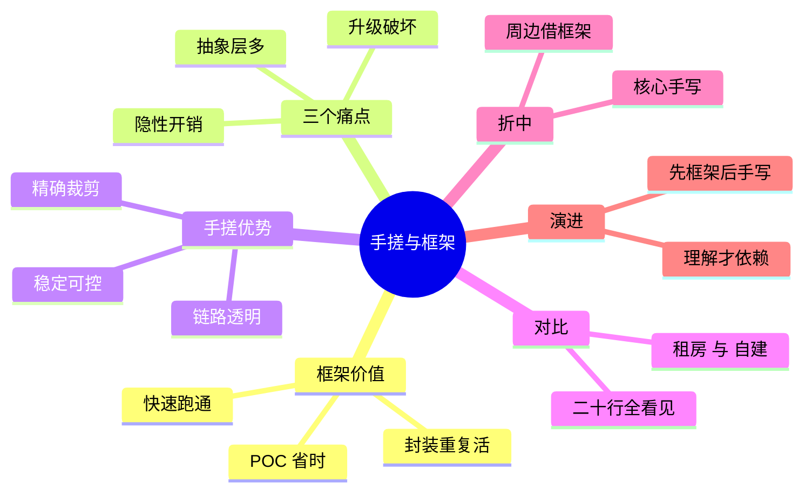

## 🔥 快速背诵

框架在 POC 阶段省事，生产上有三个痛点：抽象层太多难排查、版本升级有破坏性变更、通用设计带来隐性开销。手搓的核心是完全掌控：链路透明、性能能精确裁剪、不受外部升级影响。最务实的是折中，核心循环自己写，向量库和日志这些周边借框架。

> **一句话**：框架 POC 阶段省时省力，但有三个生产痛点——抽象层太多难排查、版本升级有破坏性变更、通用设计带来隐性性能开销。手搓的核心是"完全掌控"：可观测好、稳定不受外部升级影响、性能能精确裁剪。最务实的是折中：核心逻辑手写，周边工具性功能借框架。

## 🧠 导图



---

# 📖 背诵稿

### ① 框架到底帮了啥

**说白了，每个 Agent 项目都得重复做一堆事：定义工具格式、解析 LLM 返回的工具调用、维护对话历史、处理重试、接向量库做检索。框架就是把这些重复活全封装好，你直接调。**

比如一个装饰器就能注册工具，整个 ReAct 循环被包进一个执行器，还内置了 tracing、callback、记忆管理。早期上手快是真实的优势，两周的活缩到两天，特别是快速验证想法阶段，框架几乎没明显副作用。所以第一句话就得先肯定框架，别一开口就否定它，那是这道题最容易踩的雷。

### ② 痛点一：抽象层太多，排查像摸黑

**框架的问题不是一开始就暴露，是项目推进到第一个奇怪 bug 时才显现。**

你代码可能只有五十行，但报错的 stack trace 有四五十层，一路追到框架内部。你根本分不清问题在你写的那五十行里、还是框架某个版本逻辑变了、还是 callback 触发时机不对。你只能去 GitHub issue 里搜，或者一层层读框架源码。这里有个生动的比喻：老式车坏了，打开引擎盖自己就能看见哪根管子漏油；现代豪华车坏了，你打开看见一堆看不懂的电子设备，只能去 4S 店让诊断仪扫。框架抽象层太多，排查要穿透那些你没写也不完全懂的层，是实打实的认知负担。

### ③ 痛点二、三：升级破坏与隐性开销

**第二个痛点是版本升级。线上跑了几个月，某次依赖一升，框架改了接口，代码直接报错。你要么回滚，要么把代码改到兼容新版本，可能十几处改动。**

把核心业务逻辑建在第三方框架上，线上稳定性就受这种不确定性影响。第三个痛点是规模化才碰到的隐性开销：你关心调用延迟，发现某步 LLM 本身很快，总耗时却超预期。profile 之后才发现，框架每次调用都在做你根本不需要的事——序列化中间结果、触发一堆 callback、记详细日志。这些是为通用性设计进去的，对你这场景没用，但每次都在跑。高流量下这些开销累积成真实的延迟增加和费用浪费。

### ④ 手搓的本质：完全掌控

**说清痛点后，手搓的价值就好懂了，核心就三个字：完全掌控。**

第一，链路透明、可观测好。手搓每一行你都知在干嘛，任意位置能加日志、打断点、插监控，没有黑盒。线上出问题，靠日志复现最快，链路越清晰定位根因越快，这在生产是真实的时间成本节省。第二，精确裁剪、没多余开销。你只写确实需要的逻辑，不带任何通用性包袱，性能敏感场景优化空间全在自己手里。第三，稳定可控、不受框架升级影响。自己写的接口不会突然变，依赖只有底层 LLM SDK，相对稳定，能长期运行。有个官方背书：构建指南里也明确建议别一上来就用框架，先用最少抽象把核心逻辑跑通，因为抽象层让你离底层更远，出问题时调试成本比省下的开发时间还高。

### ⑤ 框架写 vs 手搓写，差别在哪

**光讲理论不够直观，拿最常见的带工具调用的 Agent loop 比一下就清楚。**

框架写法确实简洁，三四行就跑起来了，但你想知道"这次 LLM 返回了啥、工具怎么被选中、消息列表什么顺序"时，得去读那个执行器的源码，内部调用链可能十几层。手搓代码量多一些，但每一步都在你眼前：消息列表怎么拼、工具怎么选、循环什么时候退，全摆明面上。这里有个好比喻：框架是租房，装修好直接住、方便，但结构改不了、房东随时可能调政策；手搓是自建，建起来慢，但所有结构都熟、改啥都能改、住着踏实。框架给你省了搭建时间，但你对这"房子"的控制权始终有限。

### ⑥ 怎么选与折中方案

**这不是非此即彼，看项目阶段和对控制权的需求。**

框架适合：POC 快速验证、团队刚接触 Agent、周边工具依赖框架生态、核心逻辑本身不复杂。手搓适合：准备上生产稳定性成核心关切、流量上来性能成本敏感、业务高度定制和框架偏差大、团队要高可观测性。最务实的是折中——核心逻辑手写，周边工具性借框架。控制边界这样划：工具调用循环、对话历史管理、错误处理重试、任务状态维护，这些是 Agent 的"心脏"，直接决定系统行为，必须百分百掌控，所以手写；而调用链追踪、文档解析、向量库客户端，这些是"工具性"周边，出问题一眼能看出，用外部工具省时间完全值。就像盖房：承重墙和房间布局你必须掌控，但门锁插座水龙头买现成的就行。

---

# 🔑 记忆锚

| 记什么 | 内容 |
|---|---|
| **1** 句定位 | 框架 POC 省时，生产有三个痛点 |
| **3** 个痛点 | 抽象层多难排查 / 升级有破坏性变更 / 通用设计隐性开销 |
| **3** 个优势 | 链路透明 / 精确裁剪 / 稳定不受升级影响 |
| **1** 个比喻 | 框架租房、手搓自建 |
| **1** 个折中 | 核心手写、周边借框架（心脏手写、工具借） |
| **1** 句警示 | 框架不是问题，"不理解就依赖"才是 |
| **1** 条演进 | 先框架跑通，遇瓶颈再把手写替换核心 |

> **卡壳急救**：忘了就过三痛点（抽象多/升级崩/隐开销）→ 三优势（透明/裁剪/稳定）→ 折中（核心手写周边借框架）→ 收一句"不理解就依赖才是问题"。

---

# 🎯 追问速查

| 面试官问 | 你答 |
|---|---|
| 框架有啥价值？ | 封装重复活（工具注册、ReAct loop、记忆管理），POC 阶段两周变两天，快速验证无副作用，先肯定它 |
| 抽象层多具体怎么坑？ | 五十行代码报四五十层 stack trace，分不清问题在你代码还是框架版本还是 callback，得读源码或搜 issue，像豪华车坏了只能去 4S 店 |
| 升级破坏性变更？ | 依赖一升接口变，代码直接报错，要么回滚要么改十几处，核心逻辑建在第三方上，线上稳定性受不确定性影响 |
| 隐性开销从哪来？ | 框架每次调用做你不需要的通用逻辑：序列化中间结果、触发 callback、记日志，高流量下累积成真实延迟与费用 |
| 手搓核心优势？ | 完全掌控：链路透明好排查、精确裁剪无冗余、稳定不受外部升级影响，生产是真实成本节省 |
| 怎么选？ | 看阶段：POC/刚上手用框架；上生产/流量大/高度定制用手搓 |
| 最务实方案？ | 折中：心脏（工具循环、历史、重试、状态）手写，周边（tracing、文档解析、向量库）借框架 |

---

# 🔗 串联

- 承接 05 推理模式与 ReAct 的实现：ReAct 循环手搓最能看清每一步，框架把它藏进执行器
- 通向 11 Single-Agent 与 Multi-Agent 的设计方案：多体 Orchestrator 的调度逻辑也建议手写掌控
- 通向 14 如何赋予 LLM 规划能力：Plan-and-Execute 的规划执行分离，手写更易裁剪
- 一句话总纲：**框架租房快入住，手搓自建全掌控，核心手写周边借框架最务实**

---

# 📚 细节（背完再点开）

> [!note]- 框架写法示例
> ```python
> from langchain.agents import AgentExecutor, create_openai_tools_agent
> # 框架封装好 Agent loop，一行搞定
> agent = create_openai_tools_agent(llm, tools, prompt)
> executor = AgentExecutor(agent=agent, tools=tools)
> # 整个 ReAct 循环、工具调用、消息维护全在 executor 内部
> result = executor.invoke({"input": "帮我查一下今天的天气"})
> ```
> 简洁但想看内部细节（LLM 返回啥、工具怎么选中、消息顺序）得读执行器源码，调用链可能十几层。

> [!note]- 手搓写法示例
> ```python
> messages = [{"role": "system", "content": system_prompt}]
> messages.append({"role": "user", "content": user_input})
> for i in range(max_turns):                  # 手动控制最大轮次
>     response = client.chat.completions.create(
>         model="gpt-4", messages=messages, tools=tool_schemas)
>     msg = response.choices[0].message
>     messages.append(msg)                     # LLM 响应加入历史
>     if not msg.tool_calls:                   # 无工具调用 = 任务完成
>         break
>     for tc in msg.tool_calls:                # 逐个执行并写回结果
>         result = execute_tool(tc.function.name, tc.function.arguments)
>         messages.append({"role": "tool", "tool_call_id": tc.id, "content": result})
>         logger.info(f"工具 {tc.function.name} 返回: {result}")  # 随意加日志
> ```
> 消息怎么拼、工具怎么选、循环何时退，全在眼前；出问题看这二十行就够，不用翻框架源码。

> [!note]- 真实项目演进轨迹
> 很多项目这样走：先用框架快速跑通验证方向 → 遇第一批线上问题，把排查困难的关键部分替换为手写 → 流量上来，把性能敏感核心逻辑全手写 → 最后框架只留做得好的周边工具。既享早期速度，又在生产拿回掌控权。

> [!note]- 一个判断信号
> 如果你能清楚说出"框架在某处替我做了什么、我用的这个方法内部发生了什么"，说明你理解它、用起来有掌控感；如果你只调了个方法却完全不知里面发生什么，出问题就是个不透明黑盒——这才是要警惕的信号。框架本身不是问题，"不理解就依赖"才是。

---

# 🎴 自测（遮住上面，先自己说）

> [!question]- Q1 框架的价值是什么？
> 封装每个 Agent 都重复做的活（工具注册、ReAct loop、历史维护、重试、检索），POC 阶段省时省力，快速验证无副作用，先肯定它。

> [!question]- Q2 框架三个生产痛点？
> 抽象层太多难排查（stack trace 四五十层）；版本升级有破坏性变更（接口变代码崩）；通用设计带来隐性性能开销（每次调用做你不需要的事）。

> [!question]- Q3 手搓的核心优势？
> 完全掌控：链路透明好排查、精确裁剪无冗余开销、稳定不受外部升级影响。生产是真实时间成本节省。

> [!question]- Q4 框架和手搓的比喻？
> 框架是租房，装修好直接住、方便但结构改不了、房东随时调政策；手搓是自建，建得慢但所有结构都熟、改啥都行、住着踏实。

> [!question]- Q5 最务实的折中方案？
> 核心逻辑手写、周边借框架。心脏（工具循环、历史、重试、状态）手写掌控；工具性周边（tracing、文档解析、向量库）借框架省时间。

> [!question]- Q6 一句收尾的警示？
> 框架不是问题，"不理解就依赖"才是。能说清框架内部发生了什么，才有掌控感；否则就是黑盒。
