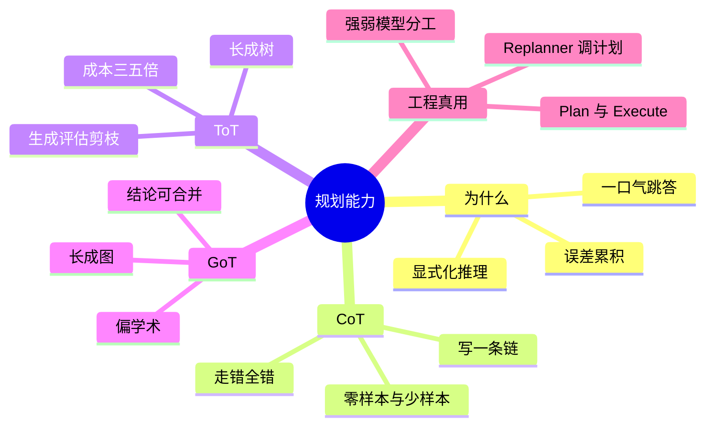

## 🔥 快速背诵

规划就是把隐式推理显式化，让它一步步推，而不是一步跳到答案。三种机制层层递进：CoT 写一条链，ToT 长成一棵树、多路径边探边剪，GoT 长成一张图、中间结论能合并复用。工程上 CoT 是零成本标配，ToT 调用量三到五倍，GoT 还偏学术。落地最常用的是 Plan-and-Execute，规划用强模型，执行用便宜模型。

> **一句话**：规划能力就是把 LLM 隐式推理显式化，让它"一步一步推"而非"一步跳到答案"。三种机制层层递进：CoT 写一条链、ToT 长成一棵树（多路径边探边剪）、GoT 长成图（中间结论可合并复用）。工程上 CoT 是标配零成本，ToT 调用约 3–5 倍，GoT 仍偏学术；真正落地最常用的是 Plan-and-Execute。

## 🧠 导图

---

# 📖 背诵稿

### ① 为什么需要规划能力

**我理解，默认模式下 LLM 接到问题就"一口气"蹦答案，中间没有任何推理过程。简单问题没事，多步推导任务就容易翻车。**

根子在于 Transformer 的 next-token 预测：每个 token 都基于前面所有 token 生成，推理链越长、隐式跳步越多，误差越容易在中间某步悄悄攒起来，最后给你一个看着特自信其实是错的答案。规划能力要解决的正是这个：把隐式推理显式化，让它不再一步跳到答案，而是一步一步推，每步都有迹可循。你可以把它想成在纸上演算——每步写出来，下一步出错概率比在脑子里算低得多，原理一样。

### ② CoT：加一句话就够了

**CoT 全称思维链，核心简单到离谱：在 prompt 末尾加一句"请一步步思考"，它就真的把推理过程逐步写出来，而不是直接给答案。**

为什么这么简单就有效？因为它输出是顺序生成的，先写的推理内容会进上下文，影响后面 token 的生成，相当于"写下来的推理"成了后续依据，帮它不跳步不乱想。触发有两种：Zero-shot 就是直接加那句话，它自己展开，零成本即插即用；Few-shot 是给几个带完整推理的例子让它模仿，更稳但占 token。这里有个容易搞错的地方：CoT 只有一条推理路径，一旦开头走错方向，整条链就歪了，没有任何纠偏机制。这也是它最大的局限。

### ③ ToT：从一条链到一棵树

**ToT 全称思维树，专门治 CoT"走错全错"的病。把"生成一条链"变成"同时探索多条路径，边探边剪，选最优的继续深入"。**

生活化理解：CoT 像你只想了一个解法一路做到底；ToT 像你先想三种思路，评估哪个最靠谱，选最好的深入，另外两条直接扔。流程三步：先让 LLM 针对同一问题给出 3 个不同初步方向；再用一次 LLM 调用给每个思路打分判可行性；只留高分思路展开下一层，反复循环到出答案。这个"生成→评估→剪枝"的循环，让它有了探索多条路、选好的走、发现错还能回头的能力。代价明显：CoT 一次生成搞定，ToT 要多次调用（路径数 × 层数 × 每层评估），典型设置下成本约 CoT 的 3–5 倍，极端场景能到 10 倍以上。

### ④ GoT：从树到图，结论能复用

**GoT 全称思维图，在 ToT 上再进一步：把树换成图，允许不同路径的中间结果合并、复用，一个节点能接收多个前置节点的输出。**

ToT 虽然是多路径，但树形结构里不同分支完全独立，两条路径的中间结论没法互相借。举例：任务要"分别研究竞品 A 和 B 再做综合对比"。ToT 里研究 A、研究 B 是两条独立路径各自结论；但"综合对比"这步同时要两条结论，树里很难自然表达，因为树每个节点只有一个父节点。GoT 的图允许把"研究 A 节点"和"研究 B 节点"的输出汇聚到"综合对比节点"，这种多结论合并输入是一等公民，表达很自然。它能建模的推理模式更丰富、更接近人处理复杂任务的方式。但落地复杂度高，目前主要学术场景，生产极少真用起来。

### ⑤ 三者演进逻辑

**把这三者放演进视角看，逻辑特别清楚，每一步都是针对上一步的局限改进。**

CoT 解决"要不要把推理显式化"——要，写出来就少跳步出错。ToT 解决"走错方向怎么办"——多探几条路、边走边评估边剪枝。GoT 解决"不同路径中间结论能不能复用"——换图自然支持汇聚复用。工程怎么选很明确：CoT 几乎是所有任务标配，加句话零成本，直接塞进 system prompt；ToT 在准确率要求高、任务复杂时值得考虑，但要准备好调用成本涨 3–5 倍；GoT 工程落地不成熟，了解思想即可，别强行引入。这里最容易漏的考点就是工程成本——CoT 零成本、ToT 3–5 倍，这数字要能张口就来。

### ⑥ 工程真正常用的：Plan-and-Execute

**CoT、ToT、GoT 都在讲"怎么把推理做得更好"，但真实 Agent 项目里更贴工程的是 Plan-and-Execute：先规划再执行。**

思路直白：面对复杂任务，先让 LLM 出一份完整执行计划，拆成若干步骤，再一步步执行，每完成一步检查进度、必要时调后续计划。类比"先写大纲再动笔"，而不是拿到题就一口气写。为什么需要它？CoT 虽能逐步推理，但是"边想边做"走到哪算哪，没有全局视角；复杂任务要调多个工具、经多个环节，没整体规划很容易某步跑偏，后面全白费。它的核心价值：先用一次 LLM 调用建立全局视角，再用后续调用逐步落地，把规划与执行分成两个阶段。流程和 ReAct 啥关系？ReAct 每步即时决策、没提前规划；Plan-and-Execute 在它上面加一层全局规划，可以想成 ReAct 管每步怎么执行、Plan-and-Execute 管整体编排和动态调整，两者常搭配。规划和执行分离后，规划可用强模型保方向、执行可用便宜模型提效，成本质量分别优化。

---

# 🔑 记忆锚

| 记什么 | 内容 |
|---|---|
| **1** 个根因 | 默认一口气跳答、误差累积；规划=把隐式推理显式化 |
| **3** 种机制 | CoT 一条链 / ToT 一棵树 / GoT 一张图 |
| **1** 句 CoT 局限 | 只有一条路径，走错方向全错，无纠偏 |
| **1** 个数字 | ToT 典型成本约 CoT 的 3–5 倍（极端 10 倍以上） |
| **1** 个递进 | CoT 显式化 → ToT 纠方向 → GoT 复用结论 |
| **1** 个工程真用 | Plan-and-Execute：先规划再执行，Replanner 动态调 |
| **1** 句分工 | 规划用强模型保方向、执行用便宜模型提效 |

> **卡壳急救**：忘了就过三机制——CoT 写一条链（零成本）、ToT 长成树（多探边剪、3–5 倍）、GoT 长成图（结论可合并、偏学术）；再补 Plan-and-Execute 才是工程真用。

---

# 🎯 追问速查

| 面试官问 | 你答 |
|---|---|
| CoT 就是规划能力？ | 错，CoT 只是最基础一种手段。规划是方向，CoT 只解决"把推理显式化"，且不纠偏 |
| CoT 为什么有效？ | 输出顺序生成，先写的推理进上下文影响后续 token，相当于"写下的推理"成依据，帮它不跳步 |
| ToT 和 CoT 差在哪？ | CoT 一条链走错全错；ToT 生成多路径、评估打分、剪枝选优，有探索与回头能力，成本约 3–5 倍 |
| GoT 比 ToT 多解决啥？ | ToT 树形分支独立、结论不能互借；GoT 图结构允许多节点输出汇聚合并复用，适合需综合多路结论的任务 |
| ToT 成本说个数字？ | 典型（每层 3 路径、搜 2–3 层）约 CoT 的 3–5 倍，极端深搜更多路径可超 10 倍 |
| Plan-and-Execute？ | 工程真常用的规划模式：先出计划拆步骤、逐步执行、Replanner 每步回顾动态调；在 ReAct 上加全局规划，常搭配 |
| 工程怎么选？ | CoT 标配零成本；ToT 复杂高准场景考虑但备好成本；GoT 学术了解即可；落地主用 Plan-and-Execute |

---

# 🔗 串联

- 承接 05 推理模式与 ReAct 的实现：CoT 是规划基础，Plan-and-Execute 在 ReAct 上加全局规划
- 承接 04 Agent 设计范式与 Workflow 的区别：Plan-and-Execute 是核心范式之一
- 通向 11 Single-Agent 与 Multi-Agent 的设计方案：Orchestrator 的动态规划本质就是规划能力
- 一句话总纲：**CoT 显式化、ToT 纠方向、GoT 复用结论，工程落地主用 Plan-and-Execute**

---

# 📚 细节（背完再点开）

> [!note]- CoT 两种触发对照
> | | Zero-shot CoT | Few-shot CoT |
> |---|---|---|
> | 做法 | prompt 末尾加"请一步步思考" | 给几个带完整推理的例子 |
> | 优点 | 零成本、即插即用 | 效果更稳、格式可控 |
> | 缺点 | 深度格式靠模型发挥 | 占 token、需备高质量示例 |
> | 适用 | 快速试验 | 格式要求固定的生产场景 |

> [!note]- ToT 执行三步展开
> 1. **生成候选**：让 LLM 对同一问题给出 3 个不同初步方向，而非只走一条路
> 2. **评估打分**：用另一次 LLM 调用（或带评估 prompt 的同模型）给每个思路判可行性
> 3. **选优剪枝**：只留高分思路展开下一层，反复循环至出答案
> 这个"生成→评估→剪枝"循环让它不再一条道走到黑，但调用次数 = 路径数 × 层数 × 每层评估。

> [!note]- GoT 汇聚示例
> 任务："分别研究竞品 A 和竞品 B，再做综合对比分析"。
> - ToT：研究 A、研究 B 是两条独立路径，各自结论；"综合对比"要同时用两路结论，树里难表达（每节点仅一个父）
> - GoT：图允许"研究 A 节点"与"研究 B 节点"的输出，汇聚到"综合对比节点"；多结论合并输入是一等公民，表达自然
> 落地复杂度高，目前主要学术场景。

> [!note]- Plan-and-Execute 三步流程
> - **Planner 规划器**：接收任务生成步骤清单，如"搜资料 → 整理关键信息 → 写总结报告"
> - **Executor 执行器**：按清单逐步执行，每步可能涉及工具调用或 LLM 推理
> - **Replanner 重规划器**：每步完成后回顾进展，判断原计划还适不适用，发现新信息或结果不符预期就动态调整后续
> 规划执行分离后可分别优化：规划用强模型（如 GPT-4）保方向，执行用更快更便宜模型提效。

---

# 🎴 自测（遮住上面，先自己说）

> [!question]- Q1 为什么 LLM 需要规划能力？
> 默认一口气跳答，多步推理误差易在中间累积得自信错答。规划=把隐式推理显式化，一步一步推、每步有迹可循。

> [!question]- Q2 CoT 是什么、为什么有效、局限？
> 思维链，prompt 加"一步步思考"让它写出推理。有效因输出顺序生成、写下的推理成后续依据、不跳步。局限：只有一条路径，走错方向全错、无纠偏。

> [!question]- Q3 ToT 解决啥、成本？
> 思维树，生成多路径+评估打分+剪枝选优，治 CoT 走错全错。成本约 CoT 的 3–5 倍（极端超 10 倍）。

> [!question]- Q4 GoT 比 ToT 多解决啥？
> 思维图，树换图，允许多路径中间结论合并复用（汇聚节点），适合需综合多路结论的任务；落地复杂、偏学术。

> [!question]- Q5 三者演进逻辑？
> CoT 显式化推理 → ToT 纠走错方向 → GoT 复用不同路径结论，每一步针对上一步局限改进。

> [!question]- Q6 工程真常用哪种规划？
> Plan-and-Execute：先出计划拆步骤、逐步执行、Replanner 动态调计划；在 ReAct 上加全局规划，常搭配；规划强模型、执行便宜模型分别优化。
