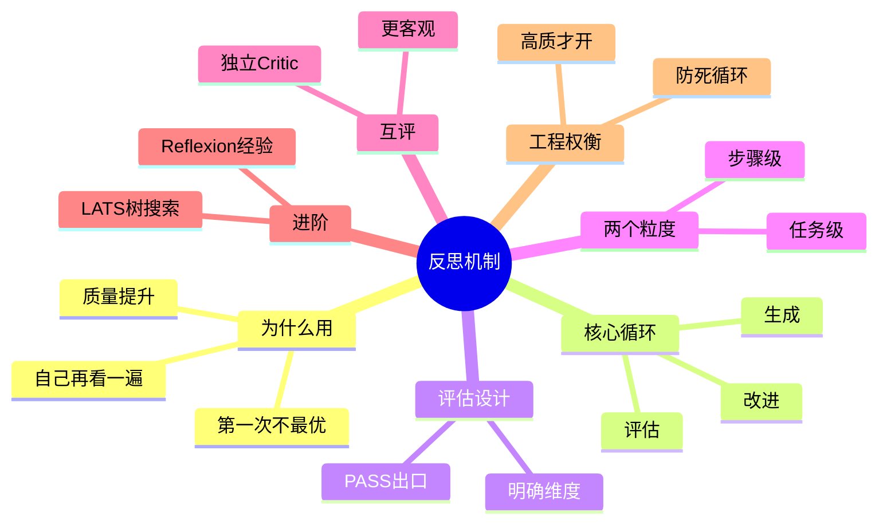

## 🔥 快速背诵

反思是给 Agent 加一个写完再看一遍的闭环：生成、评估、改进。它不是随机重试，有明确的检查维度、有 PASS 出口、有最大轮次。粒度分步骤级和任务级，步骤级早纠偏但开销大。自己评自己容易自洽，加一个独立 Critic 互评更客观。防护是硬性最大轮次，不靠模型自己停。

> **一句话**：反思是给 Agent 加一个「写完再看一遍」的闭环——生成 → 评估 → 改进循环。注意它**不是随机重试**，而是有评估、有 PASS 出口、有最大轮次控制的有结构自我修正。

## 🧠 导图



---

# 📖 背诵稿

### ① 为什么需要反思

**我理解反思解决的是这个问题：LLM 第一次生成的东西，不一定是最好的，而如果给它一次「回头看」的机会，它自己是有能力发现毛病并改好的。**

这跟人写东西一模一样。你写完一篇文章扔一边，过半小时再拿回来读，往往能发现一堆之前没注意的问题：某句逻辑跳了、某论点没支撑、某段说不清楚。改完质量就上去了。

LLM 每次生成都是「一口气」完成的，中间没有机会停。第一次常见的毛病有四类：逻辑跳跃、遗漏细节、事实错误、表达含糊。给个回头检查的机会，它就能把这些揪出来。**所以反思说白了就是：写完别急着交，自己当一遍读者。**

### ② 核心循环：生成 → 评估 → 改进

**反思不是「不满意就重新生成」，那叫随机重试，纯看运气。真正的反思是生成、评估、改进三个步骤转圈，来自 Self-Refine 这篇工作。**

你可以把它想成「草稿 → 批阅 → 修改」。学生交草稿，老师批阅指出问题，学生拿批注改，改完再交老师审，直到通过。

这个循环靠两个 prompt 驱动。第一个让 LLM 扮演「检查者」，专门找问题；如果没说 PASS，就把意见喂进第二个「改进」prompt。**注意改进 prompt 必须同时带上三样：原始任务、原始输出、评估意见。** 缺任何一个都会瞎改——只有任务没输出，它不知道在哪改；只有输出没意见，它不知道改哪；只有意见没任务，它改着改着就偏题了。

### ③ 评估 prompt 的两个关键设计

**评估这一步最容易做成摆设，所以有两个设计必须说：给出明确检查维度，以及必须有 PASS 出口。**

你直接让 LLM「看看有没有问题」，它往往会说「输出看起来不错」，什么都发现不了。所以评估 prompt 要列清楚维度：有没有事实错误、逻辑问题、有没有遗漏、表达清不清晰。有了方向它才会逐项查，而不是自由发挥、流于表面。

第二个是 PASS 机制——给 LLM 一个「够好了就停」的出口。这里有个容易搞错的地方：**没有 PASS 它会对一个已经很好的输出无限挑毛病，反而把原本对的东西改错。** 所以 PASS 不是锦上添花，是防止过度修改的安全阀。

### ④ 两个粒度：步骤级 vs 任务级

**反思可以在两个粒度触发，选哪个看任务特点——步骤之间强依赖、错一步后面全错的，用步骤级；各步相对独立、看重整体质量的，用任务级。**

步骤级是每完成一个工具调用或推理步骤就立刻检查。好处是错误早发现早纠正，不会让一个小错在后面层层放大。比如 Agent 多步检索，第一步关键词选错，后面全建在错误基础上——步骤级能在第一步就纠正。代价是每一步多一次 LLM 调用，十步任务可能实际要二十次。

任务级是整件事做完后才整体评估。好处是开销小、只多一次调用，而且从整体视角能看到步骤级看不到的问题：各步单独看都对，拼起来前后矛盾、衔接生硬，这种只有退远了才看得出来。代价是中途出大错要到最后才发现，前面白干了。

### ⑤ 多 Agent 互评比自我反思更好

**单 Agent 自己反思，评估者和生成者是同一个模型，它生成时形成的一套逻辑，评估时还会沿用，容易陷入「自洽」——自己的错自己看不见。所以加一个独立的 Critic Agent 互评，通常效果更好。**

你可以类比代码 review：自己写完检查，和让同事 review，发现问题的质量往往不一样。自己写的东西自己看，会不自觉地补脑跳过问题。独立的 Critic 没有这包袱，唯一职责就是找问题，视角更客观。

流程是：执行 Agent 出稿 → Critic 给批注 → 执行 Agent 改 → Critic 再确认。什么时候值得用？质量要求极高的时候，比如生成代码后让独立测试 Agent 验、生成报告后让事实核查 Agent 交叉验。代价是多一个 Agent 的调用和复杂度，普通场景用自我反思就够了。

### ⑥ 进阶与工程权衡

**进阶里最值得提两个：Reflexion 把失败经验存下来，下次写之前先翻笔记；LATS 把反思和树搜索结合，边探索多路径边从走过的路学教训。** Reflexion 是「当场改」，Reflexion 升级成「记笔记本」，LATS 则更重、目前还多是学术探索。

工程上最关键的是防死循环：**必须硬性设最大轮次，通常 2 到 3 轮，绝不能依赖 LLM 自己停。** 因为 LLM 有时会陷入「为了改而改」的循环，每轮改动很小、实质没进步，系统就一直转。

还有取舍：不是每步都开反思。只在输出质量要求高、错误代价大的关键节点开，比如最终报告、重要决策推理；简单任务、实时性要求高的场景别开，一次反思至少多一次完整调用，延迟可能从 1 秒涨到 3 秒。**三轮反思意味着原始生成外再额外加 6 次调用，这是做取舍的核心数字。**

---

# 🔑 记忆锚

| 记什么 | 内容 |
|---|---|
| **1** 个本质 | 反思 = 生成→评估→改进闭环，**不是随机重试** |
| **2** 个 prompt | 评估（找问题）+ 改进（带任务+输出+意见三件套） |
| **2** 个评估设计 | 明确检查维度 / 必须有 PASS 出口（防过度改） |
| **2** 个粒度 | 步骤级（早纠偏、开销大）/ 任务级（看整体、难挽回） |
| **1** 个互评优势 | 独立 Critic 比自我反思客观，破除「自洽」盲区 |
| **1** 个死穴防护 | 硬性最大轮次 2–3 轮，不靠 LLM 自停 |
| **1** 句取舍 | 高质关键节点才开，3 轮额外 6 次调用 |

> **卡壳急救**：忘了就回到循环三步——生成、评估、改进；再补「评估要有维度 + PASS，轮次必须写死上限」。

---

# 🎯 追问速查

| 面试官问 | 你答 |
|---|---|
| 反思和重新生成有啥区别？ | 重新生成是随机重试看运气；反思是评估→改进的结构化闭环，有明确检查维度和 PASS 出口 |
| 评估 prompt 最关键的设计？ | 两点：列明确检查维度（不然流于表面），设 PASS 出口（不然无限挑毛病把对的改错） |
| 改进 prompt 缺一样会怎样？ | 必须带原始任务+原始输出+评估意见三样，缺任一都会盲目改或偏题 |
| 步骤级和任务级怎么选？ | 步骤强依赖、错一步全错 → 步骤级早纠偏；各步独立、重整体 → 任务级开销小 |
| 为什么多 Agent 互评更好？ | 自评时评估者和生成者同模型，易「自洽」看不见自己错；独立 Critic 唯一职责找问题更客观 |
| 怎么防止反思死循环？ | 硬性设最大轮次 2–3 轮，绝不依赖 LLM 自己判断停止 |
| 反思该每步都开吗？ | 不该。只在高质量、高代价关键节点开；简单/实时任务会拖慢且浪费，3 轮额外 6 次调用 |

---

# 🔗 串联

- 承接 14 如何赋予 LLM 规划能力：规划讲「拆得动」，反思讲「做得对、能纠错」，plan-and-execute 常在关键步叠反思把关
- 承接 05 推理模式与 ReAct 的实现：ReAct 的循环漂移与错误传播，正好靠反思这个质量闸来修
- 通向 16 多 Agent 协作与切换：多 Agent 互评就是反思的协作形态，Critic Agent 即独立审查者
- 通向 08 Agent 的记忆机制与设计：Reflexion 把失败经验写进长期记忆，下次直接参考
- 通向 12 Agent 记忆压缩方法：反思轮次本身也是控制上下文成本的手段之一
- 一句话总纲：**生成靠模型，评估找问题，改进有方向，轮次要封顶**

---

# 📚 细节（背完再点开）

> [!note]- 评估 prompt 长什么样
> ```
> 任务：{task}
> 当前输出：{current_output}
> 请评估以上输出：
> 1. 有没有事实错误或逻辑问题？
> 2. 有没有遗漏重要内容？
> 3. 表达是否清晰准确？
> 如果输出已经足够好，回复「PASS」；
> 否则指出具体问题并给出改进建议。
> ```
> 关键：维度列清楚，且必须给 PASS 出口，否则 LLM 会无限挑毛病。

> [!note]- 改进 prompt 的三件套
> ```
> 原始任务：{task}
> 当前输出：{current_output}
> 评估意见：{reflection}
> 请根据评估意见改进输出：
> ```
> 缺任务→不知在哪改；缺输出→不知改哪；缺意见→不知改什么。三者齐备才定向修改，而不是整体重写。

> [!note]- 步骤级 vs 任务级对比
> | | 步骤级 | 任务级 |
> |---|---|---|
> | 触发 | 每步完成后 | 整任务完成后 |
> | 好处 | 错误早发现，不层层放大 | 开销小，能看到整体矛盾 |
> | 代价 | 每步多一次调用，十步可能二十次 | 中途大错到最后才发现 |
> | 适用 | 步骤强依赖、错则全错 | 各步独立、重整体质量 |

> [!note]- Reflexion 与 LATS 一句话
> **Reflexion**：不仅反思当前输出，还把「失败经验」存进经验记忆，下次类似任务前先翻笔记（类比把bug成因记笔记本）。**LATS**（Language Agent Tree Search）：把蒙特卡洛树搜索和反思结合，多路径并行探索，每路径评估反思，经验教训反馈给后续探索，更重、偏学术。

> [!note]- 辩论式反思
> 不设单方审查，而是多个 Agent 互辩：正方提方案，反方专挑毛病，正方再优化。反方职责就是挖漏洞，比单纯「检查有没有问题」的 Critic 更积极，适合高质量要求场景如商业决策、法律文本审查。

---

# 🎴 自测（遮住上面，先自己说）

> [!question]- Q1 反思和重新生成有什么区别？
> 重新生成是随机重试靠运气；反思是生成→评估→改进的结构化闭环，有检查维度和 PASS 出口，是有方向的自我修正。

> [!question]- Q2 评估 prompt 最关键的两个设计？
> 一、给出明确检查维度（事实/逻辑/完整性/表达），否则流于表面；二、必须有 PASS 出口，否则会无限挑毛病把对的改错。

> [!question]- Q3 改进 prompt 为什么必须带三样？
> 原始任务+原始输出+评估意见。缺任务不知在哪改、缺输出不知改哪、缺意见不知改什么，三者齐备才定向修改。

> [!question]- Q4 步骤级和任务级反思怎么选？
> 步骤强依赖、错一步全错→步骤级早纠偏但开销大；各步独立、重整体→任务级开销小但中途错难挽回。

> [!question]- Q5 为什么多 Agent 互评比自我反思好？
> 自评时评估者与生成者同一模型，易陷入「自洽」看不见自己错；独立 Critic 唯一职责找问题，视角更客观。

> [!question]- Q6 怎么防止反思死循环？
> 硬性设最大轮次 2–3 轮，绝不依赖 LLM 自己停止；每轮含评估+改进，3 轮即额外 6 次调用，要算清代价。
