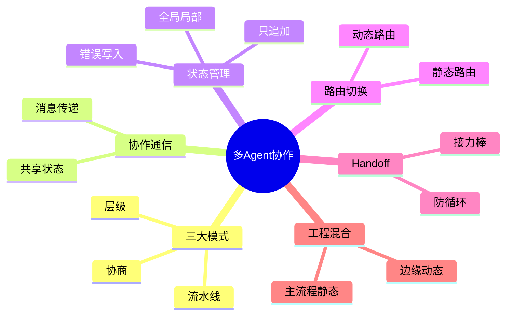

## 🔥 快速背诵

协作解决的是干完之后怎么交棒，有两种方式：消息传递解耦，像发邮件；共享状态直接，像共享白板。依赖强用共享状态，要让彼此不感知就用消息传递。状态要分层，只追加不覆盖，失败的也要写。切换靠路由，静态路由写死规则保稳定，动态路由让 LLM 兜边缘情况，两者混用最稳。

> **一句话**：协作靠两件事——消息传递（解耦，发邮件式）和共享状态（直接，共享白板式）；切换靠路由，静态路由写死规则保稳定，动态路由让 LLM 实时决策兜底边缘情况。工程上两者混用最稳。

## 🧠 导图



---

# 📖 背诵稿

### ① 协作到底解决什么问题

**我理解多 Agent 协作解决的是「干完之后怎么交棒」的问题。分工解决了谁做什么，协作解决的是各 Agent 的结果怎么传给下一个、下一步该叫谁接棒。**

你可以把它想成公司里的部门：研究部、开发部、测试部各司其职。问题来了——部门之间怎么沟通？这就引出两种通信方式，也是这道题的第一个核心。

注意一个容易搞错的地方：**协作和切换是两件事**。协作是「怎么传信息」，切换是「下一步叫谁」，不能混着说成一句「流水线传结果」。

### ② 两种通信方式：消息传递 vs 共享状态

**两种通信方式根本区别在耦合度。消息传递像发邮件，解耦；共享状态像共享白板，直接。**

消息传递是 Agent 干完把自己的结果发到消息队列，下游订阅的 Agent 取到再处理。最大的好处是解耦——研究 Agent 不用管谁在等它，接收方也不用管谁发的，只管处理。代价是要有个「邮件服务器」也就是消息中间件，部署成本高一点。

共享状态是所有 Agent 都读写同一个状态对象，比如 LangGraph 贯穿全程的 State，每个节点执行完往里写结果，下一个直接读。好处是直接，前一步写完后一步立刻能看到。代价是设计不好容易出 bug——两个 Agent 同时写互相覆盖，或者读到一半更新的脏数据。

**选哪个看依赖强不强：步骤依赖强、前一步直接喂后一步，用共享状态更直接；想让 Agent 互相不感知、独立运行，用消息传递更合适。**

### ③ 共享状态的管理要点

**共享状态是多 Agent 里最容易出 bug 的地方，三个要点要记住：结构分层、只追加不覆盖、错误也要写进去。**

第一，状态分层：全局状态放所有 Agent 都要读的，比如用户原始请求、当前进展、最终输出；局部状态放每个 Agent 自己的中间产物，比如搜索 Agent 的候选列表，不暴露给别人，避免污染。

第二，写入规则：用「只追加不覆盖」。每个 Agent 完成后把结果追加进状态，而不是改已有字段。LangGraph 的 State 更新就是这个思路——你定义好 schema，每个节点返回增量更新，框架帮你合并，就不会互相踩。

第三，错误处理：**某个 Agent 失败了，错误信息也要写进状态，不能悄悄吞掉。** 后续 Agent 或 Orchestrator 读到错误才能正确决策，比如跳过这步、换人重试、或终止任务。

### ④ 路由切换：静态 vs 动态

**切换就是决定下一步叫哪个 Agent，这个决策叫「路由」，由 Orchestrator 负责。路由分静态和动态两种。**

静态路由是提前把规则写死，比如任务含「搜索」就找 Researcher，代码写完了就找 Reviewer，匹配不到就回 Orchestrator 兜底。这像流水线每道工序去哪个工位是固定的——效率高、可预测、好调试。但它覆盖不了你没预料的情况，走了一条没定义规则的路径，系统就懵了。

动态路由是把「下一步找谁」交给 LLM 实时判断。Orchestrator 把当前任务、已完成什么、有哪些 Agent 可用全告诉它，让它选。好处是灵活，能处理任何没预设的路径；代价是每次路由多一次 LLM 调用、增加延迟成本，而且 LLM 偶尔也会路由错，行为可预测性下降。

### ⑤ Handoff：去中心化的接力棒

**除了中央 Orchestrator 集中路由，还有一种更去中心化的方式叫 Handoff，像一个运动员跑完自己那一棒，直接把接力棒递给下一个人，不用裁判喊「下一个谁」。**

好处是每个 Agent 最清楚自己的边界：做完什么、还缺什么，由它决定下一步找谁，往往比外部 Orchestrator 判断更准；而且没有中央瓶颈，扩展性更好。OpenAI 的 Swarm 框架就是用来演示这个模式的教育性工具。

缺点也很明显：**没有全局视角，容易死循环。** Agent A 交给 B，B 觉得不是自己的活交给 C，C 又交回 A。所以 Handoff 必须设计好每个 Agent 的职责边界，并加防循环机制——记录任务经过哪些 Agent，发现重复经过同一个就强制终止。

### ⑥ 工程上怎么用

**最稳的做法是两种路由组合：主流程用静态路由保底，边缘情况才交给 LLM 动态决策。静态负责兜底，动态负责兜住异常。**

因为面试官一听「主流程静态、边缘动态」就知道你真做过多 Agent 系统。通信方式同理：清晰流水线、步骤依赖明确就用共享状态，简单直接；要多个 Agent 独立并行、互不感知就用消息传递，解耦清晰。

Handoff 适合 Agent 数量不多、职责边界很清楚、任务流向相对确定的场景，比中央 Orchestrator 更简洁。但 Agent 多、流向复杂，还是建议用 Orchestrator 统一调度，别让交接变成一团乱麻。

---

# 🔑 记忆锚

| 记什么 | 内容 |
|---|---|
| **3** 大模式 | 流水线 / 层级 / 协商（可混用） |
| **2** 种通信 | 消息传递（解耦，邮件式）/ 共享状态（直接，白板式） |
| **3** 个状态要点 | 分层 / 只追加不覆盖 / 错误也要写 |
| **2** 种路由 | 静态（写死、稳）/ 动态（LLM 决策、灵活但贵且不可控） |
| **1** 个 Handoff | 接力棒式去中心化，必须防循环 |
| **1** 句工程经验 | 主流程静态保底，边缘动态兜底 |

> **卡壳急救**：忘了就分两块——协作（消息传递解耦 / 共享状态直接）和切换（静态写死稳 / 动态 LLM 灵活），最后补一句「混用最稳」。

---

# 🎯 追问速查

| 面试官问 | 你答 |
|---|---|
| 消息传递和共享状态区别？ | 消息传递像发邮件，解耦、发送方不知接收方，需中间件；共享状态像白板，所有 Agent 读写同一对象，直接但易互相覆盖 |
| 共享状态怎么防 bug？ | 三层：状态分全局/局部、写入只追加不覆盖、失败错误也写进状态供后续决策 |
| 静态和动态路由怎么选？ | 静态写死规则、可预测好调试，但覆盖不了未预料路径；动态 LLM 实时决策灵活，但每次多一次调用且可能路由错 |
| 全用动态路由行吗？ | 不行。每次多一次 LLM 调用，延迟成本上升，且 LLM 偶发路由错，行为不可预测，主流程应静态保底 |
| Handoff 是什么、坑在哪？ | 去中心化接力棒，当前 Agent 自己决定交谁；坑是无全局视角易死循环，需记录经过的 Agent 并防重复 |
| 工程上怎么用最稳？ | 主流程静态路由保底，边缘情况才交给 LLM 动态决策，两者互补 |
| LangGraph 属于哪种？ | 共享状态思路，有贯穿所有 Agent 的 State，节点执行完写回、下一节点直接读 |

---

# 🔗 串联

- 承接 10 什么是 Multi-Agent：那篇讲多 Agent 是什么，这篇讲它们怎么协作和切换
- 承接 11 Single-Agent 与 Multi-Agent 的设计方案：设计方案落地到通信与路由选型
- 通向 15 反思机制：多 Agent 互评里独立 Critic 就是一种协作下的审查形态
- 通向 17 上下文工程：共享状态本质是上下文工程里「任务状态」跨 Agent 的共享
- 通向 18 多轮对话状态管理：状态分层与错误写入正是会话状态管理的要点
- 一句话总纲：**协作分通信（解耦/直接），切换分路由（静态/动态），混合用最稳**

---

# 📚 细节（背完再点开）

> [!note]- 动态路由的代码骨架
> ```python
> def dynamic_route(task_context: str, available_agents: list[str]) -> str:
>     prompt = f"""当前任务状态：
> {task_context}
> 可用的 Agent：
> {chr(10).join(f'- {a}' for a in available_agents)}
> 请根据当前进展，判断下一步交给哪个 Agent。
> 只返回 Agent 名称，不需要解释。"""
>     resp = client.chat.completions.create(
>         model="gpt-4",
>         messages=[{"role": "user", "content": prompt}]
>     )
>     return resp.choices[0].message.content.strip()
> ```
> 实际还要加：校验返回名是否在可用列表、设 fallback Agent、记路由日志便于分析。

> [!note]- 三种协作模式对比
> | 模式 | 结构 | 类比 |
> |---|---|---|
> | 流水线 | 按固定顺序依次执行 | 工厂装配线 |
> | 层级 | Orchestrator 分配收集，其余执行子任务 | 项目经理带团队 |
> | 协商 | 无上下级，互相沟通辩论达成一致 | 圆桌讨论 |
> 三种不互斥，复杂系统常混合使用。

> [!note]- 共享状态分层示例
> - 全局状态：用户原始请求、当前任务进展、最终输出（所有 Agent 读）
> - 局部状态：搜索 Agent 的候选文档列表、代码 Agent 的草稿（仅内部用，避免污染）
> 写入用「增量更新 + 框架合并」，避免互相覆盖。

> [!note]- Handoff 防循环机制
> 记录任务已经经过的 Agent 序列。若发现重复经过同一个 Agent（如 A→B→C→A），说明陷入交接死循环，强制终止或交回 Orchestrator。同时每个 Agent 职责边界要写清楚，避免「这不是我的活」式踢皮球。

---

# 🎴 自测（遮住上面，先自己说）

> [!question]- Q1 多 Agent 协作解决什么？
> 分工解决「谁做什么」，协作解决「干完怎么交棒」：结果怎么传给下一个、下一步该叫谁。协作（通信）和切换（路由）是两件事。

> [!question]- Q2 两种通信方式本质区别？
> 消息传递像发邮件，解耦、需中间件；共享状态像白板，所有 Agent 读写同一对象，直接但易覆盖。依赖强用共享状态，要解耦用消息传递。

> [!question]- Q3 共享状态三个管理要点？
> 状态分层（全局/局部）、写入只追加不覆盖、失败错误也要写进状态供后续决策。

> [!question]- Q4 静态和动态路由区别？
> 静态写死规则，可预测好调试，但覆盖不了未预料路径；动态让 LLM 实时决策，灵活但每次多一次调用且可能路由错。

> [!question]- Q5 Handoff 是什么，坑在哪？
> 去中心化接力棒，当前 Agent 自己决定交谁。坑是无全局视角易死循环（A→B→C→A），需记录经过序列并防重复。

> [!question]- Q6 工程上最稳的用法？
> 主流程静态路由保底，边缘情况才交 LLM 动态决策；Handoff 只在 Agent 少、边界清时用。
