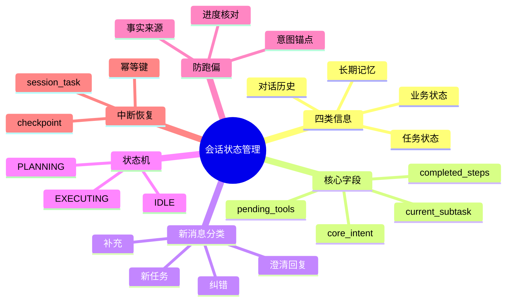

## 🔥 快速背诵

状态管理不是把历史存 Redis，而是把信息分四类：对话历史、业务状态、任务状态、长期记忆，生命周期不同不能混。对话历史记录怎么聊到这，结构化状态直接说做到哪了。防跑偏靠三道防线：常驻核心意图、每步做完做进度核对、保留事实来源和版本。中断恢复靠 checkpoint 加幂等键。

> **一句话**：状态管理不是「把历史存进 Redis」，而是把对话历史、业务状态、任务状态、长期记忆四类分开。用结构化状态机记录目标与进度、防跑偏，用 checkpoint + 幂等键支持中断恢复，避免重复付款、重复发消息。

## 🧠 导图

---

# 📖 背诵稿

### ① 光存聊天记录为什么不够

**我理解很多人一上来就说「把历史存 Redis 每次全传给模型」，这是最表层的解法。聊天记录只是原始证据，真正缺的是结构化的「当前结论」。**

你想，用户第一轮说「总结这篇文章，确认后发到技术群」，中途补了句「语气正式点」，Agent 查完文章、写完摘要、问了群名，服务却在发送前重启了。如果只有一长串聊天，恢复后模型要从几十条消息里猜四件事：最终目标是什么、文章取到没、摘要是不是终版、消息到底发没发。历史越长，错误信息和旧版本越容易混在一起。

**所以一句话：对话历史告诉我们怎么聊到这的，结构化状态直接告诉执行器现在做到哪了。两者都要，但不能互相替代。**

### ② 四类信息为什么要分开存

**要把信息分成四类，因为它们生命周期和用途完全不同：对话历史、业务状态、任务状态、长期记忆。同一句话放错位置，后果完全不同。**

对话历史是用户原话、模型回复、工具返回，当前会话用，负责还原语气和决策原因。业务状态是日期、金额、目标群、审批结果这类已确认事实，给业务规则和工具当可信参数。任务状态是核心目标、当前子任务、待办、步骤状态、错误信息，控制一次任务流程。长期记忆是用户偏好和可复用经验，跨会话。

举个例子：「这次报告用英文」可能只是当前任务的业务约束，不该直接写成「用户永远偏好英文」的长期记忆。工具返回「订单创建成功」也不能只躺聊天里，它还要更新任务步骤状态并记录订单号，供恢复时核对。**这里和 Memory 基础题的区别是：记忆关心哪些信息值得跨任务留，状态管理关心正在执行的这件事走到哪、下一步是否合法、故障后怎么接着走。**

### ③ 任务状态的核心字段

**任务状态有几个关键字段，让系统不用重读全部历史也能回答「为什么做、做到哪、还差什么」。**

`core_intent` 是归一化后的核心目标、范围、约束和完成标准，模型不能自行覆盖，用户明确改需求时版本化更新。`current_subtask` 是当前正处理的子任务步骤。`pending_tools` 是还没完成的工具调用及编号、参数、状态，先登记再执行，拿到结果改成功/失败/未知。`completed_steps` 只记可复用结论和证据引用，不复制整段原始日志。`context_snapshot` 是当前有效的用户、时间、地点、文件、订单号等实体，新信息校验后合并，保留来源与版本。

工程上还会加 `session_id`、`task_id`、`turn_id`、`state_version`。**注意 session 和 task 要分两层**：一个会话里可能先做报告又临时查天气再回来，只拿会话编号当任务编号，两个任务状态会搅一起。多个 Worker 同时处理同一任务时，`state_version` 可做乐观锁，避免旧状态覆盖新状态。

### ④ 每来一条新消息，状态怎么更新

**用户新消息不能直接追加历史就交 Agent 自由发挥，得先判断它和当前任务是啥关系。**

「语气正式点」是补充约束，更新 `context_snapshot`，目标不变。「不是技术群是产品群」是纠错，覆盖目标群槽位，并让依赖旧群名的待执行步骤失效。「请告诉我群名」只是回答上一轮澄清，解除 `WAITING_USER` 继续原任务。

最容易误判的是切题。用户突然问「北京明天天气怎么样」，系统不能只靠和第一轮向量相似度低就认定跑偏——可能是切换任务，也可能只是为原任务补充信息。**意图锚点更适合当预警信号不是最终裁判**，要结合当前步骤、待澄清问题、指代关系和用户是否用「暂停/改成/另外」等词，把新输入分四类：补充、纠错、澄清回复、新任务。置信度不够就问一句，别擅自改状态。

**特别纠正一个误区：`core_intent` 的锁定不是永远保存第一句话。** 第一轮需求可能含糊、后续也可能被合法修改。合理做法是先归一化为目标/约束/验收，必要时让用户确认；之后禁止模型静默改写，用户明确修改则生成新意图版本并记录来源。

### ⑤ 状态机 vs 自然语言历史，谁说了算

**只有结构化状态，会丢掉用户为什么这么决定的细节；只有自然语言历史，流程又变每轮重新猜。最稳的是让两者各做擅长的事。**

自然语言历史负责理解。比如用户说「还是按上周那个风格来」，模型要结合近几轮和检索到的记忆，才明白「那个风格」指什么。状态机负责执行——任务处于 `WAITING_CONFIRMATION` 时，即使模型突然建议调发送工具，执行器也应拒绝，收到有效确认才能进 `EXECUTING`。像付款、发送、删除这类高风险动作，合法状态转换必须由确定性代码校验，不能只靠 Prompt 约束。

简化流程：`IDLE → PLANNING → EXECUTING → CHECKING → DONE`，从 EXECUTING 可到 WAITING_USER 或 ERROR。模型可以提「更新哪些字段、下一步去哪」，但输出必须经 Schema 校验、权限校验、状态转换校验，最终提交状态的是编排层不是模型自己。

### ⑥ 防跑偏三道防线与中断恢复

**防跑偏有三道防线。第一道是始终保留结构化 `core_intent`，它不只是一句标题，还含最终产物、约束、完成标准，每次规划或检查前都和 `current_subtask` 一起给模型。第二道是进度核对：每完成关键步，Checker 问两个问题——这结果推进核心目标了吗、下一步还来自未完成计划吗；若连续弱相关、重复改同一状态或新计划无故丢验收条件，就重规划或人工澄清。第三道是保留事实来源和状态版本，工具出错不该让后面摘要把错误包装成确定事实。**

**中断恢复不是把字典随手写 Redis。先按 `session_id`/`thread_id` 定位，再按 `task_id` 找具体任务，用 `state_version` 校验。** 看 `pending_tools`：succeeded 跳过、failed 按策略重试、unknown 先去外部系统核对。为什么有 unknown？群消息已发出但响应没写回时进程崩了，恢复后直接重试用户会收到两条一模一样的消息。

**解决这类问题靠幂等，不是迷信「恰好执行一次」。外部写操作边界应是「执行前登记意图、执行后记录结果」：发群消息前先把调用记 planned 并生成稳定 `operation_id`，发成功后保存平台 `message_id` 改 succeeded。恢复时用稳定幂等键去重，数据库用唯一约束或 upsert，发送类动作优先按 `operation_id` 查结果。外部既不能查也不支援幂等时，转入人工确认，告诉用户「上次发送结果无法确认」，由人决定重试还是跳过。**

---

# 🔑 记忆锚

| 记什么 | 内容 |
|---|---|
| **4** 类信息 | 对话历史 / 业务状态 / 任务状态 / 长期记忆（寿命用途不同） |
| **5** 个核心字段 | core_intent / current_subtask / pending_tools / completed_steps / context_snapshot |
| **4** 类新消息 | 补充 / 纠错 / 澄清回复 / 新任务 |
| **3** 道防跑偏 | 意图锚点 / 进度核对 / 事实来源与版本 |
| **1** 句状态机 | 自然语言管理解，状态机管执行，高风险转换靠确定性代码 |
| **2** 个恢复关键 | checkpoint + 幂等键；unknown 状态必须外部核对 |
| **1** 个误区 | core_intent 不是永远锁第一句，用户明确改则版本化 |

> **卡壳急救**：忘了就分两块——四类信息分存 + 状态机管执行；再来恢复三件套：session/task 隔离、checkpoint、幂等键防重复发。

---

# 🎯 追问速查

| 面试官问 | 你答 |
|---|---|
| 历史存 Redis 不就够了？ | 不够。聊天记录是证据，结构化状态才是当前结论；只存历史恢复后要重猜目标/进度/是否发送 |
| 四类信息为什么分开？ | 寿命用途不同。如「这次用英文」是业务约束非长期记忆；「订单成功」要同时更新步骤状态和订单号供核对 |
| core_intent 锁定是啥意思？ | 不是永远保存第一句。模型不能静默改，用户明确改需求时版本化更新并记录来源 |
| 新消息怎么更新状态？ | 先分四类：补充/纠错/澄清回复/新任务。意图锚点当预警非裁判，置信不够就问 |
| 状态机和历史谁说了算？ | 历史管理解（指代/原因），状态机管执行；高风险动作合法转换由确定性代码校验 |
| 怎么防跑偏？ | 三道防线：保留 core_intent、进度核对、保留事实来源与状态版本 |
| 中断后怎么恢复不重复发？ | checkpoint + 按 session/task 隔离 + 幂等键；unknown 状态先外部核对，发送类用 operation_id 去重，不能盲目重跑 |

---

# 🔗 串联

- 承接 08 Agent 的记忆机制与设计：长期记忆是四类信息之一，状态管理更关心当前任务走到哪
- 承接 09 Agent 的长短期记忆怎么存怎么用：长期记忆跨会话召回，与任务状态分工
- 承接 17 上下文工程：结构化任务状态正是上下文装配要读取的核心
- 通向 12 Agent 记忆压缩方法：旧聊天可摘要、大结果落外部存储只留引用
- 通向 15 反思机制：CHECKING 阶段用反思做进度核对的质量闸
- 一句话总纲：**历史管证据 状态管结论 状态机管执行 幂等管恢复**

---

# 📚 细节（背完再点开）

> [!note]- 状态字段更新原则
> | 字段 | 记录什么 | 更新原则 |
> |---|---|---|
> | core_intent | 归一化核心目标/约束/完成标准 | 模型不可自覆盖，用户明确改则版本化 |
> | current_subtask | 当前子任务步骤 | 开始或切换时更新 |
> | pending_tools | 未完成调用及编号/参数/状态 | 先登记再执行，结果改成功/失败/未知 |
> | completed_steps | 已完成结论+证据引用 | 只记可复用结论，不复制原始日志 |
> | context_snapshot | 当前有效实体（人/时/地/文件/订单） | 新信息校验后合并，留来源版本 |

> [!note]- 恢复处理顺序
> 1. 用 session_id/thread_id 校验身份，再定位 task_id，防读别人任务
> 2. 加载最近一次完整提交 checkpoint，校验 state_version 和工作流版本
> 3. 看 pending_tools：succeeded 跳过、failed 按策略重试、unknown 先外部核对
> 4. 重组最小必要上下文：规则+意图+当前状态+近对话+工具结果+必要记忆
> 5. 从合法状态继续，记录恢复来源/次数/结果便于审计

> [!note]- 幂等写操作边界
> 准备发群消息 → 调工具前记 planned 并生成稳定 operation_id → 真发送成功 → 存平台 message_id 改 succeeded。恢复时若状态 unknown，优先按 operation_id 去外部查结果去重；数据库用唯一约束或 upsert；既不能查也不支援幂等则转人工确认，不盲目重发。

> [!note]- 线上补充细节
> - 冷热分层：活跃会话放 Redis，关键 checkpoint 落持久库；TTL 清可重建缓存，但等审批的长期任务不能因半小时没说话就消失
> - 并发：按 task_id 加租约/分布式锁，配合 state_version 比较后更新；请求带 request_id 防重复提交
> - 脱敏：大结果存外部只留摘要哈希引用，日志 Trace 脱敏并按租户隔离
> - 观测：看意图改写次数、澄清率、非法状态转换数、恢复成功率、重复副作用数、恢复一致性与基线差异

---

# 🎴 自测（遮住上面，先自己说）

> [!question]- Q1 只存聊天历史为什么不够？
> 聊天是证据，结构化状态才是当前结论。只存历史恢复后要从几十轮重猜目标/进度/是否发送，易混错。

> [!question]- Q2 四类信息是什么，为何分开？
> 对话历史、业务状态、任务状态、长期记忆。寿命用途不同——如「这次英文」是业务约束非长期记忆，「订单成功」要更新步骤状态供核对。

> [!question]- Q3 core_intent 锁定是啥？
> 不是永远锁第一句。模型不可静默改，用户明确改需求时版本化更新并记录来源。

> [!question]- Q4 新消息怎么更新状态？
> 先分四类：补充/纠错/澄清回复/新任务。意图锚点当预警非裁判，置信不够就问一句别擅改。

> [!question]- Q5 防跑偏三道防线？
> 保留结构化 core_intent、进度核对（Checker 问是否推进目标/下一步是否来自计划）、保留事实来源与状态版本。

> [!question]- Q6 中断恢复怎么不重复发消息？
> checkpoint + session/task 隔离 + 幂等键；unknown 状态先外部核对；发送类用 operation_id 去重，盲目重跑会发两遍。
