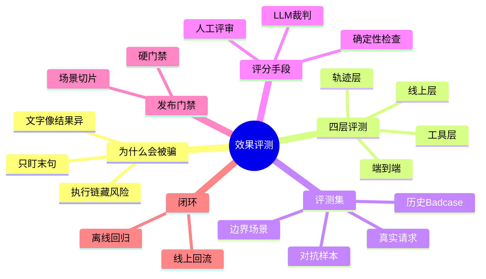

## 🔥 快速背诵

Agent 评测不能只盯最后一句答案，它还在做决策、改外部状态。要沿执行链分四层：工具、单步轨迹、端到端、线上，失败之后才知道改哪一层。轨迹约束分三类：必须出现、禁止出现、先后顺序。评分用确定性检查、人工评审、LLM 裁判三者组合。安全约束是硬门禁，不能被加权平均分掉。

> **一句话**：Agent 评测不能只盯最后一句话。要分四层——工具、单步轨迹、端到端、线上——把"会不会说"拆到"有没有把事做对"。安全约束是硬门禁，不是加分项。

## 🧠 导图

---

# 📖 背诵稿

### ① 为什么只看最终答案会被骗

**Agent 和纯问答最大的不同，是它不止吐一段文字，它还在做决策、改外部状态。一段看起来很完整的话，背后可能是错的、无效的，甚至是越权的执行。**

说白了，你问一个退款 Agent，它回你"退款成功"。这里面至少三种情况：真按规则退了、压根没调接口只是编了句成功、或者退了但没先做身份核验。三种回复文字几乎一样，可产品结果和风险天差地别。

这里有个容易搞错的地方：最终回复只能证明"它说得像不像"，证明不了"事有没有做成、过程合不合规"。最可信的成功信号是外部状态真的变了——订单真变成已退款、日历真多出一条日程、代码真通过了测试。不是它自己喊"我完成了"就算数。

### ② 四层评测，把问题定位到具体环节

**一套实用的评测，要沿执行链拆成四层：工具、单步与轨迹、端到端、线上。这么拆不只是多几个指标，是失败后能知道该改哪。**

工具层看单个工具和参数可不可靠。单步与轨迹层看每一步决策合不合理，有没有漏步、重复调用、越权或绕流程；整条调用序列是不是该有的步骤都有了、禁止的没出现。端到端层看任务最终有没有完成，外部状态有没有达到目标。线上层再看真实业务里的成功率、人工接管率、延迟、Token、成本和安全事件。

你可以把它想成体检：工具层查器官正不正常，轨迹层查动作协不协调，端到端查人能不能正常上班，线上查他日子过得怎么样。

### ③ 四层各自看什么、怎么看

**工具层先别测模型，工具是相对确定的业务代码，该先可验证。** 检查输入 Schema、必填字段、类型范围，还要覆盖正常、空结果、超时、权限失败、第三方异常。有副作用的工具要测幂等：同一笔支付重试两次，不能真扣两次款。工具稳了再测模型决策——工具选没选对、参数对不对是两件事，别混一起。

**单步与轨迹层**有个坑：别给所有任务准备一条标准轨迹逐步硬匹配。Agent 常有多条正确路径，硬匹配会把另一条对的判错。稳妥做法是定义三类约束：哪些步骤必须出现、哪些禁止出现、哪些有先后依赖，剩下的路径让 Agent 自己选。

**端到端层**核心是任务完成率，但"成功条件由谁定义"才是关键——能查环境状态就查状态，能跑测试就跑测试。复杂任务拆阶段目标，没全做完但前面子目标对了，别只记个零分，那是丢掉诊断信息。**线上层**要把安全指标单独看：未授权调用率、敏感信息泄露率、注入攻击成功率，这些不能被完成率的高分平均掉。

### ④ 评测集怎么建

**指标定好，下一步不是去网上找套通用 Benchmark，而是先写清自己的业务目标。** 通用榜只能看底座模型能力区间，不知道你的退款规则、工具 Schema、用户说话方式、风险边界。

一条样本不该只有"用户问题加标准答案"。完整的样本通常含初始环境状态、用户目标、预期最终状态、可用工具、必须或禁止的动作、关键约束、评分规则，必要时再加参考轨迹。开放式结果存评分 Rubric 和少量好例子；确定性任务存可执行验证器更可靠。

来源分四块：真实请求（生产日志去隐私后分层采样，别只抽简单常见的）、边界场景（参数缺失、含糊表达、超时、空结果、超长上下文）、对抗与安全样本（藏注入、越权、诱导绕确认）、历史 Badcase（线上每出一种新的失败模式就加进回归集）。按场景切片对比，防止"修好一类弄坏另一类"。

### ⑤ 三种评分手段，谁擅长什么

**可靠评分是确定性检查、人工评审、LLM 裁判三者组合，不是选一个包打天下。**

确定性检查最优先：参数过不过 Schema、调没调禁用工具、数据库状态对不对、代码过没过测试，程序直接判断，快、便宜、稳，最适合进持续集成。

人工评审负责定标准和处理高风险歧义，领域专家判断政策是否遵循、开放结果有没有用，不一定要评全部，关键是建清楚 Rubric 并抽查自动评测跑没跑偏。

LLM 裁判负责扩展开放式评测，比如报告完不完整、回复解没解决问题。但它不是标准答案生成器——研究已经发现位置偏差、篇幅偏差、自我偏好。候选换个顺序判决可能变；更长的答案只是显得更完整；同系列模型偏爱自己表达。工程上要拆维度评分、裁判时匿名模型名、交换顺序复核、用人工集校准一致性。

### ⑥ 指标组合成发布门禁，再加线上闭环

**综合分不能解决所有决策。更合理是先设硬门禁，再看质量与效率。** 安全违规、越权动作、绕过必要审批、重复产生严重副作用，这些样本只要失败就该阻止发布。普通质量指标再按业务目标比完成率、轨迹质量、延迟、成本。

门槛没有行业通用数字：客服、改代码、资金操作容错空间完全不同。先拿线上版本建基线，再按风险定门槛，同时看整体和关键切片。新版本总完成率涨了，但高风险退款场景退化，照样不能发。

最后是闭环：定义成功标准 → 建评测集 → 跑分层评测 → 过门禁灰度 → 看 Trace 和业务 → 归因 Badcase → 加回回归集 → 修复后跑定向集加全量集。线上 Trace 不只存输入输出，还要留模型调用、工具选择、参数、结果、重试、耗时、Token、版本、最终环境状态，出事才能判断是路由错、参数错、工具异常还是状态丢。

---

# 🔑 记忆锚

| 记什么 | 内容 |
|---|---|
| **1** 个根因 | 只看末句会被骗：执行链藏风险，文字像结果异 |
| **4** 层评测 | 工具 → 单步轨迹 → 端到端 → 线上 |
| **3** 类轨迹约束 | 必须出现 / 禁止出现 / 先后顺序依赖 |
| **4** 块评测集来源 | 真实请求 / 边界场景 / 对抗样本 / 历史 Badcase |
| **3** 种评分 | 确定性检查 / 人工评审 / LLM 裁判 |
| **1** 个门禁原则 | 安全是硬门禁，不能被加权平均分掉 |
| **1** 个闭环 | 离线回归 + 线上 Badcase 回流 |

> **卡壳急救**：忘了细节就按"四层"回：工具可不可靠、轨迹合不合理、端到端做成没、线上用户满不满意。再补一句"安全是硬门禁不是加分项"。

---

# 🎯 追问速查

| 面试官问 | 你答 |
|---|---|
| 为什么不能只看最终答案？ | Agent 还做决策改外部状态；文字像但执行可能错、无效或越权。最可信信号是外部状态真变了，不是它自称完成 |
| 四层评测指哪四层？ | 工具层（参数可靠）、单步与轨迹层（决策与约束）、端到端（任务真完成）、线上（业务效果与安全） |
| 有多条正确路径怎么办？ | 不做逐步完全匹配。定义三类约束：必须出现、禁止出现、先后依赖，其余路径允许 Agent 自选 |
| 评分用 LLM 裁判够吗？ | 不够。确定性检查优先（程序判），开放式才交给人工加 LLM 裁判，且要防位置/篇幅/自我偏好偏差，用人工集校准 |
| 安全指标怎么处理？ | 设硬门禁：违规样本直接阻止发布，不能被完成率高分加权平均掉 |
| 评测集何来？ | 真实请求、边界场景、对抗样本、历史 Badcase 四类，按场景切片对比防回归退化 |
| 闭环怎么转？ | 定义标准→建集→分层评测→过门禁灰度→线上看 Trace→归因 Badcase→回灌回归集 |

---

# 🔗 串联

- 承接 05 推理模式与 ReAct 的实现：ReAct 跑出轨迹，这篇教你怎么评那轨迹
- 工具层参数可靠 → 02 Agent 的基本架构由哪些核心组件构成 的工具模块
- 轨迹约束与重复调用 → 20 Agent 循环稳定性与无进展检测
- 端到端稳定性 → 06 三种范式的区别与选型 的选型验收
- 线上 Badcase 回流 → 18 多轮对话状态管理 的状态追踪
- 一句话总纲：**四层把"会说"拆成"做对"，硬门禁保底线，闭环让它持续变好**

---

# 📚 细节（背完再点开）

> [!note]- 四层指标对照表
> | 层级 | 核心问题 | 常用指标 |
> |---|---|---|
> | 工具层 | 单个工具和参数可靠吗 | 工具选择准确率、参数正确率、执行成功率、幂等检查通过率 |
> | 单步与轨迹层 | 决策过程合理吗 | 必需步骤覆盖率、禁止动作触发率、重复调用率、轨迹冗余、约束遵循率 |
> | 端到端任务层 | 事情真做成了吗 | 任务完成率、阶段目标完成度、结果正确性、多次运行稳定性 |
> | 线上业务层 | 用户和业务真受益吗 | 解决率、人工接管率、延迟、每次成功任务成本、安全事件率 |

> [!note]- 一条完整评测样本该含什么
> - 初始环境状态（如：订单当前为待退款）
> - 用户目标（如：为用户 A 退 100 元）
> - 预期最终状态（如：订单变已退款、余额加 100）
> - 可用工具、必须或禁止的动作（如：禁止跳过身份核验）
> - 关键约束、评分规则
> - 必要时附参考轨迹
> 确定性任务存可执行验证器，开放任务存 Rubric 加少量好样例。

> [!note]- 三条要知道的稳定性概念
> - `pass^k`：同一任务连续多次运行能否都成功，看稳定性（τ-bench 提出）
> - `pass@k`：给模型多次机会，只要一次通过即可，和上面不是一回事
> - AgentBoard 思路：成功率之外记录细粒度进度，看出卡在第一步还是只差最后一步

> [!note]- LLM 裁判的偏差与对策
> | 偏差 | 表现 | 对策 |
> |---|---|---|
> | 位置偏差 | 候选换个顺序判决变 | 成对比较时交换两边顺序复核 |
> | 篇幅偏差 | 更长的答案显得更完整 | 拆维度评分，不让"整体感觉"代替标准 |
> | 自我偏好 | 同系列模型偏爱自己表达 | 裁判时匿名模型名；用人工集校准一致性 |

---

# 🎴 自测（遮住上面，先自己说）

> [!question]- Q1 为什么只看最终答案会被骗？
> Agent 还做决策改外部状态，文字相似但执行可能错、无效或越权。最可信成功信号是外部状态真变了，不是它自称完成。

> [!question]- Q2 四层评测是什么？
> 工具层（参数可靠）、单步与轨迹层（决策与约束）、端到端层（任务真完成）、线上层（业务效果与安全）。目的是失败后能定位该改哪。

> [!question]- Q3 多条正确路径怎么评？
> 不做逐步完全匹配，定义三类约束：必须出现、禁止出现、有先后依赖，其余路径允许 Agent 自选。

> [!question]- Q4 评分三种手段？
> 确定性检查优先（程序判 Schema/状态/测试），人工评审定标准处歧义，LLM 裁判扩开放评测，但需防偏差并用人工集校准。

> [!question]- Q5 安全指标怎么进发布门禁？
> 设硬门禁：安全违规、越权、绕审批、重复严重副作用，样本失败就阻止发布，不能被加权平均分掉。

> [!question]- Q6 闭环怎么转？
> 定义标准→建集→分层评测→过门禁灰度→看 Trace→归因 Badcase→回灌回归集→修复后跑定向加全量。
