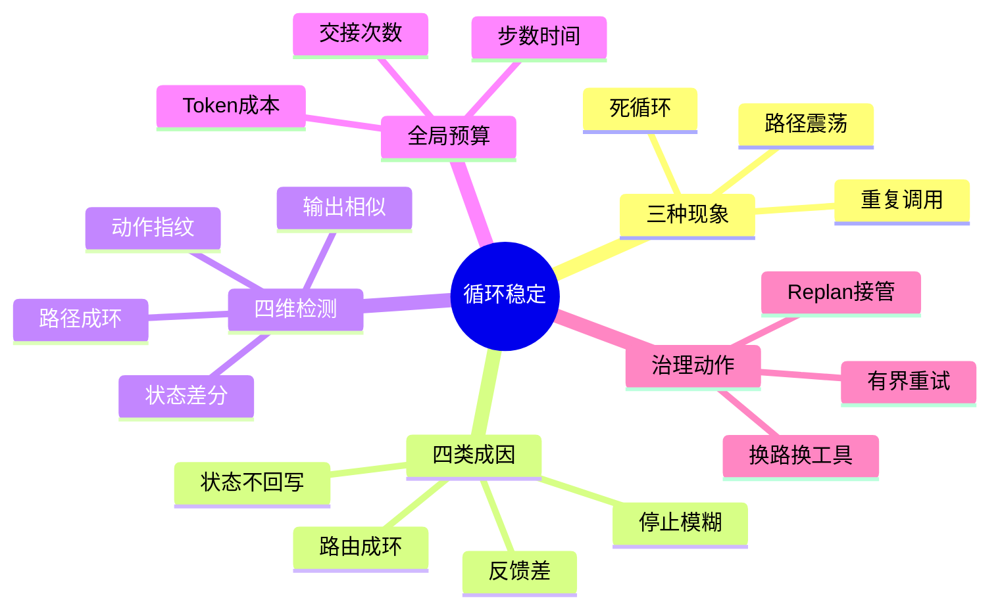

## 🔥 快速背诵

动作重复不等于死循环，可靠信号是任务状态长时间没向完成标准推进。成因沿执行链能归四类：停止条件模糊、反馈缺失、状态没回写、路由成环。检测要从四个角度看：动作指纹、输出相似度、状态差分、调用图成环。最后用步数、时间、token 做预算兜底。

> **一句话**：动作重复不等于死循环。"任务状态长时间没向完成标准推进"才是可靠信号。治理要四角度一起看——动作指纹、输出相似度、状态差分、调用图成环，再用步数时间 Token 做预算兜底。

## 🧠 导图

---

# 📖 背诵稿

### ① 路径震荡到底是什么

**它能分三个程度，但关键不是"动作又出现了"，而是"状态有没有推进"。**

重复调用是同一个工具加近似参数多次出现。路径震荡是 Agent 在几条路径间来回切，比如搜索—总结—再搜索，或者 A 交给 B、B 又交回 A。死循环是系统缺有效出口，在外部预算耗尽前自己停不下来。

这里有个容易搞错的地方：动作重复不能当成死循环。搜索 Agent 正在分页拉数据，工具名每次相同，但页码和已收集证据在变，任务有进展。接口第一次限流，系统按错误类型等待再试，也是合理容错。无进展循环的关键特征是：新一轮没带来新证据、没完成新子任务、没缩小和成功标准的差距。所以检测要看"做了什么"加"状态变了什么"。

### ② Agent 为什么会原地打转

**成因沿执行链往下排，能归成四类。**

第一类是"什么算完成"没定义清。用户说"帮我查合适会议时间"，系统却没定义要返回几个时段、要不要所有人有空、查不到满足条件时怎么退出。Checker 没验收标准，只能让 Executor"再试一下"。

第二类是工具反馈太差。超时、限流、参数错、权限拒都被包装成一句"调用失败"，模型不知道该不该重试、该改参数还是换工具，最容易继续输出上一个动作。

第三类是状态不回写。工具明明成功了，系统却没把已完成步骤、新证据、外部副作用写回状态，下一轮模型还以为"这事没做"。有副作用的工具（发邮件、扣款、建群）若缺幂等键，重复调用还会再次改外部系统，风险比多花 Token 大得多。

第四类是路由成环。多 Agent 各看局部，客服觉得要风控批，风控觉得资料不齐该交回客服，两边都没全局决策权，交接图上就出现环。Planner 和 Executor 之间也会：原计划已被工具结果证明不行，Planner 却没改计划版本，Executor 一直跑过时步骤。

### ③ 怎么在运行中抓无进展循环

**检测要从动作、结果、状态、路径四个角度同时看，单一信号容易误判。**

先看动作：每步生成"动作指纹"——把当前子任务、Agent 名、工具名、标准化后的参数拼一起取哈希。标准化很重要，参数键顺序变了或搜索词多了空格，不该被当全新动作。指纹在近期窗口反复出现，先打预警。

再看结果和状态：文本工具比结果摘要的一致或语义相似度，结构化工具直接比关键字段。状态要看已完成步骤有没有增加、待办有没有缩小、有没有拿到新证据、阻塞原因变没变。动作像、输出像、状态还没推进，循环判断才算有证据。

然后看路径：把一次任务调用链画成有向图，节点是 Agent 或工具，边是调用或 Handoff。A→B→A 只说明图上有环，还要看回到 A 时状态更新没。审核让改、执行改完再交回审核，这环可能正常；审核意见没新内容、文档也没变，才要打断。

最后加全局预算：任务开始分配最大步数、执行时间、Token、成本、单工具重试、Handoff 次数。这些是防问题放大的保险丝，不是根因诊断。简单查询和深度研究不能共用一组数字，阈值要按任务类型离线回放加线上标定。

### ④ 检测到之后，怎么把 Agent 拉出来

**第一步不是换模型，是读懂上一步失败。** 工具应返结构化错误：错误码、类型、能否重试、建议等待、可行下一步。网络抖动、限流这类临时错误，在预算内按退避重试加随机抖动；参数错、权限不足、资源不存在，要换参数、请用户授权或补信息，原样重试没意义。

第二步换路。当前动作能改参数时，要说清上次为何失败，并要求新动作和旧动作有实质差异。当前工具能力边界不匹配，换备选工具或降级到能完成部分的路径。一个工具连续多个任务都失败，调度层可开熔断器快速拒绝后续调用，避免每个 Agent 在同一故障上浪费预算。

第三步 Replan。单动作换参换工具仍推不动，问题常在原计划本身。从最近检查点恢复，把原目标、已完成结果、当前阻塞、已尝试路径交给 Planner 出新剩余计划。新计划要有新版本，并把已证无效的路径写入约束，否则 Replan 只是用更多 Token 再生成一遍旧计划。

多 Agent 的 Handoff 环要 Orchestrator 介入：读各 Agent 职责、已访问路径、全局状态，决定改派有处置权的 Agent 还是暂停请用户补信息。交接目标和接收条件写进路由规则，不能让两角色随意踢皮球。

### ⑤ 系统在循环发生前该做什么

**最省成本的治理在第一执行之前。** 每个子任务同时定义输入、预期输出、完成标准、失败出口。"查找有用信息"没法验收，改成"找到支持结论的可核验证据，指定来源无结果则返回缺失项"，Checker 才知道何时停。

状态更新要成执行协议。工具成功后，调度层在一个事务里记录结果标识、已完成步骤、对外部系统的影响。有副作用工具用任务 ID 加动作 ID 生成幂等键，业务系统据键识别重复请求，即使超时没拿到响应而重试，同一动作也不会反复产生副作用。

路由层限定职责边界。每个 Agent 写清接收条件、可交接对象、交接前必须附带事实。能用确定性状态机表达的主流程由代码控路由，只把没固定规则的边缘决策交给模型，减少无意义来回交接。

还要把每步输入输出、错误、状态增量、路由决策、预算消耗写进 Trace。线上警报告诉你"某类任务开始空转"，完整 Trace 才说明是工具反馈、状态写回还是路由规则出问题。改策略后把失败轨迹加回归集，检查新策略能否打断循环、会不会误伤正常长任务。

---

# 🔑 记忆锚

| 记什么 | 内容 |
|---|---|
| **3** 种现象 | 重复调用 / 路径震荡 / 死循环 |
| **1** 句判断 | 动作重复不等于死循环，状态长时间不向完成标准推进才是信号 |
| **4** 类成因 | 停止模糊 / 反馈差 / 状态不回写 / 路由成环 |
| **4** 维检测 | 动作指纹 / 输出相似 / 状态差分 / 路径成环 |
| **1** 道预算 | 步数 时间 Token 成本 交接次数作保险丝 |
| **3** 步治理 | 读懂失败重试 / 换路换工具 / Replan 接管 |

> **卡壳急救**：忘了就按"判断—成因—检测—治理"。判断句先说"动作重复不等于死循环，看状态推没推进"；检测四角度：指纹、相似、差分、成环。

---

# 🎯 追问速查

| 面试官问 | 你答 |
|---|---|
| 怎么判断是不是死循环？ | 动作重复不等于死循环。看任务状态是否长时间不向完成标准推进，且无新证据、无新子任务、未缩小差距 |
| 为什么会原地打转？ | 四因：停止条件模糊、工具反馈差、状态不回写、路由成环（多 Agent 交接图出现无进展环） |
| 怎么检测？ | 四角度：动作指纹查重复、输出相似度、状态差分确认进展、调用图查 Handoff 成环，配全局预算兜底 |
| 检测到后第一步？ | 先读懂失败，不是换模型。结构化错误区分临时/参数/权限，临时错误才退避重试 |
| 无进展怎么办？ | 换参数或换工具（要求实质差异），再不行从检查点 Replan 并写入已失败路径约束；多 Agent 环靠 Orchestrator 介入 |
| 怎么预防？ | 子任务定义完成标准和失败出口；工具成功事务内回写状态加幂等键；路由限定职责边界；全量写 Trace 进回归集 |

---

# 🔗 串联

- 承接 05 推理模式与 ReAct 的实现：ReAct 循环漂移、错误传播正是这里要治理的对象
- 状态回写与幂等 → 09 Agent 的长短期记忆怎么存怎么用 的状态管理
- 路由成环、Handoff → 16 多 Agent 协作与切换 的协作与切换
- 全局预算、步数兜底 → 21 Agent 延迟定位与 Trace 优化 的预算与重试
- Replan 约束 → 07 复杂任务的任务拆分 的动态重规划
- 一句话总纲：**看状态而非看动作，四角度抓空转，先读懂失败再换路或重规划**

---

# 📚 细节（背完再点开）

> [!note]- 动作指纹怎么标准化
> 把当前子任务、Agent 名称、工具名、标准化后的参数组合后取哈希。标准化的要点：
> - 参数键顺序统一（如按字母排序）
> - 去除搜索词首尾空格、归一化大小写
> - 否则"a=1&b=2"和"b=2&a=1"、多一个空格会被误判成两个不同动作
> 指纹在近期窗口反复出现，系统先打预警标记，但单凭它还不能直接判死循环。

> [!note]- 临时错误 vs 无进展的区分
> | 类型 | 例子 | 处理 |
> |---|---|---|
> | 临时性错误 | 网络抖动、接口限流 | 预算内退避重试，加随机抖动避免集中重试 |
> | 参数/权限错误 | 字段错、无权限、资源不存在 | 改参数、请授权、补信息，原样重试无意义 |
> | 无进展循环 | 换词搜但无新证据 | 禁当前路径，换参换工具，必要时 Replan |

> [!note]- 调用图成环怎么看
> 节点 = Agent 或工具，边 = 调用 / Handoff。
> - A→B→A 只说明图上有环
> - 要检查"回到 A 时状态更新没"
> - 审核让改、执行改完再交回：正常环
> - 审核意见无新内容、文档也没变：要打断的环

> [!note]- 幂等键与状态回写
> 有副作用工具（发邮件、扣款、建群）用 任务ID + 动作ID 生成幂等键。
> 工具成功后调度层在事务内记录：结果标识、已完成步骤、外部影响。
> 这样即使 Agent 因超时没拿到响应而重试，同一动作也不会反复改外部系统。

---

# 🎴 自测（遮住上面，先自己说）

> [!question]- Q1 动作重复等于死循环吗？
> 不等于。无进展循环的关键特征是状态长时间不向完成标准推进，且无新证据、无新子任务、未缩小差距。分页拉数据虽动作重复但有进展。

> [!question]- Q2 四类成因？
> 停止条件模糊（无验收标准）、工具反馈差（全包成"调用失败"）、状态不回写（下轮以为没做）、路由成环（多 Agent 交接图出现无进展环）。

> [!question]- Q3 四角度检测？
> 动作指纹查重复、输出相似度、状态差分确认进展、调用图查 Handoff 成环，再加步数时间 Token 成本交接次数的全局预算兜底。

> [!question]- Q4 检测到后第一步做啥？
> 先读懂上一步失败，不是换模型。结构化错误区分临时/参数/权限，只有临时错误才退避重试，参数权限错要改参或请授权。

> [!question]- Q5 无进展怎么治理？
> 换参数或换工具（要求实质差异），再不行从检查点 Replan 并写入已失败路径约束；多 Agent 环靠 Orchestrator 介入改派或暂停。

> [!question]- Q6 怎么预防循环？
> 子任务定义完成标准与失败出口；工具成功事务内回写状态加幂等键；路由限定职责边界；全量写 Trace 进回归集。
