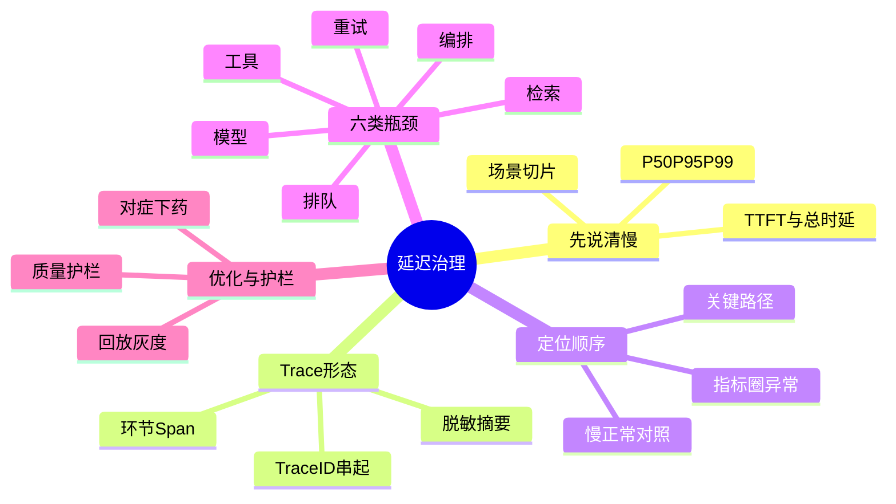

## 🔥 快速背诵

排查延迟不能凭感觉。先把一次任务拆开看：区分首字延迟和总时延，看 P95 和 P99 尾延迟，不能只看平均值，用 Trace ID 串起各环节的 Span。沿关键路径找根因，再对症下药。常见瓶颈有六类：排队、模型、检索、工具、编排、重试。优化后不能让成功率、质量和成本退化。

> **一句话**：排查延迟最怕一上来凭感觉。先把一次任务"拆开看"——区分 TTFT 和总时延、看 P95/P99 尾延迟，用 Trace ID 串起各环节 Span，沿关键路径找根因，再对症下药。

## 🧠 导图

---

# 📖 背诵稿

### ① 先别急着看 Trace，得说清"慢"是什么

**用户说 Agent 变慢，可能指两件完全不同的事。修之前先分清楚，否则改错方向白忙。**

第一种是页面迟迟没内容，用户一直面对空白。这更接近 TTFT——从请求发出到第一个 Token 到达的时间。网关排队、上下文构建、首轮检索、模型排队、模型预填充，都可能拉长它。

第二种是很快就开始输出，但 Agent 调了很多轮工具，迟迟做不完任务。这时 TTFT 可能正常，总时延却很高。模型生成速度、工具调用、Planner 决策、失败重试、反思次数、任务步数，都影响总时延。

所以我不用一个"响应时间"概括所有问题，至少同时看 TTFT 和端到端总时延。有工具步骤的任务还记录每步完成时间和整体完成时间。

### ② 只看平均值会被骗，要看分位和切片

**只看平均值很危险。90 多个请求只用两秒，少数请求慢几十秒，平均值看着还能接受，但命中慢请求的用户已经等得很难受。**

P50 帮你看典型请求，P95 和 P99 更适合发现尾部是否恶化。具体看哪个分位要结合流量、任务类型、业务承诺，不能照抄一套固定阈值。

还要先确认比较口径。简单问答和深度研究不能放一起统计，新模型和旧模型也不能混着看。我通常按任务类型、模型与供应商、工具、地区、租户、输入输出长度、发布版本切片。只有同类请求对比，才能判断延迟上涨来自系统变化，还是最近恰好来了更多复杂任务。

### ③ 一条 Agent Trace 应该长什么样

**普通接口可能只有一次数据库查询加一次下游调用，Agent 是一条动态执行链。同样一句请求，这次调一次模型，下次可能经过检索、规划、三个工具、两轮反思。只看应用日志拼不回同一个任务。**

Trace 的作用，是给一次端到端任务建一份完整"病例"。根 Span 表示整个 Agent 请求，下面拆出网关鉴权、调度排队、上下文构建、检索、模型调用、工具调用、状态存储、结果整理等子 Span。一个 Span 代表一段操作，记录开始结束时间、成功失败状态、诊断属性。

同链路 Span 共享 Trace ID，每个 Span 有自己的 Span ID 并保存父子关系。Agent 调远程工具、消息队列、子 Agent 时还要传播 Trace 上下文，跨进程跨服务后后端才知道这些操作属于同一次任务。

Span 里记什么决定以后找不找得到问题。模型调用记模型名、输入输出 Token、首 Token 到达时间、结束原因；检索记 Query 类型、召回数、各阶段耗时；工具记工具名、结果状态、错误类型、重试次数；编排记当前步骤、路由结果、计划版本、累计步数。

但可观测性不是把所有内容塞进日志。完整 Prompt、用户原文、数据库结果、工具凭证、个人信息可能含敏感数据。稳妥做法是记长度、哈希、分类标签、脱敏摘要，配合访问控制、保存周期、审计策略。排查性能不能以制造数据泄漏为代价。流量大时还要采样：只在入口随机抽会漏掉罕见超慢和错误请求，可结合错误状态、业务重要性、总耗时保留更有诊断价值的 Trace。

### ④ 从告警到根因，定位顺序不能反

**收到延迟告警，我不会先随机点开一条 Trace。单条请求只讲一个故事，证明不了整个系统。**

第一步用指标确认异常边界：TTFT 和总时延从何时涨、是 P50 还是 P95/P99 涨、成功率超时率有没有一起变。再按模型、工具、任务类型、发布版本切分，找变化最明显的组。若延迟上涨恰和一次发布、模型切换、下游异常时间重合，这些信息就是后续排查方向。

第二步选慢 Trace。不能只看最慢一条，要从异常分组抽多条慢 Trace，再找同类型同版本的正常 Trace 对照，判断慢请求共有特征——是都卡某工具，还是比正常多跑几轮模型。

第三步看瀑布图和关键路径。瀑布图把各 Span 按时间铺开，最长 Span 值得关注，但真正决定总时延的是"从请求开始到任务完成的关键路径"。两个工具并行各 3 秒，对总时延贡献约 3 秒不是 6 秒。所以不能直接相加所有子 Span 耗时，也不能看到某 Span 长就认定它是根因。

最后下钻到 Span 对应日志、错误、资源指标。模型 Span 慢，确认是客户端连接、供应商排队、首 Token、生成速度还是输出变长；工具 Span 慢，看下游接口、连接池、数据库、重试；应用内部计算慢，看 CPU、内存、线程池。Trace 告诉你哪段可疑，日志指标解释为什么可疑。

### ⑤ 六类常见瓶颈，Trace 上分别怎么看

**瓶颈大致六类，每类在 Trace 上的样子不同。**

排队：请求还没进真正调用，调度队列等待已变长，常和突发流量、并发上限、线程池耗尽、租户争抢、下游限流有关。没单独 queue Span，排队时间易被算进模型耗时，把锅甩错地方。

模型：要把网络连接、服务端等待、TTFT、持续生成分开。TTFT 涨但输出速率正常，可能是服务排队、上下文变长或预填充慢；首 Token 快但总时延长，可能是输出变长、生成速率降、或后面又触发更多步骤。流式输出只改善用户等待感，不缩短任务真正完成时间。

检索：一次 RAG 含 Query 改写、Embedding、向量召回、关键词召回、Rerank、文档读取。只建一个 retrieval 大 Span，慢了也不知道改哪。拆开才看出是向量库长尾、Rerank 慢、还是一次召回读取过多文档。

工具：第三方接口、数据库、浏览器、代码执行环境延迟特征都不同。除单次耗时，还要看超时、错误码、重试、返回大小、冷启动。同一工具连续调多次，也可能不是工具慢，而是 Agent 没用上一次结果。

编排：单个 Span 都不慢，整条 Trace 却很长，要查步骤是否膨胀。Planner 是否把简单任务拆过细、反思是否反复推翻正确结果、路由是否在多 Agent 间绕路、无依赖工具是否被逐个串行。

重试：失败调用只花一秒，但默认重试多轮且每轮退避，总时延突然拉长。Trace 要把每次尝试单独记，并保留它们属同一逻辑调用的关系。

### ⑥ 优化与验证，别治错病

**找到瓶颈再优化，不能凭感觉。每类对症下不同药。**

排队：扩容、隔离不同优先级或租户负载、设并发上限、背压、准入策略；请求带端到端截止时间，下游就不必执行已来不及返回的任务。不能只无限加机器，进速长期高于处理速，队列迟早又堆满。

模型：按难度做模型路由，简单分类改写格式交给更轻模型，复杂推理留强模型；上下文重复稳定部分用缓存，动态内容裁无关信息；约束超长输出，合理流式改善 TTFT。切模型或缩短上下文后必须重验质量，不能拿正确率换漂亮延迟图。

检索与工具：独立调用安全并行，有批量接口优先合并，高频且时效允许的结果缓存；连接复用、索引优化、返回字段裁剪、减大结果。下游持续异常要有超时、熔断、降级路径。

编排：无依赖子任务用 DAG 并行，有依赖保持顺序；Planner、Executor、Reviewer 间有清楚完成标准和停止条件，避免每轮重规划；设步数、时间、Token、重试预算，连续步骤无新结果及时换路或停。

重试：先按错误类型判断是否值得重试。网络抖动临时限流在总截止时间内有界退避加随机抖动；参数错、权限不足、资源不存在原样重试无意义。有副作用工具用幂等键，避免超时重试导致重复扣款、重复发消息。

验证不能用"试几次感觉快了"收尾。上线前把历史慢 Trace 和典型任务整理成回放集，相同输入环境下比修改前后；除端到端时延，还比各阶段 Span 对关键路径贡献，确认下降来自预期环节。上线用灰度或受控实验，继续按同口径看 TTFT、总时延、P50/P95/P99。平均降但 P99 升，尾部用户可能更差；TTFT 降但总时延超时率涨，也不算完整成功。最后设护栏：任务成功率、答案质量、工具正确率、安全违规率、单任务成本至少不能不可接受退化。

---

# 🔑 记忆锚

| 记什么 | 内容 |
|---|---|
| **2** 个时延 | TTFT（首 Token 等待）/ 总时延（任务完成耗时） |
| **3** 个分位 | P50 典型 / P95 / P99 尾部，别只看平均 |
| **1** 条 Trace | Trace ID 串起各环节 Span，传播上下文，脱敏摘要 |
| **4** 步定位 | 指标圈异常 → 慢正常对照 → 瀑布图关键路径 → 下钻日志指标 |
| **6** 类瓶颈 | 排队 / 模型 / 检索 / 工具 / 编排 / 重试 |
| **1** 组护栏 | 成功率 质量 安全 成本不能退化 |

> **卡壳急救**：忘了就按"慢是什么—Trace 怎么建—定位顺序—六类瓶颈"。先说 TTFT 和总时延要分开，再看 P95/P99 不平均，关键路径不能把 Span 耗时直接相加。

---

# 🎯 追问速查

| 面试官问 | 你答 |
|---|---|
| Agent 变慢先做什么？ | 先分清 TTFT 还是总时延，再看 P50/P95/P99 和场景切片，不凭感觉改模型 |
| 为什么不能只看平均值？ | 少量长尾请求被平均掩盖，用户抱怨的正是 P99 尾延迟；分位加切片才看得出退化 |
| Trace 怎么建？ | 同一 Trace ID 串起网关、排队、上下文、检索、模型、工具、编排、整理各 Span，传播上下文，记耗时状态 Token 并脱敏 |
| 最长 Span 就是根因吗？ | 不一定。并行 Span 重叠、父 Span 含子 Span，耗时不能直接相加；沿关键路径判断谁真推迟了结束 |
| 六类瓶颈？ | 排队、模型、检索、工具、编排、重试，每类在 Trace 上表现不同 |
| 优化后怎么验？ | 历史 Trace 回放比前后，灰度看分位；护栏守成功率、质量、安全、成本，不能只压时延 |

---

# 🔗 串联

- 承接 07 复杂任务的任务拆分：拆太细导致编排步骤膨胀，正是延迟来源之一
- TTFT 与总时延 → 17 上下文工程 的上下文长度影响预填充
- 重试放大、幂等键 → 20 Agent 循环稳定性与无进展检测 的退避重试
- 编排步骤膨胀、DAG 并行 → 11 Single-Agent 与 Multi-Agent 的设计方案
- 护栏质量安全 → 19 Agent 效果评测与评测集设计 的线上层指标
- 一句话总纲：**拆开看（TTFT/分位/Trace），沿关键路径找根因，对症下药且守住质量护栏**

---

# 📚 细节（背完再点开）

> [!note]- Span 该记什么
> | 环节 | 关键属性 |
> |---|---|
> | 模型调用 | 模型名、输入/输出 Token、首 Token 到达时间、结束原因 |
> | 检索 | Query 类型、召回数量、各阶段（改写/Embedding/召回/Rerank/读取）耗时 |
> | 工具 | 工具名、结果状态、错误类型、重试次数 |
> | 编排 | 当前步骤、路由结果、计划版本、累计步数 |
> 敏感内容（完整 Prompt、用户原文、凭证）只记长度/哈希/脱敏摘要。

> [!note]- 关键路径不能简单相加
> 两个工具并行各耗时 3 秒，对总时延贡献约 3 秒而非 6 秒。
> 父 Span 时间已包含子 Span，不能把父子时间再加一遍。
> 瀑布图里最长 Span 未必是根因，要沿"请求开始到任务完成"的关键路径判断。

> [!note]- 常见五个面试坑
> 1. 一听慢就默认模型慢——排队/检索/工具/编排/重试都可能更慢
> 2. 只报平均响应时间——掩盖长尾，应区分 TTFT、总时延、分位
> 3. 最长 Span 即根因——并行重叠、父子包含，耗时不能直接加
> 4. 用并行解决一切——只有无依赖且副作用可控的步骤才适并行
> 5. 优化后只验延迟——必须与成功率、质量、安全、成本一起验收

> [!note]- 模型瓶颈怎么细分
> - TTFT 涨但输出速率正常：服务排队、输入上下文变长、预填充慢
> - 首 Token 快但总时延长：输出变长、生成速率降、后面又触发更多步骤
> - 流式输出只改善用户感知等待，不缩短任务真正完成时间

---

# 🎴 自测（遮住上面，先自己说）

> [!question]- Q1 用户说慢，先分清什么？
> 先分 TTFT（首 Token 等待，对应空白页）和总时延（任务完成耗时，对应多轮工具迟迟做不完）。还要看 P50/P95/P99 和场景切片，不能只看平均。

> [!question]- Q2 Trace 怎么建？
> 同一 Trace ID 串起网关、排队、上下文、检索、模型、工具、编排、整理各子 Span，跨进程传播上下文；记耗时、状态、Token、步骤、错误并脱敏，敏感内容只记摘要。

> [!question]- Q3 定位顺序？
> 先指标圈异常（何时涨、哪个分位、按版本工具切分），再抽多条慢 Trace 与正常对照，看瀑布图找关键路径，最后下钻日志与资源指标确认根因。

> [!question]- Q4 六类瓶颈？
> 排队（queue Span 缺失易被误算进模型）、模型（TTFT 与生成分开）、检索（拆开 RAG 各阶段）、工具（长尾重试冷启动）、编排（步骤膨胀串行绕路）、重试（多轮退避放大）。

> [!question]- Q5 为什么最长 Span 未必是根因？
> 并行 Span 时间重叠，父 Span 已含子 Span，耗时不能直接相加；要沿关键路径判断哪个操作真正推迟了任务结束。

> [!question]- Q6 优化后怎么验证？
> 历史慢 Trace 回放比前后，灰度看 TTFT/总时延/P50/P95/P99；护栏守成功率、质量、安全、成本，不能只压时延。
