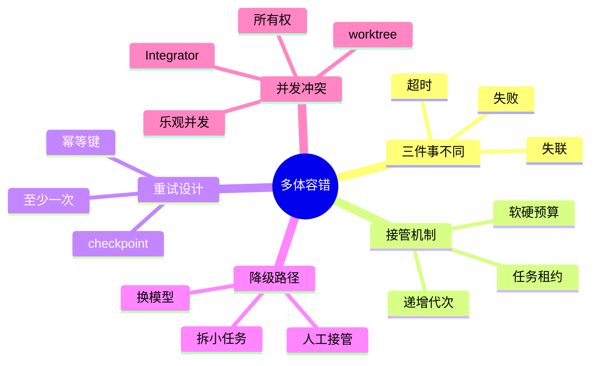

## 🔥 快速背诵

超时失联只说明协调器暂时看不到子 Agent，不等于它已经停了，三种情况的处理方式完全不同。做法是用可续租的 lease 加递增代次做故障接管，用 checkpoint 加幂等键避免重复副作用。并发冲突不要整库加锁，吞吐会退回单 Agent；用所有权划分加乐观并发，再加唯一的 Integrator 收口。

> **一句话**：超时失联只说明协调器暂时看不到子 Agent，不等于它已停。用可续租的 lease 加递增代次做故障接管，用 checkpoint 加幂等键避免重复副作用，用所有权加乐观并发加唯一 Integrator 解决并发改码冲突。

## 🧠 导图

---

# 📖 背诵稿

### ① 超时、失联、失败，真的是一回事吗

**最常见的坑，是看到超时直接宣布失败、派新 Agent 从头重跑。但其实至少有三种可能，处理方式完全不同。**

协调器让代码 Agent 改支付模块，十分钟没回音。可能是模型调用真卡死、Agent 进程已退出，或者它还在跑只是心跳没传回来。前两种算执行失败，最后一种更偏通信故障——协调器看到的是"暂时联系不上"，不是"旧执行者绝对不会再动"。

如果这时直接派新 Agent 从头执行，旧 Agent 恢复网络后也可能提交，于是同一任务有两个执行者。系统一看超时就重试，看似可用性高了，实际把一次故障变成重复写入、结果覆盖、甚至重复扣款。

所以至少要分别记执行状态和通信状态：执行状态是 PENDING→RUNNING→SUCCEEDED，通信状态记最近心跳、租约到期、进程健康。两者不能混成一个简单 online 字段。

### ② 为什么任务租约比永久锁更适合接管

**锁解决"现在谁能进门"，租约解决"这把临时钥匙到什么时候失效"。** 调度器把任务交给子 Agent 时，同时发一份有期限的租约，至少含 task_id、worker_id、lease_expire_at、递增 generation。

子 Agent 正常工作时定期心跳续租。协调器在一两次心跳没到时只标可疑，不立即重派；超过租约加宽限期，才把任务放回队列，给新执行者更大的 generation。

问题来了：旧 Agent 恢复后不知道自己过期，仍提交结果怎么办？只靠锁 TTL 挡不住，因为旧进程可能早进临界区。更稳妥的是让任务状态和产物存储都检查执行代次。旧 Agent 带 generation=7 提交，任务当前已是 8，存储层直接拒这次旧写入。这个递增代次常叫 fencing token，可理解成会失效的排队号码。

超时也不该只有一个数字。模型首字延迟、工具调用超时、整个子任务预算、租约时长，代表不同边界。深度检索二十分钟可能合理，但单次 HTTP 卡二十分钟通常不合理。生产系统每层分别设软超时和硬预算，软超时用于取消当前动作或切路径，硬预算负责终止整项任务并升级处理。

### ③ 重试必须和幂等、checkpoint 一起设计

**超时后直接重跑，最大风险不是多花 Token，而是重复产生副作用。** 比如 Agent 已创建工单，只是成功响应在网络中丢了。调度器看到超时重执行，又建一张内容相同的工单。

所以每个可重试步骤要有稳定身份。常用 task_id + step_id + operation_type 生成幂等键，同一逻辑动作不管哪个 Agent 接管都带同一键。下游保存幂等键和首次结果，后续重复请求直接返原结果，而不是再写一次。

但不是所有外部系统都支持幂等键。这时 checkpoint 很关键：它不能只存"做到第三步"，还要记已完成步骤、输入版本、产物位置、工具调用编号、外部资源 ID，以及写操作当前是 planned、succeeded、failed 还是 unknown。

接管者遇 succeeded 跳过，遇明确 failed 才在预算内重试。遇 unknown 不能凭感觉再执行，要按业务键先查外部系统。既查不了又不能幂等重放的，应暂停转人工。

这里有误区：加幂等键不等于系统能严格"只执行一次"。网络故障下执行方通常无法仅凭超时判断远端成功。更现实的目标是允许"至少一次"投递，再通过幂等、唯一约束、结果查询、补偿，把最终副作用收敛到业务可接受的一次。

### ④ 谁来接管，以及怎么降级

**租约到期只是允许接管，接下来还要决定怎么接。** 协调器先读最近一次已提交的 checkpoint，而不是把原始 Prompt 原样再发一遍。接管上下文要含原目标、验收标准、已完成产物、当前阻塞、尝试过的路径、剩余预算。

如果只是某工具暂时限流，同能力 Agent 退避后继续。若模型多次完不成同一步，可换更强模型，或把任务拆成更小确定性步骤。外部依赖不可用时，可返部分结果并明确缺失项。涉及付款、删除、发布等高风险动作且历史结果无法确认，应停止自动接管转人工。

接管也要限次数。一个坏任务被十个 Agent 轮流接走，不叫高可用，只是把死循环放大。系统要记接管次数、连续失败类型、剩余预算；超阈值进降级或人工，并留完整 Trace，方便判断是工具故障、任务不可执行还是模型能力不足。

### ⑤ 多个 Agent 改同一仓库，先别急着上锁

**很多人看到并发修改第一反应是"整个仓库加一把锁"。这样确实安全，但所有 Agent 排队干活，吞吐量回到单 Agent，Multi-Agent 没意义了。**

更好第一步是在规划阶段减少写集合重叠。Planner 不只拆任务，还要为每个子任务标出预计修改的模块、文件、接口，并声明任务所有权与文件所有权。比如 A 负责服务端接口、B 负责前端页面、C 负责测试。公共类型、依赖清单、全局配置是热点资源，默认由一个明确 Owner 改。

要区分两种所有权：任务所有权回答"谁对这个子任务最终结果负责"，文件所有权回答"当前阶段谁可以提交这个文件"。同一任务可能改多文件，同一文件也可能在不同阶段交给不同 Agent，但同一版本不能没有明确写入者。

### ⑥ worktree、乐观并发、唯一提交者

**规划只能减少冲突，不能保证没冲突。执行时让每个 Agent 在独立 Git worktree 或 branch 工作，并记录开始时的 base_commit。** 这样 A 的半成品不污染 B 的上下文，失败任务也不在共享目录留难识别的修改。

普通文件用乐观并发。Agent 提交时 Integrator 比它的 base_commit 和当前目标分支。相关文件没变就尝试合并；已被其他任务改了，就要求基于新版本重应用补丁，或把冲突上下文交回原 Agent 修正。

少数高频热点资源，如全局路由表、数据库迁移序号、依赖锁文件，加带租约的短锁。锁只保护真不能并行的提交阶段，不该覆盖 Agent 思考、生成代码、跑局部测试的整个过程，否则一个 Agent 调模型卡住就拖住所有任务。

注意 Git 只能发现文本冲突，发现不了语义冲突。A 把函数参数从字符串改成对象，B 在另一文件继续按字符串调用，两分支可能自动合并成功但代码已不一致。接口契约、Schema、测试、静态分析才是识别这类问题的第二道防线。

所以必须有唯一最终提交者。多个 Agent 都能直写主分支，系统难回答"当前仓库状态谁负责"。更稳妥是只有 Integrator 或 Orchestrator 有最终提交权，其他只产候选分支、补丁、验证证据。Integrator 先按任务 DAG 和接口依赖定合并顺序：先合公共类型和服务端接口，再合调用方，最后合测试；每次合完跑格式检查、静态检查、受影响单测，全部候选合完跑集成或端到端测试。文本冲突不要随意选一边，要留两边意图、最新基线、冲突文件让负责模块 Agent 重新生成补丁；自动合并成功但测试失败，把失败用例、相关 Trace、接口变更一并交回。验收通过才生成唯一最终提交。

这里要分清：心跳、租约、超时解决"谁还活着、谁可接管"的通信和活性问题；幂等键、执行代次、版本校验、合并验收解决"多个执行者出现时结果怎么一致"的一致性问题。给消息中间件加重试能提高到达率，却不能自动解决重复副作用和语义冲突。

---

# 🔑 记忆锚

| 记什么 | 内容 |
|---|---|
| **3** 件事不同 | 超时 / 失联（通信）/ 失败（执行） |
| **1** 个接管机制 | 可续租 lease + 递增 generation（fencing token） |
| **2** 个重试基石 | checkpoint（存步骤与状态）+ 幂等键（去重副作用） |
| **1** 个现实目标 | 至少一次投递 + 幂等收敛到业务可接受的一次 |
| **2** 种所有权 | 任务所有权 / 文件所有权，先减写重叠 |
| **1** 个最终提交者 | 唯一 Integrator 按 DAG 合并验收 |

> **卡壳急救**：忘了就分两层——通信层（心跳/租约/代次解决谁活着谁接管）和一致性层（幂等/版本/唯一提交者解决结果一致）。再加 checkpoint 防重复副作用。

---

# 🎯 追问速查

| 面试官问 | 你答 |
|---|---|
| 超时了直接重跑行吗？ | 不行。超时可能是通信故障，旧 Agent 恢复后也会提交，造成双执行者、重复写入甚至重复扣款。先区分执行状态与通信状态 |
| 怎么安全接管？ | 任务带可续租 lease 和递增 generation；租约过期才重派并给更大代次；旧代次提交被存储层据代次拒绝（fencing token） |
| 重试怎么避免重复副作用？ | 每步用 task_id+step_id+operation_type 生成幂等键；checkpoint 记写操作状态；unknown 先查外部系统，查不了转人工 |
| 能严格只执行一次吗？ | 难。网络故障下无法仅凭超时判远端成功。现实目标是至少一次投递，再用幂等、唯一约束、查询、补偿收敛到可接受一次 |
| 并发改码怎么处理？ | 先减写重叠（任务/文件所有权）；各 Agent 独立 worktree；普通文件乐观并发（比 base_commit），热点文件短锁；唯一 Integrator 按 DAG 合并验收 |
| Git 合并成功就安全吗？ | 不。Git 只管文本冲突，管不了语义冲突（如改参数类型但调用方没改）。要靠接口契约、Schema、测试、静态分析 |

---

# 🔗 串联

- 承接 10 什么是 Multi-Agent 与 11 Single-Agent 与 Multi-Agent 的设计方案：那两篇讲架构，这篇讲故障与并发
- 租约与代次、心跳活性 → 16 多 Agent 协作与切换 的路由与交接
- 幂等键、checkpoint → 09 Agent 的长短期记忆怎么存怎么用 的状态持久化
- 乐观并发、降级 → 20 Agent 循环稳定性与无进展检测 的接管与 Replan
- 唯一 Integrator 验收 → 19 Agent 效果评测与评测集设计 的端到端验收
- 一句话总纲：**通信层用租约代次管活性，一致性层用幂等版本和唯一提交者管结果**

---

# 📚 细节（背完再点开）

> [!note]- 执行状态与通信状态要分开
> - 执行状态：PENDING → RUNNING → SUCCEEDED
> - 通信状态：最近心跳时间、租约到期、进程健康
> 两者不能混成一个 online 字段。看到"联系不上"只是通信故障，不代表旧执行者绝对停了。

> [!note]- 幂等键与写操作状态机
> 幂等键 = task_id + step_id + operation_type
> 下游保存键与首次结果，重复请求直接返回原结果。
> checkpoint 的写操作状态：
> - planned：待执行
> - succeeded：跳过
> - failed：预算内重试
> - unknown：先按业务键查外部系统，查不了转人工

> [!note]- 软超时与硬预算分层
> | 边界 | 例子 | 作用 |
> |---|---|---|
> | 模型首字延迟 | 单次生成等太久 | 软超时：切路径或降级 |
> | 工具调用超时 | 单次 HTTP 卡住 | 软超时：取消当前动作 |
> | 子任务预算 | 深度检索 20 分钟 | 软超时合理 |
> | 硬预算 | 整项任务总时限 | 终止任务并升级人工 |
> 简单查询和深度研究不能共用一组数字。

> [!note]- 并发改码三层配合
> 1. 规划期：标任务所有权与文件所有权，减少写集合重叠，热点资源定 Owner
> 2. 执行期：独立 worktree/branch 记录 base_commit；普通文件乐观并发，热点文件带租约短锁
> 3. 合入期：唯一 Integrator 按 DAG 顺序合并，每步跑静态检查+单测，全量跑集成测试；文本冲突交回原 Agent，语义冲突靠测试/静态分析发现

---

# 🎴 自测（遮住上面，先自己说）

> [!question]- Q1 超时直接重跑有什么坑？
> 超时可能是通信故障，旧 Agent 恢复后仍会提交，导致双执行者、重复写入甚至重复扣款。要区分执行状态与通信状态，不能一见超时就重派。

> [!question]- Q2 怎么安全接管子 Agent？
> 任务带可续租 lease 与递增 generation；租约加宽限期后才重派并给更大代次；旧代次提交被存储层据代次拒绝（fencing token），防止旧执行者覆盖新结果。

> [!question]- Q3 重试怎么避免重复副作用？
> 每步用 task_id+step_id+operation_type 生成幂等键；checkpoint 记写操作状态；unknown 先查外部系统，查不了转人工。现实目标是至少一次投递加幂等收敛。

> [!question]- Q4 并发改同一仓库怎么处理？
> 先减写重叠（任务/文件所有权），各 Agent 独立 worktree，普通文件乐观并发（比 base_commit），热点文件短锁，最后由唯一 Integrator 按 DAG 合并验收。

> [!question]- Q5 Git 合并成功就安全吗？
> 不。Git 只管文本冲突，管不了语义冲突（如改参数类型但调用方未改）。要靠接口契约、Schema、测试、静态分析作为第二道防线。

> [!question]- Q6 通信问题和一致性问题怎么分清？
> 心跳/租约/超时解决"谁活着、谁可接管"的活性问题；幂等键/代次/版本校验/合并验收解决"多执行者时结果一致"的一致性问题。两者机制不同。
