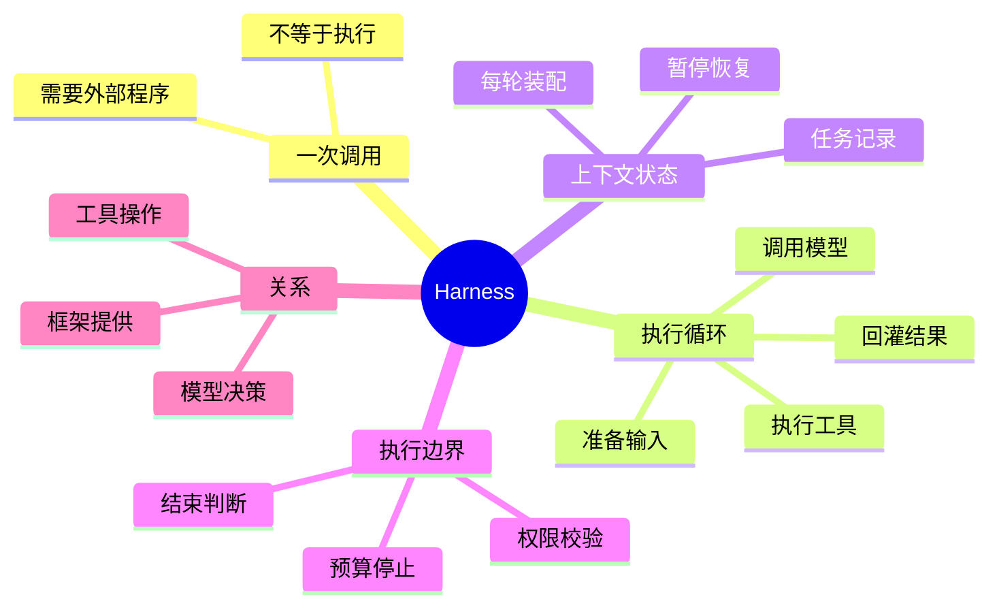

## 🔥 快速背诵

Harness 是围绕大模型的运行支撑：把模型调用和工具执行组织成一个能按真实结果连续推进的循环，并负责上下文、进度、权限和结束判断。接几个工具不等于做完了，模型提一个动作，到真正执行之间还差着一层。上下文回答这轮看见什么，任务状态回答进行到哪了，两者用途不同。运行停不等于任务成。

> **一句话**：Agent Harness 是围绕大模型的一套**运行支撑**——核心是把"模型调用"和"工具执行"组织成一个能根据真实结果连续推进的循环，并负责上下文、进度、权限和结束判断。光接工具、光写循环、光说用框架，都只说到了它的一部分。

## 🧠 导图



---

# 📖 背诵稿

### ① 一次模型调用，为什么还不等于任务执行

**最容易答偏的，是把"给模型接几个工具"当成 Harness 全做完了。其实模型返回一句工具请求，离真正执行还差着一层。**

你可以把它想成：模型说"读取文件"，只是描述了一个动作，就像你嘴上说"我要点外卖"，但没真的下单。它输出的 `read_file` 加文件路径，哪怕格式再标准，也只是一个请求。得有程序找到这个工具的实现，真的打开文件，再把内容交回模型。没有这个反馈，模型根本不知道文件里写了什么，也没法基于新材料继续判断。

**这里要把两种能力分开：模型根据输入选动作，外部程序让动作发生并提供结果。** 模型擅长分析，替代不了程序访问文件或启动进程的能力。所以从"模型推理"走到"Agent 执行"，必须在模型之外有人组织调用、动作和反馈——这层组织，就是 Harness。它可以自己写，也可以由 SDK 或系统提供。

### ② Harness 怎样把模型和工具接成执行循环

**我理解 Harness 的核心工作，就是安排"连续的交接"：每一轮准备输入、调模型、接住工具请求、执行、再把结果喂回下一轮。**

具体走法是：每轮开始，运行程序准备当前输入（目标、约束、相关材料、可用工具说明），调模型；模型返回工具请求后，程序解析工具名和参数、做必要检查、调用实际工具；工具结束后，程序按模型接口要求把"请求+结果"放进后续输入。下一轮模型看到真实观察，才能决定继续用工具、调整做法还是给最终回复。

负责推进这个循环的是运行程序，不是模型。**固定的是交接机制，具体动作可以根据观察变化**——模型读到新材料可能补查，也可能发现原判断不成立。Harness 不必提前写死每步用哪个工具，但要规定请求怎么解析、操作怎么执行、结果怎么返回。这点特别关键：工具返回"找不到文件"和"读取成功但内容为空"是两种事实，命令超时也不能直接当成命令从未执行，程序要区分实际状态，避免模型基于含糊的成功或失败继续推理。

### ③ 为什么还要管理上下文和任务状态

**循环跑起来后，一个很容易被漏掉的点：模型每轮收到的材料会越来越多，旧信息会和当前信息混在一起。**

把全部历史持续拼进输入，既逼近上下文容量，又让模型分不清哪个是现状。比如一个错误已经解决了、又冒出新问题，模型得知道哪个结果是当前的，不能把旧报错继续当现状。所以 Harness 要在调用前组织上下文：保留目标、限制、当前相关证据，减少重复；长文件或日志放外部，只带必要内容和可读取位置，后续按需补查。

这里要分清"上下文"和"任务状态"两件事，用途不同。**任务状态记录的是"任务进行到哪了"**——已执行的操作、未解决的问题、产物位置、验证结果；当前上下文则从这些记录和实际环境里选本轮需要的信息。任务记录可以长期保存，每轮输入不必包含记录全部内容。这个区分对暂停恢复很重要：程序中断后，不能只给模型一句"继续"，得读取进度、核对当前产物，才知道哪些做完了、哪些还没验证。聊天里说"准备保存文件"不代表文件已保存，记录里写"请求已发出"也不代表外部系统已成功处理。

### ④ 为什么执行边界和结束判断也属于运行支撑

**很多人以为 Harness 只管"多调几次模型"。其实模型能提动作，不代表每个动作都该执行——权限和停止控制也是它的一部分。**

请求可能格式错、可能访问不允许的资源、可能超出用户授权范围。Harness 要在实际执行路径上落实约束：哪些工具可用、哪些文件能改、什么操作需确认。Prompt 可以告诉模型守规矩，但真正阻止越界还得靠程序检查加环境限制。**明确的权限边界不能只依赖模型自觉遵守。**

持续运行还要有资源和停止控制。某个工具一直不返回，或者模型重复执行没进展的操作，都得处理。时间、步数、费用预算能限制一次运行的消耗，取消请求也要传到对应执行过程。这里要分清"运行停止"和"任务完成"：**达到预算只说明这轮不能继续，不能把任务标成成功；模型说"完成"也只是个待结合结果判断的结论。** 有明确验收条件的任务，运行系统可以通过测试、产物检查或业务状态查询提供依据；有些结果需人判断就保存产物交人审。工具成功、模型认为完成、任务满足要求，是不同层面的判断，要在运行中区分开。

### ⑤ Harness 与模型、Prompt、工具、框架的关系

**这几个词老被混为一谈，因为它们常出现在同一套产品里。但从职责看，可以清楚分开。**

模型负责处理输入、生成判断和下一步输出；Prompt 是模型收到的指令与要求，影响它怎么理解目标和使用工具；工具提供真实操作，比如查数据、读文件、调接口；Harness 组织这些部分怎么配合——选和准备输入、调模型、处理输出、安排工具执行、把结果用于下一轮。Prompt 的装配、工具的接入、相关运行策略，都可以是 Harness 的一部分。**所以这些不是互斥的模块名：一个 Harness 可以预置提示和工具，也可以让使用者替换它们。**

框架或 SDK 和 Harness 的关系，取决于封装范围。通用框架可能只提供模型调用、工具注册、状态组件，开发者自己搭运行机制；已经预置循环、上下文处理和执行策略的 SDK，本身就提供 Harness 能力。**不能只凭"用了某个框架"就判断运行问题都解决了。** 同一个模型，拿到的材料、可做的操作、反馈方式不同，表现也不同——模型决定怎么分析，Harness 影响它能看见什么、能执行什么、怎么根据结果继续工作。

---

# 🔑 记忆锚

| 记什么 | 内容 |
|---|---|
| **1** 句定义 | Harness = 围绕模型的运行支撑，组织"模型调用+工具执行"循环 |
| **2** 种能力 | 模型选动作 / 外部程序让动作发生并提供结果（模型≠程序） |
| **1** 个循环 | 准备输入 → 调用模型 → 处理输出 → 执行工具 → 回灌结果 |
| **2** 样东西 | 上下文（本轮看见什么）/ 任务状态（进行到哪了），用途不同 |
| **1** 组边界 | 权限校验 + 预算停止 + 结束判断（运行停≠任务成） |
| **1** 句关系 | 模型决策、工具操作、Harness 协调；框架可能提供也可能不提供 Harness |

> **卡壳急救**：忘了就回到一句话——"模型返回工具请求，谁执行、谁把结果交回、下一轮给模型看什么、中断怎么续、谁判断完成"。这五问正好对应循环、上下文状态、执行边界。

---

# 🎯 追问速查

| 面试官问 | 你答 |
|---|---|
| 接几个工具就是 Harness 吗？ | 不是。模型返回工具请求只是意图，需外部程序执行并把结果交回模型，这层组织（含循环、上下文、状态）才是 Harness |
| 谁真正驱动执行循环？ | 运行程序。模型每轮只输出下一步请求，程序解析、执行、回填，再调模型。模型负责选动作，程序负责让动作发生 |
| 模型说"完成"就能结束吗？ | 不能。那是待结合结果判断的结论。有明确验收条件的任务要靠测试/产物检查/业务状态查询，运行停（达预算）也不等于任务成 |
| 上下文和任务状态有什么区别？ | 上下文是本轮给模型看的材料；任务状态是任务进行到哪了（已做的、未决的、产物、验证）。状态可长期保存，每轮输入不必含全部 |
| 为什么需要任务状态？ | 为暂停恢复。中断后不能只说"继续"，要读进度、核对当前产物，否则会把"准备执行"误当"已执行" |
| 框架等于 Harness 吗？ | 不一定。通用框架只给组件，开发者自己搭机制；预置循环的 SDK 才提供 Harness。不能凭用了框架就认为运行问题都解决 |
| Prompt 算 Harness 吗？ | Prompt 是给模型的指令，它的装配可以是 Harness 的一部分，但 Prompt 本身不执行、不反馈、不控边界 |

---

# 🔗 串联

- 执行循环、谁驱动 → 05 推理模式与 ReAct 的实现 的"代码驱动循环，模型只输出一步"
- 手搓还是用框架 → 13 手搓 Agent 还是用框架（框架是否提供 Harness）
- 上下文装配、任务记录 → 17 上下文工程、18 多轮对话状态管理
- 预算停止、无进展 → 20 Agent 循环稳定性与无进展检测
- 通向 26 如何设计一个完整的 Agent Harness：这篇讲概念，下篇讲怎么把各模块落地
- 一句话总纲：**模型给意图，工具给操作，Harness 把两者接成可持续运行、可暂停、可判断完成的任务过程**

---

# 📚 细节（背完再点开）

> [!note]- 执行循环的过程图示
> ```
> 准备输入 → 调用模型 → 处理模型输出 → 执行工具
>    ↑                                      ↓
>    ←            纳入实际执行结果            ←
> ```
> 负责推进的是运行程序。模型根据当前信息选下一步，程序安排下一次调用，并处理等待、取消、执行失败等情况。固定的是交接机制，具体动作随观察变化。

> [!note]- 模型、Prompt、工具、Harness 的职责对比
> | 名称 | 在任务中的主要作用 |
> |---|---|
> | 模型 | 理解材料，形成判断，生成下一步输出 |
> | Prompt | 向模型表达目标、约束与行为要求 |
> | 工具 | 提供文件、数据和外部系统的实际操作 |
> | Harness | 组织模型调用、动作执行、反馈与运行控制 |
> | Agent | 模型与运行机制配合后，围绕目标工作的整体系统 |
> 这些不是互斥模块：一个 Harness 可预置提示和工具，也可让使用者替换；还能把存储与执行交给外部服务再协调。

> [!note]- 上下文组织的常见做法
> - 保留目标、限制、当前相关证据，减少重复内容
> - 长文件/日志存外部，只带必要内容和可读取位置，按需补查
> - 工具调用记录遵守模型接口消息格式，请求与结果通过调用编号关联，不能只留结果不留请求
> - 工具返回控大小：几万行日志只返失败用例、关键报错和日志路径
> - 调用前检查输入占用，近容量边界时减无关材料或把已结束过程整理成摘要（保留约束和未决状态）

> [!note]- 结束判断的几个状态要区分
> - 工具成功：动作执行了
> - 模型认为完成：只是结论建议
> - 任务满足要求：靠验收条件/业务状态核对
> 运行系统可保存的状态至少包括：成功、失败、等待、取消、预算耗尽，并各自带原因。达到步数上限只说明这次运行该停，不是完成证据；测试通过才是验收中的一项证据。

---

# 🎴 自测（遮住上面，先自己说）

> [!question]- Q1 一次模型调用为什么不等于任务执行？
> 模型返回工具请求只是意图（如"读取文件"），需外部程序找到实现、真正执行、把结果交回模型。模型选动作，程序让动作发生并提供结果，两者能力不同。

> [!question]- Q2 Harness 的执行循环怎么走？
> 准备输入→调模型→接住工具请求→执行→把"请求+结果"回灌下一轮。推进循环的是运行程序，不是模型；固定的是交接机制，具体动作随观察变化。

> [!question]- Q3 上下文和任务状态有什么不同？
> 上下文是本轮给模型看的材料（从状态和环境中选取）；任务状态是任务进行到哪了（已做操作、未决问题、产物、验证）。状态可长期保存，用于暂停后恢复。

> [!question]- Q4 为什么执行边界和结束判断属于 Harness？
> 模型能提动作不代表都该执行，需程序落实权限、隔离、确认。还要有预算（时间/步数/费用）和停止控制。运行停止≠任务完成，模型说完成只是待核验结论，需验收条件支撑。

> [!question]- Q5 Harness 和框架是什么关系？
> 取决于封装范围：通用框架只给组件，开发者自建机制；预置循环的 SDK 本身提供 Harness。不能凭用了框架就认为运行问题全解决。

> [!question]- Q6 模型、Prompt、工具、Harness 怎么分？
> 模型决策、Prompt 下指令、工具提供真实操作、Harness 组织协调四者配合并落地运行控制。它们不是互斥模块，一个 Harness 可预置或替换提示与工具。
