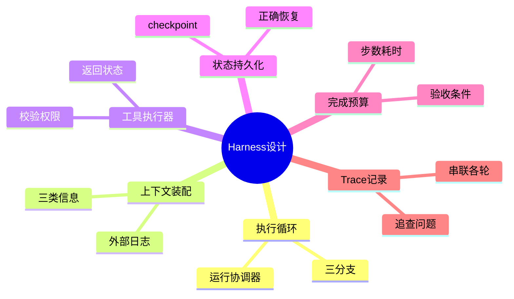

## 🔥 快速背诵

设计 Harness 要拿一个具体任务把它长出来，不是背模块清单。围绕执行循环接六块：运行协调器推进循环、上下文装配提供当前材料、工具执行器落实操作和权限、状态存储供恢复、验证器按验收条件判完成、Trace 记录过程。核心一句：模型说完成只是建议，有证据才盖章。运行预算用完只是停，不等于做完。

> **一句话**：设计完整 Harness，就是围绕一个执行循环把几块职责接起来——运行协调器推进循环、上下文装配提供当前材料、工具执行器落实真实操作和权限、状态存储保存进度供恢复、验证器按验收条件判定完成、Trace 记录每轮过程供追查。模型说"完成"只是建议，得有证据才盖章。

## 🧠 导图



---

# 📖 背诵稿

### ① 从修一个 Bug 看清要搭哪些运行部分

**我理解设计 Harness 最好的办法，是拿一个具体任务把它从问题里长出来，而不是背模块清单。就用"修复登录 Bug：空密码返回 500，但不改接口字段"。**

模型能分析这个问题，但仓库文件、终端测试进程都在模型之外。它生成"读取登录源码"，程序还得打开文件；它生成补丁，程序还得写进去。你要设计的 Harness，就是组织这些操作的运行程序，加上配合它的上下文、状态和执行控制。

最开始不用拆很多服务，一个程序里放模型调用、工具注册、运行循环就能起步。但**这些部分要有各自接口**——否则以后加暂停、恢复、权限检查时，所有逻辑会挤进同一个函数。开发者规定的是动作怎么执行、结果怎么返回、哪些动作允许；具体排查顺序（先看源码还是先跑测试）可以随观察结果变化，由模型选。

### ② 用执行循环把一次推理接成多步任务

**这是最核心的一块：运行协调器负责"模型输出后程序接着做什么"。我至少区分三种情况。**

模型请求调工具，走执行分支；模型缺必要信息（比如不知道用户指哪个接口），走等待用户分支，保存进度并设为等待；模型提出完成，走结果检查分支，检查验收条件，通过才结束、没通过就把差距反馈回去继续。这里要强调：**不要把所有文本都当命令**。模型说"我打算查看源码"只是文字；通过约定接口返回的工具名和参数，才是程序能解析的请求。

最小循环就是：每轮从任务记录准备输入 → 调模型 → 若是工具请求就校验执行、保存结果、更新状态、继续；若是等待就保存待解决问题、返回；若是完成就检查验收。有些模型一次请求多个工具，先顺序执行，互不依赖的读取可并行，但改文件和验证修改之间有依赖，测试必须看到对应版本代码，不能为了并行打乱这个顺序。**有了循环任务能向前推，但下一轮模型具体看到什么，还要单独设计——这就是上下文装配。**

### ③ 每轮装配上下文，让模型看见当前有效的信息

**循环跑几轮后，源码、补丁、测试日志越积越多。如果每轮都拼全部材料，上下文爆了不说，旧报错和新结果混一起，模型可能继续围着已修好的问题打转。**

所以我加一个"上下文装配"步骤，按当前任务选这轮要的内容。比如空值异常修好了、但正常登录测试出现回归，下一轮就该重点放当前失败测试、相关代码、接口约束；旧空值异常保留一句处理结论，原始日志留外部，需要时再取。

要分清三类信息：**用户目标和限制**（如"保持接口字段不变"）、**任务进度**（做了什么、还差什么）、**源码和日志**（判断依据，可能很长且会变）。它们不必都以聊天消息存——程序从任务记录读进度、从工作区读当前源码、再选最近相关消息组成输入。工具返回也要控大小：几万行日志写文件，只返失败用例、关键报错和日志路径。调用前检查输入占用，近容量边界就减无关材料或把已结束过程整理成摘要，**摘要必须保留任务约束和未决状态，原始资料还要能找回**。

### ④ 通过工具执行器把模型请求变成真实操作

**模型提了"修改登录函数"，协调器能直接把这输出丢给系统执行吗？还差一个工具执行器——它把请求转成实际操作，并查动作是否符合运行规则。**

以应用补丁为例，执行器先确认工具存在、参数格式对，再检查目标路径是否在允许的工作区，还要核对待修改内容和当前文件是否匹配——避免模型基于旧源码生成补丁，覆盖别人刚做的修改。校验通过才写入，然后返实际结果；补丁没匹配上，就明确告诉模型"修改未应用"，让它重读当前源码，**不能只回一句"操作完成"把失败藏起来**。

运行测试也一样：执行器记工作目录和命令，启进程，取退出码、输出、耗时，模型据此判断失败来自断言还是环境缺依赖——两种失败处理方式不同。对命令执行还要限制文件/网络/资源访问，靠受限账号、容器或隔离环境落实，只在 Prompt 写"不要访问其他目录"形不成系统级隔离。等待时间也要有上限，测试卡住程序得取消并确认处理结果。结果有时要表达"尚未完成"或"结果未知"，程序先查进程/文件/外部系统确认动作是否发生。**涉及发邮件、创建订单、支付的工具，还要业务侧幂等和结果查询，不能只靠重试保证只发生一次。**

### ⑤ 单独保存任务状态，才能暂停和恢复

**前面的循环能读代码改文件跑测试，但这些操作可能跨几分钟甚至多次运行。只把进度放程序内存，进程一退就丢。所以任务要一份持久化状态。**

这份记录的关键是**区分"做过什么"和"验证到了哪里"**，而不是聊天里一句"接下来跑测试"就算执行了。工具请求、开始执行、返回结果也应分别记录，服务重启时程序才能识别哪次操作没最终结果。可以在关键步骤存状态快照（checkpoint），恢复时有个起点。但**快照和实际工作区是两份东西**：补丁已写入磁盘、程序还没存成功状态就崩了，快照还停在"准备修改"，恢复若原样再应用一次，可能匹配失败或重复修改。

正确恢复是：先读记录、查未决操作、再核对当前文件或业务结果——确认已应用就补记录，确认没应用才重执行，暂时无法确认就留未知状态。等待用户时也能存状态释放工作进程，用户回复再按任务编号唤醒、核对环境、继续循环。若同一任务可能被多进程接手，还要限制同时运行实例或对状态更新做版本检查，否则两进程可能基于旧进度改同一份代码——**并发控制要落在程序和存储层，不能让模型靠聊天约定互相避让**。

### ⑥ 把完成条件和运行预算放进循环，并用 Trace 追查

**任务能持续执行后，还要定两件事：什么时候结束，以及怎么知道它实际怎么跑的。**

结束来自两条路。一条是验收：模型说"Bug 已修好"只是建议，程序要核对空密码场景、原正常登录行为、接口字段不变。验收依据来自用户需求和业务规则，模型可以提补充测试，但不能靠改掉失败断言把错误结果算成成功；测试结果还要对应当前修改版本，改了文件旧的通过结果不能证明新代码也过。另一条是运行限制：模型反复读同一文件或连续提同样修改、一直没进展，就给整任务设步数、总耗时、费用预算，单call和单工具设等待上限，结合重复动作和相同结果识别卡住。

**这些限制不是完成证据**——达步数上限只说明这次该停，测试通过才是验收一项证据；状态里要区分成功、失败、等待、取消、预算耗尽并各带原因。最后是 Trace：沿同一任务编号把各轮模型调用、工具请求、执行结果、状态变化串起来，能看清两次执行从哪步不同、等待花在模型还是某工具上。敏感信息要脱敏，调试记录不能成新泄漏入口。Trace 和任务状态用途不同：状态方便继续执行，Trace 方便追查状态怎么产生。改完用同一批任务比完成情况、耗时、成本，才知道调整有没有用。

---

# 🔑 记忆锚

| 记什么 | 内容 |
|---|---|
| **1** 个核心 | 执行循环 + 六块职责（协调器/装配/执行器/状态/验证/Trace） |
| **3** 个分支 | 工具请求→执行 / 缺信息→等待 / 提完成→验收 |
| **1** 个装配 | 三类信息：目标限制、任务进度、源码日志；长内容存外部按需取 |
| **1** 个执行器 | 校验工具/参数/工作区/版本匹配，返回真实状态，不藏失败 |
| **1** 个状态 | 持久化+checkpoint，分"做过"和"验证到"，恢复先核对实际产物 |
| **2** 条结束 | 验收条件（证据）/ 运行预算（步数耗时费用），后者≠完成 |
| **1** 个记录 | Trace 串联各轮，追查问题而非供执行 |

> **卡壳急救**：忘了就按"修 Bug"走一遍——循环（协调器三分支）、每轮装配上下文、工具执行器校验权限、状态持久化供恢复、完成要验收+预算、Trace 追查。模型说完成只是建议。

---

# 🎯 追问速查

| 面试官问 | 你答 |
|---|---|
| Harness 最核心的模块是什么？ | 运行协调器驱动的执行循环：准备输入→调模型→接工具请求→执行→回灌，并区分工具/等待/完成三分支 |
| 上下文为什么不能全拼历史？ | 越积越大逼近容量，且旧报错新结果混一起让模型围着已修问题打转。要装配：目标限制、进度、源码日志三类，长内容存外部按需取 |
| 工具执行器做什么？ | 把模型请求转成真实操作并校验：工具存在、参数格式、工作区权限、与当前文件版本匹配；返回真实状态，失败不藏；命令执行限制资源访问 |
| 任务状态为什么要持久化？ | 操作可能跨多次运行，内存一退就丢。状态要分"做过"和"验证到"，存 checkpoint；恢复先核对实际产物，防把"准备执行"当"已执行" |
| 模型说完成就能结束吗？ | 不能。要走验收：核对场景、原行为、接口约束，测试结果对应当前代码版本；模型不能靠改失败断言把错算成对 |
| 运行预算和完成什么关系？ | 预算（步数/耗时/费用）达上限只说明该停，不是完成证据；状态要分成功/失败/等待/取消/预算耗尽各带原因 |
| Trace 和任务状态区别？ | 状态方便程序继续执行；Trace 沿任务编号串联各轮输入/动作/状态变化，方便追查"状态怎么产生"、定位改错文件的根因 |

---

# 🔗 串联

- 执行循环、协调器 → 05 推理模式与 ReAct 的实现（代码驱动循环）
- 概念定义 → 25 Agent Harness 是什么（本篇是它的落地版）
- 上下文装配 → 17 上下文工程；状态持久化 → 18 多轮对话状态管理
- 无进展识别、预算 → 20 Agent 循环稳定性与无进展检测
- Trace 追查 → 21 Agent 延迟定位与 Trace 优化；验收证据 → 23 任务幻觉与完成声明治理
- 一句话总纲：**循环推进、装配给料、执行落地、状态可恢复、验收才盖章、Trace 能追因**

---

# 📚 细节（背完再点开）

> [!note]- 最小执行循环伪代码
> ```
> 循环，直到任务进入结束状态：
>     上下文 = 装配上下文(任务状态)        # 避免用过期进度
>     模型输出 = 调用模型(上下文)
>     如果 模型输出是工具请求：
>         工具结果 = 校验并执行(工具请求)
>         保存工具结果，更新任务状态
>         继续下一轮
>     如果 模型输出需要用户补充：
>         保存待解决问题，任务设为等待
>         返回
>     如果 模型输出提出完成：
>         检查验收条件，更新任务状态
> ```
> 真实程序还要处理模型接口失败、任务预算、取消请求，但都围绕这个循环。多个工具可先顺序，互不依赖的读取可并行；改文件与验证修改有依赖，不能乱序。

> [!note]- 三类信息与工具返回控大小
> - 用户目标和限制：决定任务范围（如"保持接口字段不变"）
> - 任务进度：已做、未做
> - 源码和日志：判断依据，可能很长且会变
> 工具返回控大小：测试几万行日志写文件，只返失败用例、关键报错、日志路径；调用前检查输入占用，近边界时减无关材料或整理成摘要（保留约束和未决状态，原始资料可找回）。

> [!note]- 工具执行器校验清单
> | 步骤 | 动作 |
> |---|---|
> | 存在性 | 工具存在、参数格式正确 |
> | 权限 | 目标路径在允许工作区 |
> | 版本 | 待修改内容匹配当前文件，避免覆盖他人修改 |
> | 隔离 | 命令执行限制文件/网络/资源，靠受限账号或容器 |
> | 超时 | 等待上限，卡住要取消并确认处理结果 |
> | 返回 | 真实状态（成功/失败/未知），失败不藏；发邮件/订单/支付需业务幂等 |

> [!note]- 状态记录与正确恢复
> 一条登录 Bug 的任务记录示例：
> ```
> 任务目标：空密码不再触发500，保持接口字段不变
> 运行状态：等待用户补充
> 已完成：定位登录函数，应用参数检查补丁
> 验证情况：空密码测试通过，正常登录测试未通过
> 待解决问题：测试环境配置从哪里获取
> 产物位置：补丁记录、当前工作区、两份测试日志
> 未决操作：无
> ```
> 恢复正确顺序：读记录→查未决操作→核对当前文件或业务结果→已应用就补记录、未应用才重执行、无法确认留未知。多进程接手同一任务要做并发控制（限制实例或状态版本检查），不能靠模型聊天约定避让。

> [!note]- 模块交接与 Trace
> | 模块 | 接收什么 | 交出什么 |
> |---|---|---|
> | 运行协调器 | 任务和模型输出 | 安排下一步调用或状态转换 |
> | 上下文装配器 | 当前状态和材料 | 生成这轮模型输入 |
> | 模型适配器 | 输入 | 解析成回复/工具请求等事件 |
> | 工具执行器 | 请求 | 实际状态与结果引用 |
> | 状态存储 | — | 进度、操作记录、产物位置 |
> | 验证器 | 验收条件与证据 | 完成或未完成依据 |
> Trace 穿过这些模块记录每次交接，与任务状态用途不同：状态供继续执行，Trace 供追查。优化依据：工具返回太长就调返回方式；常中断从头探索就查恢复记录；提前宣布完成就查验收落实。

---

# 🎴 自测（遮住上面，先自己说）

> [!question]- Q1 设计 Harness 从什么任务讲最清楚？
> 用"修复登录 Bug"这种具体任务，把运行程序、上下文、状态、执行控制从实际问题里长出来。起步可单程序放调用/注册/循环，但各模块要有接口便于扩展。

> [!question]- Q2 执行循环里协调器分哪三分支？
> 工具请求→执行分支；缺必要信息→等待用户分支（存进度设等待）；提完成→结果检查分支（验验收条件，过才结束、不过反馈差距）。只有约定接口返回的工具名参数才是可解析请求。

> [!question]- Q3 上下文装配要解决什么问题？
> 历史越积越大逼近容量且新旧混合，模型易围着已修问题打转。按目标限制、任务进度、源码日志三类选当前所需；长内容存外部按需取；调用前检查占用近边界时减料或摘要（留约束和未决）。

> [!question]- Q4 工具执行器为什么必要？
> 协调器不能直接把模型输出丢给系统。执行器校验工具/参数/工作区/版本匹配，限资源访问，超时取消；返回真实状态，失败不藏；涉及副作用的工具靠业务幂等保证不重复发生。

> [!question]- Q5 任务状态持久化和恢复怎么做？
> 持久化保存进度（分做过/验证到），存 checkpoint。恢复先读记录、查未决、核对实际产物：已应用补记录、未应用才重跑、无法确认留未知。多进程接手要做并发控制。

> [!question]- Q6 完成条件、运行预算、Trace 各管什么？
> 完成靠验收条件（证据，测试结果对应当前版本）；预算（步数/耗时/费用）达上限只说明该停不是完成；Trace 沿任务编号串联各轮输入/动作/状态，供追查根因而非执行。
