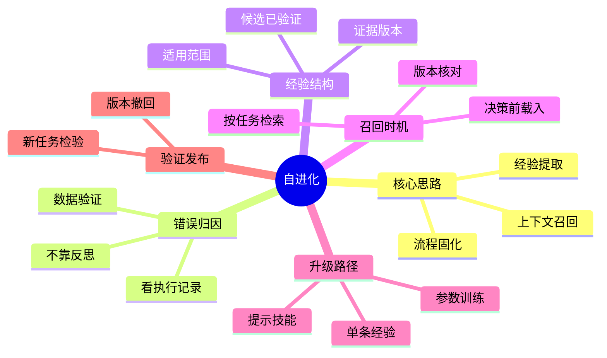

## 🔥 快速背诵

自进化不是改权重，是把一次教训从对话里取出来、存到任务之外、下次决策前再召回。流程是：从执行记录归真因，提炼带适用范围和证据的经验，决策前检索召回，反复出现的问题固化成 Prompt 或 Skill，再用新任务验证并版本化、可撤回。改对那道旧题，不等于 Agent 变好了。

> **一句话**：自进化的本质是**把一次教训从对话里取出来、存到任务之外，下次决策前再召回**，而不是去改模型权重。流程是：从执行记录归真因 → 提炼带适用范围和证据的经验 → 决策前检索召回 → 反复出现的问题固化成 Prompt 或 Skill → 用新任务验证、版本化、可撤回。

## 🧠 导图



---

# 📖 背诵稿

### ① 先分两件事：这次答对，和下次少犯错

**面试里最容易踩的坑，是把"把这道旧题改对"当成"Agent 变好了"。这俩真不是一回事。**

我理解可以这样想：用户说你查错了，你当场补上条件，这次任务确实做对了。但这份纠正还留在上一段对话里，模型参数根本没动。第二天换一个新会话，它又写出没带状态的查询。

说白了，改正当前查询是一件事，在工作笔记里写明注意事项、下次动手前翻到它，是另一件事。**只有后者才能让改进影响后续任务。** 自进化干的就是后一件事：把有用的内容从当前对话取出来，存到任务之外，合适的时候再交还给 Agent。

### ② 经验要从执行记录里挖，不能只靠反思

**用户说"你查错了"只是一个错误信号，还没告诉你怎么改。直接让模型对最终回答写段反思，非常容易把原因归错。**

这里有个容易搞错的地方：同样是订单数偏大，可能是查询没筛状态，可能是表连接产生重复行，也可能是工具查到了别的日期。原因不同，该留下的经验就不同。

所以系统不能只让模型对着答案写反思。它得把任务要求、当时用的规则、生成的查询、工具返回、用户指出的差异，全部摆在一起核对。比如固定数据快照上跑两份查询、和逐行核对结果比，才能确认"漏了状态条件"这个原因成立。**模型适合提原因，但原因对不对，得靠数据或测试验证。**

### ③ 一条好经验，得有适用范围和证据

**保存完整对话当然能追查，但让下一个任务从几十轮聊天里找教训，既费空间又容易把旧猜测当规则。得提炼成一条"有边界"的经验。**

你可以把它想成错题本的一页：既要写"怎么做"，也要写"什么时候适用、依据是啥"。比如这次能整理成——适用范围是某业务系统的有效订单统计；发现问题是直接统计全部记录漏了状态条件；建议做法是生成查询前先读指标定义；证据是规则版本 v3、固定样本里 4 笔 paid；限制是 paid 只对应本系统 v3，不直接推广。

这里有个关键：**不能为了压短文字把范围删掉。** 只存答案"4"，换批订单就废了；只存"所有订单都筛 paid"，又把局部规则推广过头。两类都不行。

### ④ 经验要在"决策前"召回，不是存了就完事

**存好经验只是第一步。要让它真正起作用，得在生成动作之前把它送到模型眼前，而不是等答案都出了再附一句"注意筛选"。**

我理解这就像考前翻笔记：你要在动笔前看到提醒，前面那个错误决策才不会发生。实现上，根据当前任务先按业务系统、指标类型缩小范围，再找语义相关的内容，最后核对规则版本还适不适用。

这里有个容易搞错的地方：不能只看文字相似度。"有效订单数"和"订单总数"字面上很像，统计条件未必相同；另一套系统可能把有效订单定义成别的状态集合。通过核验的经验，连同当前指标定义一起进上下文，模型这回才会先查定义再生成查询。

### ⑤ 反复出问题，就升级成流程

**一条经验能补一个场景。如果好几个指标都犯同一个错——都是凭名字猜规则，那就别给每个指标各写一条提醒，应该把共同点提成一套流程。**

说白了，从"记住这一题"升级到"记住这类题的做法"。比如让所有指标统计任务都先读定义、再映射字段、最后生成查询并核对。这套步骤可以写进 Prompt，也可以整理成 Skill 按需加载操作说明和检查脚本。

但经验归经验，有些事必须交给程序强制执行。比如数据访问的权限限制，应该由工具或后端检查，不能指望靠积累几条经验让模型"越来越自觉"。**经验负责提高决策质量，受控执行规则仍然承担权限约束。**

### ⑥ 验证与发布：用新任务，别只重做旧题

**候选经验写出来了，还不能说 Agent 变好了。因为那道旧题已经被系统看过、参与了经验生成，再交回去它可能只是背答案。**

这里有个关键点：要准备**没参与优化**的新任务来检验推广性。比如换日期换订单分布（正确答案不再是 4）、换种问法仍要求相同定义、再加一个"所有状态订单总数"看它会不会误加 paid。原来已能完成的查询也要重跑，看改动有没有破坏已有能力。

验证时固定模型、工具、数据快照和预算，一次只改一项策略，不然"更好"可能只是换了更强模型。验证过了再逐步启用，保留来源和版本，出问题能撤回。**要不要动模型权重，那是另一套流程——只有错误来自"模型在许多场景都难遵循一类稳定处理方式"时才值得训练。**

---

# 🔑 记忆锚

| 记什么 | 内容 |
|---|---|
| **1** 个核心认知 | 自进化 = 经验存到对话之外 + 决策前召回，**不是改权重** |
| **2** 件事 | 这次答对 ≠ 下次少犯错（改进要影响后续任务） |
| **1** 个归因铁律 | 看执行记录 + 数据验证，不靠模型自写反思 |
| **1** 条经验结构 | 做法 + 适用范围 + 证据版本 + 使用限制 |
| **3** 级升级 | 单条经验 → Prompt/Skill 流程 → 参数训练 |
| **1** 个验证原则 | 用新任务检验推广性，旧题只能查原错是否修复 |
| **1** 句发布 | 版本化、记录来源、可撤回 |

> **卡壳急救**：忘了就过四步——从记录归真因（不靠反思）、提炼带范围经验、决策前召回、反复出问题升级成流程；最后补一句"经验改的是信息和工作方式，动权重得走训练"。

---

# 🎯 追问速查

| 面试官问 | 你答 |
|---|---|
| 自进化是不是改模型参数？ | 不是。经验召回改的是这次推理看到的信息，Prompt/Skill 改的是工作指令；都不动权重。真正改权重要走训练流程 |
| 让模型每次写完反思存档行吗？ | 不行。反思可能归错因，错误诊断会传播到后续任务。要看执行记录，用数据或测试验证原因 |
| 经验只要存"正确答案"够吗？ | 不够。只存答案换数据就废；还应存适用范围、证据版本、使用限制，否则局部规则被推广过头 |
| 经验怎么真正生效？ | 在生成动作**之前**按任务检索召回，连同当前规则进上下文；不能等答案出了再附提醒 |
| 什么时候该升级成流程？ | 多个任务反复犯同类错，就把共同做法提成 Prompt 或 Skill，统一管理步骤和检查脚本 |
| 怎么证明 Agent 真的变好？ | 用**没参与优化**的新任务 + 相似反例 + 旧场景回归；固定模型工具数据只改一项策略，避免把"换强模型"当成进化 |
| 经验库越大 Agent 越强吗？ | 不是。要看合适经验有没有在合适步骤出现、是否改善了实际行为；过期规则还要替换 |

---

# 🔗 串联

- 承接 15 反思机制：那篇讲反思作为单步质量把关，这篇讲把反思沉淀成可复用经验
- 经验召回本质是 08 Agent 的记忆机制与设计 的"长期记忆"被检索使用
- 决策前注入经验 ≈ 17 上下文工程 的上下文组装
- 反复问题固化为 Skill → 13 手搓 Agent 还是用框架 的框架化沉淀
- 用新任务回归验证 → 19 Agent 效果评测与评测集设计 的评测集思想
- 一句话总纲：**这次改对是修 bug，下次少犯错才是进化；经验存出去、决策前召回来**

---

# 📚 细节（背完再点开）

> [!note]- 一条经验长什么样
> ```text
> 适用范围：A 业务系统的有效订单统计任务。
> 发现的问题：直接统计 orders 全部记录，漏掉指标要求的状态条件。
> 建议做法：生成查询前读取当前指标定义，明确状态与时间口径。
> 本次证据：规则版本 v3；固定样本中 4 笔 paid，正确结果为 4。
> 使用限制：paid 条件仅对应本系统 v3 定义，不直接推广到其他指标。
> 重新核验条件：指标定义或相关字段发生变化。
> ```
> 两层次：**具体业务知识**（本系统 v3 用 paid）和**可推广做法**（先读定义再生成查询）。经验库分"候选"和"已验证"两种状态，没核实的只当线索。

> [!note]- 错误归因要拿数据说话
> 原始查询只有日期范围，统计了一天所有订单（返回 6）；修正查询加上 `status = 'paid'`，返回 4。要在**固定数据快照**上跑两份查询再和逐行核对结果比，才能确认差异来自漏状态。若只在不断变化的线上数据先后查，数值变化可能来自新增订单，不能直接当归因证据。

> [!note]- 三种改进各改了什么
> | 方式 | 改了什么 | 是否动权重 |
> |---|---|---|
> | 经验召回 | 这次推理看到的上下文信息 | 否 |
> | Prompt/Skill | 应用交给模型的工作指令 | 否 |
> | 参数训练 | 用校验过的任务数据训练模型 | 是 |
> 三者可组合：训练改善查询能力，Skill 规定步骤，经验补近期业务细节。错误来自哪层决定改哪层——变化频繁的业务定义留外部查，工具返错先修工具，模型普遍难遵循稳定处理方式才评估训练。

> [!note]- 验证集不能无限调参
> 系统盯着同一批验证失败反复修改，实际上也在适配这些样本。长期改进要保留**不用于优化的最终检查集**，并持续补充新的真实场景。比较前后版本时固定模型、工具、数据快照、运行预算，一次只改变一项策略，否则"更好"可能只是换了更强模型。

---

# 🎴 自测（遮住上面，先自己说）

> [!question]- Q1 自进化的本质是什么？
> 把一次教训从对话取出、存到任务之外，下次决策前召回，改善后续任务看到的信息和工作指令。**不是改模型权重**。

> [!question]- Q2 为什么不能直接存模型反思？
> 反思可能归错因（漏状态 vs 重复连接 vs 查错日期），错误诊断会传播。必须看执行记录、用数据或测试验证原因。

> [!question]- Q3 一条好经验应包含哪些要素？
> 做法 + **适用范围** + 证据版本 + 使用限制。只存答案换数据就废，只存通用规则会把局部推广过头。

> [!question]- Q4 经验怎么真正起作用？
> 在生成动作**之前**按任务检索召回，连同当前规则进上下文；不能等答案出了再补提醒，那时错误决策已发生。

> [!question]- Q5 什么时候升级成 Prompt/Skill？
> 多个任务反复犯同类错，把共同做法提成流程统一管。但权限这类强制约束仍由工具/后端执行，不靠经验自觉。

> [!question]- Q6 怎么证明 Agent 真的变好？
> 用未参与优化的新任务 + 相似反例 + 旧场景回归；固定条件只改一项策略；验证后版本化、记录来源、可撤回。
