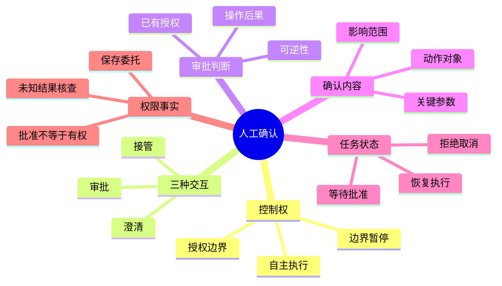

## 🔥 快速背诵

人工确认补的是决策缺口：缺意图、缺授权、或者系统处理不了，不是每调一次工具都问。判断三件事：动作在不在已授权范围内、后果大不大、有没有明确审批要求，不按工具名划分。授权包含类型、对象、目的和限制，获准生成报告不等于获准发送报告。确认要和具体方案、参数版本绑定，恢复时再核对权限和真实结果。

> **一句话**：人工确认补的是**决策缺口**——缺意图、缺授权、或系统处理不了，不是每调一次工具都问。判断三件事：动作在不在已授权范围内、操作后果大不大、有没有明确审批要求。确认要和具体方案、参数版本绑定，恢复时再核对权限和真实结果。

## 🧠 导图



---

# 📖 背诵稿

### ① 先分清楚：自主执行和人工确认的边界在哪

**用户把任务交给 Agent，是希望它在目标范围内自己安排步骤。但任务也有边界：目标规定完成什么，授权规定能采取哪些操作，执行规则规定当前身份允许做什么。**

你可以把它想成开车：导航帮你选路、踩油门是你日常决策，但到了"要不要借道逆行抄近路"这种边界，方向盘得交还给人。读取资料、比结果、选工具这些日常决策全交回用户，任务就推不动了。

这里有个容易搞错的地方：授权不会无限延伸。"整理报告"通常含读资料写草稿，但**不当然包含把草稿公开发布**——发布改变了结果传播范围，不能因为它"有助于展示成果"就自己推导出授权。人工确认的作用，就是在决策边界处暂停，让有权的人补信息、批方案或接手。

### ② 三种交互解决的是不同问题

**日常都说"找人确认"，但其实澄清、审批、人工接管，要的输入和后果完全不一样。一个确认按钮同时解决不了这三个问题。**

澄清解决的是"信息不完整"：Agent 还不知道用户指哪个对象、用啥标准，没法形成可靠方案。比如"清理旧文件"的"旧"，可能指修改时间早、也可能指已废弃，两种含义得到不同清单，得先问清楚。

审批解决的是"方案已明确但需授权"：展示将执行的动作，批准不改变内容、修改产生新方案、拒绝阻止动作。

人工接管解决的是"系统在当前能力或规则下处理不了"：多次核查仍判不了异常，或出现需业务人员处理的争议，应移交证据和未决问题，而不是反复问同一个"是否继续"。

### ③ 审批时机：看授权，也看后果

**形成动作后，先查它有没有被当前授权覆盖。用户直接指示过的具体操作，不必再把相同内容问一遍——但授权含类型、对象、目的、限制，获准生成报告不等于获准发送报告。**

说白了，授权是有边界的许可证。如果动作不在已有范围内又确实需要，就先出具体方案再请求授权；规则明确禁止的，普通用户再说一次同意也绕不过去。

接下来看操作后果：改变多少对象、影响其他人吗、数据会不会离开原范围、错了能否恢复、恢复代价多大。**可恢复性不是只看有没有撤销键**——文件能从备份恢复仍可能业务中断，邮件再发解释也保证不了收件人没读过。影响大但用户已明确授权、方案没变、规则允许，就不必仅因"影响大"再问一遍。

### ④ 面对不确定：先分清事实缺口和人的选择

**Agent 没把握，不代表一定要问用户。关键是缺的内容能不能在授权范围内自己查明。**

文件在不在、接口什么状态、查询报没报错，这些是用工具就能核实的事实，程序应该先查。而用户更想要哪个版本、同名联系人中指哪位、愿不愿承担额外影响，这些才需要人表达意图——程序不能靠检索替用户决定。

这里有个坑：**模型自报的置信度不能替代授权和事实检查。** 它说"我有 95% 把握"，只代表它对生成内容确信，不代表参数对、更不代表用户授权了。对可逆且影响小的非关键选择，给合理默认值推进；涉及外部收件人、唯一数据删除这类关键参数，不能靠猜。

### ⑤ 一次有效确认，批准范围要足够明确

**光问"是否继续"，用户根本不知道自己批了什么。要让批准能用于执行，方案至少说明具体动作、对象、关键参数和预期影响，而且要和即将执行的请求对应。**

你可以把它想成门禁授权：允许"指定身份，对指定对象，在约定条件下，完成某项操作"。一次发送就展示收件地址、最终正文、附件版本；一次批量修改就展示完整对象清单和修改规则。关键差异不能藏在笼统描述里。

参数多可以算内容指纹帮助比较方案是否变化，但指纹不能代替用户可读的预览，也不能证明批准人有权限。还要防止预览后内容继续变——批准的是文件某版本，执行时就该读对应版本，不能只检查一次再读后来变化的内容。

### ⑥ 用任务状态连接暂停、批准、恢复

**确认不是发个问题原地等。用户可能过会儿才回，服务可能重启。系统得保存任务和待确认请求，让回复能恢复正确执行。**

标准流程是：形成候选动作 → 判断需确认 → 保存方案和进度 → 标记等待 → 展示请求；真正产生影响的操作放在有效批准之后。用户回复后，系统读同一项请求、校验来源与决定、核对方案和条件，通过才执行。

状态很重要：`已批准` 是收到有效决定，`执行中` 是动作已开始，`已完成` 要有实际结果。批准完成不代表动作一定成功，未知结果要标记待核实。

**还有个容易搞错的地方：用户说同意 ≠ 他有后端操作权限，也不证明一次超时操作没发生。** 接口超时只说明调用方没收到完整响应，动作可能没发生也可能已完成。应先查实际状态，确需人决定再升级，不能让一句"继续"代替事实核查。

---

# 🔑 记忆锚

| 记什么 | 内容 |
|---|---|
| **1** 个核心 | 确认补"决策缺口"（缺意图/授权/处理能力），不是每调工具都问 |
| **3** 种交互 | 澄清（补含义参数）/ 审批（批具体方案）/ 接管（系统处理不了） |
| **1** 个审批判据 | 看已有授权 + 操作后果 + 执行规则，不按工具名划分 |
| **2** 类缺口 | 事实缺口（工具查）vs 人的选择（人决定）；置信度≠授权 |
| **1** 个确认要素 | 动作+对象+关键参数+影响，与即将执行请求对应 |
| **1** 句权限真相 | 批准≠有权，同意≠操作没发生，未知结果先查事实 |

> **卡壳急救**：忘了就过三问——这动作在不在已授权范围（授权不无限延伸）、后果大不大需不需要批、是不是系统真处理不了要接管；再补一句"批准要和具体方案版本绑定，同意不等于有后端权限"。

---

# 🎯 追问速查

| 面试官问 | 你答 |
|---|---|
| 每次调工具都确认不行吗？ | 不行。已委托的工作交回用户，任务难自主推进；重复无新信息的弹窗还会让用户不再认真看 |
| 看模型置信度决定问不问够吗？ | 不够。置信度只代表模型对生成内容确信，不代表参数对、更不代表用户授权；事实缺口应先工具查 |
| 澄清/审批/接管区别？ | 澄清补含义参数（还没方案）；审批批已明确方案（不改内容）；接管是系统处理不了，移交证据让人接手 |
| 授权了还用再问吗？ | 在授权范围内、方案和条件没变，可沿用，不必因又调一次工具重问；但授权不含类型/对象/目的的延伸 |
| 确认内容要有哪些？ | 具体动作、对象、关键参数、预期影响，且与即将执行请求对应；可算内容指纹但要有可读预览 |
| 用户说同意就安全了？ | 不。同意 ≠ 有后端操作权限，也 ≠ 超时操作没发生；未知结果应先查实际状态，不能让"继续"代替事实核查 |
| 怎么减少重复确认？ | 保存有效委托范围（如只处理某目录、最多改多少项），范围内直接自动执行；不在清单的新对象不能自动加入 |

---

# 🔗 串联

- 承接 25 Agent Harness 是什么：确认是在 Harness 执行链里插入的人工暂停点
- 权限检查 → 24 数据库连接的安全执行链 的受控执行边界
- 状态保存恢复 → 18 多轮对话状态管理 的任务状态机
- 高风险写操作去重 → 23 任务幻觉与完成声明治理 的副作用治理
- 确认弹窗属于交互层，框架化见 13 手搓 Agent 还是用框架
- 一句话总纲：**确认补的是缺口不是形式；授权有边界、批准要绑定、同意不等于有权**

---

# 📚 细节（背完再点开）

> [!note]- 三种交互对比表
> | 交互类型 | 缺什么 | 人的输入 | 怎样影响后续 |
> |---|---|---|---|
> | 澄清 | 明确含义、对象或要求 | 补齐参数 | 继续形成方案 |
> | 审批 | 对具体动作的有效批准 | 执行/修改/停止 | 执行、产生新方案或阻止 |
> | 人工接管 | 系统无法提供的判断或处理 | 人接手核查或定路径 | 移交证据与未决问题 |
> 三者可先后出现：对象不明确先澄清，方案形成后再判断要不要审批。一个确认按钮不能同时解决缺参数、缺授权、缺处理能力。

> [!note]- 任务状态机
> ```text
> 候选动作 -> 等待确认 -> 已批准 -> 执行中 -> 已完成
>                 |
>                 +-> 已拒绝 / 已取消 / 已失效
> ```
> 状态描述的是程序实际走到哪，不是模型说过什么。`已批准`=收到有效决定，`执行中`=动作已开始，`已完成`要有实际结果。拒绝/取消必须影响执行：待提交的动作停止；已提交外部的查询进度并尝试系统支持的取消，不能只关弹窗当撤销。

> [!note]- 批准记录要存什么
> | 信息 | 为什么需要 |
> |---|---|
> | 动作与对象 | 防止把批准用于另一种操作或另一资源 |
> | 关键参数与内容版本 | 防止方案变化后沿用旧批准 |
> | 批准人和请求编号 | 确认决定来源，关联正确的待处理请求 |
> | 适用条件与有效范围 | 判断批准在何种情况下仍可使用 |
> 参数多可算内容指纹辅助比较，但指纹不能替可读预览、也不能证明批准人有权限。预览后内容仍可能变，执行时应读对应版本或由资源系统检查版本条件。

> [!note]- 减少重复确认不等于减弹窗
> 要同时看三项：有没有未经授权的操作、用户是否经常修改关键参数、等待确认是否阻断了本可完成的任务。频繁改收件人说明对象消歧做得差；反复批准完全相同方案说明授权没被正确保存。靠这些记录调整理解、预览和范围检查，比单纯增删弹窗有用。

---

# 🎴 自测（遮住上面，先自己说）

> [!question]- Q1 人工确认解决的根本问题是什么？
> 补**决策缺口**：缺意图（澄清）、缺授权（审批）、或系统处理不了（接管）。不是每调工具都问，已委托的步骤应自主执行。

> [!question]- Q2 三种交互的区别？
> 澄清补含义和参数（还没有方案）；审批针对已明确方案给授权；人工接管是系统能力/规则内处理不了，移交证据让人接手。

> [!question]- Q3 审批时机怎么判断？
> 先看动作是否在已有授权范围（授权不无限延伸），再看操作后果（影响面、可逆性），结合执行规则。影响大但已明确授权且方案未变，不必仅因"影响大"重问。

> [!question]- Q4 模型说"我有95%把握"能代替确认吗？
> 不能。置信度只代表模型对生成内容确信，不代表参数正确、更不代表用户授权。事实缺口应先工具查，人的取舍才需人定。

> [!question]- Q5 一次有效确认应包含什么？
> 具体动作、对象、关键参数、预期影响，且与即将执行的请求对应；可算内容指纹辅助比较，但要有可读预览，且防止预览后内容变化。

> [!question]- Q6 用户说"同意"就安全了吗？
> 不。同意 ≠ 有后端操作权限，也 ≠ 超时操作没发生。未知结果应先查实际状态，不能让"继续"代替事实核查；批准要和方案版本绑定，恢复时再核对。
