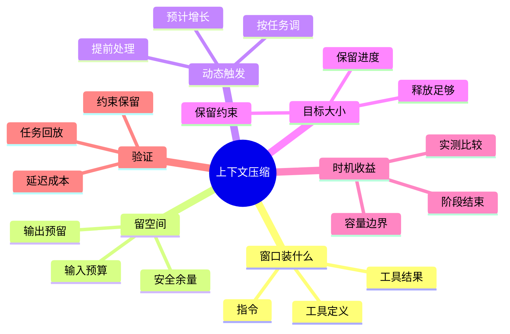

## 🔥 快速背诵

阈值没有通用的 80%。先算清窗口里实际装了什么：系统指令、工具定义、工具结果都占 token；再给模型输出、下一步工具增长和安全余量留出空间，反推输入预算。触发时机有两类：容量边界防超限，阶段结束主动整理。压完要留硬约束和当前进度，还要看释放了多少。最后用任务回放比效果。

> **一句话**：阈值没有通用的 80%。要先算清窗口里实际装了什么（指令、工具定义、工具结果都占 Token），给**模型输出 + 下一步工具增长 + 安全余量**留出空间，再反推当前输入预算。窗口越用越大要提前处理，阶段结束时也可主动整理，最后用任务回放比较效果。

## 🧠 导图



---

# 📖 背诵稿

### ① 上下文为什么会越用越大

**模型判断下一步需要当前任务的相关信息。应用通常把指令、消息、工具调用及其结果全组织起来交给模型，历史一直累积又不筛选，下一轮输入就比上一轮更大。**

说白了，用户就说了几句话，但 Agent 读源码、跑测试、改代码，每轮都往上下文里加东西，整个输入很快变长。而上下文容量用 Token 算——模型处理文本的单位，不等于字数也不等于聊天条数，一段源码和同字数中文分的 Token 可能不同。

到容量边界，有的接口直接拒请求，有的输出提前结束，任务就被打断。压缩的作用就是把已经积累的过程收敛成较短仍有用的信息，释放空间。但这里有个坑：**压缩不是无损搬家，越早压越可能提前丢掉后面还要用的细节。**

### ② 算阈值前，先看窗口里到底装了什么

**如果只统计用户和模型说了多少话，预算一定算少。实际请求里还可能有系统指令、当前任务状态、工具说明、检索资料、工具结果。**

你发现没，几十个工具的名称、描述和参数结构，哪怕没被调用，也可能随请求进上下文。还有图片、文档、模型推理内容，都要按当前接口计数规则处理，不同模型规则还不一样。

所以计数对象应该是**已经装配好的请求**。服务有计数接口就用它估算，否则用匹配模型的分词器结合实际返回用量校准，还要留余量。

这里有个容易混的点：**缓存不等于容量。** 前缀缓存能降重复处理开销，但命中缓存的内容仍占着窗口。费用降了，不代表模型多出一块能装材料的空间。

### ③ 窗口剩下的空间，还要留给模型输出

**这是"80% 就压"最大的漏洞：上下文容量不能全用来放输入，模型接下来生成的内容也要在接口允许范围里安排空间。**

我理解可以这么算：假设总窗口 32000，这类任务预留 4000 输出、再留 2000 安全余量，那当前输入预算就是 `32000 - 4000 - 2000 = 26000`。当前输入到 26000 左右就接近边界了，等拖到 32000 才处理，等于把模型下一步工作的空间也占掉了。

输出预留要跟任务走——提取一个字段和生成完整代码文件，所需空间不同。这串数字只是说明算法，不是推荐配置。关键是：**先给输出留预算，再决定输入能放多少。**

### ④ 工具结果突然变大，要更早处理

**刚才算的是一次调用。Agent 还会继续调工具，下一步可能突然暴涨。接口排查里查个配置值只回几行，跑整套测试可能回几千行日志——都叫工具调用，增长差很多。**

接着上面的例子：当前输入 21000，还没到 26000 预算，按静态阈值看似能继续。但下一步预计加 6000 工具结果 + 4000 后续输出 + 2000 余量 = 33000，已经超 32000。所以当前只占约三分之二窗口，却该提前减小输入或限制工具返回。

说白了，**固定比例只有在输出预留、工具增长和余量恰好合适时才是个起点**，换模型换任务换工具都得重查。增长估计参考同类工具过去返回量，日志波动大时单看平均值容易低估异常。工具能返回无限长内容时，光降阈值没用，得把完整日志存外部只返摘要，让增长可控。

### ⑤ 还有空间，也可能值得压缩

**容量预算解决"还能不能装下"，另一种问题是材料装得下、当前任务却不再需要很多内容。完成一个阶段时，通常更容易判断哪些能收起。**

比如已定位到连接池参数，前面几十轮排查 SQL 和网络的失败尝试，可以留结论、原始过程不用一直跟着走。把排查过程整理成结论，比还没找到原因时匆忙压缩更容易保留有效信息。

但有个容易搞错的地方：**不能看到模型重复调用就断定该压缩**，也可能是工具一直返错、或任务本身就缺信息，得结合执行记录判断，压缩不是所有卡顿和循环的解药。提前压缩也要比收益——当前任务还依赖日志里精确字段，过早概括成"出现错误"，模型又得重读，输入短了工具调用却变多，总耗时成本未必降。

### ⑥ 压到哪、怎么验证

**有了触发边界还得回答：这次释放多少空间？如果触发在 26000、压完只到 25800，下一轮加 500 又触发，Agent 会反复总结几乎相同的历史，每次花时间还逐次丢细节。**

所以触发边界决定"什么时候开始"，压缩目标决定"释放多少"——两者分开设。比如触发附近目标降到 20000，让后续几步有空间。

不论触发还是目标，**压完要保留用户目标、硬约束、关键参数、当前进度**。比如"不能改接口字段"不能压成"尽量兼容"；一次工具超时结果未知，不能总结成已失败。消息协议也有约束：工具请求和返回靠调用编号关联，不能删请求留孤立结果。

最后用任务回放验证：准备短查询、长代码修改、大日志分析，固定模型资料初始状态，跑早压、晚压、按增长动态触发，重复运行看稳定。先看任务完成没、约束违反没、关键信息还能不能用，再看大小、压缩次数、重复读取、延迟、费用。**得到的往往是一套按任务类型配置的策略，不是所有 Agent 共一个数字。**

---

# 🔑 记忆锚

| 记什么 | 内容 |
|---|---|
| **1** 个误区 | 没有通用 80%；要算实际占用再留输出/增长/余量 |
| **3** 类占用 | 指令 + 工具定义（未调用也占）+ 工具结果 |
| **1** 个公式 | 输入预算 = 总窗口 - 输出预留 - 安全余量 |
| **1** 个动态触发 | 预计下一步工具增长，提前处理而非等比 |
| **2** 类时机 | 容量边界（防超限）+ 阶段结束（收起无用过程） |
| **2** 个必保留 | 压完保留硬约束 + 当前进度；目标离触发要够远 |
| **1** 个验证 | 任务回放比效果/约束/延迟/成本，按任务配策略 |

> **卡壳急救**：忘了就过——窗口装了什么（不只聊天）、留输出空间（公式）、工具会暴涨要早压、阶段结束可主动收、压完保约束和进度、任务回放验证；核心一句"阈值从任务预算算出来，不是拍个比例"。

---

# 🎯 追问速查

| 面试官问 | 你答 |
|---|---|
| 为什么不能固定 80%？ | 没给模型输出和下一步工具增长留空间；下一步可能暴涨几千行日志直接超限，连生成摘要都来不及 |
| 等接近上限再压呢？ | 更糟。模型输出也要空间，输入塞满后下一次调用可能直接超限，来不及压缩 |
| 阈值怎么算才合理？ | 输入预算 = 总窗口 - 输出预留 - 安全余量；再按预计工具增长下调触发边界，跟着任务动态调整 |
| 工具结果会暴涨怎么办？ | 提前减小输入或限制工具返回；无限长内容要存外部只返摘要，让增长可控，光降阈值没用 |
| 还有空间为什么也压？ | 阶段完成时材料虽装得下但不再需要，收起无用过程降阅读负担；但要看是否仍在依赖精确细节，过早压会反复重读 |
| 压缩目标设多少？ | 离触发边界足够远，避免下一轮立刻再触发反复总结；同时保留目标、约束、进度、调用编号关联 |
| 怎么知道阈值适合？ | 任务回放：短查询/长修改/大日志，固定条件跑早压晚压动态触发，看完成度、约束、重复读取、延迟、成本，按任务类型配策略 |

---

# 🔗 串联

- 承接 17 上下文工程：那篇讲上下文怎么组装，这篇讲它涨满时怎么压
- 工具定义/结果占用 → 02 Agent 的基本架构由哪些核心组件构成 的工具层
- 阶段结束收起过程 ≈ 12 Agent 记忆压缩方法 的摘要压缩
- 工具返回暴涨治理 → 21 Agent 延迟定位与 Trace 优化 的工具 I/O 控制
- 触发后保留进度/约束 → 18 多轮对话状态管理 的状态保持
- 一句话总纲：**阈值从任务预算算出来，给输出和增长留空间，压完保约束和进度，回放验证**

---

# 📚 细节（背完再点开）

> [!note]- 预算计算示意
> ```text
> 总窗口 32000 - 输出预留 4000 - 安全余量 2000 = 输入预算 26000
> 下一步预计增长：当前 21000 + 工具结果 6000 + 输出 4000 + 余量 2000 = 33000（已超）
> 给增长预留后当前输入上限：32000 - 6000 - 4000 - 2000 = 20000
> ```
> 数字只是说明算法，不是推荐配置。输出预留跟任务走（提取字段 vs 生成代码文件不同）。增长估计参考同类工具历史返回量，日志波动大要结合大结果分布和任务风险。

> [!note]- 缓存与容量别混淆
> 前缀缓存减少重复处理开销，但命中缓存的内容仍占上下文窗口。费用下降不代表模型多出装材料的空间。计数对象应是已装配好的请求：服务有计数接口就用它，否则用匹配模型的分词器并结合实际返回用量校准，还要留余量。

> [!note]- 提前整理 vs 容量边界
> | 维度 | 容量边界触发 | 阶段结束整理 |
> |---|---|---|
> | 目的 | 防下一次请求超限 | 收起不再需要的过程，降负担 |
> | 触发 | 输入达到预算边界 | 阶段完成、内容重复时 |
> | 注意 | 必须留输出/增长/余量 | 别在还依赖精确字段时过早概括，否则反复重读 |
> 两者可分开设置；但重复调用不必然要压缩，可能是工具报错或任务缺信息，需结合执行记录判断。

> [!note]- 压缩完要检查两件事
> 1. 大小是否回到合适预算（目标离触发边界足够远，避免下一轮立刻再触发）。
> 2. 继续任务所需信息与消息结构是否完整：用户目标、硬约束、关键参数、当前进度必须保留；工具请求与返回靠调用编号关联，不能删请求留孤立结果；工具超时结果未知不能总结成已失败。压缩过程本身也需空间，窗口满了再交同一模型生成摘要也可能失败，要提前触发、分段处理、保留外部原始记录。

---

# 🎴 自测（遮住上面，先自己说）

> [!question]- Q1 为什么不能设固定 80%？
> 没给模型输出和下一步工具增长留空间；下一步工具结果可能暴涨几千行直接超限，连生成摘要都来不及。阈值要从任务预算算。

> [!question]- Q2 输入预算怎么算？
> 输入预算 = 总窗口 - 输出预留 - 安全余量。输出预留跟任务走，当前输入到预算边界就该处理，不能拖到窗口满。

> [!question]- Q3 工具结果暴涨怎么办？
> 提前减小输入或限制工具返回；无限长内容存外部只返摘要/位置，让增长可控。固定比例只在各余量恰好合适时才是起点。

> [!question]- Q4 还有空间为什么也压？
> 阶段完成时材料装得下但不再需要，收起无用过程降负担。但要看是否仍依赖精确细节，过早压会反复重读，总耗时未必降。

> [!question]- Q5 压缩目标设多少？
> 离触发边界足够远，避免下一轮立刻再触发反复总结。压完必须保留目标、硬约束、进度、调用编号关联。

> [!question]- Q6 怎么验证阈值适合？
> 任务回放：短查询/长修改/大日志，固定模型资料初始状态跑早压晚压动态触发，看完成度、约束、重复读取、延迟、成本，按任务类型配策略。
