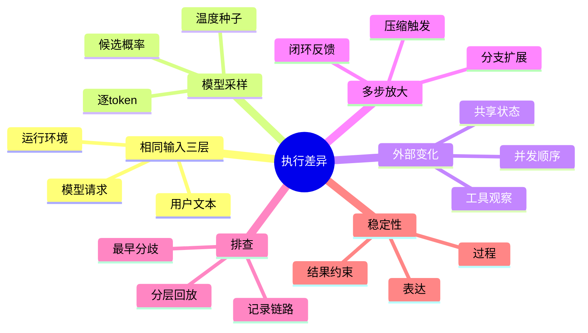

## 🔥 快速背诵

相同输入先要问清固定了哪一层：用户文本、模型请求，还是完整运行环境。差异来源有四类：模型采样、工具观察变化、并发调度、多步闭环放大。温度和 seed 只控得住采样，控不了权重、工具数据和计算实现。排查要找最早分歧，分层回放验证。稳定性按业务分层定义，逐字一致只是其中一层。

> **一句话**："相同输入"先明确固定了哪层——用户文本、模型请求、还是完整运行环境。差异来源有四类：模型采样、工具观察变化、并发调度、多步闭环放大。温度 0 和 seed 只能控一部分，动不了权重、工具数据、计算实现。排查找最早分歧，分层回放验证；稳定性按业务分层定义，逐字一致只是其中一层。

## 🧠 导图



---

# 📖 背诵稿

### ① "相同输入"有三个层次，先定比较范围

**我们通常把输入理解成聊天框里一句话。但 Agent 做决定还会读系统指令、历史、任务状态、记忆、检索材料和工具说明——用户文字相同，只是其中一部分相同。**

你可以把它想成考试：两次都拿到同一道题（用户文本），但一个考生草稿纸上已有上次查的资料，另一个没有，那他俩面对的"完整试卷"就不一样。第二次提问时历史里已存了上次查到的资料，模型可能直接分析；第一次没有，得先查。路径不同有明确信息依据。

再往外看一层：即使两次模型请求相同，工具访问的文件、数据库、外部服务也未必同状态，后续返回新观察照样影响结果。**所以比较范围分三层：用户文本相同、模型请求相同、执行环境与初始状态相同——逐层递进，只固定第一轮请求不能推断整条链路固定。**

### ② 模型生成是一串选择，采样会产生不同续写

**自回归模型逐个生成 Token，每步根据输入和已生成内容给下一个 Token 算候选分数，生成策略决定选哪个。同一份请求第一次选 A 第二次选 B，后面生成条件就不同了。**

说白了，某步三个候选概率 45%、40%、15%，按分布采样高分更容易出现，但不代表每次都选它。最初可能只是表达方式变，也可能逐渐改变工具名称、参数或计划。工具调用通常也由模型生成，所以受生成策略影响——接口要求结构合法能减格式错，但合法仍允许多个工具或多组合法参数。

**温度调节候选分布集中程度，低温度让高分更占优。但"每步固定选最高分"这件事，恰好是只调一个参数控制不了的部分**——因为最高分要先经实际数值计算。

### ③ 温度 0 和固定 seed，各自控制哪部分

**温度 0 的接口通常贪心选最高分，能消除或大幅减少显式采样带来的变化。但"最高分是谁"要先算出来，而有限精度、并行累加顺序、批处理方式不同，数学等价的计算未必逐位相同。**

这里有个容易搞错的地方：两个候选分数接近时，小误差就可能改变排序，即使仍取最高分，生成也可能从这一处分开。自部署能固定环境选确定性实现，托管服务给什么保证得看它实际开放的能力。

seed 控制的是伪随机过程——同算法、初始状态、调用顺序下可重复同一序列。但它**不能固定模型权重、工具数据、应用状态**；候选分布变了，同随机序列也可能选不同候选；随机数使用顺序变了，同起始 seed 也不保证每步用相同随机数。模型版本也是条件：固定一个会更新的服务别名，未必等于固定具体权重。

### ④ 工具观察和并发调度，是模型之外的变化

**Agent 工具请求哪怕一致，返回也可能不同——工具读的是当前环境，不是永远固定的答案。数据库会更新、文件会被改、搜索索引会重建，相同参数不同时刻访问还可能遇缓存、权限、外部状态差异。**

内容相同顺序也可能不同：查询没明确排序就不能依赖返回顺序；即使按某字段排，该字段有重复值仍需额外稳定依据。比如按时间列记录，时间相同的两项可能交换位置，若业务取第一项就需要加唯一编号，否则看似同一批数据后续选择却变。

并发也带来事件顺序差异：两个独立工具同时起，谁先返回看实际耗时，程序按到达顺序进上下文，两次输入排列就可能不同。**共享状态更麻烦：两个进程基于同一旧版本改进度，后返回的覆盖已产生的新状态——这类差异来自并发控制，调采样参数完全没用。**

### ⑤ 多步闭环，把一次局部差异带到后面

**普通一次生成到模型返回就结束。Agent 还要执行工具、读结果、更新状态再调模型——一轮输出参与构成下一轮输入，从两条路径影响后续：作为消息留历史，或通过工具改外部环境再被读回。**

我理解这是个放大回路：第一轮只有一点不同，第二轮就可能面对不同材料，两条轨迹越往后越难用相同轮次直接比。比如一次先搜代码、一次先读候选文件，都可能合理，但拿到的材料不同，后续排查顺序就不同。再遇超时、重试、压缩、预算限制，分歧继续扩展。

**不过局部差异不一定持续放大。** 两条路径可能最后读到相同事实得相同结论。是否影响最终结果，取决于任务里的分支、依赖和验证，不能只凭第一处不同就认定某次执行错了。固定第一轮 seed 不能单独保证整条任务一致。

### ⑥ 排查与稳定性：找最早分歧，分层定义一致

**最终答案只是执行末端，直接比两个答案通常判不出差异从哪进。要记录每轮实际请求、模型与生成配置、返回、工具参数与真实结果、状态更新与顺序，沿数据流向前找最早不同。**

最早分歧优先查：调用模型前的请求（指令版本、历史、消息顺序）、同请求下的模型输出（生成配置、版本、推理环境）、同动作下的工具返回（数据版本、调用身份、时间）、同结果下的状态更新（并发、重试、取消）。分支已不同后不能机械比"第七步"，应先比共同前缀再按动作依赖分析分叉。

验证用分层回放：事件回放（用已知输出和结果测程序解析调度）、固定观察后重跑模型（测生成决策）、环境恢复后整体重跑（测端到端）。

**稳定性要分层：表达、过程、结果、约束。两段措辞不同但同事实属合理；两条路径不同但都拿到证据满足目标也可同时正确；但算出不同金额、漏同一约束、或对相同业务动作重复写入，就必须靠规则和机制保障。** 审核流程要求先批准再执行，即使产物对也不能接受绕过；普通汇总可允许独立检索步骤换序。明确哪些层必须一致，再把计算、权限、写入去重落到执行机制。

---

# 🔑 记忆锚

| 记什么 | 内容 |
|---|---|
| **3** 层相同 | 用户文本 / 模型请求 / 运行环境（逐层递进） |
| **4** 类差异源 | 模型采样、工具观察、并发调度、多步闭环放大 |
| **2** 个控制 | 温度0（贪心，控采样）/ seed（伪随机，控不了权重数据） |
| **1** 个真相 | 固定 seed 动不了权重、工具数据、计算实现、模型版本 |
| **1** 个排查法 | 找最早可观察分歧，沿数据流向前 |
| **3** 种回放 | 事件回放 / 固定观察重跑模型 / 环境恢复整体跑 |
| **4** 层稳定性 | 表达 / 过程 / 结果 / 约束（逐字一致只是其一） |

> **卡壳急救**：忘了就过——先定"相同"固定哪层、四类差异源（采样/工具/并发/闭环）、温度0和seed各控什么、找最早分歧、分层回放；结尾一句"稳定性分层定义，逐字一致只是其中一层，关键看结果和约束"。

---

# 🎯 追问速查

| 面试官问 | 你答 |
|---|---|
| 相同输入结果不同，调 temperature=0 就行？ | 不行。温度0只消显式采样，但工具读到数据可能不同、模型推理环境变化、权重未固定，这些它都控不了 |
| 固定 seed 能完整复现吗？ | 不能。seed 管伪随机序列，但动不了模型权重、工具数据、应用状态、模型版本；候选分布或随机使用顺序变了，同 seed 也可能选不同 |
| 为什么两轮用户文本一样路径却不同？ | 完整请求还含历史、记忆、任务状态；第二次历史里已有上次资料，模型直接分析，第一次得先查——信息依据不同 |
| 并发怎么引入差异？ | 两工具同时起，谁先返回看耗时，按到达顺序进上下文排列就不同；共享状态还可能后返回覆盖新状态，调采样没用 |
| 怎么排查差异来源？ | 记录每轮请求/配置/返回/工具参数与结果/状态更新，沿数据流向前找最早分歧；分支不同先比共同前缀再按依赖分析 |
| 分层回放指什么？ | 事件回放（测程序解析调度）、固定观察重跑模型（测生成）、环境恢复整体跑（测端到端）；各自重跑不同部分 |
| 怎么定义"稳定"？ | 分层：表达/过程/结果/约束。措辞不同同事实合理，路径不同都满足目标也可；但不同金额、漏约束、重复写入必须用机制保障，不靠模型倾向 |

---

# 🔗 串联

- 承接 20 Agent 循环稳定性与无进展检测：那篇讲循环稳定，这篇讲稳定被哪些随机源打破
- 多步闭环放大差异 → 05 推理模式与 ReAct 的实现 的循环驱动
- 工具观察变化/并发 → 22 Multi-Agent 容错与并发冲突 的并发冲突
- 写操作去重 → 23 任务幻觉与完成声明治理 的副作用治理
- 分层回放验证 → 19 Agent 效果评测与评测集设计 的可复现评测
- 一句话总纲：**先定"相同"锁哪层，差异来自采样/工具/并发/闭环，温度seed只控一角，稳定看结果和约束**

---

# 📚 细节（背完再点开）

> [!note]- 三层比较范围
> | 比较层次 | 需固定的内容 | 仍可能变化 |
> |---|---|---|
> | 用户文本相同 | 当前用户说的话 | 历史、指令、记忆、任务进度 |
> | 模型请求相同 | 实际提交的完整材料与调用参数 | 模型实现、外部工具观察 |
> | 执行环境与初始状态相同 | 除请求外相关模型版本、工具环境、任务初始状态 | 采样、计算、调度中尚未控制的因素 |
> 完整运行条件不只是一启动快照：任务若读当前时间、调实时接口，执行中新增输入也要考虑。只固定第一轮请求不能推断整条链路固定。

> [!note]- 温度与 seed 的控制边界
> 温度0通常贪心选最高分，消除显式采样变化；但有限精度、并行累加顺序、批处理方式不同，数学等价计算未必逐位相同，接近分数可能因小误差改排序。seed 控制伪随机序列（同算法/初始状态/调用顺序可重复），但管不了权重、工具数据、应用状态、模型版本；候选分布或随机使用顺序变了，同 seed 也可能选不同候选。托管服务给什么确定性保证看实际开放能力。

> [!note]- 多步闭环回路
> ```text
> 本轮上下文 -> 模型选择动作 -> 工具产生观察
>      ↑                              |
>      +-- 新上下文 <- 更新任务状态 <--+
> ```
> 一轮输出通过两条路径影响后续：作为消息留历史，或通过工具改外部环境再被读回。第一处小差异经超时、重试、压缩、预算限制继续扩展；但局部差异不一定持续放大，两条路径可能最后读到相同事实得相同结论。

> [!note]- 分层回放对照
> | 检查方式 | 哪些部分重新运行 | 主要验证什么 |
> |---|---|---|
> | 事件回放 | 解析、调度与状态处理 | 已知事件是否被程序正确处理 |
> | 固定观察后重跑模型 | 模型生成与后续决策 | 固定材料下生成行为怎样变化 |
> | 环境恢复后整体重跑 | 模型、工具和运行程序 | 整条任务能否重复完成 |
> 回放要控制代码会读的其他输入（当前时间、随机数、事件顺序）。发送通知、创建记录等副作用需隔离或模拟，复现故障不应再产生真实业务动作。

---

# 🎴 自测（遮住上面，先自己说）

> [!question]- Q1 "相同输入"有哪三层？
> 用户文本相同、模型请求相同、执行环境与初始状态相同，逐层递进。只固定第一轮请求不能推断整条链路固定，因为历史/记忆/工具状态都可能不同。

> [!question]- Q2 调 temperature=0 能复现吗？
> 不能。它只消显式采样，控不了工具读到不同数据、模型推理环境变化、权重未固定、模型版本漂移这些差异源。

> [!question]- Q3 固定 seed 控制什么、控不了什么？
> 控伪随机序列（同算法/初始状态/顺序可重复）。控不了模型权重、工具数据、应用状态、模型版本；候选分布或随机顺序变了同 seed 也可能选不同候选。

> [!question]- Q4 模型之外的差异来源有哪些？
> 工具观察（数据/文件/索引会变）、并发调度（返回顺序随耗时变）、共享状态（并发覆盖新状态）。这些都调采样参数没用。

> [!question]- Q5 怎么排查结果差异？
> 记录每轮请求/配置/返回/工具参数与结果/状态更新，沿数据流向前找最早分歧；分支不同先比共同前缀再按动作依赖分析分叉。

> [!question]- Q6 怎么定义 Agent 的"稳定"？
> 分层：表达/过程/结果/约束。措辞不同同事实合理，路径不同都满足目标也可；但不同金额、漏约束、重复写入必须用机制和规则保障，不靠模型倾向。
