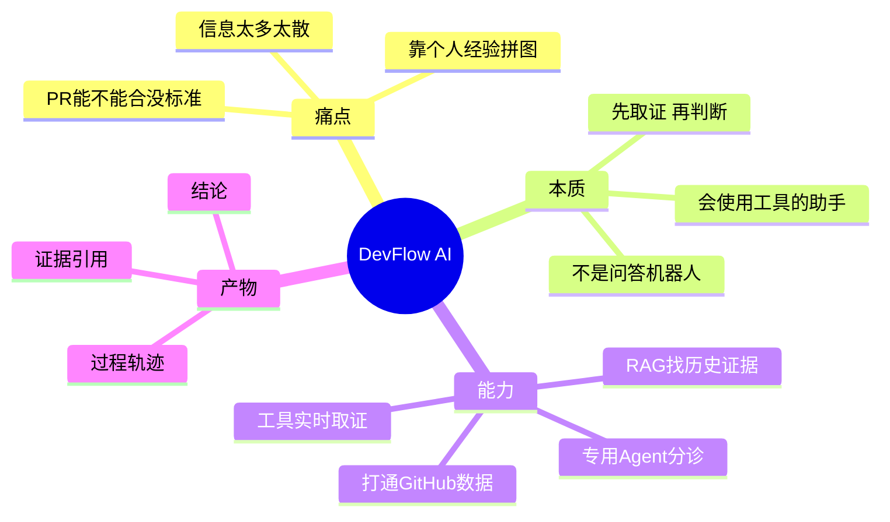

## 🔥 快速背诵

DevFlow AI 是一个研发协作 Agent 系统。它解决的不是没有信息，而是信息太多太散，判断一个 PR 能不能合，得切到 GitHub 看 diff、切到 Actions 看 CI、翻 Issue 找需求、再去群聊找结论。这活儿本该由资深 Committer 干，靠经验拼信息。DevFlow AI 把这张拼图自动化，打通 GitHub 数据、用 RAG 找历史证据、用工具实时取证，最后给结论、给引用、把过程留下来。

> **一句话**：研发协作最痛的从来不是没信息，而是**信息太多又太散**，所以需要一个会自己跑腿取证的助手。

## 🧠 导图

---

# 📖 拆碎讲

### ① 先看那个熟悉的场景

**组长问：「这个 PR 能不能合？」——你要做四件事，全在不同地方。**

1. 切到 GitHub 看 Diff，到底改了什么
2. 切到 Actions 看 CI，测试过没过
3. 翻 Issue 找原始需求，改的对不对
4. 去群聊翻之前的讨论，有没有人提过坑

做完这四步，你才有资格说一句「能合」或「不能合」。

这四步有个共同点：**每一步都不难，难的是把它们拼起来。** 而且拼得对不对，高度依赖你是不是老手——有没有踩过这个模块的坑、认不认识这个提交人。

> 所以这个项目的起点不是「AI 很火所以做个 AI」，而是「这个活儿本来就该被自动化」。

### ② 为什么直接把资料喂给大模型不行

**你可能会想：把这些材料一股脑塞给 GPT，让它判断不就行了？**

不行，有两个坎：

- **坎一：材料得先有人找。** 模型不会自己去 GitHub 拉 PR、不会自己去跑 CI。你不给它，它就只能猜。给不够，判断质量就没有保证。
- **坎二：装不下。** Issue 正文 + Diff + CI 日志 + 历史评论，随便一个 PR 就几万 token。全塞进去，要么超限报错，要么关键信息被淹没。

所以真正要建的不是「一个更会说话的模型」，而是**一套能自己找材料、会挑重点、还能记住结论的系统**。

> 这句话就是整个项目的定位。记住它，后面每一章都是它的展开。

### ③ DevFlow AI 到底是个什么东西

**它是一个「会使用工具的助手」，不是「问答机器人」。**

区别在哪儿？问答机器人是：你问 → 它答 → 结束。工具的助手是：

- 你说「这个 PR 能不能合」
- 它自己想：我需要先知道这是哪个仓库的哪个 PR
- 然后自己去查 PR、查 CI、查 Issue、查历史相似问题
- 查完发现证据够了 → 给结论；不够 → 明说「证据不足」

用一句话概括它的行为模式：**定位 → 取证 → 判断 → 沉淀。**

> [!tip] 这四个动作要背下来
> **定位**：先搞清"我在哪个仓库、哪个会话"，否则「最新」「这个」这些词没有意义
> **取证**：查 PR、查 CI、查 Issue、查历史
> **判断**：简单问题一个工具就够，复杂问题交给多个 Agent 分工
> **沉淀**：把过程存下来，供下次、复盘、审计、评测用

### ④ 它到底能干什么（功能面）

用户能看到的是一个「研发工作台」，大致几块：

| 页面 | 干什么 |
|---|---|
| Chat | 主入口，用自然语言问，能看到 Agent 调了什么工具 |
| 仓库总览 | 这个仓库整体健康状况 |
| Issue 页 | 分诊：谁处理、多急、是不是重复 |
| PR 页 | 审查：风险在哪、能不能合 |
| CI 页 | 排障：为什么挂、怎么修 |
| 周报 / 评测页 | 汇总与效果验证 |

> [!note] 这里有个设计信号
> 它不是只有一个聊天框。**每个页面都对应一类「判断」，每类判断有自己的输入、标准、输出。**
> 这个观察很重要——第 11、12 章会告诉你，正因为「判断标准完全不同」，才要把它们拆成专用 Agent，而不是塞进一个大 Prompt。

### ⑤ 如果把你自己当成作者，你会怎么起步

**第一版你肯定不会上多 Agent。** 你会这么走（这也是课程的真实顺序）：

1. 先能调通模型 → 一个 `chat/completions` 请求
2. 再让输出可控 → Prompt 写清规则 + JSON 校验
3. 再让模型能动手 → Tool Calling
4. 再把工具调用串成循环 → Agent Loop
5. 再解决"模型看不到项目事实" → 数据同步 + RAG
6. 再解决"复杂问题一个 Agent 干不了" → 专用 Agent + 多 Agent 工作流
7. 最后才补"别乱写、能看见、能评测" → 安全 / 可观测 / Eval

> [!important] 这个顺序本身就是答案
> 面试问「你这个项目怎么设计的」，最好的答法不是列模块，而是讲**你被什么问题逼着加了什么**。
> 每一个模块都是一个痛点的解药，不是一个炫技的装饰。

### ⑥ 一句话收尾

**它把「资深工程师脑子里的判断过程」，拆成了可以执行、可以检查、可以复盘的流水线。**

流水线干三件事：**先找上下文，再做判断，最后把过程留下来。**

---

# 🔑 记忆锚

| 记什么 | 内容 | 口诀 |
|---|---|---|
| **1** 个痛点 | 信息太多太散，靠经验拼图 | 「散」 |
| **4** 个动作 | 定位 / 取证 / 判断 / 沉淀 | 「定取判沉」 |
| **3** 件事 | 先找上下文 / 再做判断 / 留下过程 | 「找·判·留」 |
| **7** 步演进 | 调模型→管输出→能给工具→串循环→喂事实→分工→兜底 | 「调管给串喂分兜」 |

> **卡壳急救**：想不起任何细节时，回到「组长问这个 PR 能不能合」这个场景，把四步复述一遍，一切都能推出来。

---

# 🎯 追问速查

| 面试官问 | 你答 |
|---|---|
| 这项目解决什么真实问题？ | 研发协作里**信息分散**导致判断成本高，且质量依赖个人经验。系统把"找证据 + 给结论 + 留记录"自动化 |
| 和直接用 ChatGPT 有什么区别？ | ChatGPT 拿不到项目事实，也不会自己去找。这里有数据底座 + 工具 + 循环，能**自主取证** |
| 为什么不用一个大 Prompt 全搞定？ | 装不下、会串台、结果难复盘。后面拆成了 ChatAgent 调度 + 专用 Agent 分工 |
| 最难的地方是什么？ | 不是调通模型，是**让它在证据不足时承认不足**，以及**不让它直接对外写操作** |
| 你负责哪部分？（如果你要包装） | 建议按「数据底座 + RAG」或「ChatAgent + 工具层」挑一段讲深，别全讲 |

---

# 🔗 串联

- 讲痛点 → 顺势带到 **RAG**：为什么模型看不到项目事实（07）
- 讲"会使用工具" → **Tool Calling / MCP / Skill**（05）
- 讲"分工" → **专用 Agent 与多 Agent 工作流**（12）
- 讲"留下过程" → **可观测 + Eval**（14、15）
- 概念对照 → Agent 与大模型的本质不同

---

# 📌 打卡

- [ ] 能不看笔记讲出「组长问 PR 能不能合」这个场景的四步
- [ ] 能说出为什么"资料直接喂模型"不行（两个坎）
- [ ] 能背出「定位 / 取证 / 判断 / 沉淀」
- [ ] 能讲出七步演进顺序，并说出每一步是被什么痛点逼出来的
