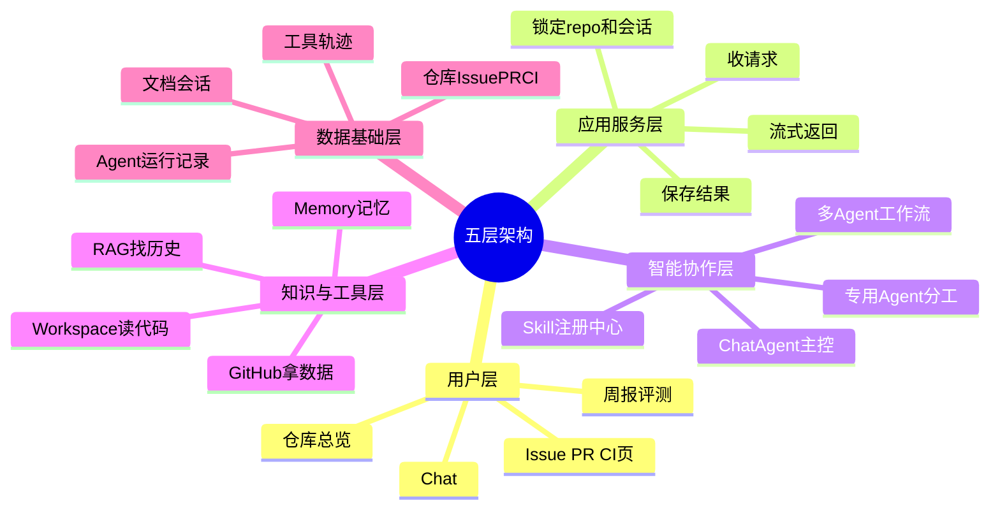

## 🔥 快速背诵

DevFlow AI 是五层架构：用户层、应用服务层、智能协作层、知识与工具层、数据基础层。一句话记，上层交互、中层调度、下层证据。一条请求走四个动作，先定位在哪个仓库哪个会话；然后取证查 PR、CI、Issue 和历史；再由 ChatAgent 调度或交给多 Agent 分工判断；最后把结论、证据、轨迹沉淀下来。它是一条研发协作流水线，不是问一句答一句。

> **一句话**：**上层负责交互，中层负责调度和判断，下层负责证据与记忆。**

## 🧠 导图

---

# 📖 拆碎讲

### ① 先想一个问题：为什么必须分层

**因为一条请求要走的路太长了。**

用户只输入一句话，系统背后却要做：判断这是谁、哪个仓库、哪次会话 → 决定要查什么 → 真去查 → 把证据揉成判断 → 流式把过程推给用户 → 存进数据库。

如果这些全塞在一个文件里，第一个月能跑，第三个月没人敢改。

> 分层的本质不是"看起来整齐"，而是**把变化频率不同的东西隔开**。前端 UI 天天改，数据表很少改，模型调用一周调三次——它们不该纠缠在一起。

### ② 五层，从上往下走一遍

**第一层：用户层。**
你能看到、能点的所有东西：Chat 页面、仓库总览、Issue 页、PR 页、CI 页、周报和评测页。
这层的职责很单纯：**展示 + 发起**。

**第二层：应用服务层（交通枢纽）。**
请求进来了，它要问清四件事：
- 这是哪个仓库？
- 哪次会话？
- 要不要流式返回？
- 结果要不要存？工具过程要不要记？

> [!important] 关键点在这里
> **仓库 ID 是这一层锁定的，不是模型给的。**
> 用户传上来的 `repo_id` 会被剥离、被服务端覆盖。这一个细节就堵死了"模型被诱导去查别的仓库"的整条路。第 13 章的安全设计，根子在这里。

**第三层：智能协作层（最有特点的一层）。**
这里有四个角色，注意它们不是名字堆在一起好看，而是真有分工：

| 角色 | 职责 |
|---|---|
| ChatAgent | 主控。判断"这是普通对话、单点工具调用，还是复杂工作流" |
| 专用 Agent | 处理具体任务：Issue 分诊、PR 审查、CI 排障 |
| 多 Agent 工作流 | 处理跨领域、需要多方取证的复杂判断 |
| Skill 注册中心 | 把稳定的流程沉淀成可复用的"作业手册" |

**第四层：知识与工具层（手和眼睛）。**
- RAG：帮它翻项目旧资料
- Memory：帮它记住上下文
- Workspace 工具：读代码、搜文件
- GitHub 工具：拿 Issue / PR / CI
- 大模型接口：完成判断、总结、表达

> 没有这一层，Agent 就只能凭空猜。

**第五层：数据基础层（事实仓库）。**
仓库、Issue、PR、CI、文档、会话、Agent 运行记录、工具调用轨迹——都得有地方落。

### ③ 一条请求的完整旅程

**场景：用户问「最新 PR 能不能合并？」**

系统分四个动作走：

> [!note]- 动作一：定位
> 先确定：哪个仓库、哪个会话、哪个 PR。
> 为什么这一步必须最先做？因为「最新」「这个」「之前那个」这些词，**脱离上下文就没有意义**。
> 「最新 PR 能不能合」在 A 仓库和 B 仓库是两个完全不同的问题。

> [!note]- 动作二：取证
> 查 PR 的 diff、查关联 Issue、查 CI 状态、查历史相似问题。
> 研发协作不能拍脑袋，**证据先于结论**。这是全项目的铁律。

> [!note]- 动作三：判断
> 如果是简单问题（"这个 Issue 该谁处理"）→ 一个工具就够。
> 如果是复杂问题（"这个 PR 能不能合"）→ 交给多 Agent 工作流分工取证再综合。
> **同一句话可能走两条完全不同的路**，这个分流由 ChatAgent 决定。

> [!note]- 动作四：沉淀
> 回答结束后存：会话消息、Agent 运行记录、工具轨迹、引用证据、长期记忆、评测结果。
> 不存会怎样？短期看着没事，长期无法复盘、无法评测、无法追责。

### ④ 为什么 ChatAgent 不是"什么都自己干"

**因为它自己干会变成一个巨大的黑盒。**

想象一下：如果让 ChatAgent 既管对话、又管工具选择、又管任务规划、又管依赖编排、又管 Replan、又管证据充分性检查——它会变成什么？

一个**没人看得懂、也没法测**的调度器。

所以项目把职责切开了：

- ChatAgent → 只判断"该走哪条路"
- PlannerAgent → 把复杂问题变成结构化计划
- WorkflowOrchestrator → 按计划执行，必要时重规划
- 专用 Agent → 各自取证
- ObserverAgent → 检查证据够不够、结论冲不冲突
- SynthesisAgent → 合成最终结论

> [!tip] 会议类比（这个比喻最好用）
> 多 Agent 工作流 = **一次小型技术评审会**。
> Planner 列议程 → 各专家分头查材料 → Observer 追问"证据够不够" → 缺就补查 → Synthesis 形成会议结论。

### ⑤ 长上下文压缩：这一层最容易被忽略

**Agent 一旦真干活，上下文涨得飞快。**

用户问题、Agent 回答、工具结果、RAG 证据、CI 日志、PR 分析、历史摘要——全在往里堆。

两个后果：窗口不够（请求失败）、噪音太多（模型抓不住重点）。

项目的思路不是"删历史"，而是**把历史整理成更适合继续工作的形态**：

| 怎么处理 | 为什么 |
|---|---|
| 最近几轮保留原文 | 用户会说"刚才那个""继续上面" |
| 重要结论沉淀成摘要 + 长期记忆 | 用户偏好、项目事实、工程决策、待办 |
| 和当前问题相关的历史用 RAG 重召回 | 而不是全部常驻 |
| 很长但可重取的工具结果只留来源 + 关键片段 | 需要时再调一次工具 |
| 过长时记录压缩起点 | 起点之前已总结，之后从摘要续 |

> **一句话**：压缩不是让 Agent 忘掉过去，而是让它**带着更清楚、更轻量的过去**继续工作。

用整理会议资料打比方：桌上只留当前讨论的文件；重要决策写进纪要；旧资料进档案柜；太厚的材料只带目录和关键页码。

### ⑥ 用一句话把整篇串起来

> 用户提出问题 → 系统定位上下文 → RAG 和工具取证 → ChatAgent 调度 → 专用 Agent 专项分析 → 多 Agent 工作流处理复杂判断 → 最后把过程沉淀成记忆、记录和评测数据。

---

# 🔑 记忆锚

| 记什么 | 内容 | 口诀 |
|---|---|---|
| **5** 层 | 用户 / 应用服务 / 智能协作 / 知识工具 / 数据基础 | 「用·服·智·知·数」 |
| **4** 动作 | 定位 / 取证 / 判断 / 沉淀 | 「定取判沉」 |
| **3** 句总结 | 上层交互 / 中层调度 / 下层证据 | 「上中下」 |
| **6** 个协作角色 | Chat / Planner / Orchestrator / 专用 / Observer / Synthesis | 「主·规·调·专·观·合」 |

> **卡壳急救**：想不起分层，就按"用户点按钮 → 请求进后端 → Agent 思考 → 去查数据 → 存数据库"这条物理路径往下走，五层自然浮现。

---

# 🎯 追问速查

| 面试官问 | 你答 |
|---|---|
| 讲一下整体架构 | 五层：用户层、应用服务层、智能协作层、知识与工具层、数据基础层。上层交互、中层调度判断、下层证据记忆 |
| 一条请求怎么走？ | 定位 → 取证 → 判断 → 沉淀。定位是锁仓库和会话，取证靠 RAG + 工具，判断按复杂度分流，最后全量落库 |
| 为什么要有 ChatAgent 和 Planner 两个？ | ChatAgent 判路由，Planner 把复杂问题变成结构化计划。**简单问题用 Planner 是绕路，复杂问题不用 Planner 会变成黑盒** |
| repo_id 谁定的？ | **服务端定的**。客户端传的会被剥离覆盖，工具闭包里也带着。三层防护：API 校验 → SQL 条件 → 向量库过滤表达式 |
| 上下文太长怎么办？ | 五级渐进压缩：正常 → 轻压旧工具结果 → 摘要压缩 → 激进压缩 → 最紧预算。压缩用"引用式 Boundary"，不复制、不删原消息 |
| 为什么要沉淀这么多东西？ | 因为研发协作不是一次性问答。要支持追问、复盘、审计、评测四件事 |

---

# 🔗 串联

- 五层里的"智能协作层" → 11、12
- "知识与工具层" → 09、10
- "定位"这一步的安全含义 → 13
- 上下文压缩 → 上下文压缩阈值、记忆压缩方法
- 多 Agent 编排形态 → 多 Agent 协作

---

# 📌 打卡

- [ ] 能默写五层，并各说一句职责
- [ ] 能讲清「定位 / 取证 / 判断 / 沉淀」各自为什么必要
- [ ] 能解释为什么 ChatAgent 和 PlannerAgent 要分开
- [ ] 能说出 repo_id 的三层防护在哪三层
- [ ] 能用"整理会议资料"讲一遍上下文压缩
