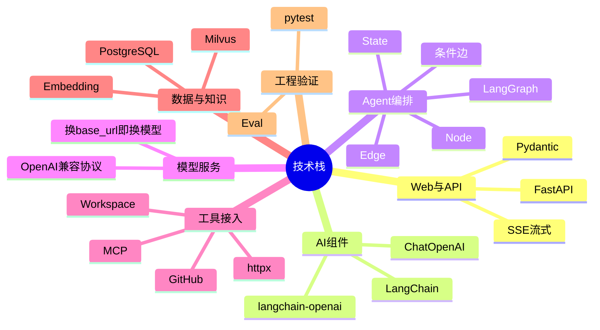

## 🔥 快速背诵

后端 Python 加 FastAPI 加 Pydantic，用 SSE 做流式；AI 层用 LangChain 接 OpenAI 兼容接口；编排用 LangGraph；PostgreSQL 存结构化、Milvus 存向量；评测靠 pytest 加 Eval。选 Python 是因为核心是 Agent 和 RAG，要频繁迭代 Prompt 和检索策略。一句话记，LangChain 给零件，LangGraph 排流程，FastAPI 管门面，Milvus 管记忆。框架只给能力，仓库隔离、参数校验、停止条件、权限得自己写。

## 🧠 导图



---

# 📖 拆碎讲

### ① 先问：为什么调个模型还要框架

**因为"调通"和"能上线"中间隔着十万八千里。**

第一版你可能只写 30 行：拼个 prompt、发个请求、打印结果。但你很快会撞上这些：

- 换一家模型，消息格式不一样
- 工具要描述给模型，Schema 得手写
- 多轮状态放哪？局部变量？那重启就没了
- 检索结果怎么塞进上下文？塞多少？
- 某一步失败要不要重试？重试几次？
- 线上出问题，我怎么知道是哪一步？

> [!tip] 发动机比喻
> **模型是发动机，业务决定车往哪开，框架提供变速箱、仪表盘和线路。**
> 发动机决定能力上限，但车能不能稳定跑，看的是周边这些工程件。

所以选框架看的不是"功能多不多"，而是三件事：**第一版多快、复杂流程能不能扩展、半年后还有没有人敢改。**

### ② 四个模块，各解决一个问题

一个能跑的 Agent 应用，最少要四块能力：

| 模块 | 解决什么 | 项目用什么 |
|---|---|---|
| **Web 框架** | 请求怎么进来、结果怎么出去 | FastAPI + Pydantic + SSE |
| **AI 编排框架** | 下一步走哪、什么时候停 | LangChain + LangGraph |
| **大模型接入** | 理解、选择、生成 | `ChatOpenAI` + OpenAI 兼容接口 |
| **工具与知识库** | 事实从哪来 | GitHub / Workspace / MCP / RAG |

串成一条链：

```
用户请求
  → Web 框架接收并校验
  → 编排框架决定下一步
  → 大模型选择工具或生成答案
  → 工具与知识库返回事实
  → 编排框架更新状态并继续
  → Web 框架持续返回结果
```

> [!important] 这条链最关键的一句
> **每个模块只干一件事，跨界的部分要靠项目代码去补。**
> 框架不会替你决定权限，不会替你限制仓库，也不会替你判断"证据够了没"。

### ③ LangChain 和 LangGraph：最容易搞混的一对

这是面试高频混淆点，用一句话切开：

> **LangChain 提供模型、消息和工具组件；LangGraph 控制这些组件按什么流程运行。**

**LangChain 干三件事：**

1. **统一模型接口** → `ChatOpenAI` 调 OpenAI 兼容协议，业务代码不用拼 HTTP
2. **统一消息结构** → `SystemMessage` / `HumanMessage` / `ToolMessage`，每个角色明确
3. **统一工具描述** → `StructuredTool` 把工具名、说明、参数 Schema 交给模型，`bind_tools` 绑定

**LangGraph 干一件事：把执行过程显式建模成图。**

四个核心概念：

| 概念 | 是什么 |
|---|---|
| **State** | 保存消息、工具结果、步数、错误、最终答案 |
| **Node** | 一次具体处理（模型决策 / 执行工具 / 生成停止结果） |
| **Edge** | 固定的下一步 |
| **Conditional Edge** | 读当前状态，决定进哪个节点或直接结束 |

ChatAgent 的主循环就长这样：

```
START
  → model_decision
      ├─ 没有工具调用 → END
      └─ 有工具调用 → tool_action
  → tool_action
      ├─ 仍有待执行工具 → 继续 tool_action
      ├─ 达到步数上限 → max_steps_stop → END
      └─ 执行完成 → 回到 model_decision
```

> [!note] 剧组比喻（很好记）
> **LangChain 是演员、道具、摄影设备；LangGraph 是通告表和现场调度。**
> 设备决定每一步能做什么，调度决定先拍哪场、出问题转哪、什么时候收工。

**为什么非要 LangGraph？** 因为 Agent 的执行顺序不固定。模型可能先读 PR、根据结果再决定查不查 CI；工具失败要记错误；重复调同一工具要停；到最大步数必须收。这些如果写进一个大函数，状态散在局部变量里，分支和循环会越来越难读。

### ④ 为什么最后选 Python

四个理由（也是你面试可以直接说的）：

1. **核心是 Agent 和 RAG** ——需要同时搞定模型调用、工具调用、状态编排、知识库、评测，Python 生态组合成本最低
2. **需要频繁迭代** ——Prompt、工具粒度、检索策略、停止条件都要反复调
3. **框架分工清楚** ——LangChain 管组件，LangGraph 管流程，**业务规则仍在项目代码里**
4. **工程约束能补齐** ——Pydantic 做运行时校验，类型标注、pytest、超时和停止条件保住可维护性

> [!tip] 加分说法
> "Go 或 Java 也能重写，需要换的只是框架适配层。**真正不能换的是仓库作用域、工具校验、状态编排、输出契约**——这些是设计，不是语法。"

### ⑤ 模型接入：怎么做到"不绑定一家"

**核心招数是协议兼容，不是自研抽象层。**

项目用 `ChatOpenAI`，但 `base_url` 指向任意 OpenAI 兼容服务。改三个环境变量就换家：

```
LLM_BASE_URL=...
LLM_API_KEY=...
LLM_MODEL=...
```

> [!warning] 一个限定条件
> 目标模型**必须支持 Tool Calling**。不然第 5 章那套工具循环根本跑不起来。
> 换模型不是"改个名字就行"，得先确认它会不会调工具。

### ⑥ 最后记住那句总结

**稳定的 Agent 应用来自清晰的模块分工：**

- Web 框架管请求
- 模型负责决策
- LangChain 提供组件
- LangGraph 控制流程
- 工具与知识库提供事实
- **项目代码守住权限和停止规则**

没有任何一个框架单独实现了整个项目。这句话在面试里非常能打——它证明你知道框架的边界在哪。

---

# 🔑 记忆锚

| 记什么 | 内容 | 口诀 |
|---|---|---|
| **4** 模块 | Web / 编排 / 模型 / 工具知识 | 「门·调·脑·手」 |
| **2** 框架分工 | LangChain 给组件，LangGraph 排流程 | 「零件 vs 调度」 |
| **4** 图概念 | State / Node / Edge / 条件边 | 「态·点·线·岔」 |
| **3** 变量 | BASE_URL / API_KEY / MODEL | 「址·钥·名」 |

> **卡壳急救**：LangChain 和 LangGraph 分不清时，想剧组——**道具 vs 通告表**。

---

# 🎯 追问速查

| 面试官问 | 你答 |
|---|---|
| 为什么用 LangGraph 不用 LangChain 的 Chain？ | Chain 是固定顺序，Agent 要循环、分支、停止条件。LangGraph 把状态和路由显式建模，可读可测 |
| LangChain 帮你做了什么？ | 统一模型接口、消息对象、工具 Schema 与绑定。**它不替你决定权限和业务规则** |
| 换模型成本高吗？ | 低，协议兼容换个 `base_url` 就行；**前提是新模型支持 Tool Calling** |
| 为什么不用 Go / Java？ | 团队和场景决定。核心是 Agent+RAG 且高频迭代，Python 最快；工程约束用 Pydantic + pytest 补 |
| 框架能保证 Agent 稳定吗？ | 不能。仓库隔离、参数覆盖、重复调用限制、超时、错误记录，都得项目代码写 |
| SSE 用来干什么？ | 把规划、工具调用、最终答案持续推给前端。Agent 跑得久，不能让用户干等 |

---

# 🔗 串联

- LangGraph 怎么用 → 05 手写循环与 LangGraph 重构
- SSE 怎么用 → 14 可观测
- Tool Calling 的前提 → 什么是 Function Calling
- 框架选型通用思路 → 手搓还是用框架

---

# 📌 打卡

- [ ] 能一句话切开 LangChain 和 LangGraph
- [ ] 能说出 LangGraph 四概念，并画出 ChatAgent 主循环
- [ ] 能背出选 Python 的四条理由
- [ ] 能说出「换模型」的唯一硬前提
- [ ] 能背出「框架不替你做什么」那串
