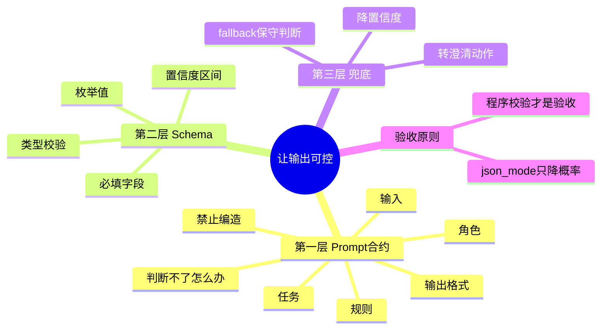

## 🔥 快速背诵

这一步解决模型输出不可控，靠三层防线。Prompt 写合约，角色、任务、输入、规则、输出格式，还要写清禁止编造什么、判断不了怎么办；Schema 管形状，枚举、必填、类型、置信度区间；代码兜底，解析失败就切确定性 fallback，不硬重试。核心认知是 response_format 只降低乱写概率，真正验收的是程序的校验函数。模型提升体验，程序保证链路跑下去。

> **一句话**：**Prompt 说规则，Schema 管形状，代码做兜底。** 三样缺一个，系统就会在某个奇怪的地方崩。

## 🧠 导图



---

# 📖 拆碎讲

### ① 第一版接入：其实就三行

**项目第一步根本不复杂。** 读 `.env` 拿三个值，拼一个请求，发出去，解析回来。

```
API_KEY / BASE_URL / MODEL
→ POST {BASE_URL}/chat/completions
→ 拿出 choices[0].message.content
```

课程里先手写 HTTP，后来换成 LangChain 的 `ChatOpenAI`，但**本质一直是同一个协议**——Chat Completions。

> [!tip] 这个顺序很重要
> 先手写一次 HTTP，你才知道 SDK 到底替你干了什么。面试时说"我先用原生请求跑通，再换 SDK"，比一上来说"我用了 LangChain"要扎实得多。

几个真实参数，记住能显功底：

| 参数 | 值 | 说明 |
|---|---|---|
| `timeout` | 60s | 手写版 |
| `temperature` | 0 → 0.2 | 结构化任务用 0，Agent 循环略放开 |
| `max_tokens` | 800 / 1000 | 控制成本 |
| 思考模式 | 关掉 | 教学阶段要稳定、要快 |

### ② Prompt 为什么叫"合约"

**因为它的作用不是"求模型帮忙"，而是"约定交付标准"。**

一份能用的合约，五个要素：

| 要素 | 回答什么问题 |
|---|---|
| **角色** | 你是谁 |
| **任务** | 要你干什么 |
| **输入** | 你会拿到什么材料 |
| **规则** | 什么能做、什么不能做 |
| **输出格式** | 交上来的东西长什么样 |

> [!important] 新手最常漏的两条
> 1. **禁止编造什么**（不是"不要编造"，而是具体到"不要编造订单号、不要承诺退款、不要假装查过物流"）
> 2. **判断不了怎么办**（必须给出降级动作，否则模型只能硬猜）

第二条是分水岭。**一个没有"我不知道"出口的 Prompt，必然产出幻觉。**

### ③ 为什么光有 Prompt 不够

**因为模型不会"理解"你的规则，它只会"倾向于"遵守。**

所以你必须有第二层：**Schema 校验**。

课程里做得很克制——**不上 Pydantic，先手写一个最小校验函数**。为什么？因为想让学习者看清校验到底在校验什么：

- 必填字段有没有
- 枚举值合不合法（比如分类只能在这几个里）
- 类型对不对（`needs_human` 必须是布尔）
- **有没有引用用户没提供的信息**

> [!note] 最后这一条最狠
> 如果用户没说"三包"、没说"30 天可退"，而模型回答里出现了这些——不是格式错，是**事实错**。
> 这种情况必须拦，而且要**切兜底**，而不是"让模型再试一次"。

### ④ 三层防线，第四层复盘

作者把它拆成四层，这个拆法很好用：

```
Prompt  →  告诉模型规则
Schema  →  约束输出形状
fallback→  出错时的确定性保底
Observer / Eval →  事后复盘，看是不是系统性出问题
```

> [!tip] 关键洞察：**不做重试，做降级**
> 解析失败时，项目选的是切到一个**关键词判断的保守兜底函数**，而不是"重试三次"。
> 为什么？因为重试只是在赌概率，兜底是**确定性的**。
> 重试的适用场景是"网络抖动"；这里的问题是"模型没按合约交付"，重试大概率还是错。

### ⑤ 五条元规则（这段最值钱）

项目把"怎么和 AI 协作"提炼成几条铁律，直接写进 System Prompt，也写进代码结构：

| # | 规则 | 落地在哪 |
|---|---|---|
| 1 | **交接必须写 WHY** | 工作流任务要带 `reason`、验收标准；综合结论要给"决策依据" |
| 2 | **Review 必须铁面无私** | 分 P1（阻塞）/ P2（补验证）/ P3（登记）；每条带 `severity / evidence / required_action / blocking` |
| 3 | **不确定就提问，不要硬猜** | Issue 信息太少 → 直接输出「等待澄清」 |
| 4 | **外部写操作必须有人确认** | 只读分析可自动跑；评论/关 Issue/改标签 → 只生成草稿 |
| 5 | **禁止表演性同意** | 先复述问题和失败路径，理解清楚才改，不盲目附和 reviewer |

> [!important] 这五条为什么重要
> 它们不是"提示词技巧"，而是**把团队协作规范编码进了系统**。
> 面试讲到这里，你的项目就从"我调了个模型"升级成"我设计了一套协作约束"。

### ⑥ 一个具体的硬规则示例

**PR 审查里最典型的一条：**

> 如果发现了 P1 或 P2 级问题，**即使模型自己写"建议合入"，代码也要把它降级成"修改后合入"**。

这条为什么必须写在代码里？因为模型的判断是概率性的，而"有阻塞问题就不能合"是**不可违反的业务规则**。

> 这就是第 3 章那句话的实例：**越确定不可违反的约束，越该写成程序校验，而不是指望模型记得。**

### ⑦ 一句话收尾

> **模型负责把话说好听，程序负责保证它别说错。**

一份 Prompt 合约、一层 Schema、一个 fallback、一套复盘——四件套下来，模型的不确定性就被框在了一个可控的盒子里。

---

# 🔑 记忆锚

| 记什么 | 内容 | 口诀 |
|---|---|---|
| **5** 要素 | 角色 / 任务 / 输入 / 规则 / 输出格式 | 「角·任·入·规·出」 |
| **2** 必写 | 禁止编造什么 / 判断不了怎么办 | 「禁·退」 |
| **3** 层防线 | Prompt / Schema / fallback（+Eval 复盘） | 「说·卡·兜·盘」 |
| **5** 元规则 | 写 WHY / 铁面 Review / 不确定就问 / 写操作确认 / 不表演性同意 | 「理·严·问·审·真」 |

> **卡壳急救**：想不起结构化输出怎么做，就背那句——**"JSON mode 只降概率，程序校验才是验收"**。

---

# 🎯 追问速查

| 面试官问 | 你答 |
|---|---|
| 怎么保证模型输出格式正确？ | 三层：Prompt 写清输出契约 → JSON mode 降低乱写 → **程序校验必填/枚举/类型/事实来源**，失败切 fallback |
| 解析失败为什么重试不好？ | 重试是赌概率，问题是"没按合约交付"不是"网络抖动"。**确定性兜底比概率重试可靠** |
| 用什么做校验？ | 课程先手写最小校验函数看清本质；工程上用 Pydantic，枚举用 `Literal`，置信度用 `Field(ge=0, le=1)` |
| 模型总爱编怎么办？ | ① Prompt 里逐条列"禁止编造哪些" ② Schema 拦"引用了不该有的信息" ③ 证据不足主动降置信度 ④ 强制引用来源 |
| 温度和结构化输出什么关系？ | 结构化任务温度调低（0 左右），减少格式漂移；Agent 探索阶段可略高 |
| 什么是"元规则"？ | 把团队协作规范编码进系统：写 WHY、Review 分级、不确定就问、写操作要人确认、不盲目附和 |

---

# 🔗 串联

- 结构化输出 → 专用 Agent 的输出契约（12）
- 写操作确认 → 13
- Prompt 五要素通用版 → 如何写好 Prompt
- 幻觉治理 → 幻觉的成因与缓解

---

# 📌 打卡

- [ ] 能背 Prompt 五要素 + 两个必写项
- [ ] 能说清为什么"不做重试做降级"
- [ ] 能讲出 `response_format` 为什么不是最终验收
- [ ] 能说出五条元规则
- [ ] 能举一个"业务规则必须写进代码而不是 Prompt"的例子
