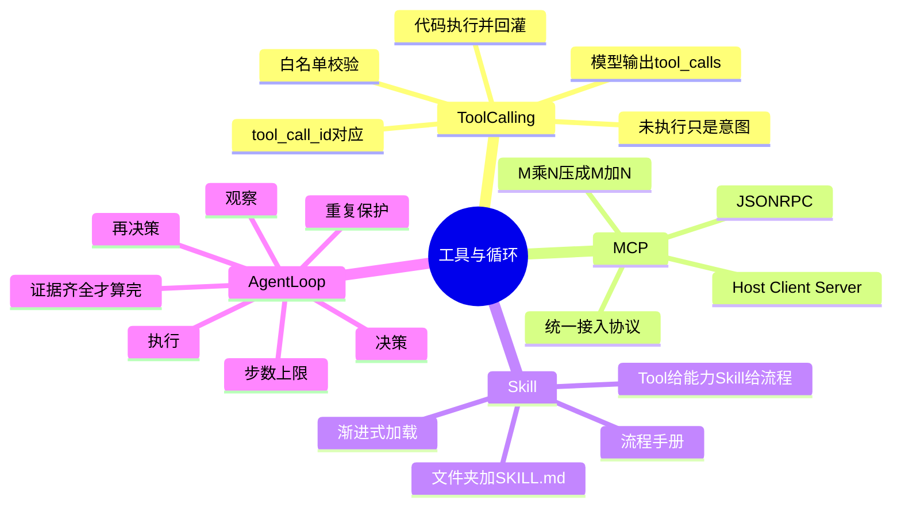

## 🔥 快速背诵

讲三件事。一，Tool Calling 是模型输出结构化的调用意图，代码去执行，决策和执行分离。二，MCP 是工具接入的统一协议，解决重复适配；Skill 是流程手册，教怎么组合工具，一个给能力一个给流程。三，Agent Loop 是把多次工具调用串起来的循环，模型决策、程序执行、结果回灌、再决策，直到不调工具或到步数上限。手写一遍再用 LangGraph 重构会发现，控制权和业务规则仍然在程序手里。

> **一句话**：**模型只负责"提出要调什么"，真正执行的永远是程序。** 这句话是工具层和循环层的共同地基。

## 🧠 导图



---

# 📖 拆碎讲

### ① Tool Calling：一次调用到底发生了什么

**先破一个最常见的误解：模型没有"执行"任何东西。**

完整过程是两轮对话加中间一段执行：

> [!note]- 第 1 步：你告诉模型有哪些工具
> 把工具的名字、说明、参数 Schema 随请求一起发过去。
> **注意：这里传的是一份"说明书"，没有一行执行逻辑。**
> 用 LangChain 的话，`@tool` 装饰器靠"函数名 + 类型标注 + docstring"自动生成这份说明书。

> [!note]- 第 2 步：模型输出"我要调谁"
> 模型这时候**不返回文字答案**，而是返回结构化的 `tool_calls`：调哪个工具、参数是什么、这次调用的 id。
> 关键词：**这只是意图，不是结果。**

> [!note]- 第 3 步：你的代码去执行
> 拿到 `tool_calls`，先在**白名单**里查这个名字存不存在（不存在直接报"未注册工具"），再执行，拿到返回值。

> [!note]- 第 4 步：结果回灌，模型再答一次
> 把结果包成 `ToolMessage`，**带上 `tool_call_id`** 追加进消息列表，再调一次模型。这样"哪次调用"和"哪份结果"就对上了——支持一次并行调多个工具。

> [!important] 记住这一句
> **决策和执行分离。模型是大脑，不是手脚。**
> 面试里只要把这句话说出来，Tool Calling 就答到点了。

### ② MCP：把 M×N 压成 M+N

**没有 MCP 的世界是这样的：** 5 个应用要接 8 个工具，就得写 40 份对接代码。每接一个新应用，重写一遍；每加一个工具，所有应用改一遍。

MCP 做的事很朴素：**定一套标准协议**，工具方按标准实现一次，任何支持 MCP 的应用拿来就能用。40 份变成 13 份。

**三层角色：**

| 角色 | 干什么 |
|---|---|
| Host | 管权限和上下文（就是你的应用） |
| Client | 一对一对接某个 Server |
| Server | 真正提供能力 |

**Server 暴露三类东西：** Tools（可执行操作）、Resources（只读数据源）、Prompts（预置提示模板）。

**通信：** 消息统一走 JSON-RPC 2.0；传输本地用 stdio，远程用 Streamable HTTP。
好处是**格式和传输解耦**——换传输不用动上层逻辑。

### ③ 项目里 MCP 具体怎么接的（这段能显真做过）

**没有配置文件，也没有启动时动态加载。** 项目把一个记忆服务包装成 **stdio 子进程**，每次工具调用时启动。

握手顺序固定四步：

```
initialize（protocolVersion 2024-11-05）
  → notifications/initialized
  → tools/list
  → tools/call
```

每次请求带 `asyncio.wait_for(..., timeout=30)`，JSON-RPC 的 error 会转成 `McpClientError`。

**只挂了三个工具，全是只读的：**

- `devflow_search_evidence` — 搜历史证据
- `devflow_get_thread_context` — 取会话上下文
- `devflow_read_session_events` — 读会话事件

> [!note] 为什么只有三个，而且全只读
> 因为 MCP 在这里的定位是"临时补记忆"，不是"给 Agent 开一堆口子"。
> **能读不能写**，是安全设计的直接体现——第 13 章会讲为什么。

### ④ Skill：不是工具，是作业手册

**最容易搞混的一点：Skill 不发明新工具，它只是"怎么组合已有工具"的说明书。**

在项目里它就是一个目录 + 一个 `SKILL.md`：

```
backend/app/skills/project-investigation/SKILL.md
```

frontmatter 里写清元信息：`name / title / version / description / category / entrypoint / tools / input_modes / workflow_steps / output_contract / safety_level`；正文写工作流步骤和**禁止操作**。

**加载机制：** 注册中心扫所有 `*/SKILL.md`，校验 manifest，然后产出三样东西：

1. 塞进 System Prompt 的上下文
2. 记到轨迹元数据里
3. **追加到相关工具的描述后面**

> [!important] 第三点最巧
> Skill 不改变工具能做什么，它改变的是**模型对工具的理解**。
> 同一个 `search_code`，挂上"调查类 Skill"之后，模型知道"应该先列目录再搜关键词"，而不是一上来乱搜。

**一句话对比：Tool 给能力，Skill 给流程。**

### ⑤ Agent Loop：把单次调用串成"会干活"

**一次 Tool Calling 只能干一件事。真实任务要连着干好几件。**

手写版循环的骨架大概是这样：

```
state = EvidenceState()          # 证据状态
for step in range(max_steps):
    decision = 模型决策(目标, state.model_view(), 工具指南)
    if decision.action == "final":
        if 证据不齐: 记 final_rejected, continue
        else: break
    执行工具 → 结果写回 state
    if 证据齐了: break
else:
    记 LoopGuard: max_steps_stop

最后用模型综合生成答案
```

这段里有三个设计点，全是踩过坑才有的：

> [!note]- 设计点 1：`model_view()` 只给最近 8 条 trace
> 工具结果全留着，上下文会无限膨胀。
> 但也不能一刀切——最近发生了什么模型必须知道，否则它会重复调同一个工具。
> 折中是：**完整记录留在 state，给模型看的只截最近 8 条**。

> [!note]- 设计点 2：`final_rejected` 守卫
> Prompt 里写"证据不齐不许结束"是不够的——模型经常自我感觉良好。
> 所以程序里加一道：**模型说 final 了，程序先查证据齐不齐，不齐就驳回，继续取证据。**
> 这就是"不靠模型自觉"的典型写法。

> [!note]- 设计点 3：`normalize_arguments()`
> 模型会把 PR 号当 Issue 号填进去、会把参数名写错。
> 所以执行前要做**参数归一化**——这不是模型的问题，是工程必须做的适配层。

**`run_tool` 是整个循环唯一的接缝。** 白名单校验、参数归一、状态更新、trace 记录全在这一个函数里。这个"单一接缝"的设计很值得学——所有外部副作用只有一个入口。

### ⑥ LangGraph 重构：框架给了什么，没给什么

**手写版暴露的问题很实在：** 模型请求自己封装、消息自己拼、工具自己注册、结果格式自己适配——项目一大，这些重复劳动越积越多。

LangGraph/LangChain 替你干了：

| 手写 | 框架 |
|---|---|
| 拼 HTTP 请求 | `ChatOpenAI.invoke()` |
| 拼消息字典 | `SystemMessage` / `HumanMessage` |
| 函数 + 注册表 | `@tool` 工具对象 |
| 直接调函数 | `tool.invoke()` |
| 自己写 while 循环 | `StateGraph` + 条件边 |

**但它没替你干这些（面试重点）：**

- 业务 JSON 协议解析
- Schema 校验
- 工具白名单
- 工具别名映射与参数归一（模型把 `get_ci_status` 写成 `read_ci` 也得能纠正）
- 证据状态的归属与合并
- **确定性业务规则**（比如"有 P1 就必须拦"）

> **结论：框架统一通用接口，Agent Loop 的控制权仍然在程序里。**

### ⑦ 一句话收尾

> 三种模式（手写 / LangGraph / 其他框架）换的是**接口层**，不换的是**控制流和业务规则**。
> 谁掌握了循环的终止条件和证据判定，谁才真正拥有这个 Agent。

---

# 🔑 记忆锚

| 记什么 | 内容 | 口诀 |
|---|---|---|
| **4** 步调用 | 传说明书 / 模型给意图 / 代码执行 / 结果回灌 | 「传·说·做·回」 |
| **3** 个 MCP 工具 | search_evidence / thread_context / session_events | 全只读 |
| **3** 个循环守卫 | max_steps / final_rejected / normalize_arguments | 「限·驳·正」 |
| **1** 个接缝 | `run_tool` 是唯一副作用入口 | 「一口进」 |
| **1** 句对比 | Tool 给能力，Skill 给流程 | 「能 vs 谱」 |

> **卡壳急救**：想不起循环长什么样，就背"决策→执行→观察→再决策，到步数或证据齐了为止"。

---

# 🎯 追问速查

| 面试官问 | 你答 |
|---|---|
| Tool Calling 是模型执行工具吗？ | 不是。模型只输出 `tool_calls`（名字+参数+id），**执行在代码侧**，结果用 `ToolMessage` 带 `tool_call_id` 回灌 |
| MCP 和 FC 什么关系？ | 上下层。FC 是"表达要调什么"的语法，MCP 是"工具怎么被发现和复用"的生态协议。**MCP 底层靠 FC 驱动** |
| Skill 和 MCP 什么区别？ | MCP 给能力（能不能调），Skill 给流程（按什么步骤调）。一个装工具，一个发手册 |
| 循环怎么停下来？ | 三个条件：模型不再调工具、达到 `max_steps`、证据判定为齐 |
| 怎么防重复调用？ | 工具名 + 规范化参数做指纹，同一指纹重复超过 N 次就停 |
| 手写和 LangGraph 差别大吗？ | 差在接口，不差在控制权。**白名单、参数归一、证据判定、业务规则，框架都不会替你做** |
| 只读工具就没风险了吧？ | 有。风险不是改外部世界，而是**把不该进上下文的东西（密钥、越界路径、别的仓库代码）带进来** |

---

# 🔗 串联

- FC 机制细讲 → 什么是 Function Calling
- MCP 全貌 → 什么是 MCP、MCP 的通信方式
- Skill 与渐进式加载 → Skill 是什么
- 三者对比 → FC / Skill / MCP 的区别
- 循环稳定性 → 无进展检测
- 手搓还是框架 → 手搓还是用框架

---

# 📌 打卡

- [ ] 能完整讲一次 Tool Calling 的四步，并强调"意图 ≠ 执行"
- [ ] 能解释 MCP 把 M×N 压成 M+N 怎么算
- [ ] 能一句话切开 MCP 和 Skill
- [ ] 能画出循环骨架，并说出三个守卫
- [ ] 能说出 LangGraph 没替你做什么（至少 3 条）
- [ ] 能回答"只读工具有什么风险"
