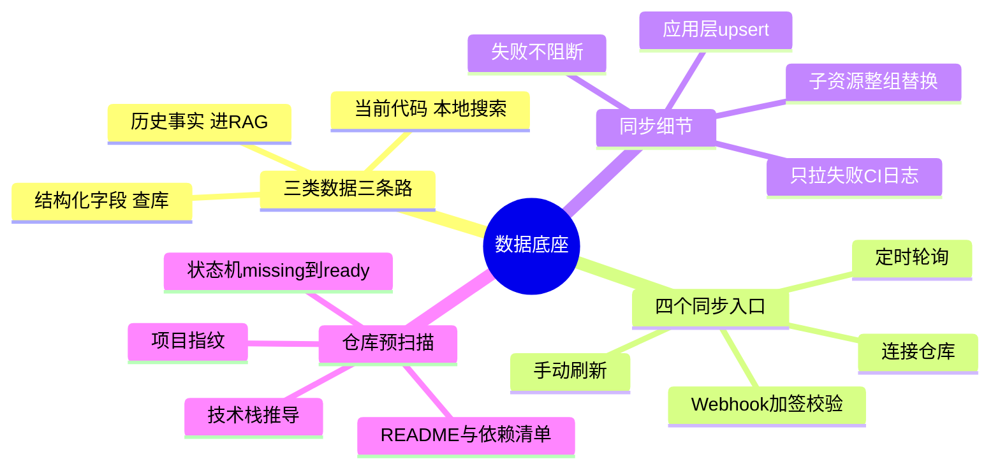

## 🔥 快速背诵

数据底座解决 Agent 看到什么。三类数据走三条路，Issue、PR、CI、文档这类历史事实同步进库；当前代码和 Diff 靠本地 checkout 加实时搜索；负责人、状态这类结构化字段直接查数据库或 API。同步有四个入口，连接仓库、手动刷新、定时轮询、Webhook，其中 Webhook 要校验签名。同步是应用层 upsert，失败只记日志不阻断其他仓库。另外做仓库预扫描，识别 README、依赖清单、技术栈，产出项目指纹。

> **一句话**：**Agent 没法凭空判断，它得先有事实。** 这一章就是"事实怎么进系统"。

## 🧠 导图



---

# 📖 拆碎讲

### ① 先分清：什么数据该走哪条路

**这一步想错，后面全错。**

因为"把所有东西都丢进向量库"是最常见的第一反应，也是最贵的错误（第 7 章专门讲为什么）。

项目实际是三条路：

| 数据 | 去哪 | 为什么 |
|---|---|---|
| Issue / PR 评论 / 失败 CI 日志 / 项目文档 | **RAG（向量库）** | 历史事实，需要语义召回 |
| 当前代码、Diff、Patch | **本地工作区实时搜索** | 变化快、要精确命中标识符 |
| 状态、负责人、时间、是否合并 | **数据库 / API 直查** | 就是要一个确定值，不需要语义 |

> [!important] 最容易被问住的一点
> **同一个对象，不同字段走不同的路。**
> 比如 PR：它的**评论**进 RAG，它的**当前 Patch** 走 Git，它的**是否合并**查数据库。
> 能说出这个拆分，说明你真想过架构。

### ② 同步：四个入口，一个核心

**为什么要有四个入口？** 因为不同场景要不同的及时性。

| 入口 | 什么时候用 |
|---|---|
| 连接仓库 | 第一次接入，全量拉一遍 |
| 手动刷新 | 用户点了"刷新"，等不及定时 |
| 定时轮询 | 兜底，定期扫一遍（间隔有下限，不能太密） |
| Webhook | 实时，GitHub 上发生事就推过来 |

Webhook 有个必答点：**要校验签名**（`X-Hub-Signature-256`，HMAC-SHA256）。不校验的话，任何人伪造一个 POST 就能往你库里灌假数据。

> [!tip] 这个设计思路可以复用
> **实时靠 Webhook，兜底靠轮询。** 只靠 Webhook 会漏（网络抖动、配置错），只靠轮询会慢。

### ③ 同步里的四个工程细节

> [!note]- 细节 1：只拉失败 CI 的日志
> CI 日志有多大？一个几百 MB 的压缩包很常见。
> 项目只对 `conclusion = failure` 的运行拉日志，解压后拼接文本。
> **成功的日志不进库**——数量大、重复多、长期检索价值低，还会把 RAG 灌成噪音。

> [!note]- 细节 2：Issue 按业务键 upsert
> 用 `repo_id + github_issue_id` 查：有就更新字段，没有就新增。
> 这样重复同步不会产生重复数据。

> [!note]- 细节 3：PR 的子资源整组替换
> PR 的 files 和 comments 不用逐条 diff，直接"先删旧的、再插新的"。
> 简单、不会漏、代价是会重写一遍。

> [!note]- 细节 4：失败不阻断
> 一个仓库同步失败，只记 `logger.warning`，不影响其他仓库。
> **批量任务里，单点失败不能拖垮全局。**

> [!warning] 一个诚实的坑（面试可以讲）
> 这里的 upsert 是**应用层**做的，不是数据库唯一约束。
> 所以并发双写时仍可能产生重复行。
> 正确做法是加唯一索引 + `ON CONFLICT`，或者用分布式锁。

### ④ 为什么要 Checkout 到本地

**因为"读代码"这件事，语义检索不好使。**

- 想确认某个函数到底怎么实现的 → 得打开文件看
- 想搜某个错误码出现在哪 → 得 grep 全仓
- 想理解模块依赖 → 得看目录结构和 import

所以项目把仓库拉到本地工作区，搜索时直接读文件。

两种模式：

| 模式 | 什么意思 |
|---|---|
| `managed` | 系统自己拉下来管 |
| `local` | 用户指定本地已有副本，通过 `origin` 还原仓库身份 |

> [!tip] 为什么要有 local 模式
> 大仓库 clone 一次几个 GB，开发机上明明已经有了，没必要再拉一遍。
> **这是"能用起来"和"Demo 好看"的区别。**

### ⑤ 预扫描：进门先做一次体检

**第一次接一个仓库，系统不会一上来就全量索引。** 它先做一次轻量预扫描：

- 找**权威文档**：README / ARCHITECTURE / CONTRIBUTING
- 找**依赖清单**：`package.json` / `requirements.txt` / `pyproject.toml` / `Cargo.toml` / `go.mod` / `pom.xml`
- 跳过 `.git`、`node_modules`、构建目录
- **拦截 `.env`、密钥文件**

从依赖清单反推技术栈（标记为"推导"而不是"用户声明"）。

> [!important] 注意最后那条
> **拦 `.env` 和密钥**。这不是可选项。
> 只读工具的最大风险不是"改了外部世界"，而是"把密钥读进上下文，再写进日志、写进向量库"。

### ⑥ 项目指纹：怎么判断"要不要重建索引"

**这是很多人会漏掉的设计。**

每次扫描不可能都全量重建（太贵），但也不能不重建（会过期）。

项目的做法是算一个指纹：

```
fingerprint = SHA-256(Git HEAD + 各文档的 mtime + size)
```

配一个状态机：

```
missing → building → ready
              ↓
           failed / stale
```

> [!warning] 这个指纹的局限（加分点）
> 它用的是 mtime 和文件大小，**不是内容哈希**。
> 所以如果文件内容被改了但 mtime 没变（比如某些构建流程），会漏检。
> 更稳的做法是逐文件内容哈希，代价是扫描变慢。

### ⑦ 一句话收尾

> 数据底座不是"同步脚本"，它是**Agent 的世界观**。
> 它同步了什么、跳过了什么、什么时候重建——直接决定 Agent 能看到什么、看不到什么。

---

# 🔑 记忆锚

| 记什么 | 内容 | 口诀 |
|---|---|---|
| **3** 条数据路线 | RAG / 本地搜索 / 直查库 | 「史·码·值」 |
| **4** 个同步入口 | 连接 / 手动 / 定时 / Webhook | 「连·手·时·钩」 |
| **1** 个必校验 | Webhook 签名 HMAC-SHA256 | 「签」 |
| **3** 类预扫描产物 | project_overview / project_doc / project_manifest | 「览·文·单」 |
| **4** 个状态 | missing / building / ready(+failed/stale) | 「缺·建·好」 |

> **卡壳急救**：想不起数据怎么分类，就问一句——**"这个数据是要"搜得到"，还是"要一个确定值"？"**

---

# 🎯 追问速查

| 面试官问 | 你答 |
|---|---|
| 数据怎么进来的？ | 四个入口：连接仓库、手动刷新、定时轮询、Webhook（要验签）。统一走一个 GitHub 客户端 |
| 增量怎么做？ | Issue 按业务键 upsert；PR 的 files/comments 整组替换；只拉失败 CI 日志 |
| 为什么只拉失败日志？ | 日志量巨大，成功日志重复多、检索价值低，还会污染 RAG |
| 为什么会 checkout 到本地？ | 代码需要精确检索（grep 标识符）和文件级阅读，语义检索对代码不好使 |
| 怎么知道该不该重建索引？ | 算项目指纹（Git HEAD + mtime + size），配状态机 missing→building→ready |
| 这个设计有什么不足？ | 指纹不含内容哈希，可能漏检；upsert 是应用层的，并发下可能重复 |
| 预扫描为什么要拦 .env？ | 防止密钥进上下文、日志、向量库。只读操作也有风险 |

---

# 🔗 串联

- 为什么源码不进 RAG → 07
- 切分与入库 → 08
- 只读数据的风险 → 13
- 知识库动态更新 → 知识库动态更新

---

# 📌 打卡

- [ ] 能说出三条数据路线 + 判断标准
- [ ] 能背四个同步入口，并说出 Webhook 必做的一件事
- [ ] 能讲清"为什么只拉失败日志"
- [ ] 能解释项目指纹和状态机
- [ ] 能主动说出这个设计的两个不足
