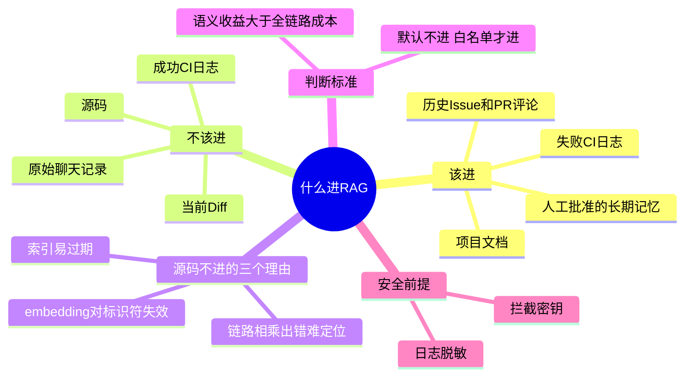

## 🔥 快速背诵

这一章最反直觉：不是所有数据都该进向量库，源码就不该进。三条理由，一是 embedding 对代码标识符失效，getUserById 和 deleteUserById 向量很近但语义相反；二是 RAG 链路多环节相乘，出错难定位，而 grep 命中直接可查；三是代码变化太快，索引上午建下午就过期。判断标准一句，只有语义召回带来的收益大于切片、索引、同步、调试和安全成本，这份数据才值得进 RAG。

> **一句话**：**不是所有数据都该进向量库。源码就不该进。**

## 🧠 导图

---

# 📖 拆碎讲

### ① 先破一个思维惯性

**学完 RAG 之后，人很容易形成一条固定推论：**

> "大模型不知道我的私有数据 → 所以要 RAG。"

这条推论**跳了一步**。从"模型不知道"到"必须用 RAG"，中间少了一个判断：**这份数据适合语义检索吗？**

外部取数据至少有四条路：

| 方式 | 适合 |
|---|---|
| RAG 向量检索 | 语义模糊、表述多样、要靠"意思像"召回 |
| grep / 全文搜索 | 有精确标识符（函数名、错误码、路径） |
| 数据库 / API 直查 | 要一个确定值（状态、负责人、时间） |
| 读文件 / 列目录 | 要看具体实现、理解结构 |

> [!important] 记住这句
> **RAG 是"召回工具"，不是"数据总入口"。**

### ② 源码为什么不进 RAG（重点，三条理由）

这是全篇最值钱的部分，面试几乎必问。

> [!note]- 理由一：embedding 对代码标识符基本失效
> `getUserById` 和 `deleteUserById`，在向量空间里距离非常近——都是"按 id 操作用户"。
> 但一个查询、一个删除，**行为完全相反**。
> 代码是"结构化精确标识符"，函数名/类名/错误码本身就是最好的检索词。
> **精确匹配比语义匹配更可靠，而且不会语义漂移。**

> [!note]- 理由二：RAG 链路是"乘法"，grep 是"一步"
> 切分 → embedding → 召回 → 重排 → 生成，**每一环都可能出偏差，而且偏差会相乘**。
> 结果不准的时候，你很难定位是切错了、向量不准、还是重排把对的扔了。
> 而 grep 命中关键词和文件位置，**结果可以直接打开检查**。

> [!note]- 理由三：索引时效性
> 代码仓库一天几十次提交。上午建的索引，下午就对不上了。
> 频繁重建成本高；不重建就会召回已删除的代码行——**这比搜不到更危险**。
> grep 每次搜的都是当前工作区，零运维。

> [!tip] 一个有力的佐证
> 连做代码 Agent 的公司也走过这条路：早期试过给代码建语义索引，后来放弃，改成"agentic search（让 Agent 自己 grep）优先，只有在确实需要更快时才叠加语义搜索"。

### ③ 那什么该进 RAG

| 数据 | 为什么进 |
|---|---|
| Issue 标题与正文 | 历史问题，表述多样，靠语义才找得全 |
| PR 标题、正文、Review 评论 | 决策讨论，关键词难覆盖 |
| 失败 CI 日志 | 错误形态多变，同类问题换个报错文案就搜不到 |
| 项目文档 | 天然是自然语言 |
| **人工批准过的长期记忆** | 需要跨会话复用 |

> [!warning] 失败日志进 RAG 有个前提：先脱敏
> Token、Authorization、JWT、云密钥、私钥——**必须先清洗掉**。
> 日志里什么都可能有，直接 embedding 等于把密钥永久存进向量库。

### ④ 原始聊天记录为什么不进 RAG（这条最反直觉）

**直觉是：聊出来的结论挺有价值的，存起来以后能用。**

但这里有个陷阱：**对话里的大量内容是"未证实的推测"。**

比如某次排障时模型推断"这个 Token 可能 15 分钟过期"——它只是个猜测。如果这句话自动进了项目知识库，后面会被多个会话、多个 Agent 反复召回，**当成事实传播**。

> [!important] 所以项目做了一个"关卡"
> 对话里发现值得留的结论 → 先存成**待审候选（pending）**
> → **人工批准** → 才变成正式记忆条目 → 才向量化
> → 拒绝就只改状态，不进 RAG
>
> 这就是第 10 章要讲的「知识晋升」。

### ⑤ 工程的落地方式：默认不进，白名单才进

**这条设计特别值得抄。**

不是"看到新数据就自动 embedding"，而是反过来——**默认不进 RAG，只有在白名单里的数据类型才生成向量。**

这样一来，新增一种数据源时，你必须显式回答一个问题：**"它真的需要语义召回吗？"**

> [!tip] 这个模式叫什么
> **默认拒绝（deny by default）**。
> 安全设计里很常见，用在数据治理上同样好用——它把"要不要进"从"顺手就进"变成"必须论证"。

### ⑥ 一条可复用的判断原则

把上面所有内容压成一句话：

> **只有当 RAG 带来的语义召回收益，大于切片、索引、同步、调试、安全的全部成本时，这份数据才值得进 RAG。**

这句话可以直接背下来用在任何项目里。它同时解释了：

- 为什么源码不进（收益小：精确检索更好；成本高：索引易过期）
- 为什么成功 CI 日志不进（收益小：重复多价值低；成本高：体量巨大）
- 为什么原始聊天不进（收益不确定：可能是错的；成本高：错误会被放大）

### ⑦ 一句话收尾

> **RAG 不是"把知识塞进向量库"，而是"判断哪些知识值得用语义的方式被找回来"。**

前者是技术动作，后者是工程判断。面试考的是后者。

---

# 🔑 记忆锚

| 记什么 | 内容 | 口诀 |
|---|---|---|
| **3** 条不进源码的理由 | 标识符失效 / 链路相乘 / 索引过期 | 「失·乘·旧」 |
| **3** 条数据路线 | 语义 / 精确 / 直查 | 「语义·grep·查库」 |
| **1** 条原则 | 语义收益 > 全链路成本 | 「收益大于成本」 |
| **1** 个模式 | 默认不进，白名单才进 | 「默认拒」 |

> **卡壳急救**：忘记理由就想一个例子——`getUserById` 和 `deleteUserById` 向量很近，但一个查一个删。

---

# 🎯 追问速查

| 面试官问 | 你答 |
|---|---|
| 为什么代码库不做 RAG？ | 三条：embedding 对标识符失效（相近向量相反语义）、链路相乘出错难定位、代码变化快索引易过期。**grep 确定性更强** |
| 那代码怎么查？ | checkout 到本地，grep + 读文件 + 符号检索。Claude Code 也是 agentic search 优先 |
| 什么数据该进 RAG？ | 自然语言形态、表述多样、需要语义召回的历史事实：Issue、PR 讨论、失败日志、文档、人工批准的结论 |
| 聊天记录能直接进知识库吗？ | 不能。含大量未证实推测，会被反复当成事实传播。必须**人工审批晋升** |
| 日志进 RAG 要注意什么？ | 先脱敏：Token、Authorization、JWT、云密钥、私钥 |
| 怎么防止"什么都往 RAG 塞"？ | 白名单机制 + 默认拒绝，新增数据源必须论证语义收益 |
| RAG 什么情况下反而不如关键词？ | 有精确标识符（错误码、接口名、路径、人名）时，BM25/精确匹配更稳 |

---

# 🔗 串联

- 数据同步怎么做 → 06
- 切分与入库 → 08
- 混合检索（语义 + 关键词互补） → 09
- 知识晋升与记忆 → 10
- 概念对照 → RAG 解决什么问题、向量 vs 关键词

---

# 📌 打卡

- [ ] 能不看笔记讲出源码不进 RAG 的三条理由
- [ ] 能举出 `getUserById` 那个例子
- [ ] 能说出为什么聊天记录不能自动进 RAG
- [ ] 能背出那条判断原则
- [ ] 能解释"默认拒绝 + 白名单"的好处
