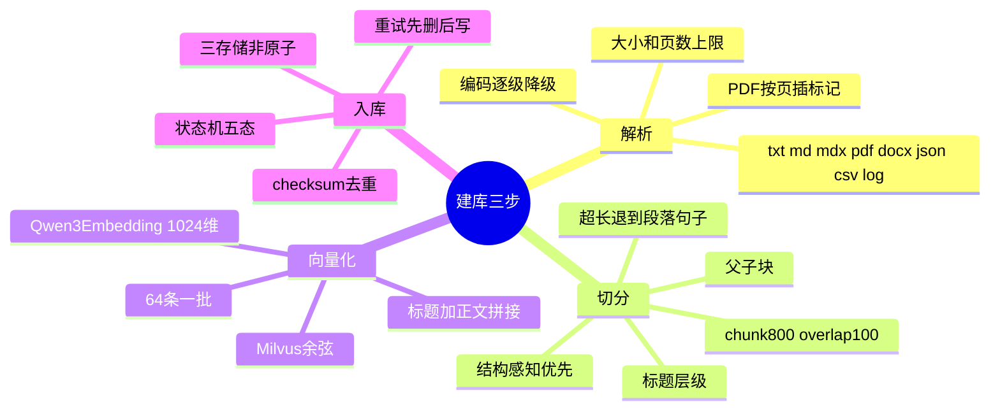

## 🔥 快速背诵

建库分三步：解析、切分、入库。解析支持 txt、md、pdf、docx、json、csv、log，PDF 按页插标记，编码从 utf-8 到 gb18030 逐级降级。切分从固定窗口改成结构感知，先按标题层级分，超长才退到段落、句子、字符，同时用父子块解决召回要小、阅读要大的矛盾。向量化用 Qwen3-Embedding 六亿参数、1024 维，存 Milvus，一批 64 条。入库是状态机，排队、解析、切分、向量化、完成，失败记原因。

> **一句话**：**结构决定第一刀落在哪，最大长度只负责兜底。**

## 🧠 导图



---

# 📖 拆碎讲

### ① 解析：脏活，但决定上限

**文档进来第一步是"变成纯文本"。** 这步很脏，但做不好后面全废。

项目支持的格式：`txt / md / mdx / pdf / docx / json / csv / log`。

几个值得记的细节：

| 细节 | 做法 | 为什么 |
|---|---|---|
| PDF | 用 pypdf 逐页提取，每页插 `<!-- page: N -->` | **保留页码**，后面引用能说"第 12 页" |
| DOCX | 转成 Markdown 风格 | 保留标题层级，切分才有结构可用 |
| 编码 | utf-8-sig → utf-8 → gb18030 → latin-1 逐级降级 | 中文项目里 GBK 编码的老文件很常见 |
| 上限 | 12MB / 400 万字符 / 500 页 | 防单文档撑爆整个流程 |

> [!tip] "插页码标记"这个动作很聪明
> 它不是给人看的，是给**切分器和引用**看的。
> 切出来的每个块都知道自己在第几页，回答时就能说"见第 12 页"——这才是可信的引用。

### ② 切分：为什么不能用固定窗口

**固定窗口是最容易想到的方案**：每 800 字符切一刀，重叠 100。

它的问题有三个，全是真问题：

> [!warning]- 问题一：语义被截断
> 一个条件在上一块、结论在下一块。两块单独看都不完整，检索时两块的相关度都不高，**结果两块都没召回**。

> [!warning]- 问题二：结构被破坏
> 标题和正文分离、表格被切成两半、代码围栏被切断——**记号不完整，模型读不懂**。

> [!warning]- 问题三：重叠制造重复
> 同一句话出现在多个块里，检索时挤占 Top-K 名额，也挤占上下文预算。

**所以项目改成"结构感知"：**

先按文档结构切（Markdown 按标题层级、按空行、按代码围栏），**超长才退到段落 → 句子 → 字符**。

> [!important] 这句要背
> **结构决定第一刀落在哪，最大长度负责兜底。**
> 递归切分不能替代格式解析器——`.md` 就用标题切，别用字符数硬切。

### ③ 父子块：一个很优雅的矛盾解法

**这里有个绕不过去的矛盾：**

| 块小 | 块大 |
|---|---|
| 召回准（一个向量表达一个意思） | 上下文完整 |
| 但模型读到的东西不够 | 但一个向量混了多个主题，召回不准 |

**父子块（small-to-big）的解法：**

- **子块**参与检索（小、准）
- 命中后用 `parent_id` 找回**父块**（大、完整）
- 或者扩展到相邻子块

每个块都带着 `chunk_id / parent_id / section_path / page / start_line / end_line`。

> [!note] 为什么这套元数据是必须的
> - `parent_id` → 能"由小找大"
> - `section_path` → 能告诉模型"这段属于哪一节"
> - `page / start_line / end_line` → 能生成可信引用，能让人回去核对

### ④ 参数怎么定（这段能显你真调过）

课程给的默认值是 **`chunk_size = 800`，`chunk_overlap = 100`**。
但重点不是这两个数字，是**怎么定**：

| 考虑因素 | 影响 |
|---|---|
| Embedding 模型的适配长度 | 超了会被截断，白切 |
| 问题的粒度 | 问细节要小块，问全貌要大块 |
| 结构密度 | 表格/代码密集的文档要更小 |
| 后续链路承载 | 重排和压缩能吃多大 |
| 成本与延迟 | 块越多，向量越多，检索越贵 |

**递归优先级：** 章节 → 段落 → 句子 → 标点/词 → 字符（兜底）。

> [!warning] 一个坑
> `max_chars` 只是快速保护，**字符数 ≠ Token 数**。
> 中文、代码、特殊符号的 token 密度差别很大。入库前应该抽样看真实 Token 分布，别只信字符数。

### ⑤ 向量化：这里有个"合同"概念

| 项 | 值 |
|---|---|
| 模型 | Qwen3-Embedding-0.6B |
| 维度 | 1024 |
| 批次 | 64 条一批 |
| 拼接方式 | `文档标题 · 标签 \n 正文` |
| 存储 | Milvus，余弦相似度 |

> [!important] Embedding Contract（这个点很多人不知道）
> **索引时的 embedding 模型和维度，必须和查询时完全一致。**
> 项目直接把这个做成硬约束：维度不一致**拒绝启动向量库**，不截断、不补零、不偷偷换 Provider。
>
> 为什么这么刚？因为偷偷"兼容"一下，结果是**所有检索结果都悄悄变差**，而且没人发现。

**拼接标题+正文**这个小技巧也值得记：标题本身是高密度语义信号，带上它能提升召回。

### ⑥ 入库：真正难的是"可靠"

**写向量库不是 `insert` 一下就完事。** 项目用了状态机：

```
queued → parsing → splitting → embedding → completed
                                        ↘ failed（记 error_message）
```

**去重靠 checksum：** 算文档的 SHA-256，按 `repo_id + checksum + 状态非失败` 判断是不是重复。

**重试是"先删后写"：** 先把这个文档组的旧向量全删掉，再重新走一遍流程。
为什么要先删？因为重跑会生成新的 chunk，如果不删旧的，库里就有两份，检索时互相打架。

### ⑦ 最硬的一个工程问题：三存储不是原子的

**这里有三个存储：** PostgreSQL（元数据）+ Milvus（向量）+ 文件系统（原文件）。

它们之间**没有分布式事务**。

项目的顺序是：`PG flush（拿 ID）→ Milvus upsert → PG commit`。

> [!warning] 这意味着什么
> 中途失败，可能 PG 有记录但 Milvus 没向量，或者反过来。
> **状态是 `completed` 不等于数据一致。**
> 所以必须有对账 + 重建机制：定期比对、发现不一致就重跑。

> [!tip] 面试时的加分答法
> 不要只说"我用 Milvus 存向量"。要说"**三存储之间没有事务，我用状态机 + checksum + 对账重建来兜一致性**"。
> 这句话直接把"用过"和"想过"区分开了。

### ⑧ 还两个诚实的不足（主动说更加分）

1. **并发缺幂等键**：`repo_id + checksum` 没有数据库唯一约束，同时上传同一个文件可能双写。
2. **后台任务不持久**：用的是进程内的后台任务，进程重启任务就丢。生产上应该用持久化队列 + 独立 worker。

> 主动指出不足，比被面试官问出来要好一百倍。

### ⑨ 一句话收尾

> 建库看起来是"切一切、存一存"，真正难的是两件事：
> **切得准**（结构感知 + 父子块），和**存得可靠**（状态机 + 对账）。

---

# 🔑 记忆锚

| 记什么 | 内容 | 口诀 |
|---|---|---|
| **3** 步 | 解析 / 切分 / 入库 | 「解·切·入」 |
| **2** 个数字 | 800 / 100 | 「八·百」 |
| **5** 个状态 | queued / parsing / splitting / embedding / completed | 「排·解·切·向·完」 |
| **3** 个存储 | PG / Milvus / 文件 | 「三库不同步」 |
| **1** 个硬约束 | 索引与查询 embedding 必须同模型同维度 | 「一个合同」 |

> **卡壳急救**：忘记切分原则，就背"结构决定第一刀，长度只做兜底"。

---

# 🎯 追问速查

| 面试官问 | 你答 |
|---|---|
| 切分怎么做？ | 结构感知优先：按标题层级/空行/代码围栏切；超长递归退到段落→句子→字符。默认 800/100 |
| 为什么不用固定窗口？ | 语义被截断（相关度都不高导致都不召回）、结构被破坏、重叠制造重复 |
| 父子块解决什么？ | 小块召回准但上下文不够，大块完整但向量混主题。**子块检索、父块阅读** |
| 参数怎么定？ | 看 embedding 适配长度、问题粒度、结构密度、下游承载、成本。**字符数≠token 数，要抽样看真实分布** |
| 怎么保证入库可靠？ | 状态机 + checksum 去重 + 失败重试先删后写 + 三存储对账重建 |
| 向量库和数据库不一致怎么办？ | 没有分布式事务，所以靠对账任务发现 + 重跑重建。**completed 不等于一致** |
| Embedding 换模型会怎样？ | 全废。必须同模型同维度，否则检索结果静默变差。项目直接硬性拒绝启动 |

---

# 🔗 串联

- 为什么这些数据才进来 → 07
- 检索怎么用这些块 → 09
- 切分通用方法 → Chunking 策略、语义被切断
- 向量库选型 → 向量数据库与选型
- 更新与重建 → 知识库动态更新

---

# 📌 打卡

- [ ] 能背"结构决定第一刀，长度只做兜底"
- [ ] 能说出固定窗口的三个问题
- [ ] 能讲清父子块怎么解决矛盾
- [ ] 能背入库五状态
- [ ] 能解释三存储为什么不一致、怎么兜
- [ ] 能主动说出两个不足
