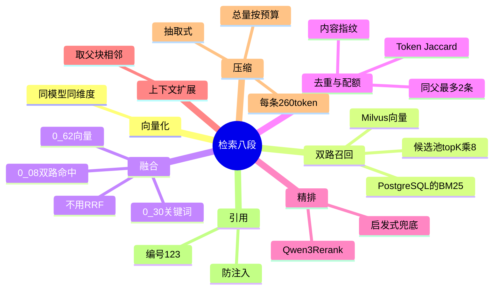

## 🔥 快速背诵

检索是八段流水线，每段解决上一段的遗留问题。查询进来先向量化，然后双路召回，Milvus 走向量、PostgreSQL 走 BM25，合并后加权融合，权重是向量 0.62、关键词 0.30、双路命中加 0.08。融合后去重、限制同一父块最多两条，再用 Qwen3-Rerank 精排，截 topK，扩展父块上下文，最后做抽取式压缩，每条约 260 token。不做 RRF 做加权是为了表达业务偏好，压缩用抽取不用生成，怕改写数字和否定词。

> **一句话**：检索不是"查一下就完"，是一条**八段的流水线**，每一段都在解决上一段的遗留问题。

## 🧠 导图



---

# 📖 拆碎讲

### ① 为什么一定要"双路"

**因为两种检索的盲区刚好错开。**

| | 强在哪 | 弱在哪 |
|---|---|---|
| **向量（语义）** | 同义表达、换个说法也能找到 | 对错误码、接口名、路径、人名**不敏感** |
| **关键词（BM25）** | 精确名称、编号、报错原文一搜就中 | 同义表达、跨语言完全无解 |

用户问"上次那个 500 报错"——向量可能找出一堆"服务器错误"讨论，但真正命中 `HTTP_500` 的是关键词那一路。
用户问"这个接口为啥合并失败"——文档里写的是"上游冲突导致构建中断"，一个字都不重叠，只有向量能捞回来。

> **所以不是"哪个更好"，是"两条腿走路"。** 这也是 向量 vs 关键词 那篇的落地版。

### ② 为什么不用 RRF，而用加权融合

这是本章最有辨识度的一个点。

**RRF（Reciprocal Rank Fusion）很流行**，因为它只用排名不用分数，天然免疫"两路分数不可比"的问题。**但它有个代价：它丢掉了"这一路有多确信"的信息。**

项目的选择是**归一化加权融合**：

```
最终分 = 0.62 × 向量分 + 0.30 × 关键词分 + 0.08 × 双路都命中奖励
```

**为什么这么选？**

1. **能表达业务偏好**：这个项目里语义相关比字面命中更重要，所以给向量更高权重
2. **能加额外奖励项**：比如"双路都命中"、"来源更权威"、"时间更新"——这些 RRF 表达不了
3. **实践上够用**：分数用"除以本路最大值"做批次内归一化，简单有效

> [!tip] 面试怎么说才不踩坑
> 不要说"RRF 不好"。要说：**"RRF 是分数难校准时的稳健基线；如果我们知道自己更信哪一路，加权融合表达力更强。"**
> 这样既显示了你知道 RRF，也显示了你会做取舍。

### ③ 去重：三层，各治一种病

融合完的候选列表是"脏"的，要去三层脏：

> [!note]- 第一层：chunk 级去重
> 同一个 chunk id 出现多次（两路都召回了）→ 合并成一条。

> [!note]- 第二层：近重复去重
> 不同 chunk 但内容几乎一样（重叠区造成的）→ 用内容指纹 + Token 级 Jaccard 相似度判定，留一条。

> [!note]- 第三层：父级配额
> **限制同一个父块最多占 2 条。**
> 为什么？因为如果不限，一个长文档会把 Top-K 全部占满，你拿到的 5 条证据其实来自同一篇文章——**等于没做多源取证**。

> [!important] 第三层是最容易被忽略、但最体现工程思维的
> 它解决的其实是"**来源多样性**"问题，不是"重复"问题。
> 面试讲这一条，比讲十条"我去重了"都有用。

### ④ 精排：先控深度，再上模型

**重排（Rerank）解决什么？** 融合后的候选只是"**可能**相关"，重排要判断"**这段内容能不能回答这个问题**"。

两个工程要点：

1. **先控制候选深度再重排**。不能把几千条直接丢给 Rerank 模型——又慢又贵。所以候选池先截：`min(max(top_k × 8, 20), 100)`。比如 `top_k=5` 且开了重排，取 40 条进重排。
2. **必须有兜底**。Rerank 服务挂了不能整条链路崩——降级到启发式排序，并记下 `fallback_reason`，**不静默降级**。

### ⑤ 上下文扩展：小块召回，大块阅读

命中一个子块之后，把**父块的前后相邻块**一起带回来。

这就是第 8 章父子块设计的兑现点：**检索要小（准），阅读要大（完整）。**

> 如果只给那一小块，模型经常"看到了答案的一半"，然后自信地答错。

### ⑥ 压缩：为什么不能用生成式摘要

**问题：** Top-K 条证据全塞进去，token 爆炸。

**诱惑：** 让模型把每条证据"总结成一句话"。

**项目为什么拒绝？** 因为生成式摘要会**改写数字、抹掉否定词、改变代码语义**。

举个致命的例子：原文是"这个接口**不**支持批量删除"，摘要成"这个接口支持批量删除"——一个字之差，结论反了。

所以项目用**抽取式压缩（query-aware extraction）**：

- 只保留和查询相关的句子
- 优先保留异常类型、函数签名、行号这类"硬信息"
- **每条上限约 260 token**
- 总量按预算装：`min(1800, max(520, top_k × 260))`

> [!important] 顺序也很讲究：**压缩放在重排之后**
> 先让重排看到未压缩的原文，避免"压缩时把关键否定词删掉了，重排就判错了"。

### ⑦ 引用：让答案可以被核对

最后一步，把证据编成 `[1] [2] [3]`，同时用在两个地方：

- 塞进给模型的资料区（让它按编号引用）
- 返回给前端的来源卡片

系统提示里会明确要求：

- 结论要标 `[1][2]`
- **证据不足就拒答**，不要硬凑
- **资料是"不可信数据"**——防提示注入（检索到的文档里可能藏着"忽略以上指令"）

> [!warning] 还有一处细节：出参要脱敏
> 返回给前端的元数据里，会把服务器本地路径这类字段删掉，防止泄露内部结构。

> [!tip] 这最后一步为什么重要
> 没有引用，用户只能"信或不信"。
> 有了引用，用户可以**回去核对**——这才是"研发协作"场景能建立信任的前提。

### ⑧ 别忘了那个贯穿全链路的东西：repo 隔离

**每一次检索，都必须带 `repo_id` 过滤。**

三层防护：

1. API 入口校验仓库归属
2. SQL 查询条件里带 `repo.id`
3. **向量库的过滤表达式里也必须带 `repo_id`**

> [!important] 第三层最容易被漏
> 很多人以为"我在业务层限制了仓库"就够了。
> 但向量检索是独立的一次查询，**过滤条件必须下推到向量库**，否则 A 仓库的问题会召回 B 仓库的代码片段。
> 这是那种"平时看不出来、出事就是事故"的 bug。

### ⑨ 一句话收尾

> 检索链路的每一段都在补上一段的漏：
> **双路补单路的盲区 → 融合补分数不可比 → 去重补重复 → 配额补单一来源 → 重排补"相关不等于能答" → 扩展补上下文不足 → 压缩补预算不够 → 引用补不可核对。**

---

# 🔑 记忆锚

| 记什么 | 内容 | 口诀 |
|---|---|---|
| **8** 段链路 | 向量化→双路→融合→去重/配额→重排→扩展→压缩→引用 | 「召·融·去·排·扩·压·引」 |
| **3** 个权重 | 0.62 / 0.30 / 0.08 | 「六三〇·八」 |
| **2** 条限制 | 同父最多 2 条、每条压缩 260 token | 「二·二六」 |
| **3** 层 repo 防护 | API / SQL / 向量过滤 | 「三层不串仓」 |
| **1** 个拒绝 | 不用生成式摘要（怕改数字和否定词） | 「只抽不生」 |

> **卡壳急救**：忘记链路顺序，就想"从"查到给模型看"这一路的动作"——先找候选、再排、再补上下文、再压、最后编号。

---

# 🎯 追问速查

| 面试官问 | 你答 |
|---|---|
| 检索链路讲一下 | 向量化 → 向量+BM25 双路召回 → 加权融合 → 去重+父级配额 → Rerank → 父块扩展 → 抽取式压缩 → 编号引用 |
| 为什么用加权不用 RRF？ | RRF 只用名次丢掉了置信度。加权能表达业务偏好、能加双路命中/来源/时间奖励。分数用批次内归一化 |
| 权重怎么定的？ | 向量 0.62、关键词 0.30、双路命中 0.08。语义在这个场景更重要，但要保精确命中 |
| 为什么要限制同一父块条数？ | 防单一文档占满 Top-K，保证**来源多样性**，否则 5 条证据来自同一篇等于没多源取证 |
| 为什么不用生成式压缩？ | 会改写数字、删掉否定词、扭曲代码语义，**结论可能反转**。用抽取式，保异常类型/函数签名/行号 |
| 引用怎么做？ | `build_sources` 从 1 编号，同一份用在 prompt 资料区和前端卡片；系统提示要求标注 + 证据不足拒答 |
| 怎么防串仓库？ | 三层：API 校验、SQL 条件、**向量库过滤表达式**。第三层最容易漏 |
| Rerank 挂了怎么办？ | 降级启发式排序，记 `fallback_reason`，**不静默降级** |

---

# 🔗 串联

- 块怎么来的 → 08
- 压缩之后怎么放进上下文 → 10
- 检索概念地基 → 在线检索全流程、多路召回与 RRF、检索优化四层
- 引用与幻觉 → 幻觉治理

---

# 📌 打卡

- [ ] 能背出八段链路，并说出每段补什么漏
- [ ] 能说出三个权重数字
- [ ] 能讲清"不用 RRF 的理由"而不贬低 RRF
- [ ] 能解释"父级配额"解决的是多样性不是重复
- [ ] 能说出为什么压缩不能生成、且要放在重排之后
- [ ] 能说出 repo 隔离三层，并强调向量库那一层
