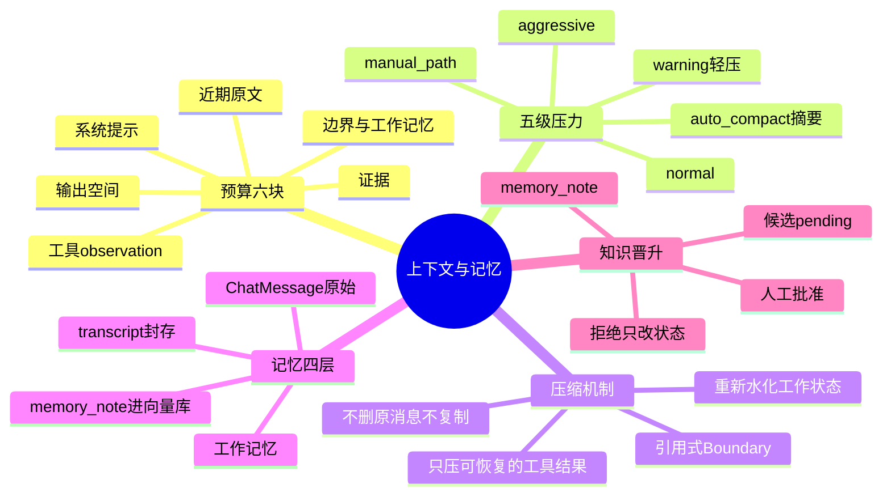

## 🔥 快速背诵

这一层解决两件事：装得下、记得住。窗口按六块分配，系统提示、工作记忆、证据、近期消息、工具结果、输出空间，必须给回答留位置，填满了请求会失败。压力分五级，正常、轻压、摘要压缩、激进压缩、最紧预算；轻压只清可恢复的工具结果，不删助手回答。压缩用引用式 Boundary，不复制不删原消息，还会把工作文件、Skill、工具名重新水化回摘要前面。记忆分四层，最后一层必须人工审批才能进 RAG。

> **一句话**：**压缩不是让 Agent 忘掉过去，是让它带着更清楚、更轻的过去继续干活。**

## 🧠 导图



---

# 📖 拆碎讲

### ① 先看"装不下"这件事有多具体

**很多人以为上下文问题是"超了会报错"，其实更麻烦的是——填满了也会失败。**

因为**输入和输出共享同一个窗口**：你把窗口填到 99%，模型就没有位置生成回答了。

所以预算这一步，第一件要干的事是：**先给输出留位置。**

### ② 预算分六块（这个拆分很实用）

| 块 | 装什么 |
|---|---|
| 系统提示 | 稳定的规则、工具说明、Skill 上下文 |
| 边界与工作记忆 | 压缩边界、摘要、当前任务状态 |
| 证据 | RAG 检索结果、结构化观察 |
| 近期原文 | 最近几轮对话，用户会说"刚才那个" |
| 工具 observation | 本轮 Agent 循环产生的工具结果 |
| **输出空间** | 模型生成回答用的余量 |

> [!important] 为什么必须分开算
> 如果混成一个数字，出问题时你**诊断不出来**是证据给多了、还是工具结果爆了、还是历史太长。
> 分开算，才能知道该砍哪一块。

还有一个细节：项目同时保留**调用前估算**和**调用后真实用量**，并标明来源（`estimate` / `provider`）。
因为估算不准的时候，你得知道"是谁不准"。

### ③ 五级压力：不是一到顶就砍

**这是设计得很聪明的一点：分级，而不是一刀切。**

| 级别 | 做什么 |
|---|---|
| `normal` | 正常，什么都不做 |
| `warning` | 轻压：只清理旧的可恢复工具结果 |
| `auto_compact` | 生成摘要 + 插入压缩边界 |
| `aggressive` | 缩小保留后缀、加大摘要力度 |
| `manual_path` | 最紧预算，走人工兜底路径 |

**"轻压"这一步是精髓。** 它只清两类东西：

- 角色是 `tool` / `tool_result` 的消息，或子类型是 `tool_result`
- 而且要**足够旧、足够长**

> [!important] 为什么只压工具结果
> - 工具结果**可以重新获取**（再调一次工具就有），所以压掉是安全的
> - 助手的回答**不可重建**，压掉就真丢了
>
> 一句话：**只压能再生的，不碰不可再生的。**

而且轻压完如果回到正常水位，就**不调摘要模型**了——省钱、省延迟。

### ④ 正式压缩：引用式边界

**压缩时最容易犯的错是"把历史摘要一下就删掉原消息"。**

后果：你再也查不到原话，审计断链，出了问题没法复盘。

项目的做法很讲究：

> [!note]- 剪断而不删除
> 插一条系统消息作为**压缩边界**，记下：从哪条到哪条被总结了、保留了哪几条、原始转录在哪。
> **旧消息不删，最近消息不复制**，只是"投影"出一份活动视图。

> [!note]- 重新水化（rehydration）
> 摘要前面会插一段 `[Rehydrated Working State]`，把"当前在干什么"恢复给模型：
> 最多 5 个工作文件、6 个激活 Skill、8 个工具名，加上怎么恢复转录和会话的办法。
> **但不注入文件全文**——只给索引，需要时再读。

> [!tip] 这个设计哲学值得学
> 摘要解决"太长"，水化解决"太薄"。
> 只摘要不水化，模型会知道"以前聊过"，但不知道"现在手里有什么工具、在看哪些文件"。

### ⑤ 记忆四层：别把它们混成一锅

| 层 | 形态 | 生命周期 |
|---|---|---|
| 原始对话 | `ChatMessage` | 永久，可审计 |
| 单轮封存 | `transcript_json`（数据库） | 一次会话结束就固化 |
| 当前工作记忆 | 会话/线程记忆（结构化字段） | 随会话演进 |
| 项目长期知识 | `memory_note`（进向量库） | 跨会话复用 |

工作记忆里存的字段很说明问题：摘要、事实、决策、未决问题、任务、用户偏好、仓库上下文、引用、已纳入的会话。

> **看到"决策 / 未决问题 / 任务"这三个字段，就知道这不是普通的聊天记录——它在存"工作状态"。**

### ⑥ 知识晋升：为什么必须有人点头

**这是本章最重要的一条设计。**

回忆第 7 章：原始聊天记录不能直接进 RAG，因为里面有未证实的推测。

那怎么把它们留下来？走一条"晋升"链路：

```
对话里发现值得留的结论
  → 存成待审候选（status = pending）
  → 不进 RAG
  → 人工批准
  → 变成 memory_note（source_type = memory_note）
  → 才向量化进 Milvus
```

拒绝呢？**只改状态，不删，也不进 RAG。**

> [!important] 为什么要这道关卡
> **影响面不一样。**
> 会话记忆只服务当前会话，猜错了影响有限。
> 一旦进了项目知识库，它会被**多个会话、多个 Agent 反复召回**，一个错误推测就被放大成"项目事实"。
>
> 一句话：**可信度要求越高的地方，入口越要窄。**

### ⑦ 一个诚实的取舍

记忆封存是**同步**跑在请求收尾链路里的，没做异步。

为什么？因为要真异步，得配 outbox、幂等键、独立 worker、死信处理——**缺了这些的"伪异步"比同步更危险**（任务丢了你还以为成功了）。

所以项目选择：宁可慢一点同步做，也不做一个不可靠的异步。

> [!tip] 这个回答在面试里非常加分
> 它证明你不是"不会做异步"，而是"知道异步的代价，并且在当前阶段做了正确的取舍"。

### ⑧ 一句话收尾

> 上下文管理不是"塞更多"，而是**在正确的时机，把正确的信息，以正确的形式**交出去。
> 这是 Context Engineering 的核心，也是第 15 章 Harness 的第二层。

---

# 🔑 记忆锚

| 记什么 | 内容 | 口诀 |
|---|---|---|
| **6** 块预算 | 系统 / 边界记忆 / 证据 / 近期 / 工具 / 输出 | 「六块留一手」 |
| **5** 级压力 | normal / warning / compact / aggressive / manual | 「正·轻·摘·激·兜」 |
| **1** 条铁律 | 只压可再生的（工具结果），不碰回答 | 「压可再生的」 |
| **4** 层记忆 | 消息 / 转录 / 工作记忆 / 项目知识 | 「四层四可信度」 |
| **1** 道关卡 | 候选 → 人工批准 → 才进 RAG | 「先审后进」 |

> **卡壳急救**：忘记压缩原则，就想"工具结果能再调一次，回答调不回来"。

---

# 🎯 追问速查

| 面试官问 | 你答 |
|---|---|
| 上下文怎么管？ | 先按六块算预算并给输出留位置；五级压力渐进压缩；只压可再生的工具结果；正式压缩用引用式边界 |
| 为什么要给输出留空间？ | 输入输出共享窗口，填满了模型没位置生成，请求照样失败 |
| 压缩会丢信息吗？ | 旧消息不删只"投影"，边界记下被总结范围和保留清单；摘要前会重新水化工作文件/Skill/工具名 |
| 什么能压什么不能压？ | 工具结果能重新获取，可压；助手回答不可重建，不压 |
| 记忆分几层？ | 原始消息、会话转录、当前工作记忆、项目长期知识。可信度和生命周期各不相同 |
| 聊天结论能直接进知识库吗？ | 不能。要 pending → 人工批准 → memory_note → 才向量化。**影响面越大入口越窄** |
| 为什么没做异步封存？ | 缺 outbox/幂等/独立 worker 的伪异步会丢任务，同步更可靠。是取舍不是不会 |
| 阈值一般多少？ | 没有通用百分比。先算窗口里实际装了什么，再反推输入预算（对应 阈值那篇） |

---

# 🔗 串联

- 压缩前的证据从哪来 → 09
- 知识晋升与安全 → 13
- 概念地基 → 上下文工程、记忆压缩、长短期记忆

---

# 📌 打卡

- [ ] 能背六块预算，并解释为什么必须分开算
- [ ] 能说出五级压力，并解释"轻压"为什么只清工具结果
- [ ] 能讲清"引用式边界"和"重新水化"
- [ ] 能背四层记忆
- [ ] 能说清知识晋升为什么必须人工审批
- [ ] 能解释为什么不做伪异步
