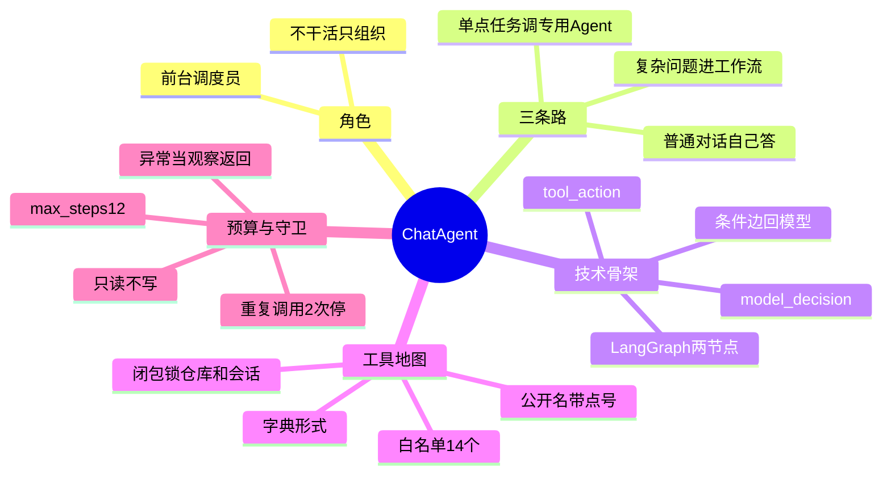

## 🔥 快速背诵

ChatAgent 是系统主入口，本质是一个带状态机的调度员。它不直接查数据、不直接分析 PR，而是判断这个问题该走哪条路，普通问题自己答，单点任务调专用 Agent，复杂问题进多 Agent 工作流。技术上是一个 LangGraph 图，两个节点循环，模型决策和工具执行，条件边回到模型。它只挂只读工具，一共十四个，用闭包把仓库和会话锁死在工具里。预算最多十二步，同一工具同一参数重复两次就停。

> **一句话**：**ChatAgent 不干活，它组织别人干活。**

## 🧠 导图



---

# 📖 拆碎讲

### ① 先想清楚它是"调度员"不是"专家"

**想象一家公司的前台。**

你走进去说"我想问下这个月报表"，前台不会自己去做报表，它会说"这事找财务"，然后把你带到正确的门口。

ChatAgent 干的就是这个活。

它面前有几扇门：

| 你说 | 它把你送到 |
|---|---|
| 「这个 Issue 该谁处理」 | Issue 分诊能力 |
| 「这个 PR 风险在哪」 | PR 审查能力 |
| 「CI 为什么失败」 | CI 排障能力 |
| 「最新 PR 能不能合并」 | **多 Agent 工作流**（因为要跨领域取证） |

> [!important] 为什么这个比喻重要
> 因为它解释了一个设计原则：**ChatAgent 的核心职责不是"替所有模块干活"，而是"组织这些模块一起干活"。**
> 一旦它开始什么都自己算，它就会变成一个巨大黑盒。

### ② 一次请求在代码里的真实路径

```
POST /api/chat
  → 校验仓库存在（404 就返回）
  → 确保会话存在（锁定 repo_id）
  → 剥离客户端传来的越权字段
  → 构建当前仓库的「工具地图」（闭包）
  → ChatAgent.run()：绑定工具 → 模型决策 → 执行 → 循环
  → 保存消息 / 运行记录 / 工具调用 / 引用
```

> [!warning] 第二个和第三个箭头，是安全的关键
> - **锁定 `repo_id`**：不是信任前端传什么，而是服务端自己确定
> - **剥离越权字段**：客户端塞进来的 `repo_id` 一律丢掉
>
> 这叫"**不信任输入**"。第 13 章会展开。

### ③ 工具地图：这个设计很值得抄

**"工具地图"到底是什么？** 一个字典：

```
{ 公开工具名 → 一个已经绑定好上下文的函数 }
```

键是给模型看的公开名（带点号，比如 `workspace.search_code`、`rag.search_similar_documents`），值是一个**闭包**——它已经把当前 `repo`、`conversation`、`db` 捕获进去了。

> [!important] 这意味着什么
> 模型调用 `workspace.search_code(query="xxx")` 时，**它根本没法选择查哪个仓库**——仓库是闭包里写死的。
> 模型只能在白名单里挑工具，看不到 shell、看不到 SQL、看不到网络。
>
> **能力被限定在"能做什么"，而不是靠"提示它别乱做"。**

一个小细节：工具名里的点号在传给 LangChain 时会转成双下划线（`workspace__search_code`），回来再映射回去。因为底层工具名不认点号。

### ④ 十四个工具，一条铁律

项目一共挂了 **14 个公开工具**，分几类：

| 类别 | 例子 | 性质 |
|---|---|---|
| 仓库健康 | `repo_health.generate_summary` | 只读 |
| RAG 检索 | `rag.search_similar_documents` | 只读 |
| 工作区 | `list_files` / `search_code` / `read_file` | 只读 |
| 记忆 | 通过 MCP 走的三件 | 只读 |
| 专用 Agent | Issue / PR / CI 分析 | 只读 |
| 工作流 | 触发多 Agent | 只读 |
| 安全 | 生成草稿 | **不直接写** |

> [!important] 一条铁律：**ChatAgent 只挂只读工具。**
> 所有写操作（评论、关 Issue、改标签）都不在它的能力范围里。
> 它最多能"生成一张草稿"，然后等人确认。
>
> 这就是"从架构上不给你犯错的机会"，而不是"提醒你别犯错"。

### ⑤ 循环：两个节点，一条条件边

```
START
  → model_decision（模型决定：要不要调工具、调哪个）
      ├─ 没有 tool_calls → 结束，走最终回答
      └─ 有 tool_calls   → tool_action
  → tool_action（真正执行）
      ├─ 还有待执行工具 → 继续 tool_action
      ├─ 到步数上限     → max_steps_stop → 结束
      └─ 执行完         → 回 model_decision
```

**为什么这样分？** 因为"决策"和"执行"必须分开——
决策是模型的活，执行是程序的活。第 5 章那句"决策与执行分离"，在这里变成了图结构。

### ⑥ 三个守卫（这段最能体现工程功底）

> [!note]- 守卫一：`max_steps = 12`
> Agent 有可能永远不收敛——一直查、一直查。
> 12 步是个经验值：够跑完一个复杂任务，又不至于无限烧钱。
> 到顶了不是崩，是走 `max_steps_stop` 节点，**给一个可解释的收口结果**。

> [!note]- 守卫二：重复调用检测（同指纹最多 2 次）
> 指纹怎么算？**工具名 + 规范化后的参数 JSON**。
> 同一个工具、同样的参数，调两次以上就停。
> 为什么不用"调用次数"简单判断？因为合法场景下确实需要连调几次不同参数（比如读 3 个文件）。

> [!note]- 守卫三：异常当观察结果，不当崩溃
> 工具抛异常了怎么办？
> **把异常信息包成一条 observation 回给模型**，让它自己决定换个工具、缩小范围，还是承认失败。
> 这比直接 500 好得多——用户拿到的可能还是一个有用的"我查不到，因为权限不足"。

### ⑦ 一个容易被忽略的优化

**它不会无脑调记忆工具。**

如果最近的原文已经在 prompt 里了，模型就"知道刚才聊了什么"，没必要再去查一次会话记忆。

项目判断的逻辑是：先看历史覆盖率 / 最近上下文能否回答，能就直接答。

> [!tip] 这个细节为什么值钱
> 它体现了一个成熟度：**不是"我有这个能力就每次都用"，而是"我知道什么时候不需要用"。**
> 每一次多余的工具调用都是延迟和 token。

### ⑧ 一句话收尾

> ChatAgent 的设计目标不是"更聪明"，而是**"更可控"**：
> 能力白名单、仓库闭包、步数上限、重复保护、异常降级、只读约束——六道闸门，让它跑不飞。

---

# 🔑 记忆锚

| 记什么 | 内容 | 口诀 |
|---|---|---|
| **1** 定位 | 前台调度员，不干活只组织 | 「不干只派」 |
| **3** 条路 | 自己答 / 调专用 / 进工作流 | 「答·调·流」 |
| **14** 个工具 | 全只读，写操作只生成草稿 | 「十四全读」 |
| **12** 步 | `max_steps` | 「十二步」 |
| **2** 次 | 同指纹重复上限 | 「同参两次」 |
| **3** 层防护 | 服务端锁 repo / 剥离前端字段 / 闭包写死 | 「三层不串仓」 |

> **卡壳急救**：想不起 ChatAgent 干什么，就想前台把访客带到对应办公室这个画面。

---

# 🎯 追问速查

| 面试官问 | 你答 |
|---|---|
| ChatAgent 和专用 Agent 什么区别？ | ChatAgent 判路由（普通对话/单点/复杂流），专用 Agent 干专项。**职责不同，Prompt 完全隔离** |
| 工具怎么管？ | 工具地图 = 公开名 → 闭包函数，闭包捕获 repo/会话/DB。模型只能白名单选，选不中仓库 |
| 为什么不给 ChatAgent 写权限？ | 模型不是权限系统。**从架构上不给能力**比提示它别乱做可靠得多 |
| 循环怎么停？ | 模型不调工具、达到 12 步、或路由到 END |
| 怎么防重复调用？ | 工具名 + 规范化参数算指纹，同一指纹超过 2 次就停 |
| 工具报错怎么办？ | 包成 observation 回给模型，让它换策略或承认查不到，**不崩进程** |
| 为什么还要专门判断"要不要查记忆"？ | 最近原文已在 prompt 里就不用查，省一次调用就是省延迟和钱 |

---

# 🔗 串联

- 工具是怎么定义的 → 05
- 上下文和记忆怎么进 prompt → 10
- 复杂问题为什么交出去 → 12
- 只读与写操作的边界 → 13
- 概念对照 → Agent 基本架构

---

# 📌 打卡

- [ ] 能用"前台调度员"讲清 ChatAgent 的定位
- [ ] 能说出三条路由
- [ ] 能解释"工具地图 + 闭包"怎么锁死仓库
- [ ] 能背 12 步和 2 次两个数字
- [ ] 能说出为什么工具异常不崩进程
- [ ] 能解释为什么 ChatAgent 只挂只读工具
