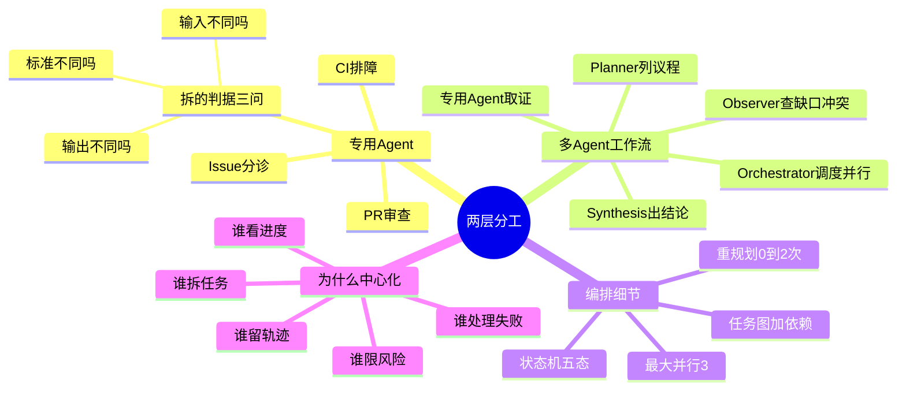

## 🔥 快速背诵

分两层。第一层是专用 Agent，Issue、PR、CI 各一个，因为输入不同、判断标准不同、输出合同不同，塞进一个大 Prompt 必然串台，判据就三问，输入、标准、输出是不是完全不同。第二层是多 Agent 工作流，Planner 拆任务图，Orchestrator 按依赖并行调度，专用 Agent 分头取证，Observer 查证据缺口和结论冲突，最后 Synthesis 合成结论。选中心化因为要有人对总链路负责。

## 🧠 导图

---

# 📖 拆碎讲

### ① 先回答：为什么不能一个大 Prompt 全搞定

**因为会串台。**

想象你让一个人同时干三件事：给 Issue 分诊、审 PR、查 CI 日志。

短期他也许能应付，但你很快会发现：
- 他给 Issue 打分时，脑子里还在想 CI 日志的报错
- 他审 PR 时，顺手去判断需求优先级（不该他管）
- 你问他"为什么这么判断"，他自己也说不清

模型一样。**所有指令堆在一个 Prompt 里，模型的注意力会涣散，输出标准会互相污染。**

> [!important] 专用 Agent 的本质
> 不是"多了一个 Agent"，而是**"Prompt 的隔离与专注"**。
> 每个 Agent 有完全独立、互不干扰的上下文。

### ② 三个专用 Agent，各自的"业务合同"

| Agent | 输入 | 输出（合同） |
|---|---|---|
| **Issue** | Issue 正文 + 仓库上下文 | 结论 / 优先级 / 复杂度 / 负责人 / 重复候选 / 证据 / 行动清单 / 草稿 / **置信度** |
| **PR** | PR + 拆分的 diff 块 | 合入建议 / P1-P2 分级发现 / 阻塞项 / 测试建议 / 重点文件 |
| **CI** | 失败日志 | 失败类型 / 首个错误 / 根因判断 / 修复步骤 / **是否阻塞合并** |

> 注意每个都有"证据"和"分级"。这不是装饰——**没有证据的判断在研发场景等于没有判断。**

### ③ 拆的判据：三问（这段可以背下来用）

**什么时候该拆出一个新 Agent？** 不是"看着复杂就拆"，而是问三个问题：

1. **输入是不是完全不同？**
   Issue 给的是问题和讨论，PR 给的是 diff，CI 给的是日志——完全不同。
2. **判断标准是不是完全不同？**
   Issue 判"能不能进开发"，PR 判"能不能合"，CI 判"从哪开始修"——完全不同。
3. **输出合同是不是完全不同？**
   分诊单 / 审查发现 / 排障步骤——结构完全不一样。

**三个都是"是"，才拆。**

> [!warning] 反面：不要为了"显得有多 Agent"而硬拆
> 如果两个任务的输入、标准、输出都一样，拆开只会让你多维护一个 Prompt、多一倍调用成本。
> **判据是"能不能独立验收"，不是"类名有几个"。**

### ④ 三个 Agent 的硬规则（最能体现"不靠模型自觉"）

这三个规则都是"模型说 A，代码强制 B"的例子：

> [!note]- 规则一：Issue 缺复现步骤 → 「等待澄清」
> 不是让模型猜"可能是缓存问题"。**证据不足就明说不确定。**

> [!note]- 规则二：发现 P1/P2 → 合入建议强制降级
> 模型自己写"建议合入"，但代码里只要有 P1/P2，"最终结论"就改成"修改后合入"。
> **因为"有阻塞问题就不能合"是不可违反的业务规则，不是模型的偏好。**

> [!note]- 规则三：负责人必须在成员表里
> 模型可能编一个名字出来。代码里查团队成员表，不在就替换。
> **这是"防幻觉"最硬的一招——用真实数据源覆盖模型的自由发挥。**

还有一个共同模式：**先算确定性 fallback，再让模型出结论，然后合并、再用 Pydantic 校验。**
模型挂了或输出不合法，系统仍然能给一个保守但可用的结论。

### ⑤ 那些 Agent 是谁在调？（架构关系）

**三个专用 Agent 都是独立服务，不是 ChatAgent 的子 Agent。**

- 用户可以直接点页面上的"分析"按钮 → API 路由直接调
- ChatAgent 也可以把它们当**工具**挂进工具地图

> [!note] 这个设计的好处
> 同一条能力，既能"被用户直接触发"，也能"被 Agent 调度"。
> 不用写两套逻辑，也不用让 ChatAgent 成为唯一入口。

而**仓库 ID 是从对象本身带出来的，模型不能选**——又是一次"不给犯错机会"。

### ⑥ 多 Agent 工作流：一场技术评审会

复杂问题长什么样？

- 「这个 CI 失败会不会影响 PR 合入？」
- 「当前版本发布还有哪些阻塞？」
- 「这个需求现在优先级高不高？」

这些**不是某个专用 Agent 看一眼就能回答的**，因为它们需要跨领域取证。

于是有了这条流水线：

| 角色 | 干什么 | 会议里的类比 |
|---|---|---|
| **Planner** | 把模糊问题拆成结构化任务图 | 列议程 |
| **Orchestrator** | 按依赖调度，能并行就并行 | 主持流程 |
| **专用 Agent** | 分头取证 | 各专家查材料 |
| **Observer** | 查证据缺口、结论冲突、稳不稳 | 追问"证据够吗" |
| **Synthesis** | 合成最终结论 | 形成会议纪要 |

> [!important] 一句话
> **多 Agent 的价值不在"数量多"，而在于"复杂问题可以先拆开取证，再合起来判断"。**

### ⑦ 编排的三个具体参数

| 参数 | 值 | 意义 |
|---|---|---|
| 最大并行任务数 | 3（范围 1-8） | 并行提升速度，但要控资源 |
| 重规划次数 | 0-2，默认 1 | 允许补查一轮，但不允许无限重来 |
| 任务状态 | pending / running / success / skipped / error | **失败也要成为数据** |

依赖关系：仓库健康度先跑，三个专用任务依赖它，然后并行。

**重规划的触发**：发现证据缺口（比如缺历史相似问题、缺安全检查），就补一个任务。已经成功的任务不重跑。

> [!warning] 一个特别关键的设计
> **依赖失败不是"任务消失"，而是 `skipped` + `dependency_failed`。**
> 为什么重要？因为如果失败的任务直接没了，Observer 和前端只看到"工作流少了几块"，会误以为一切正常。
> **失败必须留下痕迹，否则等于隐瞒。**

### ⑧ 为什么选中心化，不去中心化

**去中心化听起来更"智能"：Agent 之间自由协商、互相调用。**

但它会立刻撞上五个问题：

1. 谁负责拆任务？（可能重复拆）
2. 谁掌握整体进度？
3. 谁处理失败？
4. 谁保存轨迹？
5. 谁限制风险？（写操作、评论、打标签很容易越界）

**中心化的答案是清楚的：Planner 拆、Orchestrator 调度、Observer 检查、Synthesis 收口。**

> [!tip] 一句话总结
> **Worker 可以专业分工，但总链路必须有人负责。**

通信方式也选了"共享状态 + 持久化任务结果"，而不是消息队列——因为同一个后端内，类型化状态更容易解释、测试和排查。

### ⑨ 为什么不把"选哪个 Agent"也交给模型

**因为成本和稳定性。**

模型的动态路由看起来灵活，但它会：多一次调用（钱和延迟）、偶尔选错（不稳定）。

所以项目用**静态映射**：`task_type` → 固定 runner。边缘情况才交给模型判断。

> [!important] 这就是"能确定性就别用概率"的另一面
> 结构化输出用 Schema 卡、业务规则用代码卡、任务路由用映射卡。
> **模型只留在他真正不可替代的地方。**

### ⑩ 一句话收尾

> 专用 Agent 解决"职责清晰"，多 Agent 工作流解决"跨领域判断"。
> 前者是**分工**，后者是**开会**。两者都需要一个明确的收口人。

---

# 🔑 记忆锚

| 记什么 | 内容 | 口诀 |
|---|---|---|
| **3** 问判据 | 输入 / 标准 / 输出是否都不同 | 「输入·标准·输出」 |
| **3** 个专用 Agent | Issue / PR / CI | 「分·审·排」 |
| **5** 个协作角色 | Planner / Orchestrator / 专用 / Observer / Synthesis | 「规·调·专·观·合」 |
| **3** 个参数 | 并行 3、重规划 1、状态 5 态 | 「三·一·五」 |
| **1** 句原则 | Worker 分工，但总链路要有人负责 | 「有人兜底」 |

> **卡壳急救**：忘记专用 Agent，就背"分诊单 / 审查发现 / 排障步骤"三种完全不同的输出。

---

# 🎯 追问速查

| 面试官问 | 你答 |
|---|---|
| 为什么要拆专用 Agent？ | 输入、判断标准、输出合同三者完全不同。**混在一个 Prompt 里会串台、难维护、难测试** |
| 怎么判断该不该拆？ | 三问：输入不同？标准不同？输出不同？三个都是才拆。判据是**能否独立验收** |
| 为什么还要多 Agent 工作流？ | 单点 Agent 解决不了跨领域问题（如"CI 失败会不会影响合入"）。需要先拆取证再综合 |
| 编排是中心化还是去中心化？ | 中心化。去中心化回答不了"谁拆任务、谁看进度、谁处理失败、谁留轨迹、谁限风险" |
| 任务失败怎么处理？ | 变成结构化数据（`skipped` + `dependency_failed`），**失败必须留痕**，不能让工作流"少一块" |
| 重规划无限次吗？ | 不。0-2 次，默认 1。已成功的任务不重跑 |
| 为什么不让模型决定调哪个 Agent？ | 成本、延迟、偶发选错。静态 `task_type → runner` 映射更稳，边缘情况才给模型 |
| 三个 Agent 有什么硬规则？ | Issue 缺复现→等待澄清；有 P1/P2→强制降级合入建议；负责人必须在成员表 |

---

# 🔗 串联

- 专用 Agent 的输出契约 → 04
- ChatAgent 怎么调它们 → 11
- 写操作为什么要人确认 → 13
- 概念地基 → 什么是 Multi-Agent、单 vs 多 Agent、协作与切换

---

# 📌 打卡

- [ ] 能背三个专用 Agent 的输出合同
- [ ] 能用"三问判据"判断该不该拆
- [ ] 能说出三个硬规则
- [ ] 能用"技术评审会"讲清五个角色的分工
- [ ] 能回答"为什么中心化"
- [ ] 能说出为什么"失败也必须成为数据"
