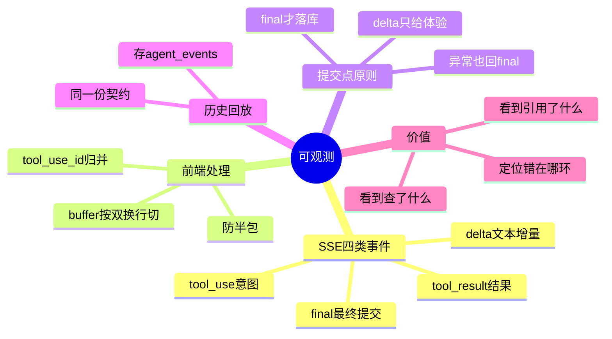

## 🔥 快速背诵

用 SSE 推流，四类事件：tool_use 工具调用意图、tool_result 执行结果、delta 文本增量、final 最终提交。前端拿 buffer 按双换行切分防半包，用 tool_use_id 把意图和结果归并成同一张卡片。关键原则是 final 才是唯一可信提交点，delta 只负责体验，不写库。历史回放靠保存的 agent_events 重放，实时和回放用同一份事件契约。有了轨迹，用户能看到它查了什么、引用了什么、错在哪一环。

> **一句话**：**只看最终答案，你无法判断它靠不靠谱。**

## 🧠 导图

---

# 📖 拆碎讲

### ① 为什么"只看答案"不够

**因为一个看起来完美的答案，可能在过程里全是坑。**

想象 Agent 回答："这个 PR 可以合并，风险较低。"

听起来不错。但实际上可能：
- 它根本没查 CI
- 它引用的 Issue 是三个月前的、已经被推翻的结论
- 它没有读 diff，只看了 PR 描述
- 前端拿到的 JSON 结构是错的，只是文本恰好能显示

> **结论：一句话的正确性，不能替代一次运行的正确性。**

### ② SSE 四类事件（这是最小可用的设计）

项目用 SSE（Server-Sent Events）往前端推流，四类事件：

| 事件 | 带什么 | 作用 |
|---|---|---|
| `tool_use` | 工具名、参数、调用 id | 让用户知道"它要干什么" |
| `tool_result` | 对应 id、状态、结果摘要 | 让用户知道"干成没" |
| `delta` | 文本增量 | 打字机效果 |
| `final` | 完整答案、路由、工具调用、事件列表 | **唯一可信的提交点** |

> [!important] `tool_use` 和 `tool_result` 用 `tool_use_id` 配对
> 前端靠这个 id 把"开始调"和"调完"归并成同一张卡片。
> 不这么做的话，并行调三个工具时，卡片会乱成一团。

### ③ 前端两个必须处理的坑

> [!warning]- 坑一：SSE 会"半包"
> 网络传输不是按事件切的。你收到的可能是半截 JSON。
> **解法：用 buffer 累积，按 `\n\n`（双换行）切分，只处理完整的块。**
> 这条不做，线上会随机出现"解析失败"。

> [!warning]- 坑二：重复渲染
> 同一个 `tool_use` 事件可能被处理两次（重连、重放）。
> **解法：按 `tool_use_id` 查找已有卡片，有就替换，没有才新增。**

### ④ 最关键的原则：`final` 是唯一提交点

**`delta` 不写数据库。**

为什么？因为：
- 一次回答可能产生几百个 delta，逐条写库是灾难
- 中途失败的话，库里会留下半截脏数据
- 短事务写多了会拖垮 DB

所以设计是：**`delta` 只负责体验，`final` 才落库。**

落库时同时写三样：消息内容、Agent 运行记录（含状态）、会话封存。

> [!note] 异常也不破例
> 出错了怎么办？**照样回一个结构化的 `final`**，Agent 运行状态记 `error`。
> 这样前端永远有一个明确的结束信号，而不是"卡住了"。

### ⑤ 历史回放：实时和回放用同一份契约

**刷新页面后，那些工具轨迹还在吗？**

在。因为 `final` 里带了 `agent_events`，前端用同一套逻辑重放。

> [!important] 这是设计上的自我一致性
> **实时推流和事后回放，用的是同一个数据结构。**
> 如果这两条路走两套格式，就会出现"刷新前看到 5 步，刷新后看到 3 步"的诡异 bug。

### ⑥ 轨迹里到底能看到什么

多 Agent 场景下，轨迹名会带上前缀，一眼能看出是哪条链路：

- `workflow.issue_analysis`
- `workflow.pr_review`
- `workflow.ci_debug`
- `workflow.observer`

每一步记：谁（actor）、做了什么（action）、参数、观察结果、以及**当时的思考**。

> [!tip] 这就是"可复盘"的物理基础
> 出了错，你能回答一个问题：**是证据没查到、工具调错了、还是模型判断错了？**
> 没有轨迹，这三个答案永远分不清。

### ⑦ 一句诚实的工程细节

**完整工具结果和"给模型看的投影"是两套东西。**

- **审计形态**：完整、不可变，进转录存档
- **Prompt 形态**：受预算裁剪，给模型看

有测试专门验证"投影不会改写原始观察记录"。

> [!note] 为什么要这样分
> 因为如果要"可审计"，就必须保原文；如果要"省 token"，就必须裁剪。
> 两个需求冲突，只能存两份。

### ⑧ 一句话收尾

> 可观测不是"加日志"，而是**让一次 Agent 运行的每个决策点都留下证据**。
> 这样系统才从"看起来能用"变成"敢用在生产"。

---

# 🔑 记忆锚

| 记什么 | 内容 | 口诀 |
|---|---|---|
| **4** 类事件 | tool_use / tool_result / delta / final | 「用·果·增·终」 |
| **1** 个提交点 | 只有 final 落库 | 「final 才算数」 |
| **2** 个前端坑 | 半包、重复 | 「切双换行 + 按 id 归并」 |
| **1** 份契约 | 实时与回放同一份 | 「一套格式」 |
| **2** 套形态 | 审计完整 / Prompt 投影 | 「存两份」 |

> **卡壳急救**：忘记四类事件，就想用户看到的页面：先冒出一个"正在查 CI"的卡片，然后它变成"查完了"，然后文字一点点流出来，最后出完整答案。

---

# 🎯 追问速查

| 面试官问 | 你答 |
|---|---|
| 为什么要做流式？ | Agent 一次要跑十几秒到几分钟，不流式用户会以为卡死；而且过程可见才建立信任 |
| 推了哪几类事件？ | tool_use（意图）、tool_result（结果）、delta（增量）、final（提交） |
| 为什么 delta 不写库？ | 量大、易产生半截脏数据、短事务拖垮 DB。**final 才是唯一提交点** |
| SSE 有什么坑？ | 半包（用 buffer 按 `\n\n` 切）、重复（按 `tool_use_id` 归并） |
| 刷新后轨迹还在吗？ | 在。`final` 里带 `agent_events`，前端用同一套逻辑重放，**实时与回放同契约** |
| 出错怎么办？ | 照样回结构化 `final`，运行状态记 error，前端一定有结束信号 |
| 有了轨迹能干什么？ | 定位是证据没查到、工具调错、还是模型判错——这三件事没有轨迹根本分不清 |

---

# 🔗 串联

- 事件里推的工具是什么 → 11
- 轨迹用来做什么评估 → 15
- 概念地基 → Trace 与延迟定位

---

# 📌 打卡

- [ ] 能背四类事件
- [ ] 能说出两个前端坑和各自解法
- [ ] 能解释为什么 delta 不落库
- [ ] 能讲清"实时与回放同契约"的好处
