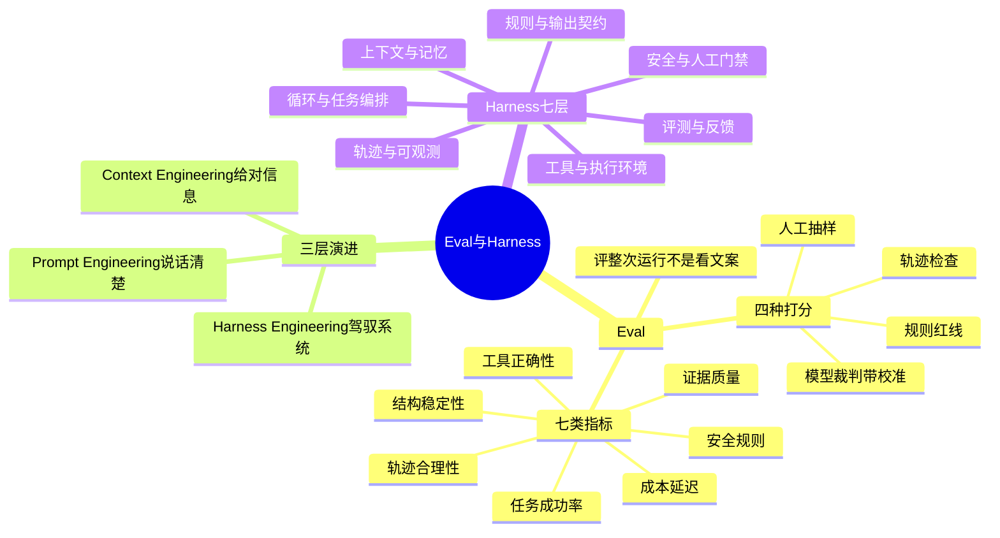

## 🔥 快速背诵

先看 Eval。Agent 评测不能只看回答像不像，因为失败经常不写在最终文案里，没查 CI、引用了没读的 diff、结构前端解析不了。要评整次运行，任务成功率、证据质量、工具正确性、轨迹合理性、结构稳定性、安全规则、成本延迟七类，打分用规则加人工加模型裁判加轨迹检查，红线规则必须百分之百。再看 Harness，它是 Prompt、Context 之外的第三层，公式是 Agent 等于 Model 加 Harness。

> **一句话**：**模型决定 Agent 能有多聪明，Harness 决定这份聪明能不能被稳定地用起来。**

## 🧠 导图



---

# 📖 拆碎讲

### ① Eval 为什么不能只看答案

**先看一个例子。**

Agent 回答："这个 PR 风险可控，建议合并。"

文案很漂亮。但过程里：它没跑 CI、它引用的 Issue 是别人三个月前否掉的方案、它没看 diff 只看描述。

**文案正确，运行错误。**

> [!important] 这句要背
> **模型评测 ≠ Agent 评测。**
> 前者评"说得对不对"，后者评"整条工作流有没有按预期跑完"。

### ② 七类指标（这是本章骨架）

| # | 指标 | 看什么 |
|---|---|---|
| 1 | 任务成功率 | 最终有没有解决用户的问题 |
| 2 | **证据质量** | 该查的查到没（Issue / diff / CI / 历史）；引用忠实度 |
| 3 | 工具使用正确性 | 工具选对没、参数对不对、该调没调 |
| 4 | **轨迹合理性** | 证据是否先于结论、安全检查是否先于写、重试有没有无限 |
| 5 | 结构稳定性 | JSON 能不能解析、枚举合法、引用编号对不对 |
| 6 | 安全规则 | 写动作是否都走了草稿 + 风险 + 人工确认 |
| 7 | 成本与延迟 | token、耗时、工具调用次数 |

> [!note] 第 2 和第 4 条最容易漏，但最值钱
> 因为大部分"回答得很好但结论是错的"事故，根子都在证据和轨迹上，不在文案上。

### ③ 一个特别犀利的点：工具调对了，还要问"谁决定调的"

**同一个工具被成功调用，含金量可能完全不同：**

| 路径 | 说明 | 能力含量 |
|---|---|---|
| 系统预取 | 代码写死"先查 PR 再回答" | 低 |
| 控制器强制 | 流程规定必须查 | 中 |
| **模型自主决定** | 模型自己判断"我需要查这个" | **高** |

> 所以在评测里，要把"系统给的证据"和"模型自己选的工具"**分开打分**。
> 否则你会得出一个假结论：工具都用对了，说明模型调度能力很强——其实全是流程写死的。

### ④ 四种打分方式，各管一段

| 方式 | 管什么 | 注意什么 |
|---|---|---|
| **规则校验** | 红线：JSON 合法、枚举合法、必填存在、危险动作必须确认 | 便宜、稳定，**红线要 100% 通过** |
| **人工评审** | 复杂质量判断 | 抽样，成本高但最可信 |
| **模型当裁判** | 语义、忠实度 | 要有明确评分标准、要校准；防位置偏好、长度偏好、自己判自己 |
| **轨迹检查** | 行为是否合理 | 不只看最终答案 |

> [!important] 防"自己判自己"
> 如果生成和评判用同一个模型，它天然偏向自己的输出。
> 缓解办法：用**不同模型家族**做裁判，加人工抽查校准。

还有一条原则：**不指望一个总分。**
- 安全门禁、Schema 这类确定性要求 → 必须 100%
- 语义质量 → 看平均分和置信区间
- 高风险用例 → 固定参数重复跑，看通过率和方差

### ⑤ 从 Prompt 到 Context 到 Harness（三层递进）

这是整门课最后给的框架，非常好用：

| 层 | 核心问题 | 项目里的例子 |
|---|---|---|
| **Prompt Engineering** | 怎么把话说清楚 | 角色、约束、证据要求、结构化输出 |
| **Context Engineering** | 什么时候给什么信息 | RAG、记忆、预算、压缩、Skill 发现 |
| **Harness Engineering** | 怎么建立一套可靠的系统 | 工具、循环、工作流、安全、轨迹、Eval |

> **它们不是三个流行词，是**研究范围逐层扩大**。
> Prompt 是 Context 的一部分，Context 又是 Harness 的一部分。**

### ⑥ Harness 是什么：马具

**这个词本意是"马具"。**

马很强壮、跑得很快，但力量本身不保证它朝对的方向走，也不保证它该停的时候停。人需要缰绳、头套，把力量变成可控的行动。

大模型也一样。它会推理、会调工具，但放任自由，它也会理解错任务、选错工具、重复执行、幻觉、越权操作。

> 所以：**Agent = Model + Harness**，反过来就是 **Harness = Agent − Model**。

### ⑦ Harness 七层（这是全课最重要的表）

| 层 | 解决什么 |
|---|---|
| 1. 规则与输出契约 | 目标、边界、证据要求、结构化结果 |
| 2. 上下文与记忆 | 当前步骤真正需要什么 |
| 3. 工具与执行环境 | 能读、能搜、能写，但要校验 |
| 4. 循环与任务编排 | 多步执行、角色分工、停止条件、失败恢复 |
| 5. 安全与人工门禁 | 高风险动作先生成草稿，人确认 |
| 6. 轨迹与可观测 | 记录决策、调用、证据、错误 |
| 7. 评测与反馈 | 发现问题并沉淀回系统 |

**这七层对应的七个问题：**

```
Agent 应该做什么？
它现在应该看到什么？
它可以使用哪些工具？
复杂任务按什么顺序执行？
危险动作在哪里停下？
运行过程怎样被看见和复现？
结果由谁检查，失败怎样进入下一轮改进？
```

> [!important] 这七个问题就是面试的万能骨架
> 任何"你怎么设计这个 Agent"的问题，都可以按这七层答。**比背模块名高级得多。**

### ⑧ 两个真实团队的实践（可以当谈资）

> [!note]- OpenAI：先给 Agent 建一个能工作的环境
> - 一开始把规范全塞进一个巨型 `AGENTS.md`，结果失败：文件越大，有效上下文越被挤掉；每条都重要就等于都不重要；还会过期。
> - 改成：`AGENTS.md` 缩成一百行左右的地图，其余分到结构化 `docs/` 目录，让仓库成为事实来源。
> - 把架构约束**编码成 linter 和结构测试**，违反就报错并给修复方向——约束进入可执行反馈回路，不靠模型"记得遵守"。
> - 定期清理技术债、检查文档新鲜度。
>
> 一句话：**Humans steer. Agents execute.**

> [!note]- Anthropic：让长任务一段一段完成
> - 初始化 Agent 把模糊目标拆成结构化功能清单，准备启动脚本、进度文件、初始 Git 状态。
> - 编码 Agent 每次只做一个功能：开始前读清单和进度，结束时测试、提交、更新交接记录。
> - 演进成 Planner / Generator / Evaluator 三角色。**为什么把生成和评估分开？因为让同一个 Agent 检查自己，它经常过于乐观。**

> [!warning] 但别照抄（这是个高级观点）
> Harness 不是组件越多越好。**每一个组件都隐含一个判断："模型自己还做不好这件事"。**
> 模型变强后，要重新验证这个判断，删掉不再必要的复杂度。
> **一套好的 Harness 应该允许自己变简单。**

### ⑨ 一句话收尾

> **Harness 不是搭完一次就结束的外壳。**
> 发现一次错误，真正有价值的动作不是只修这次结果，而是判断：能不能补一条规则、一个测试、一件工具、一份文档，**让同类错误以后更难再发生**。

---

# 🔑 记忆锚

| 记什么 | 内容 | 口诀 |
|---|---|---|
| **7** 类指标 | 成功 / 证据 / 工具 / 轨迹 / 结构 / 安全 / 成本 | 「成·证·具·轨·构·安·本」 |
| **4** 种打分 | 规则 / 人工 / 模型裁判 / 轨迹 | 「规·人·判·轨」 |
| **3** 层演进 | Prompt → Context → Harness | 「说清 → 给对 → 驾驭」 |
| **7** 层 Harness | 契约 / 上下文 / 工具 / 编排 / 安全 / 可观测 / 评测 | 「约·上·具·排·闸·看·评」 |

> **卡壳急救**：忘记七层，就按"Agent 从接到任务到跑完"的时间顺序想：它要干什么 → 看到什么 → 用什么 → 按什么顺序 → 哪里停 → 怎么被看见 → 怎么被检查。

---

# 🎯 追问速查

| 面试官问 | 你答 |
|---|---|
| 怎么评测这个 Agent？ | 评整次运行不看文案：七类指标（成功率/证据/工具/轨迹/结构/安全/成本），规则+人工+模型裁判+轨迹混合打分 |
| 为什么不能只看最终答案？ | 失败常不写在文案里：没查 CI、引用没读的 diff、结构解析不了。**文案对 ≠ 运行对** |
| 模型裁判有什么坑？ | 位置偏好、长度偏好、自己判自己偏乐观。用不同模型家族 + 人工抽查校准 + 明确评分标准 |
| 什么是 Harness？ | 围绕模型的整套工程系统：Agent = Model + Harness。七层：契约/上下文/工具/编排/安全/可观测/评测 |
| Harness 是不是新瓶装旧酒？ | 有旧酒成分（Test Harness、评测 Harness 早就有），**价值在于把分散实践组织成面向 Agent 的方法** |
| 模型变强了 Harness 会消失吗？ | 会变化不会消失。权限、真实工具、业务状态、审计、确定性测试不会因为模型变强就没了。**好的 Harness 应该允许自己变简单** |
| 整门课讲了什么？ | 就是给一个 Agent 建 Harness 的过程：从调模型、管输出、给工具、串循环，到喂事实、分工、兜底、验证 |

---

# 🔗 串联

- 轨迹从哪来 → 14
- 安全规则怎么定 → 13
- 上下文那层 → 10
- 概念地基 → Harness 是什么、如何设计 Harness、评测集设计

---

# 📌 打卡

- [ ] 能背七类指标
- [ ] 能解释"文案对 ≠ 运行对"
- [ ] 能说出模型裁判的三个偏差和缓解办法
- [ ] 能背 Harness 七层和七个问题
- [ ] 能讲 OpenAI 和 Anthropic 两个案例各一个要点
- [ ] 能说出"好的 Harness 应该允许自己变简单"的理由
