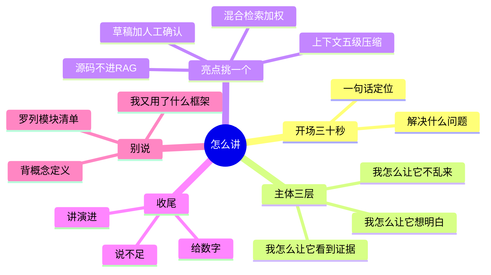

## 🔥 快速背诵

讲这个项目最容易犯的错是罗列模块，用了 LangGraph、用了 RAG、用了 Milvus，这不是设计，是清单。正确讲法按 Harness 七层组织，为了让模型听懂任务做了什么，为了让它看到正确信息做了什么，为了让它能动手做了什么，为了让它不乱来做了什么。每一层都有一个具体痛点和具体取舍。最后给一个数字，比如十二步上限、八百字符切分、零点六二权重，证明真调过。

> **一句话**：别背模块名，讲**你被什么问题逼着加了什么**。

## 🧠 导图



---

# 📖 拆碎讲

### ① 三十秒版本（先背这段）

> "这是一个研发协作 Agent 系统。它解决的不是'没有信息'，而是'信息太多太散'——判断一个 PR 能不能合，要看 diff、看 CI、翻 Issue、找历史讨论，全靠资深工程师的经验拼起来。
>
> 我做的是把这套拼图自动化：打通 GitHub 数据做事实底座，用 RAG 找历史证据，用工具实时取当前状态，用一个主控 Agent 判路由，复杂问题拆给多个专用 Agent 取证再综合。
>
> 最关键的设计是**先取证再判断**，以及**所有外部写操作只生成草稿、必须人工确认**。"

这段里已经藏了四个考点：痛点、技术栈、核心设计、安全边界。

### ② 三分钟版本：按"三个我怎么"来讲

**别按章节讲，按你的设计意图讲。**

> [!note]- 第一个我：怎么让它"想明白"
> Prompt 合约五要素 + 结构化输出三层防线。
> **取舍**：解析失败不做重试，做确定性 fallback——因为问题是"没按合约交付"不是"网络抖动"。
> **收获**：`response_format` 只降概率，程序校验才是验收。

> [!note]- 第二个我：怎么让它"看得到"
> 数据分三条路：历史事实进 RAG、当前代码走本地 grep、结构化字段直查库。
> **取舍**：源码**不进** RAG——embedding 对标识符失效、链路相乘难定位、索引易过期。
> **收获**：RAG 是召回工具，不是数据总入口。

> [!note]- 第三个我：怎么让它"不乱来"
> 只读工具集 + 写操作只生成草稿 + 权限分离 + 全量审计。
> **取舍**：不靠 Prompt 说"不要乱写"，靠架构不给它能力。
> **收获**：模型不是权限系统。

> [!tip] 为什么这个结构好用
> 因为它证明你有**设计意图**，而不是"跟着教程敲了一遍"。
> 面试官最怕听到"我这里用了 RAG"，最想听到"我这里**不得不用** RAG，因为……"

### ③ 亮点只挑一个，讲透

面试时间有限，**挑一个你最熟的讲到底**，比撒胡椒面强十倍。推荐这几个（都好讲、都有反直觉点）：

| 亮点 | 一句话钩子 |
|---|---|
| **源码不进 RAG** | "代码不该进向量库"——反直觉，容易展开 |
| **混合检索加权融合** | "我没用 RRF，因为…"——显技术判断 |
| **上下文五级压缩** | "只压可再生的工具结果"——显工程分寸 |
| **草稿 + 人工确认** | "模型不是权限系统"——显安全意识 |
| **失败也必须成为数据** | "工作流少一块比报错更危险"——显成熟度 |

### ④ 数字是你的可信度

**说得出数字，说明你真跑过。**

| 数字 | 上下文 |
|---|---|
| **12 步** | ChatAgent 循环上限 |
| **2 次** | 同工具同参数重复上限 |
| **800 / 100** | 切分大小 / 重叠 |
| **1024 维** | Embedding 维度 |
| **0.62 / 0.30 / 0.08** | 向量 / 关键词 / 双路命中权重 |
| **2 条** | 同父块最多占位 |
| **260 token** | 单条证据压缩上限 |
| **3 个并行** | 工作流最大并行任务数 |

> [!warning] 但别乱报
> 面试官会追问"这个 12 是怎么定的"。
> 标准答案是：**"经验值，够跑完一个复杂任务又不至于无限烧钱；真正兜底的是证据判定，步数是最后一道闸。"**

### ⑤ 主动说不足（这一招特别好用）

**没有人相信一个"完美"的项目。**

准备好这三条：

> [!note]- 不足一：指纹不够严
> 项目指纹用的是 Git HEAD + mtime + size，不含文件内容哈希。
> 内容改了但 mtime 没变就会漏检。更稳的做法是逐文件内容哈希，代价是扫描变慢。

> [!note]- 不足二：并发幂等不够
> `repo_id + checksum` 没有数据库唯一约束，同时上传同一文件可能双写。
> 生产上要加唯一索引 + `ON CONFLICT`，或者用分布式锁。

> [!note]- 不足三：任务不持久
> 后台任务用的是进程内任务，重启就丢。
> 生产上要换持久化队列 + 独立 worker + 死信处理。

> [!important] 为什么主动说是加分而不是减分
> 因为它证明你**知道边界在哪**。
> "我不知道这块还能怎么改"才是减分项。

### ⑥ 讲演进，别讲状态

**"为什么最后是这个架构"比"最后是什么架构"更值钱。**

一条清晰的演进线：

```
单次调用模型  → 输出不可控
  ↓ 加 Prompt 合约 + Schema
输出可控  → 但模型看不到项目事实
  ↓ 加工具 + 数据同步 + RAG
能看到事实  → 但一次只能干一件事
  ↓ 加 Agent Loop
能连干几件事  → 但复杂问题一个 Agent 干不了
  ↓ 加专用 Agent + 多 Agent 工作流
能处理复杂问题  → 但会乱写、看不见、不知道好不好
  ↓ 加安全草稿 + 可观测 + Eval
```

> **每一行都是一个痛点，每个箭头都是一个设计决策。** 这条线讲完，你就赢了。

### ⑦ 三句"禁语"（说了就露怯）

| 别说 | 改说 |
|---|---|
| "我用了 RAG" | "我判断哪些数据**值得**进 RAG，哪些不该——因为…" |
| "我用了 LangGraph 编排" | "我用图来表达状态和路由，因为 Chain 表达不了循环和停止条件" |
| "多 Agent 效果更好" | "多 Agent 的价值是**先拆开取证再合起来判断**，不是数量多" |

### ⑧ 如果被问到不会的

**不要编。这样答：**

> "这块我当时没深入。我的理解是……（说出你确定的部分）。如果要补，我会从……入手。"

比硬编一个听起来合理但经不起追问的答案安全得多——**面试官一般会追问三层，编的答案第二层就露了。**

---

# 🔑 记忆锚

| 记什么 | 内容 | 口诀 |
|---|---|---|
| **3** 个我 | 想明白 / 看得到 / 不乱来 | 「想·看·守」 |
| **5** 个亮点 | 源码不进RAG / 加权融合 / 五级压缩 / 草稿确认 / 失败成数据 | 挑一个讲透 |
| **3** 条不足 | 指纹不严 / 幂等不够 / 任务不持久 | 「主动认账」 |
| **3** 句禁语 | 不说"我用了X"，说"我为什么用X" | 「讲取舍」 |

> **卡壳急救**：脑子空白时，回到 Harness 七个问题，一个一个答，就是完整项目介绍。

---

# 🎯 追问速查

| 面试官问 | 你答 |
|---|---|
| 简单介绍这个项目 | 见上面 30 秒版本（痛点 → 做了什么 → 核心设计） |
| 最难的地方？ | 不是调通模型，是**让它承认证据不足**，和**不让它直接对外写** |
| 你最大的贡献？ | 挑一块讲深：比如"我负责 RAG 链路，最关键的决定是不让源码进 RAG" |
| 如果重做会怎么改？ | 加内容哈希指纹、加幂等唯一约束、把后台任务换成持久队列 |
| 这个项目的价值？ | 把资深工程师的判断过程拆成可执行、可检查、可复盘的流水线 |
| 你从中学到什么？ | 模型只负责不可替代的部分；能确定性的地方绝不用概率 |

---

# 🔗 串联

- 全项目的收束 → 15 Harness
- 五个亮点的详情 → 07、09、10、13
- 简历写法参考 → Harness、设计 Harness

---

# 📌 打卡

- [ ] 30 秒版本能一口气说完，不卡
- [ ] 三分钟版本能按"三个我怎么"展开
- [ ] 挑定一个亮点，能讲 3 分钟不重复
- [ ] 能报出至少 5 个数字，并解释其中一个怎么定的
- [ ] 能主动说出三条不足
- [ ] 能画出演进线（七个痛点 → 七个解药）
