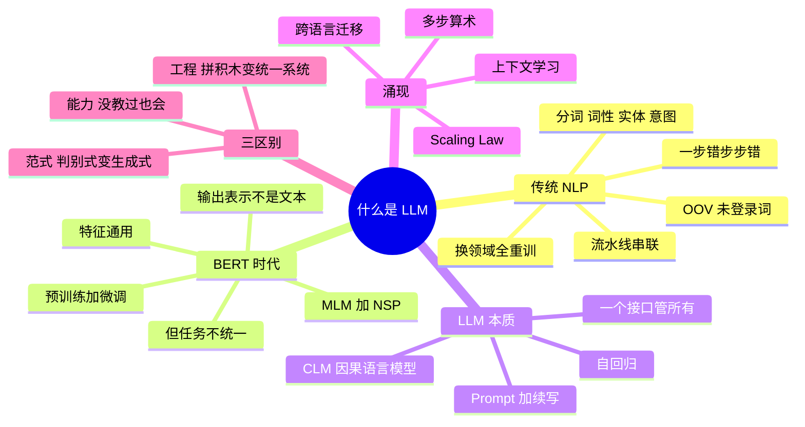

## 🔥 快速背诵

大语言模型的本质，是把所有 NLP 任务收编成预测下一个 token。翻译、摘要、问答、写代码，在它眼里都是给定前文续写后文，所以一个模型能干所有事，不用一个任务训一个。它有三个特征：通用、生成式、规模到一定程度后涌现。幻觉、CoT 为什么有效、温度干什么用，都能从 next-token prediction 推出来。

> **一句话**：LLM 的本质是**把所有 NLP 任务收编成「预测下一个 token」**——一个模型干所有事、生成式、还会涌现。

## 🧠 导图



---

# 📖 背诵稿

> 四段，按顺序背。

### ① 传统 NLP 是流水线

**传统 NLP 是「一任务一模型」，一个完整任务要拆成好几步，每步一个专门模型。**

比如做客服：先分词，「我想退货」拆成「我/想/退货」；再词性标注；再命名实体识别找订单号；再意图分类；最后查知识库。光分词就有一堆坑，中文没空格，「南京市长江大桥」怎么切要靠模型判断，遇到「绝绝子」这种新词直接懵——这就是 OOV 未登录词。每一步都有自己的模型、数据、标注规范，整个 pipeline 又长又脆，**前面错一步后面全错，而且错误累积传导没法补救**。更糟的是换领域（客服→医疗）所有模型基本都要重训，因为实体完全不是一回事。

### ② BERT 通了一半

**BERT 用「预训练 + 微调」解决了特征通用，但没解决任务统一。**

它在 33 亿词无标注文本上做两件事：MLM 随机遮 15% 的词让模型猜，NSP 判断两句是否连续。这两个任务不需要标注，所以能吃海量数据。预训练学到通用语言表示后，下游接个任务头微调就能刷 SOTA。但它走到一半停了，原因两个：第一，输出是「表示」不是「文本」，做分类要接分类头、做 NER 要接序列标注头、做问答要接抽取式头，一个 BERT 在公司里能派生出十几个微调副本；第二，MLM 本质是填空，没学过连续生成长文本，所以翻译写作对话这块是短板。

### ③ LLM 的本质

**LLM 的根本转变是把所有任务统一成「预测下一个 token」。**

这个目标叫 CLM 因果语言模型，训练方式叫自回归——下一步预测依赖上一步输出，GPT、Claude、Qwen、DeepSeek 本质都是「自回归 + 因果掩码」。听起来简单但威力极大：翻译就是 Prompt 写「翻译成英文：我喜欢你 →」接着预测；分类就是「正面还是负面？→ 答：」；总结、写代码同理。**所有任务都被「Prompt + 续写」这个统一接口收编了。** 为什么简单目标能学到这么多？因为要准确预测下一个词，模型必须知道事实（北京是首都）、会算数、懂代码逻辑——这些能力是被目标逼出来的。副产物是 In-Context Learning：给几个例子就能学会新模式，不用更新参数。

### ④ 涌现与三个区别

**规模到一定程度，模型会冒出训练目标里没显式教过的能力，这就是涌现。**

真实数据：5 步算术应用题，8B 以下准确率几乎 0，62B 才 5%，到 540B 的 PaLM 突然跳到 60%。In-Context Learning 在 1.5B 的 GPT-2 上完全看不到，175B 的 GPT-3 突然就有。跨语言迁移也是，GPT-3 训练数据 92% 是英文，却能直接处理中文、日文甚至冰岛语。**要留个 caveat**：有研究认为部分「突然」来自评测指标的离散性，exact match 会把连续提升看成突变，所以更稳的说法是「工程上能观察到能力跃迁，学术上是否测量假象还有争议」。最后三个区别归一张表：工程层面从拼积木变统一系统，范式层面从判别式变生成式，能力层面从「喂什么学什么」变成「没教过也会」。

---

# 🔑 记忆锚

| 记什么 | 内容 | 口诀 |
|---|---|---|
| **3** 大区别 | 一任务一模型 → 一个模型；判别式 → 生成式；显式监督 → 涌现 | 「统·生·涌」 |
| **2** 个 BERT 目标 | MLM 填空 / NSP 下一句 | 「填·判」 |
| **2** 个规模杠杆 | 数据 + 参数 | 「量变到质变」 |
| **3** 个涌现例子 | 多步算术 / 上下文学习 / 跨语言 | 「算·学·跨」 |

> **卡壳急救**：先答「统一成预测下一个 token」，再用「统·生·涌」三点收尾。

---

# 🎯 追问速查

| 面试官问 | 你答 |
|---|---|
| 参数多就叫大模型吗？ | 不是。关键是训练目标统一 + 大规模自监督 + 涌现能力 |
| BERT 也是几亿参数，算 LLM 吗？ | 不算。它是 Encoder-only 判别式，输出表示不是文本，任务还要各自接头 |
| 为什么一个模型能干所有 NLP 任务？ | 因为都表达成「Prompt + 续写」，训练目标只有一个 |
| 「端到端」不算新东西，那新在哪？ | 新在**目标统一**：以前的端到端还是一款任务一个模型 |
| 涌现是真实的吗？ | 工程上能观察到跃迁；学术上有「评测指标离散性」的争议，答题时留一句 caveat |
| 是不是越大越好？ | 不是。参数边际收益递减，现在更看数据量：Llama 3 8B 用 15T token 打赢早期 175B |
| 对工程团队意味着什么？ | 先想 Prompt，再想 RAG，最后才考虑微调；技能栈整体换了 |

---

# 🔗 串联

- 架构底座 → **02 Transformer**、**03 MHA/GQA/FlashAttention**
- 训练过程 → **06 大模型怎么训练出来**、**07 Scaling Law 与涌现**
- 工程延伸 → Prompt（16）、RAG、Agent 都建立在这三个特征之上
- 收尾金句：**目标足够简单，规模足够大，能力就自己长出来了**

---

# 📚 细节（背完再点开）

> [!note]- 三代对照表
> | 维度 | 传统 NLP | BERT | LLM |
> |---|---|---|---|
> | 任务方式 | 一任务一模型 | 预训练 + 每任务微调 | 一个模型 + Prompt |
> | 输出 | 标签 / 概率 | 表示向量 | 文本 |
> | 训练信号 | 显式标注 | MLM 自监督 | CLM 自监督 |
> | 迁移 | 换领域重训 | 换任务接头重训 | 换 Prompt |

> [!note]- In-Context Learning 长什么样
> ```
> 苹果 -> apple
> 香蕉 -> banana
> 草莓 -> strawberry
> 橘子 ->
> ```
> 模型不更新任何参数就输出 orange。这是 Prompt Engineering 这门工程学科诞生的基础。

---

# 🎴 自测

> [!question]- Q1 LLM 的一句话本质？
> 用海量语料预训练、自回归生成、把所有任务统一成预测下一个 token。

> [!question]- Q2 三大区别？
> 一个模型干所有事 / 生成式 / 涌现能力。

> [!question]- Q3 BERT 卡在哪？
> 输出是表示不是文本，每任务要接头；MLM 不擅长连续生成。

> [!question]- Q4 为什么简单目标能学到复杂能力？
> 准确预测下一个 token 逼着模型学语法、事实、算术与代码逻辑。

> [!question]- Q5 涌现的例子和 caveat？
> 多步算术、ICL、跨语言；扰动指标离散性可能夸大突变。
