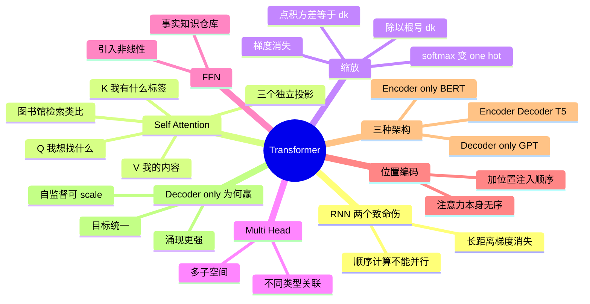

## 🔥 快速背诵

Transformer 的突破是 Self-Attention：每个 token 直接连任意位置，所有位置同时并行算，破掉了 RNN 的长距离衰减和必须串行。按用哪半边分三兄弟，只用 Encoder 是 BERT，擅长理解；只用 Decoder 是 GPT，适配自回归生成；两边都用加交叉注意力是 T5。LLM 时代 Decoder-only 赢了，因为它的训练目标最统一。

## 🧠 导图

---

# 📖 背诵稿

> 五段，按顺序背。

### ① RNN 卡在哪

**RNN 有两个致命伤：不能并行，还有长距离信息衰减。**

它从左到右逐个处理，第 N 步必须等第 N-1 步算完，GPU 的并行能力完全用不上，训大了就慢得离谱。更致命的是序列一长，梯度反向传播时指数级衰减，第 1 个词的信息传到第 800 个词基本就没了，模型学不到远距离关系。LSTM 用门控缓解了一些，但根子没解决。2017 年那篇《Attention is All You Need》就是来把这俩一起破掉的。

### ② Self-Attention 的直觉

**核心是让每个 token 直接关注任意位置的其他 token，算出相关程度再加权聚合。**

三个向量：Q 是「我想找什么」，K 是「我有什么标签」，V 是「我的实际内容」。用图书馆检索类比：你拿关键词 Q 去匹配每本书的标签 K，算出相似度分数，再按分数把书的内容 V 加权求和。关键点是 **Q/K/V 都从同一个输入 X 经三个独立的线性投影矩阵算出来**——「自」注意力这个「自」就在这里，区别于 Cross-Attention 的「Q 来自一边、K/V 来自另一边」。三个矩阵独立学习也很重要，如果都直接等于 X，模型就没法学到「从什么角度提问、用什么标签匹配」的差异。

### ③ 为什么除以 √d_k

**因为不除的话 softmax 会变成 one-hot，梯度直接死掉。**

假设 d_k=128，Q、K 每维都是均值 0 方差 1 的随机数，点积是 128 项相加，方差就是 128，标准差约 11.3，数值散布在 ±30 这种范围。这种极端值过 softmax，最大值对应概率趋近 1、其他趋近 0，输出几乎 one-hot。而 softmax 梯度里有 p(1-p) 这一项，p 接近 0 或 1 时梯度都接近 0，反向传播信号被压扁。除以 √d_k 把方差压回 1，分布就正常了。试过别的方案吗？有——用可学习标量代替，效果差不多但多参数；限制 d_k 很小，等于砍容量。**√d_k 是数学上最自然的那个，8 年实践没人改。**

### ④ 另外三块拼图

**除了注意力，还有多头、FFN 和位置编码。**

Multi-Head 是把 Q/K/V 投影到多个子空间（8 或 32 个头）各自算，因为语言关联是多维的：「我」和「吃」是主谓，「苹果」和「吃」是宾动，指代关系又是另一种，一个头抓一种。FFN 是两层全连接加激活，对每个位置独立做非线性变换——注意力本质是线性加权，非线性靠 FFN 补，而且研究显示 **FFN 里存了大量事实知识，可以理解为模型的记忆仓库**。位置编码则是必须的补丁：注意力计算是对称的，「我打你」和「你打我」在它看来一样，所以要把顺序信息显式注入。

### ⑤ 三种架构与为什么 Decoder-only 赢

**Encoder-only（BERT）双向、Decoder-only（GPT）因果掩码单向、Encoder-Decoder（T5）一边理解一边生成。**

现代大模型几乎全是 Decoder-only，原因不是它「更先进」，而是「预测下一个 token」这个目标极其统一：问答、写作、推理、代码、翻译全都能表达成续写，一套目标搞定一切；而且这个目标能直接在互联网海量无标注文本上自监督训练，最适合 scale up；规模一上来，涌现的能力也更强。另外两种架构没消失，检索、分类、嵌入、翻译摘要里仍然有价值，只是**做通用生成模型，Decoder-only 更容易堆大**。

---

# 🔑 记忆锚

| 记什么 | 内容 | 口诀 |
|---|---|---|
| **2** 个 RNN 病 | 不能并行 / 长距衰减 | 「慢·忘」 |
| **3** 个向量 | Q 问 / K 标签 / V 内容 | 「问·签·货」 |
| **1** 个缩放 | 除 √d_k 防 one-hot | 「压方差」 |
| **3** 种架构 | Encoder / Decoder / Enc-Dec | 「双·单·桥」 |

> **卡壳急救**：从 RNN 两个病出发 → Attention 怎么破 → 为什么 Decoder-only 赢，三句话串起全题。

---

# 🎯 追问速查

| 面试官问 | 你答 |
|---|---|
| Attention 凭什么比 RNN 好？ | 一是并行（无时序依赖），二是任意两位置直连（无衰减） |
| Q/K/V 哪来的？ | 同一个输入 X 经三个独立可训练矩阵投影得到 |
| 为什么三个矩阵不能共用一个？ | 要学「从什么角度提问/匹配/返回」三种不同视角，独立才能有自由度 |
| 为什么要除 √d_k？ | 点积方差随 d_k 增大，softmax 变 one-hot，梯度消失 |
| 多头有什么用？ | 不同头抓不同类型关联（主谓/宾动/指代），d_k = d_model/H 不增开销 |
| FFN 干什么？ | 引入非线性，并存储大量事实知识（记忆仓库） |
| 为什么还要位置编码？ | 注意力对称、本身无序，必须显式注入顺序 |
| 为什么全是 Decoder-only？ | 目标统一 + 可自监督 scale + 涌现更强 |

---

# 🔗 串联

- 多头与高效注意力 → **03 MHA/MQA/GQA/FlashAttention**
- 位置编码 → **04 RoPE/ALiBi**
- FFN 存知识 → 呼应 **MoE（19）**：把 FFN 换成专家
- 架构选型 → 承接 **01（LLM 本质）**、**06（训练流程）**
- 收尾金句：**RNN 顺着一路走，Transformer 一次看全场**

---

# 📚 细节（背完再点开）

> [!note]- 一个公式说清
> `Attention(Q,K,V) = softmax(Q·Kᵀ / √d_k) · V`
> 三步：Q 和所有 K 做点积得分数 → 缩放后 softmax 归一化 → 加权求和 V。

> [!note]- 投影维度的小细节
> `d_k = d_model / H`。比如 d_model=512、H=8，则 d_k=64。这样多头总参数量和单头基本一致，不额外增加计算量。

> [!note]- 三种架构对照
> | 架构 | 代表 | 方向 | 擅长 |
> |---|---|---|---|
> | Encoder-only | BERT | 双向 | 理解、分类、嵌入 |
> | Decoder-only | GPT/Claude/Qwen | 因果单向 | 生成、通用对话 |
> | Encoder-Decoder | T5/BART | 双向理解+单向生成 | 翻译、摘要 |

---

# 🎴 自测

> [!question]- Q1 RNN 两个致命伤？
> 顺序计算不能并行；长距离梯度消失导致早期信息衰减。

> [!question]- Q2 Q/K/V 怎么来？「自」在哪？
> 同一个 X 经三个独立矩阵投影；Q/K/V 同源，所以叫「自」注意力。

> [!question]- Q3 √d_k 的作用？
> 防止点积方差过大让 softmax 变 one-hot、梯度消失。

> [!question]- Q4 FFN 的两个作用？
> 引入非线性；存储事实知识。

> [!question]- Q5 Decoder-only 赢的三个理由？
> 目标统一、可大规模自监督、涌现能力更强。
