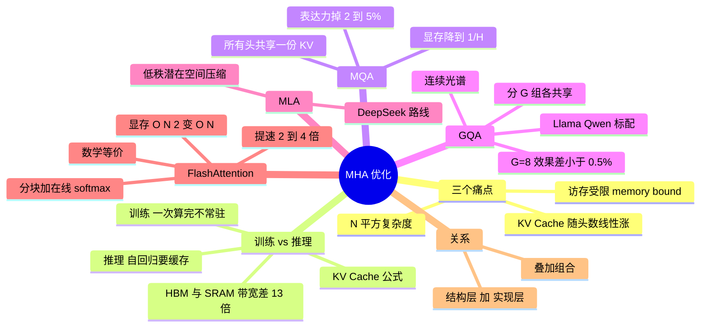

## 🔥 快速背诵

MHA 有三个痛点：KV Cache 显存随长度和并发爆掉、注意力是访存受限而不是算力受限、还有 N 方复杂度。两个优化方向要分开：MQA 和 GQA 在结构层省，MQA 所有头共享一份 K 和 V，GQA 分组共享，用一点质量换大量显存；FlashAttention 在实现层省，分块计算加在线 softmax，把中间矩阵留在片上，省的是访存不是算力。两者叠加，不是替代。

> **一句话**：MHA 三个痛点——**KV Cache 显存爆炸、访存受限、N² 复杂度**；**MQA/GQA 在结构层省显存，FlashAttention 在实现层省显存又加速，两者是叠加不是替代**。

## 🧠 导图

---

# 📖 背诵稿

> 五段，按顺序背。

### ① 三个痛点

**MHA 的痛点是三个，而且它们互相加剧。**

第一是显存爆炸：推理时每个 head 都要为所有 token 保存自己的 K 和 V，这就是 KV Cache，头数越多、序列越长越夸张。一个 7B 模型（32 层、32 头、d_k=128）跑 32K 上下文，光 KV Cache 就是 2×1×32000×32×32×128×2 字节 ≈ 17GB，加上权重 14GB，一张 4090 根本放不下。第二是访存慢：Attention 里 softmax 那步要把整个 N×N 矩阵在显存里搬来搬去，**瓶颈不在算力而在内存带宽**——GPU 算力翻倍，跑 Attention 可能只快 20%，这就是 memory-bound。第三是 N² 复杂度：序列翻倍，计算量翻 4 倍。

### ② 训练和推理要分开说

**很多人只笼统说「O(N²) 慢」，一追问就崩，根源是没分阶段。**

训练时那个 N×N 矩阵要存下来给反向传播用，N=32K 时约 2GB（FP16），但它是**一次性算完的**，不需要跨时间步常驻。推理才是另一个故事：自回归每生成一个 token 都要对前面所有 token 算注意力，每次都重算成本会累加到 O(N³)，所以才有了 KV Cache——存下历史 K/V，新 token 只算自己的 Q。**KV Cache 是推理的救星，同时又是显存大户，这个矛盾正是 GQA 要解的。**

### ③ MQA 与 GQA

**MQA 是最暴力的办法：所有 head 共享一份 K/V，只有 Q 各自独立。**

KV Cache 直接降到 1/H，前面那 17GB 只剩 0.5GB 左右，注意力公式也不用改。代价是表达力下降：原本 32 个头有 32 套「视角」，现在 32 个视角共用同一套标签和内容，只是用不同 Q 去问。实测效果掉 2~5%，简单任务还行，推理类（数学、代码）损失明显。**GQA 是折中：把 H 个头分 G 组，组内共享、组间独立**，G=H 退化成 MHA、G=1 退化成 MQA，是个连续光谱。H=32、G=8 时显存压到 1/4，而效果差距不到 0.5%——这就是甜蜜点，所以 Llama 2 70B、Llama 3 全系、Qwen 2/3 都用 GQA。再往前一步是 DeepSeek 的 MLA，不共享而是把 K/V 压到低秩潜在空间，省得更多，但机制不同，**别简单说成 GQA 升级版**。

### ④ FlashAttention

**FlashAttention 完全换赛道：不动数学公式，只改计算实现。**

根源在 GPU 存储分层：HBM 容量大但带宽约 1.5TB/s，SRAM 容量小（每个 SM 只有 192KB）但带宽约 19TB/s，快 13 倍。标准实现把 N×N 矩阵一遍遍写回 HBM，时间全花在搬运上。FlashAttention 的做法是分块：把 Q/K/V 切成小块，每次只在 SRAM 里算一小块，算完直接累加到输出，不把 N×N 中间结果写回 HBM。难点是 softmax 要看整行才能算，它用「在线 softmax」维护当前最大值和累积和，每来一块做增量更新，最终结果与一次性算 softmax 等价。收益：**显存从 O(N²) 降到 O(N)，速度提升 2~4 倍，数学上等价**（浮点细节略有差异），现在 vLLM/SGLang/TGI 都默认用它，已迭代到 v3。

### ⑤ 关键认知：叠加不是替代

**MQA/GQA 是结构层优化，FlashAttention 是实现层优化，攻击的是不同维度。**

所以「只能选一个」是伪命题。主流配置就是 **GQA + FlashAttention**：前者把 KV Cache 压到 1/4，后者把计算提速 2~4 倍，叠加之后 7B 模型能在 4090 上跑 32K 上下文，五年前不敢想。进阶方向还有滑动窗口（Mistral）、线性注意力、Mamba/SSM，但大多还在演进，把这三种讲透就足够。

---

# 🔑 记忆锚

| 记什么 | 内容 | 口诀 |
|---|---|---|
| **3** 个痛点 | 显存 / 访存 / 复杂度 | 「爆·堵·方」 |
| **3** 种方案 | MQA 1 份 / GQA G 份 / FA 分块 | 「一·G·块」 |
| **1** 个数字 | GQA G=8 效果差 <0.5%，显存 1/4 | 「省四倍，几乎不亏」 |
| **1** 条关系 | 结构层 + 实现层 = 叠加 | 「两个维度各打各的」 |

> **卡壳急救**：先背「爆·堵·方」，再按「结构层 / 实现层」分类报方案。

---

# 🎯 追问速查

| 面试官问 | 你答 |
|---|---|
| O(N²) 是计算还是显存？ | **两个都是**，但训练时它是一次性中间量；推理的显存大头是 KV Cache |
| MQA 训练时也共享吗？ | 是，结构层面的共享，训练推理一致 |
| 为什么 Llama 2 用 GQA 不用 MQA？ | MQA 性价比差：省得多但效果掉 2~5%；GQA 省到 1/4 却几乎无损 |
| MLA 是 GQA 升级版吗？ | 不是。它把 K/V 压到低秩潜在空间，机制不同 |
| FlashAttention 是近似吗？ | 不是。数学等价，只是浮点实现细节有微小差异 |
| 在线 softmax 解决什么？ | 分块后 softmax 无法整行计算，用增量更新维护 max 和 sum |
| MQA/GQA 和 FA 能一起用吗？ | 能，而且这就是主流标配 |
| 长上下文还有哪些方向？ | 滑动窗口、线性注意力、Mamba/SSM，多为研究热点 |

---

# 🔗 串联

- 上游 → **02（Attention 原理与 √d_k）**
- 下游 → **14（KV Cache / Prompt Caching）**：本节的 KV Cache 是那篇的地基
- 位置编码的兼容性 → **04（RoPE）**
- 部署侧 → **20（vLLM/SGLang 为什么默认 FA）**
- 收尾金句：**能存得更少、搬得更少，才跑得更长**

---

# 📚 细节（背完再点开）

> [!note]- KV Cache 显存公式
> `2 × B(批次) × N(长度) × L(层数) × H(头数) × d_k × 2 字节(FP16)`
> 7B（L=32,H=32,d_k=128）、B=1、N=32K ≈ **17GB**。GQA G=8 后约 4GB 量级。

> [!note]- 方案对照
> | 方案 | 改什么 | 攻哪个痛点 | 效果损失 |
> |---|---|---|---|
> | MQA | 结构：K/V 压成 1 份 | 显存 | 2~5% |
> | GQA | 结构：K/V 压成 G 份 | 显存 | <0.5% |
> | FlashAttention | 实现：分块 + 在线 softmax | 显存 + 访存 + 速度 | 数学等价 |

---

# 🎴 自测

> [!question]- Q1 三个痛点？
> KV Cache 显存爆炸、访存受限、N² 复杂度。

> [!question]- Q2 为什么训练和推理要分开讲？
> 训练的 N×N 是一次性中间量；推理要跨步常驻 KV Cache，矛盾在显存。

> [!question]- Q3 GQA 为什么是甜蜜点？
> H=32、G=8 时显存 1/4，效果差 <0.5%。

> [!question]- Q4 FlashAttention 的核心两招？
> 分块 + 在线 softmax，避免 N×N 写回 HBM。

> [!question]- Q5 三类优化什么关系？
> 结构层与实现层，叠加使用。
