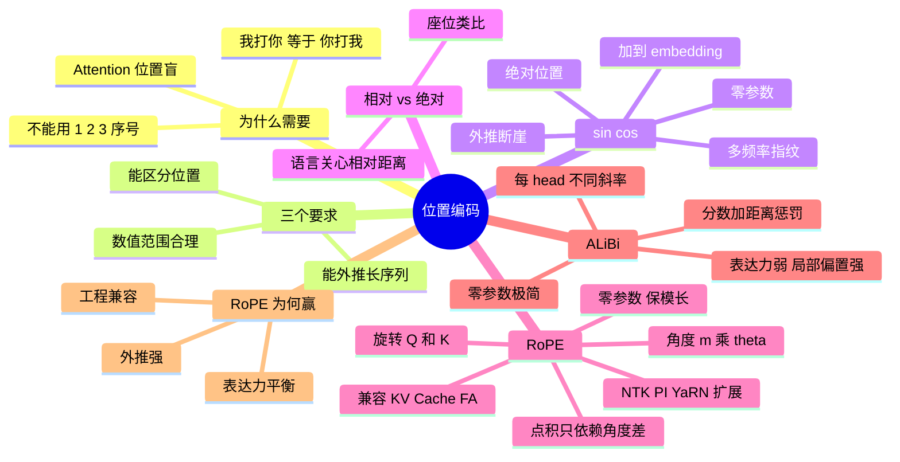

## 🔥 快速背诵

Attention 本身是位置盲的，句子打乱算出来一样，所以必须显式注入顺序。sin-cos 是固定的绝对位置，简单但外推差；RoPE 用旋转矩阵把相对距离编进点积，相对关系只跟角度差有关，既有相对性又能外推；ALiBi 直接按距离给注意力加线性惩罚。RoPE 成为主流，是因为它在相对位置、长上下文、工程兼容三件事上最均衡。

> **一句话**：Attention 是「位置盲」的，必须显式注入顺序。**RoPE 用旋转把相对距离编进点积**，赢在「相对位置 + 长上下文 + 工程兼容」三者的均衡。

## 🧠 导图

---

# 📖 背诵稿

> 五段，按顺序背。

### ① 为什么必须要有

**Self-Attention 是「位置盲」的，怎么打乱顺序算出来都一样。**

输入「我打你」，三个字互相算注意力，模型只知道它们之间有关联，**完全不知道谁在前谁在后**。换成「你打我」，embedding 一模一样只是位置变了，Attention 结果几乎相同——可语义是反的，分不清主语宾语就没法理解语言。那能不能直接加 1、2、3、4 这种序号？不行：一是数值范围问题，第 1000 位的「1000」会把原本 -1 到 1 的 embedding 拉爆；二是没法泛化，训练见过 1~2048，推理来 4096 就是个没见过的数字。所以位置编码要同时满足三个要求：数值范围合理、能区分位置、能外推到长序列。

### ② sin/cos 绝对编码

**原始 Transformer 用一组不同频率的 sin/cos 生成每个位置的「指纹向量」，直接加到 embedding 上。**

d 维分成 d/2 对，第 1 对高频，相邻位置差异明显，适合区分近距离；第 d/2 对低频，跨很远才区分得开。像几个不同频率的振子叠加，高频记精细位置、低频记粗略位置。用加法不用拼接，是因为加法不增维度，而神经网络能自己把两部分信息解开。优点是零参数、公式算得出任意位置。**致命问题是长上下文外推差**：理论上能算任意长度，但模型训练只见过 2K 以内的相对距离，喂 4K 进去注意力分布直接乱掉，效果断崖下跌。

### ③ 相对位置才是模型想要的

**模型理解语言时关心的是相对距离，不是绝对编号。**

问你坐哪，你会说「坐在 XX 旁边」，不会说「前排第 3 个」。语法关系也一样：「主谓宾」的关键不是主语在第 3 位、动词在第 5 位，而是它们隔了几个词——前面加多少修饰语都不影响这个相对关系。而绝对编码给每个位置发独立身份证，让模型自己从「位置 3」和「位置 5」推出「距离 2」，这全靠训练慢慢碰运气，没有显式归纳偏置。相对位置编码的思路就是把这个差值直接编进注意力计算，**让编码只取决于位置差 m-n，与绝对值无关**。

### ④ RoPE 与 ALiBi

**RoPE 不「加」位置，而是「旋转」Q 和 K 向量。**

位置 m 的向量被旋转 mθ 角度，越靠后转得越多。为什么旋转能表达位置？关键在于数学性质：**两个旋转后的向量做点积，结果只依赖它们的角度差**，也就是只跟 (m-n) 有关，与 m、n 各自的绝对值无关——相对位置就这么天然编进点积了。它还有四个好处：天然相对、零参数、旋转不改模长所以不破坏数值范围、只在 Q/K 上动手所以跟 KV Cache / FlashAttention / GQA 无缝叠加。外推上，旋转角度是连续变化的，没有「截止」概念，虽然超出训练长度仍会衰减，但比 sin/cos 平缓得多，再配合 PI / NTK-aware / YaRN 把频率参数调一调，能推到 32K、100K 甚至更长——**但别说成「无损银弹」**，推得越远越需要长上下文继续训练或校准，还要专门评测长文检索和多跳推理。

**ALiBi 更暴力：完全不动 Q/K/V，直接在注意力分数上加距离惩罚。**

偏置是 -m×|i-j|，离得越远扣得越多，每个 head 斜率不同，相当于让不同 head 关注不同距离范围。零参数、实现极简、线性外推天然支持长上下文。短板是表达力弱——所有位置信息只靠一个「距离惩罚」传递，对精细语序建模不灵活；而且局部偏置过强，反而不利于长距离依赖。MPT、BLOOM 用过后就没了下文。

### ⑤ 为什么 RoPE 赢

**因为它在这三个维度上最均衡，而不是某一项最强。**

第一，长上下文外推强，配合 NTK/YaRN 生态是目前最能打的；第二，相对位置和表达力平衡得好——ALiBi 外推好但表达力弱，sin/cos 表达力够但外推差，只有 RoPE 兼顾；第三，工程兼容性好，只旋转 Q/K，跟现代推理优化全部能叠加，这对工业部署至关重要。所以 2023 年之后主流开源模型全是 RoPE：Llama 1/2/3、Qwen 1/2/3、DeepSeek 全系、Mistral/Mixtral、GLM。

---

# 🔑 记忆锚

| 记什么 | 内容 | 口诀 |
|---|---|---|
| **3** 个要求 | 范围合理 / 可区分 / 可外推 | 「稳·分·长」 |
| **3** 种注入方式 | 加 embedding / 旋转 QK / 加分数 | 「加·转·罚」 |
| **1** 个数学核心 | 点积只依赖角度差 → 相对位置 | 「转出差值」 |
| **3** 个扩展 | PI / NTK-aware / YaRN | 「插·调频·精细化」 |

> **卡壳急救**：先说「位置盲」立论，再用「加·转·罚」三种注入方式串起三种方案。

---

# 🎯 追问速查

| 面试官问 | 你答 |
|---|---|
| 为什么不能直接加位置序号？ | 数值范围破坏 embedding，且没见过的长度无法泛化 |
| sin/cos 缺点？ | 绝对编码、外推断崖式下跌 |
| RoPE 为什么能表达相对位置？ | 旋转后两点积只依赖角度差 (m-n) |
| RoPE 要训练参数吗？ | 不要，纯数学旋转；且保留模长、不破坏数值范围 |
| RoPE 怎么扩到 100K？ | PI 等比例压缩、NTK 调频率、YaRN 分段细化，常需继续训练校准 |
| ALiBi 为什么没成主流？ | 表达力弱、局部偏置过强，精细语序建模不如 RoPE |
| 为什么 Llama 选 RoPE 不选 ALiBi？ | RoPE 在表达力与外推上更均衡，且兼容所有推理优化 |
| 位置编码会影响 KV Cache 吗？ | RoPE 只旋转 Q/K，与 KV Cache、FA、GQA 完全兼容 |

---

# 🔗 串联

- 上游 → **02（Attention 为什么无序）**
- 兼容性 → **03（GQA/FA 组合）**、**14（KV Cache）**
- 长上下文 → 大模型工程线的上下文扩展与 **Agent 上下文压缩**
- 收尾金句：**绝对位置是编号，相对位置才是关系**

---

# 📚 细节（背完再点开）

> [!note]- 三种方案对照
> | 维度 | sin/cos | ALiBi | RoPE |
> |---|---|---|---|
> | 类型 | 绝对 | 相对（惩罚） | 相对（旋转） |
> | 注入 | 加 embedding | 加注意力分数 | 旋转 Q/K |
> | 参数 | 零 | 零 | 零 |
> | 外推 | 差（断崖） | 好 | 很强（需扩展+校准） |
> | 表达力 | 中 | 弱 | 强 |
> | 采用 | 原始 Transformer | MPT/BLOOM | Llama/Qwen/DeepSeek 全系 |

> [!note]- 外推三招的直觉
> - **PI**：把 100K 的位置等比缩到 2K 圈内，位置 50000 当 1000 用 → 简单但精细距离被压缩
> - **NTK-aware**：高频维度几乎不动、低频维度缩放 → 保细节
> - **YaRN**：在 NTK 上再加温度与分段策略 → 目前大厂最常用

---

# 🎴 自测

> [!question]- Q1 为什么 Attention 必须加位置编码？
> 它的计算对位置不敏感，「我打你」与「你打我」结果几乎相同。

> [!question]- Q2 sin/cos 最大的问题？
> 绝对位置 + 超出训练长度外推断崖。

> [!question]- Q3 RoPE 的数学关键？
> 旋转后两向量点积只依赖角度差，即相对距离。

> [!question]- Q4 RoPE 的四个优点？
> 天然相对、零参数、保模长、兼容推理优化。

> [!question]- Q5 ALiBi 的思路与短板？
> 注意力分数加距离惩罚；表达力弱、局部偏置强。
