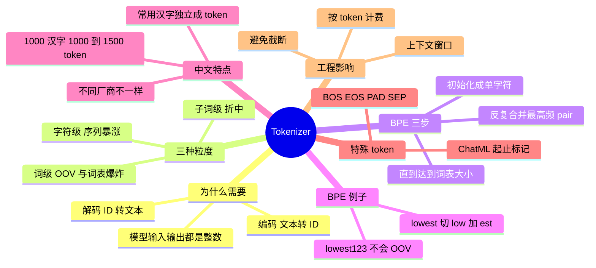

## 🔥 快速背诵

模型只认整数，Tokenizer 是文字和整数之间的桥。粒度上有取舍，字符级词表小但序列长，词级序列短但词表爆炸还有未登录词，子词级是甜蜜点。BPE 反复合并最高频的字符对，WordPiece 按似然挑合并对象，SentencePiece 直接在原始文本上切、连空格都当字符。中文常有一个字被切成好几个 token，这是成本和上下文长度的隐形税。

> **一句话**：模型只认整数，Tokenizer 是文字与整数之间的桥。粒度上**字符级太碎、词级太散，BPE 这类子词级是甜蜜点**。

## 🧠 导图

---

# 📖 背诵稿

> 四段，按顺序背。

### ① 为什么需要

**大模型的本质是一个函数：输入一串整数，输出下一个整数的概率分布。**

整个过程中模型看到的全是整数，完全不认识字符串。Tokenizer 就是连接人类文字和模型整数世界的桥，做两件事：编码（文本 → token ID 序列）和解码（ID → 文本）。所以「分词器就是把词切开」只是表面，它真正的职责是**做一次无损的编码转换**。

### ② 三种粒度的取舍

**字符级太碎，词级太散，子词级是中间的甜蜜点。**

字符级每个字母或汉字一个 token，词表很小（英文 26 个字母加标点），但序列暴涨：「hello」就是 5 个 token，一篇文章膨胀到成千上万，而 Attention 是 O(N²)；而且字符本身语义太少，模型还要自己从离散字符里重新学出「单词」。词级则是每个完整单词一个 token，词表会膨胀到几十万甚至几百万（cat/cats/catty 各存一份），更严重的是 **OOV 未登录词**：遇到没见过的新词、网络用语就直接丢失语义；中文更糟，还得先做中文分词，分词错下游全错。子词级取中间：既控制词表大小，又能处理新词，还比字符保留更多语义。

### ③ BPE 三步

**BPE 的直觉是「从小单元出发，反复合并最高频的相邻片段」。**

第一步初始化：把语料拆成最小单元（单字符或字节），形成初始词表。第二步反复合并：统计所有相邻 pair 的频率，把最高的那对合成新 token——「t」和「h」经常一起，合并成「th」；再统计，「th」和「e」合并成「the」；每轮产生一条合并规则、词表加一个 token。第三步重复直到达到预设词表大小，GPT-2 是 50257，Llama 3 是 128000。举个效果例子：「lowest」会被切成「low」+「est」；来了个新词「lowest123」，切成「low」+「est」+「1」+「2」+「3」，**一个 OOV 都没有**，每一段都是有意义的 token。注意 BPE 只是子词分词的一类，SentencePiece/Unigram、WordPiece 也很常见。

### ④ 中文与工程影响

**中文里常用汉字通常直接作为独立 token，因为频率够高不需要拆。**

常见词（比如「人工智能」）可能合成一个 token，也可能拆成「人工」+「智能」，看训练语料里的频率。经验值是 **1000 个汉字大约 1000~1500 个 token**，但这只是粗估：Qwen、Llama、OpenAI、Claude 的 tokenizer 各不相同，中英代码表格混排时比例会明显变化，真要算成本必须用目标模型的 tokenizer 跑一遍。特殊 token 是另一类东西：BOS 标记序列开始、EOS 标记结束（生成到它就停）、PAD 用于批量对齐、SEP 分隔部分，ChatML 里还有 `<|im_start|>` / `<|im_end|>` 区分轮次和角色，它们的 embedding 在训练中被专门优化过。工程上三个直接坑：**计费按 token 不按字数**；**上下文窗口按 token 算**，中英代码混排时会「看着没超实际超了」；**别把词从中间硬截断**，工程上要留几百 token 的安全 buffer。

---

# 🔑 记忆锚

| 记什么 | 内容 | 口诀 |
|---|---|---|
| **2** 个动作 | 编码 / 解码 | 「文转数，数转文」 |
| **3** 种粒度 | 字符 / 词 / 子词 | 「碎·散·中」 |
| **3** 步 BPE | 初始化 / 合并高频 / 到词表上限 | 「拆·并·停」 |
| **1** 个经验值 | 1000 汉字 ≈ 1000~1500 token | 「中文一比一点几」 |

> **卡壳急救**：先说「模型只认整数」，再用「碎·散·中」讲取舍，最后报 BPE 三步。

---

# 🎯 追问速查

| 面试官问 | 你答 |
|---|---|
| 为什么不直接用字符？ | 序列太长（O(N²) 爆炸），且字符语义太弱 |
| 为什么不直接用词？ | 词表爆炸 + OOV，中文还要先分词 |
| BPE 具体怎么跑？ | 初始化单字符 → 反复合并最高频 pair → 到预设词表大小 |
| 新词怎么办？ | 拆成已知子词，如 lowest123 → low+est+1+2+3，不产生 OOV |
| 中文为什么 1:1.5？ | 汉字 token 化效率略低于英文，英文合并词覆盖更多字符 |
| 特殊 token 有哪些？ | BOS/EOS/PAD/SEP，以及 ChatML 的 `<|im_start|>` |
| Tokenizer 会踩什么坑？ | 计费、上下文超限、词被截断导致检索/解析失败 |
| 换模型要注意什么？ | 同一文本不同 tokenizer 的 token 数不同，成本与截断都要重算 |

---

# 🔗 串联

- 上游 → **01（LLM 本质：token 是什么）**、**02（为什么序列长度敏感）**
- 下游 → **14（KV Cache 按 token 计）**、**16（Prompt 成本）**
- 工程 → LLM 网关的成本统计全靠 token 计（工具调用第 16 篇）
- 收尾金句：**先数 token，再谈成本；先切对，再谈效果**

---

# 📚 细节（背完再点开）

> [!note]- 三种粒度对照
> | 粒度 | 词表 | 序列长度 | 新词 | 语义 |
> |---|---|---|---|---|
> | 字符级 | 很小 | 极长 | 天然支持 | 弱 |
> | 词级 | 爆炸 | 短 | OOV | 强 |
> | 子词级 | 适中（几万~十几万） | 适中 | 拆解支持 | 较强 |

> [!note]- 常见词表规模
> GPT-2 50257 / Llama 3 128000 / Qwen 系列约 15 万级。词表越大，单 token 覆盖越多字符，但 embedding 层参数更多。

---

# 🎴 自测

> [!question]- Q1 Tokenizer 的两个动作？
> 编码文本→ID、解码 ID→文本，模型只认整数。

> [!question]- Q2 字符级和词级各有什么病？
> 字符级序列太长、语义弱；词级词表爆炸 + OOV。

> [!question]- Q3 BPE 三步？
> 初始化单字符、反复合并最高频 pair、到预设词表大小。

> [!question]- Q4 中文 token 经验值？
> 1000 汉字约 1000~1500 token，且各厂商不同。

> [!question]- Q5 工程上易踩的三个坑？
> 计费按 token、上下文超限、硬截断破坏语义。
