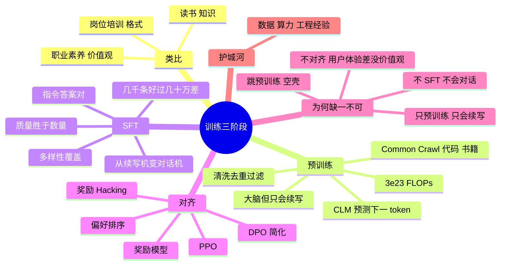

## 🔥 快速背诵

大模型训练是三段流水线。预训练是自监督的 next-token prediction，用几万亿 token 学语言和世界知识，这一段决定能力天花板。SFT 用指令和回答配对做监督微调，教它听懂人话、按格式输出。对齐用 RLHF 或 DPO 学人类偏好，教它什么该说什么不该说。预训练定天花板，SFT 给格式，对齐给价值观，缺任何一段模型都用不起来。

> **一句话**：三段流水线——**预训练定天花板，SFT 给格式，对齐给价值观**。缺任何一段，模型都用不起来。

## 🧠 导图

---

# 📖 背诵稿

> 五段，按顺序背。

### ① 为什么分三段

**大模型训练分三个阶段，因为每段解决的是完全不同层面的问题。**

类比培养一个能独当一面的员工：他得先有基础知识，从小学读到大学，掌握语言、逻辑、常识；然后得会公司流程，怎么写汇报、怎么和客户对话；最后得有职业素养，知道该说什么不该说什么。对应到模型就是：**预训练让它读万卷书，SFT 让它学会问答格式，对齐让它学会好好说话**。三个层面不同，所以缺一不可。

### ② 预训练：读万卷书

**预训练是大模型能力的根基，所有上层能力都从这里来。**

数据来源就是「能爬到的所有公开文本」：Common Crawl 的网页、GitHub 代码、维基百科、图书、论文、新闻。GPT-3 用了 3000 亿 token，Llama 3 用了 15 万亿。但原始数据不能直接用，里面全是重复内容、机器乱码、论坛灌水、广告，要做去重、过滤、语言识别、剔除有害信息——**高质量训练集的清洗成本可能比训练本身还贵，这是大模型公司的核心竞争力之一**。训练目标反直觉地简单：预测下一个 token，学术上叫 CLM。为什么这么简单却这么强？因为要准确预测下一个词，模型必须真的懂语法、记事实、会推理：预测「北京是中国的__」要知道首都是北京，预测「x=2 则 x²=__」要会算数，预测代码下一行要懂编程逻辑。开销也离谱：GPT-3 约 3.14×10²³ FLOPs，单张 A100 要算 36 万年。训完之后模型有了大脑，**但它不会回答问题，只会续写**。

### ③ SFT：从续写机变对话机

**SFT 的目的就是把这个「续写机器」改造成「对话机器」。**

你问它「天空为什么是蓝色的」，它可能续写成「……这是个有趣的科学问题。今天天气不错，让我们看看……」无限发散下去，根本没在回答。SFT 的解法是换数据格式：从「连续文本」变成「(指令, 期望回答) 对」，模型在这种数据上继续训，就学会了「看到这种格式要给完整答案，别无限续写」。关键认知是**质量比数量重要**：Llama 2 用了约 100 万条，但每条都精心标注；AlpacaFarm 的研究发现几千条高质量数据训出来比几十万条低质量更好。另外多样性也不能少，问答、写作、代码、角色扮演、数学、翻译都得覆盖，不然没见过的任务就拉胯。

### ④ 对齐：好好说话

**对齐的目标是让模型行为符合人类价值观和偏好。**

同一个问题「怎么学好 Python」有很多种合格回答：简洁的、详细的、带代码的、承认不熟的、硬装专家胡说的。SFT 只教会了「这种格式算合格」，没告诉它「哪种用户更喜欢」。主流方法是 RLHF：让标注员对同一问题的多个回答排序，用排序数据训一个奖励模型学会自动打分，再用 PPO 调主模型让输出尽量得高分。但工程上很难：流程长、要维护好几个模型、训练不稳定，模型还会「钻空子」讨好奖励模型而不是真的变好，这叫 **Reward Hacking**。后来 DPO 把流程大幅简化——它发现 RLHF 的目标可以数学等价地改写成纯监督学习，**不需要奖励模型也不需要 PPO**，直接拿（问题，好回答，差回答）三元组训，让好回答的概率提升得更多就行。这里要小心别说过头：Llama 2-Chat 论文主线是 SFT + 拒绝采样 + PPO，并不是 DPO；Llama 3 用了更复杂的多阶段 post-training。说「DPO 是开源社区常见方案」可以，说「Llama 2 都是 DPO」就不严谨。

### ⑤ 为什么缺一不可

**每缺一段，模型就废在一个具体的地方。**

只预训练不做 SFT：只会续写，问它问题它给你接一篇文章，只能当智能补全工具。预训练 + SFT 不对齐：会对话了但质量参差，可能生成有害内容、歧视言论，或者自信地胡说，上线体验差还可能被监管找麻烦。只做 SFT 和对齐跳过预训练：那是在空壳上优化，没有底层知识，给再多对话数据也学不出智能。所以结论是：**预训练定天花板，SFT 和对齐只在天花板内做优化**。这也解释了大模型公司的护城河在哪——不是 SFT 和对齐技巧（公开材料都有），而是预训练阶段的数据、算力和工程经验，这些要么靠时间要么靠真金白银。

---

# 🔑 记忆锚

| 记什么 | 内容 | 口诀 |
|---|---|---|
| **3** 个阶段 | 预训练 / SFT / 对齐 | 「读书·培训·素养」 |
| **1** 句分工 | 定天花板 / 给格式 / 给价值观 | 「顶·形·德」 |
| **2** 个对齐路线 | RLHF（RM+PPO）/ DPO（免 RM） | 「重流程 vs 轻流程」 |
| **1** 个反直觉 | 几千条高质量 > 几十万条低质量 | 「少而精」 |

> **卡壳急救**：先背「读书·培训·素养」，再逐段展开数据、目标、产出。

---

# 🎯 追问速查

| 面试官问 | 你答 |
|---|---|
| 为什么不能一次训完？ | 三个阶段目标、数据格式完全不同：语言能力、对话格式、价值偏好 |
| 预训练目标是什么？ | CLM 预测下一个 token，自监督，无需标注 |
| 为什么简单目标很强大？ | 准确预测下一个词逼着模型学语法、事实、算术、代码逻辑 |
| SFT 数据要点？ | 指令-回答对；质量 > 数量；任务多样；别只覆盖一种 |
| RLHF 的坑？ | 流程长、多模型维护、训练不稳、Reward Hacking |
| DPO 好在哪？ | 数学等价改写为监督学习，免奖励模型免 PPO，简单稳定 |
| 能说 Llama 2 用 DPO 吗？ | 不严谨。Llama 2-Chat 主线是 SFT + 拒绝采样 + PPO |
| 护城河在哪？ | 预训练的数据、算力、工程经验，不是 SFT/对齐技巧 |

---

# 🔗 串联

- 上游 → **01（LLM 本质）**、**02（架构）**
- 预训练细节 → **07（Scaling Law 与涌现）**、**05（数据与 tokenizer）**
- Post-Training 展开 → **08（微调方案）**、**09（LoRA）**、**10（RLHF/DPO/GRPO）**、**11（DPO vs PPO）**
- 收尾金句：**天花板在预训练，落地在对齐**

---

# 📚 细节（背完再点开）

> [!note]- 三阶段速览
> | 阶段 | 数据 | 目标 | 产出 |
> |---|---|---|---|
> | 预训练 | 万亿 token 无标注文本 | 预测下一 token | 有知识与语言能力的底座 |
> | SFT | 万级~百万级指令-回答对 | 学会按指令作答 | 会对话的模型 |
> | 对齐 | 偏好排序 / 三元组 | 符合人类偏好与安全 | 上线可用的助手 |

> [!note]- 「续写机 vs 对话机」的直观差别
> 续写机：问「天空为什么蓝」→「天空为什么是蓝色的？这是个有趣的科学问题。今天天气不错……」
> 对话机：→「因为大气对短波蓝光的散射更强……」*（有问有答、会收尾）*

---

# 🎴 自测

> [!question]- Q1 三阶段与类比？
> 预训练=读书、SFT=岗位培训、对齐=职业素养。

> [!question]- Q2 预训练目标？
> CLM 预测下一个 token，自监督，不需要人工标注。

> [!question]- Q3 SFT 的核心洞察？
> 质量胜于数量；几千条高质量能打赢几十万条低质量。

> [!question]- Q4 RLHF 的经典坑？
> Reward Hacking：模型学会讨好奖励模型而非真的变好。

> [!question]- Q5 为什么跳过预训练不行？
> 没有底层知识，等于在空壳上做对齐优化。
