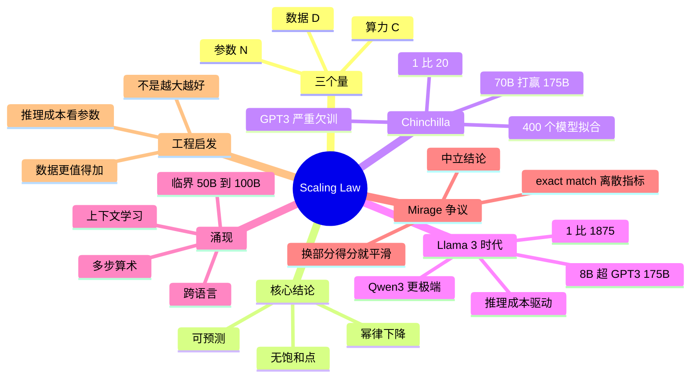

## 🔥 快速背诵

Scaling Law 说的是 loss 随参数、数据、算力按幂律可预测下降，所以能在小规模上拟合、预判大模型效果。Chinchilla 指出参数和数据要配比，大约 1 比 20 才划算，很多早期模型是参数太大、数据不够，属于饿着训。涌现是另一个现象，某些能力在小模型上完全没有，规模过阈值后突然具备。争议在于这是真跳变还是评测太苛刻，工程上仍按规模换能力下注。

> **一句话**：loss 随**参数 / 数据 / 算力**按幂律可预测地下降；Chinchilla 说**参数与数据约 1:20 才划算**，但这不是数据上限——涌现则是「能力从不会到会」的跃迁。

## 🧠 导图

---

# 📖 背诵稿

> 五段，按顺序背。

### ① 它是什么

**Scaling Law 讲的是 loss 怎么随参数、数据、算力这三个量变化——而且是可预测的。**

2020 年 OpenAI 系统训练了一系列从几万到几十亿参数的模型，发现 loss 按幂律下降，写成 `loss ∝ N^-α`。业界震撼有三点：**可预测**（有 X 算力就能提前算出最终 loss，敢投资了）、**没看到饱和点**（一直加大还在降，信号是「继续加就还能提升」）、**三个变量能分别分析**。但它留了个坑：没回答「参数和数据该按什么比例配」。当时普遍做法是能加多少参数加多少，数据差不多就行，结果训出一批严重欠训的模型。

### ② Chinchilla 的修正

**2022 年 DeepMind 训了 400 个模型拟合损失曲面，结论是固定训练算力下参数和数据要按接近 1:20 配。**

它做了个极有说服力的对照：Gopher 280B 配 300B token；GPT-3 175B 配 300B token；Chinchilla 只用了 **70B 参数但配 1.4T token**，训练算力和 Gopher 同量级，结果明显超过这两者。算一下就明白为什么：GPT-3 的比例是 1:1.7，最优是 1:20，**数据缺口约 12 倍**——当时所有人训的模型都严重欠训。这个发现把业界从「只堆参数」拉回了「参数和数据要均衡」，2022 年之后模型配比激进得多，LLaMA 1 的 7B 就用了 1T token。

### ③ Llama 3 颠覆了「上限」

**Chinchilla 说的是「给定训练算力怎么配更划算」，不是「数据再多没用」。**

Llama 3 8B 用了 15T token，比例 1:1875，是 Chinchilla 推荐的 94 倍，按老常识早该过拟合了，但实测从 1T 推到 15T loss 一直在降，最后 **8B 打赢了 GPT-3 175B**——22 倍参数差。Qwen3-0.6B 更极端，36T token，比例 1:60000。背后是两个极现实的工程原因：**推理成本**，8B 一张消费卡就够，175B 要好几台 H100；**数据比算力便宜**，H100 三万美元一张，集群上千万，算力受限时把预算花在「跑更多数据」比「跑更多参数」更划算。所以两句话不矛盾：Chinchilla 优化训练算力，Llama 3 之后优化部署成本。

### ④ 涌现

**涌现指某项能力在小模型上完全看不到，规模过某个临界点突然出现。**

典型三类：多步算术，PaLM 的 5 步应用题 8B 约 0%、62B 约 5%、540B 突然约 60%；In-Context Learning，1.5B 的 GPT-2 完全没有，175B 的 GPT-3 突然就有，临界在 100B 左右；跨语言，GPT-3 训练数据 92% 是英文，却能直接处理中文、阿拉伯语甚至冰岛语。临界规模通常在 50B~100B，一个流行解释是模型大到一定程度，注意力头数和隐藏维度才够编码复杂推理结构。

### ⑤ Mirage 争议与工程启发

**2023 年斯坦福那篇论文提出：很多涌现可能只是评估指标不连续造成的假象。**

比如多步算术用 exact match，答错一步就是 0 分，自然是「小模型一直 0、大模型突然 60%」；换成部分正确率（答对 4 步给 0.8），同一条曲线就变平滑了。后续也有论文反驳，认为某些现象在多种连续指标下都能观察到。**中立结论**：能力跃迁客观存在，但「涌现」可能被过度神化，也不存在统一的「魔法规模」——不同任务临界点不同。这条争议在面试里说出来很加分，说明你真看过论文。工程启发四条：不是越大越好，看是否训练充分；数据规模比参数规模更值得加（同算力下 3B+250B 常胜过 7B+100B）；推理成本与参数强相关；依赖涌现能力的任务（多步推理、ICL）门槛在 30B~70B。最后可以提一句天花板：**数据墙**（高质量公开文本约 10T~50T token）和算力增长放缓，应对方向是合成数据、多模态、RL 生成数据。

---

# 🔑 记忆锚

| 记什么 | 内容 | 口诀 |
|---|---|---|
| **3** 个量 | 参数 / 数据 / 算力 | 「N·D·C」 |
| **3** 个震撼点 | 可预测 / 无饱和 / 可拆分 | 「算得出·加得动·拆得开」 |
| **2** 个比例 | Chinchilla 1:20 / Llama 3 1:1875 | 「先配比，后超配」 |
| **1** 个争议 | Mirage：指标离散性放大突变 | 「换指标就平滑」 |

> **卡壳急救**：先用「N·D·C 幂律」立论，再讲 Chinchilla → Llama 3 的两段演进，最后补 Mirage。

---

# 🎯 追问速查

| 面试官问 | 你答 |
|---|---|
| Scaling Law 一句话？ | loss 随参数/数据/算力按幂律可预测下降 |
| 越大越好吗？ | **不是**。要看配比与训练是否充分 |
| Chinchilla 1:20 是常数吗？ | 是固定算力下的 compute-optimal 经验点，不是自然常数 |
| GPT-3 哪里错了？ | 175B 只配 300B token（1:1.7），欠训约 12 倍数据 |
| 70B 怎么打赢 175B？ | 配足数据（1.4T），同算力下更优 |
| Chinchilla 是数据上限吗？ | 不是。Llama 3 用 1:1875，为降推理成本主动超配 |
| 涌现是真的吗？ | 工程上能力跃迁存在，但指标离散性会放大突变，学界仍有争议 |
| Scaling Law 的天花板？ | 数据墙 + 算力增长放缓，应对：合成数据、多模态、RL |

---

# 🔗 串联

- 上游 → **06（预训练）**、**01（涌现初识）**
- 下游 → **08/09（微调与 LoRA）**：小模型大数据正是「降本」路线
- 工程侧 → **20（部署方案）**：推理成本决定选型
- 收尾金句：**规模可预测，配比可优化，天花板可预判**

---

# 📚 细节（背完再点开）

> [!note]- 关键对照实验
> | 模型 | 参数 | 数据 | 结果 |
> |---|---|---|---|
> | Gopher | 280B | 300B | 基线 |
> | GPT-3 | 175B | 300B | 略弱于 Gopher |
> | Chinchilla | 70B | 1.4T | 明显超过两者 |
> | Llama 3 8B | 8B | 15T | 多项基准超 GPT-3 175B |

> [!note]- Mirage 的论证结构
> 1. 涌现只在**离散指标**（exact match）下出现
> 2. 换连续指标（部分得分）曲线变平滑
> 3. 结论：能力是连续提升，指标不连续性制造了「突变」
> 反驳：部分任务在多种连续指标下仍有跃迁 → 争议未定

---

# 🎴 自测

> [!question]- Q1 三个变量的关系？
> loss 按幂律随 N、D、C 下降，可预测、无饱和点。

> [!question]- Q2 Chinchilla 的核心结论？
> 固定算力下参数与数据约 1:20 更优；GPT-3 严重欠训。

> [!question]- Q3 Llama 3 说明了什么？
> 1:20 不是上限，为降推理成本可超配数据。

> [!question]- Q4 涌现的三个例子？
> 多步算术、上下文学习、跨语言迁移。

> [!question]- Q5 Mirage 论点？
> 涌现可能是指标离散性造成的测量假象，换连续指标即平滑。
