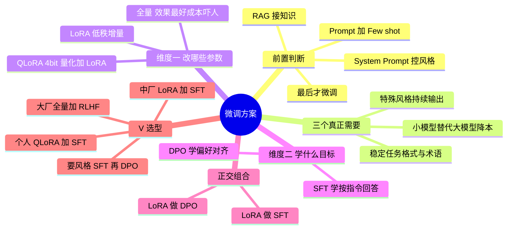

## 🔥 快速背诵

微调要分两个正交维度看：改哪些参数，和学什么目标。改参数有三档，全量、部分层、PEFT，PEFT 里最常用 LoRA 和 QLoRA；学目标有 SFT 和 DPO。比方法更重要的是前置判断，微调是最后手段，不是第一选择。知识更新和事实性错误优先用 RAG，因为改知识要重训；只有风格、格式、领域语感、固定输出结构这些教得会的东西，才值得微调。

> **一句话**：微调有**两个正交维度**——「改哪些参数」（全量 / LoRA / QLoRA）× 「学什么目标」（SFT / DPO）。前置判断更重要：**微调是最后手段，不是第一选择**。

## 🧠 导图

---

# 📖 背诵稿

> 五段，按顺序背。

### ① 前置判断：该不该微调

**微调是最后手段，不是第一选择。**

很多人一遇到「模型表现不好」就想上微调，这是新人本能。但微调成本远比想象大：高质量数据集（标注可能几万到几十万）、GPU 资源、调参经验，最坑的是维护成本——基础模型一升级（Llama 3 换 Llama 4），你之前微调的版本基本就废了，得重训。所以顺序应该是：要特定格式，先试 Prompt + Few-shot 写清格式给 3~5 个示例；要特定风格，先用 System Prompt 描述风格加对话示例；要领域知识，先上 RAG 挂知识库实时查。**这些都试过还不达标，才认真考虑微调。**

### ② 什么时候才真值得

**只有三种场景微调真值得做。**

第一种，模型需要持续以某种特殊风格输出，Prompt 控制不住，比如生成特定格式的代码、特定语气的文案；第二种，需要模型稳定掌握某类任务模式或内部术语表达；第三种，想用小模型替代大模型省成本，7B 微调模型替代 70B 通用模型，推理成本差一大截。这里特别提醒：如果需求是「补充经常变化的事实知识」——价格、政策条款、库存、合同原文——微调不是好选择，**微调适合学行为、格式、风格和任务模式，不适合当会频繁更新的知识库**。

### ③ 维度一：改哪些参数

**这一维回答「怎么改」，三个方案：全量、LoRA、QLoRA。**

全量微调所有参数都改，效果上限最高，但代价吓人：7B 模型光权重 14GB、梯度 14GB、Adam 优化器状态约 56GB，一次训练 80GB 起步，70B 要几十张 A100 组集群。更糟的是**灾难性遗忘**：所有参数都被改写，新任务学好了，预训练的通用能力反而下降。LoRA 的洞见很巧妙：权重更新量 ΔW 虽然维度很大，但真正有意义的变化发生在**低维子空间**，具有内在低秩性。所以冻结原权重 W，旁边加两个小矩阵 A（d×r）和 B（r×d），r 通常 8 或 16，只训这两个。一个 4096×4096 矩阵原本 1600 万参数，r=16 只需约 13 万，降到 1/120；整个 7B 的可训参数降到 2000 万量级，显存从 80GB+ 降到 20GB 级。**QLoRA 再往下打**：先用 4-bit（NF4）量化基础模型，7B 从 14GB 压到约 4GB，再套 LoRA，全程 10GB 以内，一张 4090 就能微调 7B 甚至 13B，精度损失几乎可以忽略——Alpaca、Vicuna 都是这么训出来的。

### ④ 维度二：学什么目标

**这一维回答「改成什么样」，两个方案：SFT 和 DPO。**

SFT 是把「续写机器」切成「对话机器」，数据格式是（指令，期望回答）对，模型学会「看到这种格式就给完整答案，别无限续写」。SFT 是**目标不是方法**，可以用全量、LoRA、QLoRA 任一实现，工业最常用 QLoRA + SFT。数据质量远比数量重要，几千条高质量胜过几十万条粗糙。DPO 是更进一步的偏好对齐：SFT 只保证「合格」，没保证「用户喜欢」，可能太啰嗦、太简洁、说话不得体。早期标配是 RLHF（偏好数据 → 奖励模型 → PPO），流程长、多模型维护、不稳；DPO 发现 RLHF 的目标可以数学等价改写成纯监督损失，**绕过奖励模型和 PPO**，直接拿（问题，好回答，差回答）三元组训。这里别说太绝对：Llama 2-Chat 公开流程主要是 SFT、拒绝采样和 PPO/RLHF；很多社区模型为了降成本才换成 DPO。

### ⑤ 选型落地

**核心原则：能用轻量方案搞定的，绝不上重的。**

个人开发者或小团队：QLoRA + SFT，一张 4090 训 7B，几千条数据就够，绝大多数项目走这条。有几张 A100 的中小团队：LoRA + SFT，比 QLoRA 精度略好、速度更快。如果还要「回答风格更符合偏好」：SFT 之后再加 LoRA + DPO，先学格式再对齐风格。大厂追求极致：全量微调 + SFT（甚至 + RLHF），但要承担几十张 A100 的成本和工程复杂度。常见误区是「方案越重越好」，其实训练成本、调参难度、维护成本全都指数上升，所以实战里绝大多数项目就是 QLoRA + SFT。

---

# 🔑 记忆锚

| 记什么 | 内容 | 口诀 |
|---|---|---|
| **2** 个维度 | 改哪些参数 × 学什么目标 | 「两轴正交」 |
| **3** 个改参数方案 | 全量 / LoRA / QLoRA | 「全·低·量」 |
| **2** 个目标 | SFT 格式 / DPO 偏好 | 「会答·答得好」 |
| **3** 个该微调场景 | 风格 / 任务模式 / 降本 | 「风·式·省」 |

> **卡壳急救**：先答「两轴正交」，再把五个名词各归到一轴，最后给选型表。

---

# 🎯 追问速查

| 面试官问 | 你答 |
|---|---|
| LoRA 和 SFT 是一层吗？ | 不是。LoRA 是「改哪些参数」，SFT 是「学什么目标」 |
| 能组合吗？ | 能，LoRA+SFT、QLoRA+DPO 都合法，这就是选型的自由度 |
| 什么时候不该微调？ | 格式/风格/知识都能用 Prompt、System Prompt、RAG 先解决 |
| 为什么不建议微调补知识？ | 知识频繁变，微调难更新且易过时；该放 RAG 或数据库 |
| LoRA 为什么有效？ | 权重更新具有内在低秩性，低维子空间就够表达 |
| 全量微调最大风险？ | 灾难性遗忘 + 显存成本（权重/梯度/优化器状态三份） |
| QLoRA 的关键？ | 4-bit NF4 量化底座 + LoRA，10GB 内可训 7B/13B |
| DPO 比 RLHF 好在哪？ | 免奖励模型免 PPO，等价改写为监督学习，稳定好落地 |

---

# 🔗 串联

- 上游 → **06（三阶段训练）**、**07（小模型大数据降本）**
- LoRA 细节 → **09（LoRA 优点）**
- 对齐细节 → **10（Post-Training）**、**11（DPO vs PPO）**
- 落地 → 工具调用线的 **16（成本控制：用微调小模型替代大模型）**
- 收尾金句：**先问该不该，再问怎么改，最后问改成啥**

---

# 📚 细节（背完再点开）

> [!note]- 显存账（7B 模型）
> | 方案 | 训练显存 | 说明 |
> |---|---|---|
> | 全量 | 80GB+ | 权重 14 + 梯度 14 + Adam 状态 ~56 |
> | LoRA | ~20GB | 只存小矩阵梯度与优化器状态 |
> | QLoRA | <10GB | 底座 4-bit 量化到 ~4GB |

> [!note]- LoRA 的参数量对比
> 4096×4096 全量 = 16,777,216 参数
> LoRA r=16 = 4096×16 + 16×4096 = 131,072 参数 → **约 1/128**

---

# 🎴 自测

> [!question]- Q1 两个维度分别是什么？
> 改哪些参数（全量/LoRA/QLoRA）× 学什么目标（SFT/DPO）。

> [!question]- Q2 微调的三个真正场景？
> 特殊风格持续输出、稳定任务格式/术语、小模型替代大模型降本。

> [!question]- Q3 LoRA 的核心洞见？
> 权重更新有内在低秩性，低维子空间足够表达。

> [!question]- Q4 QLoRA 为什么能上 4090？
> 4-bit 量化底座把权重压到约 4GB，加 LoRA 后总显存 <10GB。

> [!question]- Q5 最经济的组合？
> QLoRA + SFT，多数项目足够。
